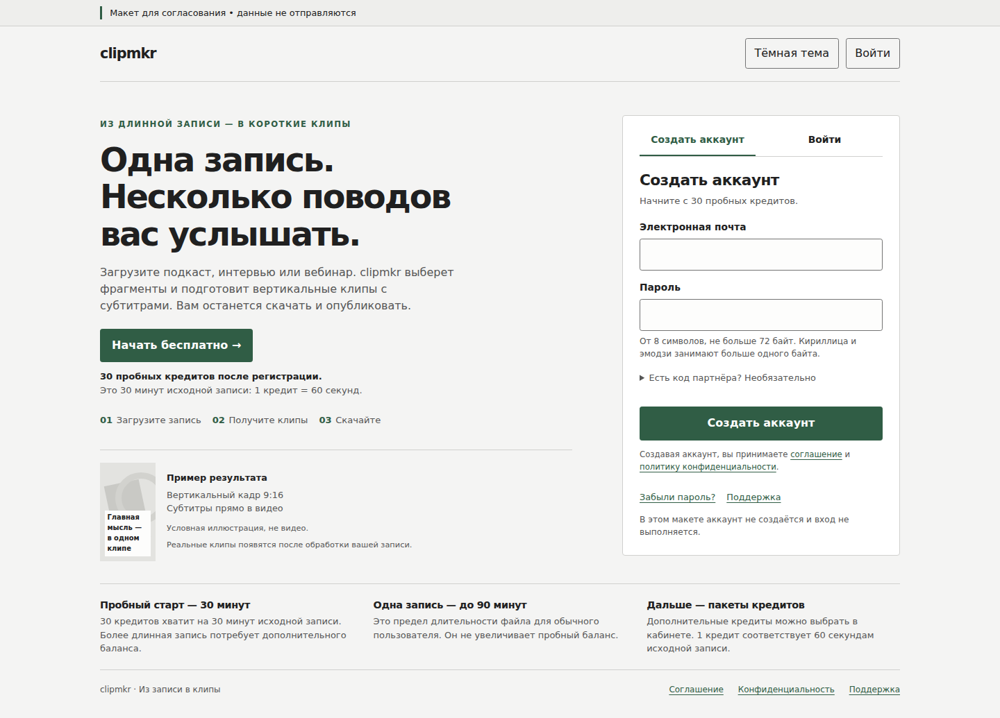
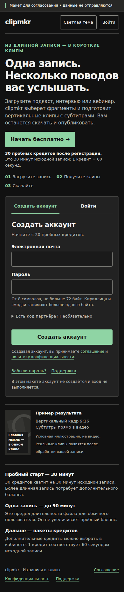

# Главная: предложение для согласования

Это отдельный макет публичной главной, регистрации и входа. Он **не перенесён
в приложение**. До реализации требуется согласование владельца по правилу
[AGENTS.md](../../AGENTS.md).

Предлагается продолжить выбранный «Кабинет»: нейтральная светлая/тёмная палитра,
зелёный акцент, единый бренд и спокойная форма. Первое действие — регистрация;
вход существующего пользователя доступен явно. Необязательный код партнёра раскрывается
по запросу. Пробные30минут и лимит90минут на запись объяснены раздельно.

## Посмотреть

- [Интерактивный HTML](2026-11-05-public-entry-mockup.html): скачать raw-файл
  и открыть в браузере. Он автономный, данные не отправляет.
- [Что работает в демонстрации и что требует реализации](2026-11-05-public-entry-mockup-notes.md).
- [Аудит настоящего сайта: регистрация, вход и восстановление](2026-11-05-public-entry-audit.md).

### Большой экран, светлая тема

### Телефон, тёмная тема

Экспортированы только два просмотренных скриншота автономного макета с пустыми полями.
Реальных аккаунтов, сессий или пользовательского медиа на них нет. Приватные исходные
прогоны не публикуются. Это отдельное действие координатора после авторской передачи;
его исходные notes описывают состояние до экспорта.

Восстановление пароля требует отдельной настройки почты: на действующем тестовом
web отправка выключена и провайдер не настроен. Макет честно сообщает недоступность,
не обещая отправленное письмо. Согласование композиции не закрывает эту настройку,
реальные authE2E, остальные проверки продукта или приёмку Cloud.ru.

## Проверка перед показом

Автор `gpt-6.1-sol high`; независимый проверяющий `gpt-6-astra xhigh`, новая сессия
с исходными требованиями. Проверяющий самостоятельно выполнил12сочетаний
320/390/1440 ×две темы ×100/200% текста, функциональные проверки формы и отдельный
WebKit390 smoke. Найденная ошибка начального фокуса длинного диалога исправлена;
собственная повторная проверка6сочетаний Chromium закрыла её. Неизменность остальной
HTML-разметки относительно исходного независимого прогона проверена по хешу.

Оговорка: на320px при удвоенном тексте слова чрезмерно дробятся, хотя контент и действия
достижимы. «Пример результата» здесь — условная иллюстрация, не настоящее видео.
Это допуск макета к обсуждению, не готовность приложения или сертификат доступности.

Окончательный HTML SHA256:
`23857448fa59c1c1d8ea34cd4b6a72a3099f07108498b354b2b7a74617f43a80`.
