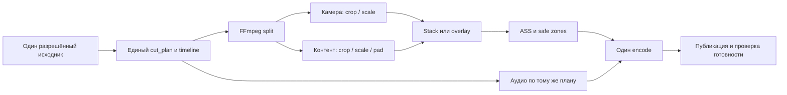

# Варианты архитектуры — исследовательское предложение

Не ADR и не утверждённый UI. Рассуждение от базовых ограничений: композитный кадр уже потерял разделение исходных источников; извлекаются прямоугольные области доступной картинки, не скрытые слои OBS. Геометрия, принадлежность автору, сопровождение и сегментация должны оцениваться отдельно.

## SCQA

- Situation: Clipmkr уже выбирает фрагменты и делает 9:16 с поиском лиц/кадрированием; стримерская запись совмещает камеру, игру/контент и overlays.
- Complication: самое большое/движущееся лицо может принадлежать игре или просматриваемому видео; центральный crop теряет камеру либо важную игровую информацию. Камера иногда отсутствует физически.
- Question: как сохранять узнаваемую реакцию автора и смысл события при малом ручном усилии, не подменяя отсутствующее изображение?
- Answer, гипотеза: явная область камеры и пресет канала, независимая область контента, простой двухпанельный шаблон, проверка сцен и понятное поведение при отсутствии камеры. Автовыбор области — помощник с подтверждением; удаление фона не является режимом по умолчанию.

## Сегменты и физические ограничения

Facecam — область с камерой автора внутри общей картинки. ROI (region of interest) — выбранный прямоугольник исходного кадра. Он может содержать лицо, фон комнаты и рамку камеры; это не вырезанная по контуру голова.

| Сегмент | Что нужно сохранить | Где ошибётся универсальное «следовать за лицом» | Разумный первый режим, предложение |
|---|---|---|---|
| Gameplay | Реакция автора, действие, важный HUD | Лицо персонажа, загрузочный экран, закрытый kill feed | Подтверждённая камера + отдельный игровой ROI; проверить события отдельно от речи |
| Reaction / совместный просмотр | Автор и причина реакции | Крупное лицо в просматриваемом видео вытеснит автора | Явно назначить, какая панель принадлежит автору; второй человек не выбирается автоматически |
| Coding / educational stream | Читаемый код, курсор, слайд/формула, маленькая камера | Крупный crop камеры вытеснит редактор; уменьшение всего IDE сделает текст мелким | Камера + выбранная область IDE/слайда; приоритет читаемости, отдельный пресет для лекции/редактора |
| Tutorial / демонстрация программы | Действие в интерфейсе и объяснение | Смена окон/всплывающие панели; нужный элемент вне центрального crop | Подтвердить полезную область, проверять её на границах сцен |
| IRL / разговор с подвижной камерой | Лицо/действие в единой сцене | Отдельной врезки камеры нет | Обычное кадрирование с сопровождением; stacked не обязателен |
| VTuber / PNG-аватар | Авторский аватар и событие | Детектор человеческого лица пропустит/перепутает аватар | Manual ROI без требования детекции человеческих лиц; анимация и переходы — отдельные фикстуры |
| Гость / несколько ведущих | Правильная принадлежность и согласие участников | Самый большой/говорящий человек не обязательно владелец канала | Явный выбор одной/двух камер; без скрытой смены identity |

При отсутствующей камере, перекрытии alert/overlay или уходе из сцены пикселей лица нет. Crop и segmentation их не восстанавливают. Предложения для согласования: предупредить и оставить основной контент; исключить такой интервал из кандидатов с явным сокращением результата; попросить отдельную синхронную запись камеры. Последняя годится только если она действительно записана; это не способ восстановить прошлый отсутствующий кадр. Заморозка последней реакции должна быть явно обозначена и не предлагается по умолчанию.

Маленькую камеру можно увеличить геометрически, но новая детализация не появляется. При полном переносе 1920 px ширины в 1080 px масштаб 0,5625: для IDE это уменьшает и текст. Это расчёт масштаба, не результат usability-теста и не универсальный порог читаемости. Для coding нужен выбор области кода, а не обещание одновременно показать весь рабочий стол крупно.

## Строгий режим как вариант будущего требования

Если обещание формулируется «голова автора на протяжении всего ролика», одного среднего coverage по доступным кадрам недостаточно. Предложение на согласование: экспортировать только проверенные интервалы с видимой камерой автора, исключая gaps/occlusions; если от этого теряется смысл или приемлемая длительность, выбрать другой фрагмент либо отказать в строгом экспорте. Смена на игровой персонаж или content-only кадр не считается выполнением требования. Сохранение момента и синхронизации важнее механического вырезания всех сомнительных кадров.

Обычный режим с явным предупреждением и основным контентом без камеры можно рассматривать отдельно. Он не должен незаметно заменять строгий режим. Для отдельного camera source строгие проверки видимости/identity/sync всё равно нужны. Выбор режима, формулировка обещания и критерий достаточной видимости требуют решения владельца; текущие product requirements не меняются.

## Сравнение вариантов

Оценки ниже качественные, из состава операций и рисков; стоимость/скорость здесь не замерены.

| Вариант | Ручное усилие и надёжность | Зависимости / стоимость / риск | Когда выбирать |
|---|---|---|---|
| Manual ROI, сохранённый для канала | Начальная настройка; предсказуем при неизменной сцене | Существующий FFmpeg; проверка resolution/aspect/scene, иначе пресет может стать неверным | Первый ограниченный прототип, включая аватары и маленькую камеру |
| Auto ROI + подтверждение | Меньше поиска при хорошем предложении; человек исправляет identity | Существующий YuNet можно запускать в предложенных областях; нужен отказ от неуверенного предложения | После проверки исходного варианта, если уменьшение ручного времени подтверждено |
| Сопровождение камеры/лица | Полезно при движущейся/меняющей размер области | Детекция + association + scene reset + smoothing; tracker ID не равен автору | Только если движения действительно ломают фиксированный ROI |
| Segmentation / удаление фона | Позволяет силуэт поверх игры, но волосы/руки/края могут мерцать | Дополнительная модель, маски, лицензии weights и больший объём обработки; принадлежность не решена | Отдельная advanced-опция после измерения потребности; не условие первого варианта |
| Отдельный исходник камеры, например через OBS-плагин | Лучшее качество и независимость от overlays композита | Предварительная настройка автором, дополнительная запись/диск/encoder, синхронизация двух файлов | Опционально для подготовленных авторов; не обязательный вход для всех |
| Кадрирование всего исходника по saliency | Мало ручного ввода | Может выбрать игру, гостя, scrolling chat или лицо внутри видео | Ориентир/fallback для общей сцены, не гарантия присутствия автора |

[Проверенные реализации и условия лицензий](oss-candidates.md) не дают основания автоматически перенести целый Python/продукт с новым GPU-контуром в Clipmkr. Базовый ROI-режим совместим с уже существующим стеком; его качество всё равно требует проверки.

## Минимальный путь сборки без отдельного encode камеры

Существующий [format.ts](https://github.com/djd1m/clipmkr/blob/9375c10238a147fcf43219ab8d9533b75a3ae6c7/apps/worker/src/render/format.ts#L73) уже делит поток, делает crop/scale и vstack. Официальные [FFmpeg filters](https://ffmpeg.org/ffmpeg-filters.html) содержат соответствующие операции. Предложение: два выбранных ROI одного декодированного потока → две ветви filtergraph → scale/pad → stack или overlay → общие ASS/branding → один финальный encode. Промежуточный сжатый `facecam.mp4` технически не обязателен. Это не обещание конкретного ускорения или готовый production filtergraph.

Для первой оценки достаточно одного stacked-шаблона, например верхняя треть — камера, остальное — контент; соотношение — начальная гипотеза, не лучший доказанный layout. По умолчанию сохранять область контента целиком; увеличение важной части — доступная коррекция. На coding-материале и игре с мелким HUD результат может потребовать другого соотношения; нельзя скрывать эту цену за словами «всё помещается».

Advanced-коррекция отдельно: рамки ROI, доля камеры, fit/fill, положение, замена пресета после scene change. На основном пути — одно подтверждение и видимый preview. Это описание вариантов, не согласованный макет. Safe zones должны учитывать фактические интерфейсы платформ и собственные captions/branding; универсальные неизменные пиксельные отступы для всех соцсетей не доказаны.

### Семантика нового режима требует отдельного решения

Старое требование владельца в [format.ts:64](https://github.com/djd1m/clipmkr/blob/9375c10238a147fcf43219ab8d9533b75a3ae6c7/apps/worker/src/render/format.ts#L64) и [ADR-009](https://github.com/djd1m/clipmkr/blob/9375c10238a147fcf43219ab8d9533b75a3ae6c7/docs/ADR.md#L284): два этажа предназначены для двух людей; пустую панель/стену показывать нельзя. Камера + игра/IDE — **другая семантика**, хотя геометрические операции FFmpeg похожи. При возможной реализации нужны явная новая дельта требований, ADR/layout-policy и согласованный макет. Нельзя молча переопределить существующий `dual`; подкастовый режим и его критерии должны сохраниться. На стадии исследования OpenSpec остаётся N/A, потому что эта дельта пока не принята.

### Исходная камера внутри content ROI

Если оставить весь композитный кадр в нижней панели, исходная маленькая камера может остаться в нём: голова появится дважды. Пилот должен сравнить допустимое явное дублирование, content crop без этой области и fit/маску с честной потерей закрытых деталей. То, что игра/код находились **под** встроенной камерой, из композита уже не получить. Простым crop нельзя восстановить закрытый HUD или строку редактора. Отдельный исходник игры/камеры может помочь только если он реально записан. Inpainting и генерация скрытых деталей не предлагаются. Дополнительные настройки не должны перегружать основной путь.

## Одна временная шкала

Существующий [compaction.ts:25](https://github.com/djd1m/clipmkr/blob/9375c10238a147fcf43219ab8d9533b75a3ae6c7/apps/worker/src/render/compaction.ts#L25) определяет результирующую длительность D′ из сохранённых интервалов с учётом переходов. [mapTime:58](https://github.com/djd1m/clipmkr/blob/9375c10238a147fcf43219ab8d9533b75a3ae6c7/apps/worker/src/render/compaction.ts#L58) переносит таймкоды исходника, а [buildCompactionGraph:72](https://github.com/djd1m/clipmkr/blob/9375c10238a147fcf43219ab8d9533b75a3ae6c7/apps/worker/src/render/compaction.ts#L72) использует xfade/acrossfade для video/audio.

Предложение обязано сохранять один cut_plan: камера и контент получают одинаковые удаления/переходы, captions и ROI-keyframes переводятся той же картой времени. Нельзя вырезать паузы только из gameplay, а сверху оставить несжатую или взятую из другого момента реакцию. Для отдельной записи камеры дополнительно нужны offset, проверка drift и обработка gaps; без доказанной синхронизации этот режим не должен проходить экспорт.

## TRIZ и ресурсная инвентаризация

Противоречие: увеличение лица уменьшает место для содержания. Разделение в пространстве даёт две панели; разделение по условию — разные режимы для игры, IDE и отсутствующей камеры; предварительное действие — один раз сохранённый пресет; обратная связь — preview и коррекция при смене сцены. Это эвристики из problem-solver-enhanced, не математическое доказательство оптимальности.

Уже доступные ресурсы: композитный исходник; существующий FFmpeg/OpenCV; transcript/выбранные таймкоды; cut_plan; схема заданий, ограниченные попытки и immutable publication. Пока отсутствуют: подтверждённая авторская camera identity, согласованный streamer layout, измеренная полезность для сегмента, новые разрешения на VOD/chat. За пределами этих ресурсов не обещаются восстановленные пиксели, «распознанный владелец» или бесплатная обработка.
