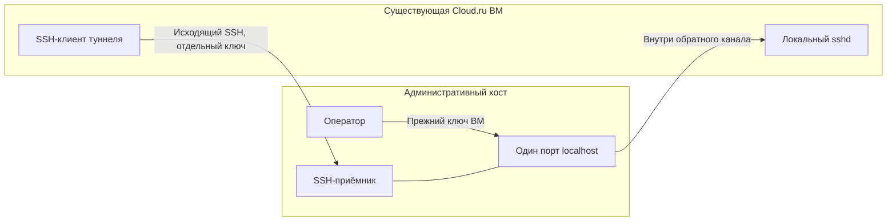

# Сопровождение существующей Cloud.ru ВМ через обратный SSH

Дата проверки: 03.11.2026. Статус: временный рабочий маршрут подтверждён.
Связанный [протокол инцидента](../incidents/2026-11-03-cloudru-access.md).

## Проблема и установленная граница

Прямое TCP-соединение с SSH-портом Cloud.ru ВМ завершается тайм-аутом из двух
административных сетей. HTTPS работает; ВМ запущена, sshd слушает, облачные правила
разрешают подключение. SYN видны на источнике и не видны внутри целевой ВМ.
Точное место фильтрации не установлено. Считать виновником конкретного провайдера
без дополнительной диагностики нельзя.

Неверный SSH-ключ не объясняет этот тайм-аут: до аутентификации дело не доходит.
В дальнейшем тот же ключ успешно использован для настоящего входа через обратный
канал, в том числе после блокировки временного консольного пароля.

## Рабочее решение

ВМ сама устанавливает исходящее SSH-соединение к административному хосту.
Стандартный OpenSSH remote forwarding связывает один порт localhost приёмника
с локальным sshd ВМ. Новая облачная ВМ, VPN-продукт или собственный транспорт
для этого не потребовались.

Используются **два разных ключа**: отдельный ключ канала, который остаётся внутри
ВМ, и прежний ключ для входа в саму ВМ. Закреплены ключи обоих хостов;
`StrictHostKeyChecking` включён. Временный пароль для консоли после настройки
заблокирован, его локальный файл удалён.

## Ограничения доступа

- На приёмнике создана отдельная системная учётная запись, без интерактивного shell.
- Ключ ограничен проверенным адресом источника, сроком действия и одним конкретным
  портом localhost. Пароли, PTY, agent и X11 forwarding отключены.
- Узкое `Match User`-исключение разрешает только remote forwarding;
  `PermitListen` ограничивает слушающий адрес/порт, `PermitOpen none` запрещает
  direct-tcpip. Цель обратного перенаправления задаёт SSH-клиент на ВМ; сам
  `PermitListen` не ограничивает этот целевой адрес.
- Общая SSH-политика остальных пользователей и firewall сохранены. Штатный
  `harden.sh --check` пройден до и после настройки. Перезагружалась конфигурация
  SSH-приёмника; приложение, БД и воркеры не перезапускались.

Разрешение ключа действует до **04.11.2026 около 15:01 UTC**. Истечение запрещает
новую аутентификацию, но само по себе не завершает уже установленную сессию.
Для отзыва действующего доступа нужно также остановить туннель и завершить его
сеанс на приёмнике.

На ВМ запущен transient systemd unit: он перезапускает SSH-клиент при ошибке,
но не сохраняется после перезагрузки ВМ. Лимит RuntimeMaxSec относится к одному
запуску процесса, не является общим сроком разрешения. Перед истечением ключа
нужно восстановить прямой SSH либо отдельно продлить и проверить временный канал.

## Проверки, выполненные на работающем маршруте

| Проверка | Результат |
|---|---|
| Вход прежним ключом и выполнение команды UID | PASS |
| Повторный вход после блокировки консольного пароля | PASS |
| SFTP-загрузка, совпадение SHA-256, удаление временного файла | PASS |
| Перезапуск только службы туннеля, новый экземпляр и повторный вход | PASS |
| Shell-команда ключом технического приёмника | Отклонена |
| Перенаправление другого порта | Отклонено |
| Публичный слушающий адрес | Отклонён |
| Прямой TCP-канал технической учётной записи | Отклонён |
| Локальное прослушивание разрешённого порта | Только localhost |
| Контейнеры приложения и публичный healthcheck | Семь контейнеров работают; HTTP 200 |

Это проверки доступа и ограничений, а не новая приёмка продуктового CJM.

## Порядок сопровождения и откат

1. Использовать закрытый SSH-профиль и обёртку из операторского журнала.
   Конкретные адреса, ключи, имена учётных записей и параметры подключения не
   публикуются в Git. Перед изменениями проверить цель, срок ключа и альтернативный
   вход через консоль.
2. Для обновления приложения отдельно выполнить проектные проверки и согласованный
   план с резервной копией. Наличие канала само по себе не разрешает миграцию БД,
   перенос трафика или удаление данных.
3. Для отключения сначала подтвердить прямой SSH либо готовность консоли.
   Остановить только службу туннеля, отозвать её ключ и завершить соответствующий
   сеанс на приёмнике. Проверить отсутствие локального слушающего порта.
4. Удалить только созданные для канала учётную запись/ключи/профиль и маркированное
   SSH-исключение. Сохранить прочие изменения конфигурации; выполнить `sshd -t`,
   reload SSH и штатный baseline check. Приложение и его volumes не удалять.

Полные рабочие команды и точный откат сохранены в закрытом Markdown-протоколе
оператора с правами 0600. Обращение провайдеру подготовлено, но не отправлено.

## Отношение к Cloudru Hub

Это обычный SSH с явной авторизацией на своих хостах. Сессии Hub не подделывались,
защитный прокси не отключался. Ограничение Hub на двухчасовую сессию после деплоя
остаётся отдельной задачей: [dz-harness#24](https://github.com/djd1m/dz-harness/issues/24).
Поддержка нестандартного порта и маршрута до существующей ВМ должна входить в
проверяемый транспортный контракт будущего режима сопровождения.
