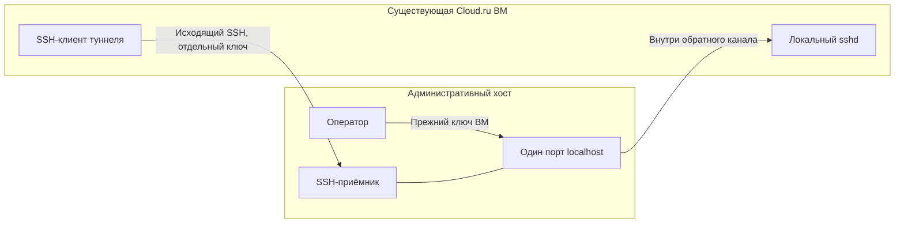

# Сопровождение существующей Cloud.ru ВМ через обратный SSH

Дата проверки: 04.11.2026. Статус: **постоянный маршрут установлен и проверен**.
Связанный [протокол инцидента](../incidents/2026-11-03-cloudru-access.md).

## Проблема и установленная граница

Прямое TCP-соединение с SSH-портом Cloud.ru ВМ завершается тайм-аутом из двух
административных сетей. HTTPS работает; ВМ запущена, sshd слушает, облачные правила
разрешают подключение. SYN видны на источнике и не видны внутри целевой ВМ.
Точное место фильтрации не установлено. Считать виновником конкретного провайдера
без дополнительной диагностики нельзя.

Неверный SSH-ключ не объясняет этот тайм-аут: до аутентификации дело не доходит.
В дальнейшем тот же ключ успешно использован для настоящего входа через обратный
канал, в том числе после блокировки временного консольного пароля.

## Рабочее решение

ВМ сама устанавливает исходящее SSH-соединение к административному хосту.
Стандартный OpenSSH remote forwarding связывает один порт localhost приёмника
с локальным sshd ВМ. Новая облачная ВМ, VPN-продукт или собственный транспорт
для этого не потребовались.

Используются **два разных ключа**: отдельный ключ канала, который остаётся внутри
ВМ, и прежний ключ для входа в саму ВМ. Закреплены ключи обоих хостов;
`StrictHostKeyChecking` включён. Временный пароль для консоли после настройки
заблокирован, его локальный файл удалён.

## Ограничения доступа

- На приёмнике создана отдельная системная учётная запись, без интерактивного shell.
- Ключ ограничен проверенным адресом источника, сроком действия и одним конкретным
  портом localhost. Пароли, PTY, agent и X11 forwarding отключены.
- Узкое `Match User`-исключение разрешает только remote forwarding;
  `PermitListen` ограничивает слушающий адрес/порт, `PermitOpen none` запрещает
  direct-tcpip. Цель обратного перенаправления задаёт SSH-клиент на ВМ; сам
  `PermitListen` не ограничивает этот целевой адрес.
- Общая SSH-политика остальных пользователей и firewall сохранены. Штатный
  `harden.sh --check` пройден до и после настройки. Перезагружалась конфигурация
  SSH-приёмника; приложение, БД и воркеры не перезапускались.

Первоначальное временное разрешение ключа действует до **04.11.2026 около 15:01 UTC**. Истечение запрещает
новую аутентификацию, но само по себе не завершает уже установленную сессию.
Для отзыва действующего доступа нужно также остановить туннель и завершить его
сеанс на приёмнике.

Первоначально на ВМ был запущен transient systemd unit: он перезапускает SSH-клиент при ошибке,
но не сохраняется после перезагрузки ВМ. Лимит RuntimeMaxSec относится к одному
запуску процесса, не является общим сроком разрешения. Перед истечением ключа
нужно восстановить прямой SSH либо отдельно продлить и проверить временный канал.
**С 4 ноября основной операторский профиль использует новый постоянный канал,
а не этот временный ключ и transient unit.** Старый маршрут сохранён отдельно
как временный резерв; его срок больше не ограничивает основной SSH-вход.

## Постоянный канал, 4 ноября 2026

Владелец потребовал постоянный доступ к рабочей Cloud ВМ. Рядом с прежним каналом
создан новый, с отдельными ключом, технической учётной записью приёмника и
localhost-портом. У нового ключа нет календарного истечения; ограничения
источника, одного listen-порта, запрета shell/direct/Unix-socket forwarding и строгой
проверки host keys сохранены. Приватный ключ канала создан внутри ВМ и не извлекался.

На Cloud ВМ установлен обычный unit
`/etc/systemd/system/clipmkr-maintenance-persistent.service`:

- `WantedBy=multi-user.target`, служба включена (`enabled`), `Transient=no`;
- `Restart=always`, повтор через 10 секунд, `StartLimitIntervalSec=0`;
- `RuntimeMaxUSec=infinity`, ожидание network-online;
- keepalive и `ExitOnForwardFailure=yes`; после недоступности сети процесс
  продолжает попытки установить разрешённый канал;
- процесс работает от непривилегированного пользователя, с отдельными
  файловыми ограничениями и лимитом памяти.

Фактически проверены вход, SFTP с SHA-256 и удалением проверочного файла,
завершение только нового SSH-клиента и автоматическое восстановление соединения
с новым PID/NRestarts. Четыре отрицательные проверки отклонили shell, чужой
listen-порт, публичный listener и direct-tcpip. На приёмнике `sshd -t` и
`harden.sh --check` прошли; эффективные настройки обычного root SSH не изменились.
Все семь Cloud-контейнеров сохранили IDs, StartedAt и restart counts; публичный
health — 200 с прежней ревизией. Приложение, БД и ВМ не перезапускались.
Фактическая перезагрузка ВМ не проверялась: автозапуск подтверждён установленным
unit, enable-ссылкой и настройками systemd, а восстановление — процессным испытанием.

Старый операторский путь сохранён, а основной закрытый SSH-профиль атомарно
переведён на постоянный канал. Поэтому прежняя команда сопровождения теперь
использует его без зависимости от времени жизни временного ключа.

## Независимый постоянный резерв

На существующем VPS сайта подготовлен второй ограниченный приёмник. Cloud ВМ
подключается к нему отдельным постоянным unit
`clipmkr-maintenance-backup.service`: другая пара ключей канала, другой localhost-порт,
тот же автозапуск и восстановление без календарного истечения. Порт 2222 из
Cloud оказался недоступен; проверен и используется уже работающий SSH-порт 22.
Firewall не менялся. Для входа в Cloud на VPS сайта создан отдельный
административный ключ; приватные ключи между серверами не копировались.

Резерв проверен новым SSH-входом при остановленном основном туннеле. Через него
основной канал фактически запущен обратно; после готовности его listener вход
с управляющего сервера снова прошёл. Самая первая проверка после start опередила
готовность listener и получила отказ подключения; последующая проверка реального
состояния подтвердила восстановление, изменяющая команда не повторялась вслепую.
Отдельное завершение SSH-клиента резерва подтвердило его автоматический restart.
Явный `AllowStreamLocalForwarding no` и отрицательный Unix-socket forward
проверены на обоих приёмниках после независимого замечания; оно закрыто.
Все 7 Cloud и 68 Site контейнеров сохранили IDs, StartedAt и restart counts.

С VPS сайта используется закрытая обёртка `clipmkr-cloudru-backup-ssh`;
точный вход на VPS и конфигурации находятся в операторской инструкции.
При недоступности управляющего сервера владелец входит непосредственно на VPS
сайта и использует этот маршрут. Он не требует работы основного туннеля или
копии его административного ключа.

Постоянство не устраняет зависимость от доступности самой ВМ и сети. Изменение
закреплённых IP/host keys требует проверенной перенастройки; ключи можно явно
отозвать. Данные обычного входа на оба административных сервера следует хранить
владельцу вне единственного сервера. Аварийная панель/консоль Cloud.ru остаётся
дополнительным способом восстановления; её новый вход в этом испытании не
проверялся. Подробности и точный откат обоих каналов — в закрытом журнале.

## Проверки, выполненные на работающем маршруте

| Проверка | Результат |
|---|---|
| Вход прежним ключом и выполнение команды UID | PASS |
| Повторный вход после блокировки консольного пароля | PASS |
| SFTP-загрузка, совпадение SHA-256, удаление временного файла | PASS |
| Перезапуск только службы туннеля, новый экземпляр и повторный вход | PASS |
| Shell-команда ключом технического приёмника | Отклонена |
| Перенаправление другого порта | Отклонено |
| Публичный слушающий адрес | Отклонён |
| Прямой TCP-канал технической учётной записи | Отклонён |
| Локальное прослушивание разрешённого порта | Только localhost |
| Контейнеры приложения и публичный healthcheck | Семь контейнеров работают; HTTP 200 |

Это проверки доступа и ограничений, а не новая приёмка продуктового CJM.

## Порядок сопровождения и откат

1. Использовать закрытый SSH-профиль и обёртку из операторского журнала.
   Конкретные адреса, ключи, имена учётных записей и параметры подключения не
   публикуются в Git. Перед изменениями проверить цель, срок ключа и альтернативный
   вход через консоль.
2. Для обновления приложения отдельно выполнить проектные проверки и согласованный
   план с резервной копией. Наличие канала само по себе не разрешает миграцию БД,
   перенос трафика или удаление данных.
3. Для отключения сначала подтвердить прямой SSH либо готовность консоли.
   Остановить только службу туннеля, отозвать её ключ и завершить соответствующий
   сеанс на приёмнике. Проверить отсутствие локального слушающего порта.
4. Удалить только созданные для канала учётную запись/ключи/профиль и маркированное
   SSH-исключение. Сохранить прочие изменения конфигурации; выполнить `sshd -t`,
   reload SSH и штатный baseline check. Приложение и его volumes не удалять.

Полные рабочие команды и точный откат сохранены в закрытом Markdown-протоколе
оператора с правами 0600. Обращение провайдеру подготовлено, но не отправлено.

## Отношение к Cloudru Hub

Это обычный SSH с явной авторизацией на своих хостах. Сессии Hub не подделывались,
защитный прокси не отключался. Ограничение Hub на двухчасовую сессию после деплоя
остаётся отдельной задачей: [dz-harness#24](https://github.com/djd1m/dz-harness/issues/24).
Поддержка нестандартного порта и маршрута до существующей ВМ должна входить в
проверяемый транспортный контракт будущего режима сопровождения.

## Срок сопровождения и обновление кода

У работающей ВМ и приложения нет ограничения двумя часами из-за Hub. Двухчасовое
ограничение относится к разрешённой сессии управления Hub. Новый постоянный
обратный SSH работает отдельно от неё, без календарного истечения ключа.
Срок 4 ноября относится только к прежнему временному разрешению, которое
больше не используется основным операторским профилем.

Для длительного сопровождения 4 ноября установлен описанный выше постоянный
обратный SSH с политикой ограниченного ключа, явного отзыва и автозапуска.
Старый transient unit постоянным каналом не считается и для основного доступа
больше не используется. Восстановление прямого SSH остаётся отдельной задачей
сетевой диагностики и может дать независимый административный путь.

Код меняется в Git checkout на управляющем сервере, проходит проектные проверки,
фиксируется commit и доставляется одним набором неизменяемых образов на явные
тестовые цели. Порядок и команды — [release-candidate.md](release-candidate.md).
Штатная последовательность: prepare → validate → source-sync для новой ревизии
на обе цели → apply с проверенным previous-set → проверка runtime и данных.
Перед writer нужны свежие резервные копии и доказательства допуска; старые
квитанции нельзя переименовывать или обновлять только временем.

4 ноября 2026 фактически выполнена последовательность A→B→A→B на обеих тестовых
целях с проверкой образов, данных и неизменности инфраструктуры. Это доказывает
возможность обновлять существующую ВМ без её пересоздания. Это не автоматическая
синхронизация файлов: простое редактирование исходника либо git push само по
себе не меняет работающий контейнер. После правки нужен явный выпуск; ручные
изменения внутри контейнера не входят в воспроизводимый процесс доставки.
Переключение основного домена по-прежнему требует отдельной команды владельца.
