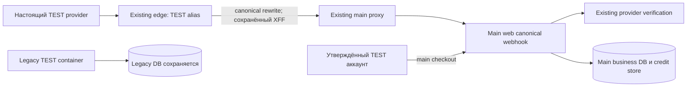

# Архитектура TEST callback

Предварительная архитектура M light для независимого QCSD. Это подготовка входов, не исполненный Step5 checkpoint. Inputs: `01_requirements.md`, `03_adr/001-align-test-callback-upstream.md`; normative ledger связан SHA в требованиях.

Edge принимает только существующий alias; handler URL/HTTP contract остаются прежними. Main proxy разрешает existing web; web владеет проверкой provider, idempotency и grant. Никакого прямого SQL/grant оператора нет. Legacy container остаётся работающим со своими данными и не становится main writer.

Trust boundary: публичный request → edge → private main proxy → web; фактический client IP должен соответствовать существующему `trustedProxyHops`. Нельзя доверять произвольному клиентскому XFF. Проверка обязана моделировать spoofed XFF и сравнить native chain с `apps/web/src/server/ip.ts`; несовпадение блокирует apply, env/header patch вне scope.

Operational state: полный файл host `/home/dz-projects-2026/edge/Caddyfile` single-file mounted в existing `ai-hub-tls-proxy:/etc/caddy/Caddyfile`. Canonical repo artifact содержит только exact scoped handle. Candidate/backup/full diff остаются вне Git. Private operator обязан compare exactBefore once, exactAfter once, остальное byte-identical и подтвердить source hash непосредственно перед записью. Native QE measured input связывает repo fragment/test и read-only handler/IP/config owners; binding к full private file осуществляется SHA и фактической extraction comparison, не одной строкой prose.

Наблюдение full source SHA: `4fccb901ce4825e921518bc0112b672bdbd4cccacb1f53e6d800cbf5f707b0c2`; private candidate SHA: `93967c31704f6468ffd3bff5a88730b77a1048e4056d1075b227c1cf427b6c08`. Эти hashes описывают подготовку; свежесть перед apply ещё не проверена. Образы, env, сети и DB identities фиксируются before/after без публикации секретов. No schema migrations, новые data models/API отсутствуют.
