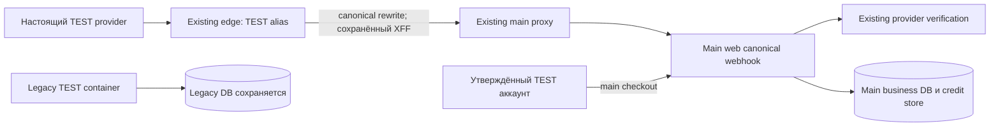

# Архитектура TEST callback

Предварительная архитектура M light для независимого QCSD. Это подготовка входов, не исполненный Step5 checkpoint. Inputs: `01_requirements.md`, `03_adr/001-align-test-callback-upstream.md`; normative ledger связан SHA в требованиях.

Edge принимает только существующий alias; handler URL/HTTP contract остаются прежними. Main proxy разрешает existing web; web владеет проверкой provider, idempotency и grant. Никакого прямого SQL/grant оператора нет. Legacy container остаётся работающим со своими данными и не становится main writer.

Trust boundary: публичный request → edge → private main proxy → web; фактический client IP должен соответствовать существующему `trustedProxyHops`. Нельзя доверять произвольному клиентскому XFF. Проверка обязана моделировать spoofed XFF и сравнить native chain с `apps/web/src/server/ip.ts`; несовпадение блокирует apply, env/header patch вне scope.

Operational state: полный файл host `/home/dz-projects-2026/edge/Caddyfile` single-file mounted в existing `ai-hub-tls-proxy:/etc/caddy/Caddyfile`. Canonical repo artifact содержит только exact scoped handle. Candidate/backup/full diff остаются вне Git. Private operator обязан compare exactBefore once, exactAfter once, остальное byte-identical и подтвердить source hash непосредственно перед записью. Native QE measured input связывает repo fragment/test и read-only handler/IP/config owners; binding к full private file осуществляется SHA и фактической extraction comparison, не одной строкой prose.

Наблюдение full source SHA: `4fccb901ce4825e921518bc0112b672bdbd4cccacb1f53e6d800cbf5f707b0c2`; private candidate SHA: `93967c31704f6468ffd3bff5a88730b77a1048e4056d1075b227c1cf427b6c08`. Эти hashes описывают подготовку; свежесть перед apply ещё не проверена. Образы, env, сети и DB identities фиксируются before/after без публикации секретов. No schema migrations, новые data models/API отсутствуют.

Ниже — дизайн с семью own-verified на R2 исходными conditions; bounded author R3 меняет только permission drift RISK-03 вP/C. RISK-03 OPEN до originating review новых bytes; actual executor/runtime checks planner не выполнял. Детали реализуют существующие FR-1/FR-2/FR-3/NFR-1, не расширяют requirement ledger. Только root после настоящих gates и preflight может использовать делегирование автономных шагов 1–4 TEST CJM. План сам не разрешает apply.

## O. Минимальный операторский контракт

### O1. Эксклюзивность и граница окна

Один ответственный root/operator и один существующий edge; один private advisory operation lock для apply, restore и cooperating reload/restart. Lock находится вне bound Caddyfile и не заменяется/не удаляется для обхода занятости. Взятие nonblocking: занят → STOP, без writes. Crash отпускает lock, но НЕ снимает durable incomplete marker. Следующий запуск сначала обнаруживает незавершённую операцию, а не начинает новый apply.

До окна root реально исследует **обычных cooperating writers/reload**: операторские сессии и процессы, deploy/CI hooks, timers/cron/systemd, watch и automation status. Их фактический статус и контроль фиксируются в private record; cooperating действия используют root operation lock и проверяют incomplete marker. Занятый lock, активный конкурентный writer/reload, неизвестные текущие source/control, необъяснённый restart-loop или отсутствие ответственного recovery → **STOP до записи**. Одного flock без фактического preflight недостаточно.

Prospective correction по полностью прочитанному `R/callback-plan-repair/ROOT_READONLY_FACTS.private.md` (R — private каталог root): actual inspect координатора установил edge `unless-stopped`, `caddy run --config /etc/caddy/Caddyfile --adapter caddyfile`, без `--watch`. Это сведения root, не повторный runtime inspect planner. Обычная restart policy без known active conflict **сама по себе не блокирует apply**. Предыдущее требование исключить любое чтение partial bytes при host/Caddy crash ввёл координатор, оно не является owner requirement; здесь оно сужено до проверяемого контроля cooperating действий.

Окно: under-lock recheck → запись/fsync → validate/reload → health → durable applied/restored, без другого ops work. Если активная фаза не укладывается в300 с с начала final prewrite recheck, до write STOP, после write recovery/incident; отдельные H deadlines сохраняются. Это предел операционной попытки, не SLA recovery при host outage. Crash оставляет окно незавершённым. До write root проверяет отдельный постоянный SSH control/recovery channel, не зависящий от TLS edge, доступность backup/record и ответственного; root сообщил, что такой путь уже установлен, но его свежая доступность — обязательный preflight. Host reboot может оборвать SSH-сессию: recovery ждёт восстановления существующего SSH доступа, его непрерывность при hardware failure не обещается.

Остаточный риск **явный**: host/hardware/Caddy crash может привести к автоматическому чтению partial config и простою общего edge до ручного restore. Durable backup+marker+независимый от TLS SSH дают путь восстановления, но не автоматический recovery/нулевой downtime. Не менять restart policy, не добавлять daemon/network и не перезапускать весь edge ради абсолютной гарантии. Это обоснование достаточности предлагаемого M10 дизайна для originating RISK/quality review, не уже принятый владельцем риск и не closure. Реальный конфликт/ошибка/unknown остаются STOP, а новая авария — O4/incident.

### O2. Подготовка до первого live write

1. До любого файла назначения выполнить executor binding §E. Получить lock, прочитать незавершённые records. Если есть incomplete → только O4, не новая операция.
2. Under lock проверить реальный host/mount/source SSH session PID+runstate; `lstat`/`open` без follow symlink, `fstat` и mount identity должны доказать тот же regular file `(st_dev, st_ino)` на host и действующий single-file bind. Открывать без truncate; один held read/write fd до конца apply/restore. Повторный open по имени для записи и rename bound файла запрещены. Baseline mode/uid/gid/size/SHA сохраняются; initial SHA должен совпасть с рассмотренным source. Проверить same path/inode и source SHA непосредственно перед write.
3. Сохранить полные old bytes в private backup0600, каталог0700 вне repo на устойчивом storage; fsync backup, затем directory, повторно прочитать и сверить length/SHA. Это обязательный доступный recovery input; ссылка на память/временный stdout не backup. Full candidate0600 строится из captured old bytes: exactBefore встречается один раз, exactAfter один раз, вне единственного upstream bytes идентичны. Сверить scoped fragment с reviewed repo bytes.
4. Полный candidate заранее валидируется **тем же binary/version существующего edge**. Использовать отдельный private scratch файл вне `/etc/caddy/Caddyfile` через существующий transport, без нового контейнера/сети; конкретный путь и transport root привязывает к private executor до его review. Проверить переданные candidate SHA и output/exit `caddy validate --config <private-candidate> --adapter caddyfile`. Любая неизвестность/nonzero → STOP, live bytes не трогать. Transport не должен менять bound path.
5. До live write сохранить persistent operation record0600: operation ID, ответственный/UTC, reviewed/executed executor SHA, Python/runtime/binary versions, paths, fd identity `(dev,ino)`, source+candidate+backup lengths/SHA, backup path/mode, scoped fragment SHA, control evidence, health baseline, BOTH-store inventory reference, `state=incomplete`, `last_completed=prepared`, `applied=false`. Записать record, fsync record и parent directory **BEFORE первого in-place write**. Ошибка durability → STOP до live write. Record и backup не удаляются при ошибке. Их updates могут быть atomic replace внутри private directory с fsync; bound файл заменять нельзя.

### O3. Запись и синхронный отказ

Held fd: seek0 → loop `write` до full length → truncate до точной длины → fsync → readback exact length/SHA. Положительный short write продолжает loop с оставшегося offset; zero write, exception, неполная запись к deadline, truncate/fsync failure не являются успехом. Затем повторно доказать same path/dev/inode и container-visible exact candidate bytes. Все эти шаги выполняются при durable incomplete record. После проверенной полной записи фиксируется `last_completed=written`, но `applied=false` сохраняется.

Далее `caddy validate --config /etc/caddy/Caddyfile --adapter caddyfile` → подтверждённый exit0 → `caddy reload --config /etc/caddy/Caddyfile --adapter caddyfile` на том же edge → §H after-health. `applied=true,state=applied` допускается только после всего набора и fsync финального record. Успешный write, validate или reload по отдельности не означает applied. Если final record не удалось durable сохранить, операция остаётся incomplete/unknown: не публиковать успех, остановить CJM и выполнить recovery.

Любой failure/unknown после начала записи требует exact rollback O4; ошибка до live write — STOP без него. Не reload partial/unvalidated bytes; ловля исключений и finally не считаются защитой от SIGKILL. Runtime failure injection запрещён: только временная изолированная fixture. Проверяемый временный partial file — реальная остаточная опасность, а не атомарная запись.

### O4. Recovery после crash и rollback

Root/recovery executor получает тот же lock и читает durable record **до** новых writes/reload. Проверяет целостность record, backup0600, его length/SHA, текущий path/dev/inode/mount и фактический SHA. Классификация: old / candidate / mixed (любой иной набор bytes, в том числе укороченный). Наличие candidate SHA не доказывает, что reload или health завершились. После прерванного apply без финального durable success default — restore old, не продолжение нового TEST CJM.

Если backup проверен, inode/mount прежние и происхождение mixed bytes ограничено этой операцией под доказанным контролем O1, восстановить old через held fd по O3 (loop write → truncate → fsync → exact host/container hash), затем validate → reload → §H для old baseline. Если файл уже old, повторно подтвердить точные bytes и validate/reload/health; лишняя перезапись не нужна. Только после полного успеха fsync `state=restored,applied=false`; сохранить исторический incomplete record/transition, не стирать свидетельство.

Changed inode/mount, missing/corrupt backup/record, посторонний writer, недоступный host/SSH либо недоказуемая возможность безопасно восстановить → **STOP + incident, no additional write/reload**. Ошибка самого restore/validate/reload/health → incident и STOP, record остаётся incomplete/restore_failed; не «чинить» заменой inode, restart-all или новыми настройками. На диске могут оставаться mixed bytes, это явно указывается ответственному. Cooperating ручной reload/restart непроверенных bytes запрещён; поведение existing restart policy при crash остаётся описанным остаточным риском O1.

Если TLS edge не поднялся, но независимый SSH/host filesystem доступны и backup/inode/control проверены, это **не запрет восстановить host file**: открыть recovery fd без truncate, доказать прежний dev/inode и выполнить same-inode restore. Container-visible validate/reload и H выполняются, когда existing edge вновь доступен; нельзя заявлять их успех заранее. Existing restart policy может сама снова запустить Caddy с восстановленным файлом; это не предписание ручного restart-all. Если в пределах recovery checks edge недоступен либо PID/runstate изменились, явно записать crash/identity deviation и incident/recovery_pending; не подменять неизменность H и не утверждать applied/restored-health PASS. Дальнейшее действие требует root incident assessment, не новой инфраструктуры.

Если TEST checkout уже создан, перед плановым route rollback обязательно §P. При аварии edge health доступность восстанавливается old bytes по O4 немедленно, даже когда payment reconciliation ещё невозможно; тогда targeted TEST CJM halted, durable `business=incomplete_pending`, права/платежи не объявляются принятыми. Recovery конфигурации не отменяет бизнес-события.

## E. Привязка actual private executor

Будущий оператор — **один self-contained Python stdlib private file вне Git**, без импортов изменяемых local helper modules, plugins или загружаемых скриптов. Содержит apply/recover и reviewed execution boundary. Root до code QE вписывает в финальный 06 точный SHA-256 реального файла и review/fixture references; сейчас файла/SHA нет, gate NOT ESTABLISHED. Нельзя подставлять SHA макета либо mock.

На границе запуска независимо reviewed launcher читает exact bytes из fd, сверяет SHA с независимым review binding, удерживает bytes как immutable byte string и делает `compile(captured_bytes, ..., 'exec')`/exec in-memory (либо исполняет доказанно неизменяемую retained-fd copy). Проверка имени файла с последующим запуском по этому имени запрещена. Boundary/launcher также часть source review и binding; он не доверяет self-check уже запущенного неподтверждённого файла. При несовпадении источника **ноль writes**, включая lock/record/scratch/live; refusal evidence пишет вызывающий root отдельно. Подмена path после capture не меняет executed bytes; before-capture подмена отказывается.

Launcher — короткая неизменяемая invocation string, рассмотренная вместе с единственным Python file и поданная runtime in-memory, не второй изменяемый helper-файл. Её exact bytes/SHA входят в review receipt и operation record. Remote payload при необходимости — фиксированные bytes из того же captured source. Это замыкает binding на execution boundary без добавления инфраструктуры или repo targets.

Запуск с изолированным Python import path (без site/customize/PYTHONPATH и CWD helpers), фиксируются Python executable/version, stdlib origin/runtime environment и Caddy/SSH tooling versions. Это не обещание защиты от компрометации самого runtime. Remote script payloads допускаются только как captured части того же рассмотренного source, exact SHA проверяется на remote execution boundary до compile/exec; не скачивать/импортировать mutable helpers. Operation record хранит actual executed source SHA и remote payload SHA, а не только ожидаемый digest.

Actual executor получает **собственный независимый source review иной моделью и реальные fixture tests**: tempfile files, настоящий fd/inode/fsync и дочерний процесс с SIGKILL; где возможно, тот же путь исполнения apply/recover/launcher, что пойдёт на existing host, при привязке корня к temp sandbox. Caddy/SSH в fixture не трогают runtime; adapter/mocked внешние ответы отмечаются как ограничение. Отдельная модель состояния или зелёный fragment test этого не заменяют. Неиспытанный actual code path блокирует apply.

## H. Health oracle и deadlines

Owner каждой проверки — root/operator; private evidence содержит timestamp, endpoint/method, status/error, elapsed, sanitized response digest и identity. Это план checks, **не actual PASS**. Root сперва проверяет фактическое размещение `clipmkr.ru`, существующий edge и main; `/home/clipmkr` и имя legacy `n5` не доказывают host identity. Никаких Cloud/DNS/network изменений.

| Check before / after / restored | Доступный контракт и expected |
|---|---|
| Main page `GET https://clipmkr.ru/` | 200, без неожиданного redirect; одинаковый published release связывается с H health/image ниже, а не хешем динамического HTML |
| Main health `GET https://clipmkr.ru/health` | 200, JSON `status=ok`, `revision` и `X-Clipmkr-Release` равны exact published SHA из root release evidence; `unversioned`, другой SHA, 503 или неизвестность — отказ |
| Main API `GET /api/webhooks/yookassa` | 405 (в исходнике объявлен только POST); baseline до apply должен подтвердить этот контракт на опубликованном main |
| Existing TEST alias `GET /api/webhooks/yookassa-test` | Только безопасное чтение ответа; зафиксировать old status/body digest до apply, ожидаемый canonical после apply — 405; при restore — прежний измеренный ответ. Не объявлять old status заранее измеренным |
| Canonical callback reject-negative | POST с пустым телом к `/api/webhooks/yookassa`: 400 `invalid_body` из раннего reject, provider/бизнес-записи не вызываются. После apply тот же negative через TEST alias должен дать тот же отказ. Ошибку 200 нельзя принять за health |
| Spoofed XFF | Отдельный non-provider probe с `{}` и подставным XFF: 400 `verification_failed` при подтверждённом реальном non-provider IP; при недоступной доказательной цепочке STOP. Не подделывать trusted provider ingress; fixture проверяет также missing-hop reject |
| Main network reachability | Из уже существующего edge network namespace read-only HTTP `http://n5-clipmaker-proxy-1:80/health` с прежним Host `clipmkr.ru`: 200 и тот же published SHA. Использовать уже имеющийся инструмент; если его нет/маршрут не доказан — STOP, без network connect/new container |
| Identity | Host/mount/dev/inode, edge/main proxy/web container IDs, image IDs/digests (особенно web image), start time/PID/runstate, env/network/store identity неизменны. Existing authorized source SSH transport PID/runstate живы; потеря контроля → unknown. Не печатать env values/DB URL |
| Provider GET-only inventory | После TEST preflight только существующий `GET https://api.yookassa.ru/v3/payments/{id}` для известного nonterminal TEST ID (§P): 200, exact ID/shop/test=true и ожидаемая metadata/amount. 401/403/404/429/5xx/timeout — unknown/STOP; не пробовать иной secret/shop. Это provider baseline, не доказательство callback delivery |

`apps/web/src/app/health/route.ts` действительно содержит `/health`, SQL `SELECT 1` и release header; **`/api/health` в этой копии отсутствует**. Не создавать endpoint и не записывать придуманный 200. Root должен сопоставить это с опубликованной версией до apply; несоответствие — STOP. `GET /api/checkout/{intentId}` не является read-only health: существующий handler может вызвать `markCanceled`. В baseline его не использовать; допустим позже как штатное действие TEST CJM с учётом business writes.

Ограничение ожидания: HTTP connect≤2 с, total≤5 с/запрос, максимум 3 попытки transient transport/timeout с интервалом2 с; один полный before/after/restore набор≤90 с. Mismatch status/SHA/identity/isolation — немедленный отказ, без «дожидания зелёного». Unknown после исчерпания попыток — отказ. Read-only local/SSH check≤10 с; candidate/container validate и reload — по одной попытке≤15 с. Ожидание outstanding reload при timeout нельзя обойти вторым reload: подтвердить завершение прежнего процесса перед restore/reload; при неизвестном состоянии control → incident/STOP без дополнительных writes.

До записи весь набор обязан пройти; иначе STOP. После записи failure/unknown → O4 rollback; после rollback failure/unknown → incident, без success. Recovery, как и apply, имеет собственный набор≤90 с; это предел проверки, не SLA восстановления/provider redelivery/retention. Provider GET для pending inventory может изменить бизнес-статус между samples: записать фактический статус и перейти §P, а не требовать его искусственной неизменности. Snapshot configuration/identity снимается до разрешённых TEST business writes; их отсутствие в дальнейшем не обещается.

## P. Pending cutover и возврат маршрута

Только после root TEST preflight (global=false, exact sole approved account, TEST shop, test=true/test_ key; LIVE запрещён) выполнять read-only inventory **обоих** business stores. Прочитать `payment_intent`, `payment`, `payment_event`, `credit_grant` с их связями/схемой; все относящиеся к shared shop записи, не только целевой аккаунт. Legacy schema не предполагается идентичной: отсутствующая/непрочитанная таблица не равна пустой. Идентификаторы аккаунтов/intent/provider/payment/grant и credentials остаются private0600.

Для каждой записи: store identity, владелец account, intent ID, provider TEST shop/payment ID, metadata.order_id, SKU/price/amount/currency/test, status/fulfilled/needs_review, event key/payload hash, `payment_ref` и grant total. Обнаружить orphan, одинаковый payment ID в обоих stores, разногласие owners/status/amount, созданный intent без provider ID, незавершённый create request. Не связывать спорных владельцев по email. Для всех известных nonterminal TEST IDs фактически GET provider по H; pending/requires_action/waiting_for_capture и неопознанные статусы считаются незавершёнными. Истёкшее окно ожидания или abandon браузера не доказывают cancel.

Inventory имеет время/полноту/границы, stable повтор под O1 перед live write и проверку отсутствия новых неподконтрольных checkout/inflight requests. Один snapshot не доказывает quiescence. Terminal legacy rows не отбрасываются: сопоставить каждый relevant event/owner и возраст **события**, включая refund; неизвестная история — конкретная unresolved связь, не предположение о бесконечном retry.

### P1. Измеренный historical TEST debt отдельно от нового CJM

Root фактически прочитал оба stores 05.11.2026 23:23 UTC и затем provider GET незавершённых main intents. Полный результат, положительные provider cases, ID/PII/даты и соответствия остаются **только private**: `R/callback-plan-repair/ROOT_READONLY_FACTS.private.md`, `R/payment-cjm/cutover-inventory-private-readonly.json`, `R/payment-cjm/cutover-nonterminal-provider-readonly.private.json`. Planner не вызывает API и не объявляет данные сверенными самостоятельно. Обнаруженный старый TEST payment/ledger gap — отдельный **historical TEST debt**, не новый checkout и не выполненное reconciliation; считать его нулём или замаскировать новым grant нельзя. Дополнительные root observations уточнили принадлежность исторических intents и верхнюю границу отдельного события; остальные relevant events требуют собственной полной classification, без экстраполяции одного timestamp на весь store.

Scope этой feature: read-only classification старого TEST debt и отдельно новый approved-target CJM. По дополненному root facts старые main intents не принадлежат sole approved target; cross-store evidence старого positive и event-time upper bound находятся в `R/payment-cjm/historical-target-owner-readonly.private.json` и `R/payment-cjm/historical-cross-store-positive-readonly.private.json`. Это наблюдения root, не самостоятельная DB/provider verification planner; ID/PII/exact positive cases остаются private. Классификация не означает, что долг reconciled или права начислены.

**Historical reconciliation исключена из feature и из зависимостей нового CJM:** нельзя обрабатывать old positive через canonical handler/relay, создавать старые payment_event/payment/grant, выполнять старый mutating status flow или менять чужой account. Ни отдельная техническая санкция root внутри этой feature, ни known owner не расширяют неизменённый OpenSpec. Долг передаётся в deferred протоколP3 без business writes; grant старому intent не является условием route/new-CJM GO.

### P2. Ограниченное окно доставки и route GO

ЮKassa считает HTTP200 подтверждением уведомления; при ином HTTP-коде продолжает доставку в течение24 часов **с момента события**. Это опубликованная политика, не фактический delivery/ACK receipt и не гарантия отсутствия будущего refund или ручного повтора. Источник: [официальная документация входящих уведомлений](https://yookassa.ru/developers/using-api/webhooks), прочитана в этом refinement. Не использовать возраст intent/`created_at`, «нет строк25ч» или число попыток как замену event time.

Для каждого legacy event, который мог бы попасть в main: root фиксирует private `event_time` с происхождением (проверенный provider timestamp нужного перехода/исходное событие) либо доказанную верхнюю границу `event_time_upper_bound`. Например, время уже подтверждённого приёма именно этого события или первое зафиксированное достоверное наблюдение соответствующего terminal статуса — верхняя граница; `created_at` такой границей не является. Неизвестная семантика поля/clock → STOP для этой попытки. Если exact event time не найден, допустим консервативный конечный срок `upper_bound + 24h` с учётом установленной погрешности часов, без придуманного retention SLO. Новое событие (например refund) получает своё окно; статус старого payment его не покрывает.

| Условие свежего preflight | Решение и причина |
|---|---|
| Legacy owner/event однозначны, terminal; документированное24ч окно каждого relevant события истекло по доказанному времени/upper bound; нет observed inflight/new event/активного manual replay | Route GO возможен при остальных gates. Это ограниченное обоснование прекращения обычных retries, не zero-risk-forever и не гарантия безопасного ACK произвольного legacy replay |
| Legacy event ещё в24ч окне либо observed inflight | STOP cutover сейчас; оставить old route у владельца, наблюдать штатную обработку/read-only ledger, записать точный defer-until. По наступлении срока — один новый preflight; не бессрочный busy-wait |
| Legacy event time неизвестно, но есть достоверное terminal observation time | Вычислить конечную консервативную upper-bound дату; до неё STOP этой попытки. Если нет даже такой границы/полноты — BLOCKED с названным missing evidence, не выдумывать дату |
| Owner/store/shop/test/amount или relevant event-time неоднозначны, orphan/двойная принадлежность не разобраны, любой relevant pending/requires_action/inflight активен либо не классифицирован | STOP **apply и новый CJM**: route может направить событие в чужой store или изменить чужие права. Простая запись «debt» этого не разрешает |
| Старый terminal TEST debt полностью классифицирован read-only, ownership однозначен (включая nonapproved owner), relevant event window доказанно истёк, нет активных/неопределённых relevant платежей/inflight | Сам debt не блокирует route/new-CJM GO при остальных gates; оставить DEFERRED/UNRESOLVED, не начислять grant и не replay старое событие |
| Свежий полный BOTH-store inventory и event classification прошли, route health подтверждён; снят новый approved-target baseline | Root может выдать GO **только новому** checkout/CJM; QA business requests затем привязаны к exact intent, созданному после этого GO/baseline. Никакой исторической компенсации |

Решение bounded: один свежий inventory и оценка таблицы за попытку root; результат GO / defer-until / STOP с конкретным missing evidence или action. Отсутствие сведений сейчас не объявляется PASS. Измеренные terminal legacy и aged rows полезны, но сами **не устанавливают**, что24ч от каждого события уже прошли. Никаких новых provider calls в planner turn.

### P3. Deferred historical debt и граница QA-оператора

Отдельная deferred запись/protocol в own private handoff сохраняет references исходных root facts, store/owner/event classification, отсутствие ожидаемых прав, статус **DEFERRED/UNRESOLVED** и владельца дальнейшего решения root. Это backlog для отдельного блока вне feature, без разрешения/запуска reconciliation. Не исправлять старые payment/event/grant/intent/account rows, не создавать relay/POST или mutating status GET для старого canceled/created, не компенсировать долг новым checkout. No manual grant/SQL/cleanup/migration и никаких новых служб. Для дальнейшего исправления root понадобится отдельная постановка с полномочиями и gates, текущая история их не заменяет.

QA-оператор этой feature: перед созданием checkout проверить root GO/baseline и sole approved account; перед каждой последующей business action/POST/controlled relay проверить exact intent ID из этого нового checkout, его account/shop/test/SKU/amount и создание после GO/baseline. Old/pre-GO intent, nonapproved account, иной ID или unknown evidence → STOP **до бизнес-запроса**, включая status GET, способный обновить canceled. Negative fixture: historical approved intent и nonapproved intent отвергаются с нулём POST/relay/mutating-status calls; fresh approved intent проходит positive control. Это admission оператора/QA и evidence, не новый API/filter приложения. Ordinary native provider traffic, handler и его штатная идемпотентность остаются прежними.

Legacy — исторический TEST store: контейнер/данные сохраняются, новый checkout идёт в main. `unknown_intent/needs_review` HTTP200 не считается safe business ACK; классифицированный прошлый unknown_intent остаётся долгом. Вне текущего cutover window будущие legacy refund/manual repeat требуют отдельного протокола с проверкой store owner; их гипотетическая возможность не создаёт бесконечного BLOCKED или dual-store dispatcher. Реально обнаруженный новый event/inflight/ambiguity в текущем окне, напротив, возвращает STOP и свежий inventory. Event-window правилоP2 не обещает невозможности будущих событий.

После **любого NEW TEST checkout** normal route rollback запрещён без нового inventory/reconcile в обоих stores, включая новый intent и возможный repeat. Reconcile означает сопоставить provider GET с фактическими штатными событиями/правами, не вручную «починить» rows. При аварии edge health O4 сначала восстанавливает old route для availability; до/при recovery сохраняется durable `business=incomplete_pending` с известными private IDs/unknown creation outcome. Targeted TEST CJM останавливается, grant не удаляются, нет business acceptance. Следующий retry GO требует нового полного inventory и установления safe delivery уже при выбранном route; success health не снимает payment gate.

## C. Корреляция TEST CJM и paid clip

Весь C относится только к новому intent sole approved target, созданному после root GO и baseline поP2/P3. Historical/nonapproved intent исключён до любых QA business requests; native provider traffic не переписывается. Старый debt не закрывается этой приёмкой.

До checkout создать private baseline целевого main account, grant totals/rights и intent/payment/events; подтвердить sole approved target, фактический SKU/amount и TEST shop. **До отправки checkout** fsync private `business=incomplete_pending` с известной correlation/началом попытки; после ответа дополнить exact IDs и fsync. Потерянный ответ/kill означает unknown creation outcome, а не отсутствие платежа; новый checkout до inventory запрещён. Собрать **одну связанную цепь**, не набор несвязанных зелёных ответов: exact main intent + provider TEST shop/payment ID + account/SKU/amount/currency/test=true/metadata.order_id → edge callback request (alias/time/existing request ID или correlation по payment ID/body hash + log window) → main handler outcome → `payment_event(provider,eventKey,payload_sha256)` → main `payment`/intent → `credit_grant.payment_ref=intent_id`, `source_key=intent:<id>` → rights в fresh session.

Один положительный grant для intent, сумма его `total_seconds` ровно intended `grant_seconds`, корректные entitlement dates/owner и уникальные provider event/payment identity. Account aggregate balance сам по себе недостаточен: чужой grant или trial может скрыть ошибку. Проверить main store identity и отсутствие обработки этого нового intent в legacy. Доступных существующих журналов может не хватить для request correlation; тогда NOT VERIFIED, без нового logging/API/env в этой фиче. Return page не oracle. После login в новом browser session права совпадают с тем же grant и его периодом.

Повтор: независимо доставленный **provider duplicate** требует факта второго ingress/delivery того же payment/event и нулевого дополнительного grant/sum; один event row без второго request не доказывает duplicate. Controlled operator relay — отдельная категория evidence, только если root установил разрешённый существующий путь без обхода IP/provider verification; он не называется provider redelivery и не закрывает её сценарий. Недоступный native duplicate → NOT VERIFIED, не mock PASS. Реальный fail/cancel подтверждается provider terminal outcome и нулём grant именно этого intent; abandon/pending/timeout — NOT VERIFIED. Handler не принимает cancel как grant-event; штатный status flow может отметить canceled. UI-ошибка без provider evidence не доказывает cancel.

Оплаченная возможность: один новый реальный job/video утверждённого account при действующих оплаченных правах → полный upload/process → ready clip → **native Chrome Play и Download**. Private evidence связывает job/video с единственным `credit_charge` и его `credit_allocation`: списание/резерв за этот job один раз, сумма allocation равна intended charge по штатной измеренной длительности. Repeat/reload UI не создаёт второй debit/job. FIFO может расходовать старый trial grant раньше нового payment grant: показать фактические allocation и не утверждать, что потрачен новый paid grant, если этого нет. Paid entitlement и источник списанных секунд проверяются отдельно. Trial не удалять для удобства доказательства.

Обычный аккаунт не получает checkout; его отрицательный probe не создаёт бизнес-платёж. Единственные допустимые business writes — штатный новый TEST CJM sole approved target после GO/baseline, его события, grants, job/debit. Historical debt остаётся read-only/deferred вне этих исключений. Grants и прочие доказательные данные сохраняются; **никакого SQL cleanup, ручных grant, других аккаунтов или LIVE**. Платёжная приёмка остаётся неполной при любом NOT VERIFIED обязательном сценарии, даже если route operationally healthy.
