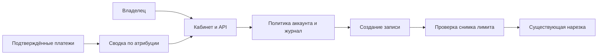

# Архитектура ограниченного дополнения

Владельческий раздел `/dashboard/bloggers` и API `/api/owner/bloggers` используют текущую
сессию и проверку hasOwnerUnlimited. Новый сервис, авторизация или платёжный провайдер
не создаются. DB-модуль настроек отвечает за роль и audit; DB-модуль отчёта — за агрегаты.

Account → политика длительности → транзакция video.create → video.source_limit_seconds →
getProbeSource / acceptProbe → существующая расшифровка / выбор / рендер. Внутренние helpers
принимают технический диапазон; реальный допуск определяется снимком video до расходов.

Граница доверия: ни роль, ни лимит, ни результат оплаты не берутся на веру из браузера.
Магазин Clipmkr настраивается отдельно; включение реальных списаний без его настроек не имитируется.
