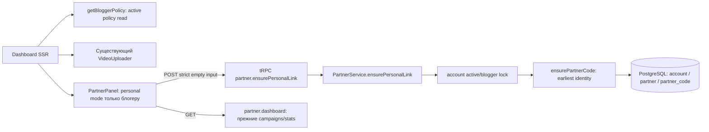

# Архитектура личной ссылки блогера

Статус: проект для независимого QCSD; runtime не изменён. Решение ADR-001.

## C4 Component

SSR getBloggerPolicy — только чтение, передача `personal` разрешает UI, но не заменяет серверную
авторизацию. POST повторно проверяет роль под account lock. GET никогда не вызывает ensure.
Существующий route использует authorizeUpload: origin → session/rate → bounded body → tRPC.
Чужой account/code не принимается в input. Существующий foreign-statistics отказ 403 сохраняется.

## API design
`POST /api/trpc/partner.ensurePersonalLink`, JSON `{}`. Неизвестные ключи → 422.
Сервисный результат `{id:string, code:string, status:'active'|'blocked', blocked_reason:string|null}`.
Обёртка прежняя `{result:{data:{data:result,meta:{request_id}}}}`, успех HTTP 202 после COMMIT.
Нет session → 401; чужой origin → 403; rate → 429; роль снята/account не active → 404;
неожиданная ошибка → существующий sanitized partnerResult. GET mutation → отказ tRPC без write.
Input не содержит account_id, кода, роли или флага active. New API не меняет createCode/dashboard.

## Data & storage
Схема прежняя. Транзакция: account row lock → partner UPSERT → earliest code → locked status read.
Роль назначается владельцем через setBloggerPolicy и тот же account lock; удаление тоже сериализовано.
Старые коды, guest-pack, attribution и payment_intent остаются по прежним ID.
Самый ранний blocked возвращается как blocked. При любом существующем коде mint отсутствует;
наличие blocked другой кампании сохраняет её состояние и не создаёт новый обходной код.
Процесс после commit может упасть: повтор устойчив через строки БД, не через память процесса.

## UI states and composition
- loading: ожидание выдачи, без выдуманного URL и без активного copy.
- ready: полный публичный configured origin + `/r/<code>`, readonly/selectable URL и copy.
- blocked: явное объяснение, copy отсутствует/disabled во всех personal-mode представлениях этого id,
  включая раскрытый PartnerSummary; прежняя статистика доступна. Другую active кампанию
  не блокируем вместе с ним; обычный mode сохраняет прежнее поведение.
- error: понятное сообщение и «Повторить», тот же endpoint; только текущий attempt может менять UI.
- clipboard failure: URL остаётся видимым, выделяемым; aria-live сообщает ручной путь.

Один PartnerPanel personal у блогера: открытая компактная ссылка рядом с uploader; статистика
и campaigns внутри вложенного раскрываемого блока без ручной формы. Для обычного аккаунта
сохраняется прежний secondary details. Desktop рядом с upload, mobile после действий upload
и перед VideoList. Для обеих текущих компоновок один экземпляр uploader, без key по теме/виду.
Предпочтения меняют CSS/атрибуты, не дерево компонентов. Статистика может фильтроваться независимо.

## Подтверждение границы принадлежности
В существующем browser HTTP/PG harness два активных блогера A/B проходят настоящий auth,
POST adapter → PartnerService → PG. Sequential и concurrent первые запросы, повтор/reload
сохраняют собственный id/code, различный между A/B; JOIN partner_code → partner проверяет
точный account_id. Собственный dashboard показывает только свои коды, чужой code_id → 403
без чужого payload. Подмена account на A внутри сервиса должна сломать положительный контроль B.
Это план одного meaningful integration case в существующей suite, не новый runtime-компонент.

## Observability
Повторно используем status HTTP и request_id текущего adapter; не логируем cookies, полный URL,
реферальный код или персональные данные. Новых событий на каждый render и счётчиков не требуется.
Числа для диагностики: error rate автоматического RPC и количество partner_code данного account
до/после конкуренции (последнее — тестовая проверка, не новая runtime-метрика).
Внешний симптом: карточка остаётся в error с повтором либо blocked; пользователь и поддержка видят
понятное сообщение, HTTP request_id связывает запрос с действующим журналом. Ошибка не блокирует
отдельно работающую загрузку. Долгое ожидание проверяется управляемой задержкой в browser suite;
retry не запускает параллельный клиентский attempt, для этого короткого RPC компонент передаёт существующему rpc AbortSignal с deadline 10 секунд,
объединённый с cleanup AbortController. Общий 360-секундный mutation timeout не меняется.
