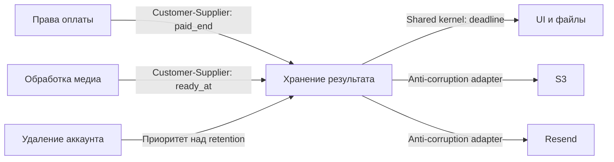

# Модель предметной области

Статус: proposed; проект для L-tier, не завершённый gate. Привязка к FR-1…FR-8 и ADR-001…ADR-003. Продуктовые числа согласованы, дополнительные границы перечислены в `technical-clarifications.md`.

## Bounded context map
Новых сервисных контекстов нет. Media processing владеет первой готовностью и принятой версией результата. Billing владеет подтверждёнными правами и их историей. Retention внутри существующего web владеет доступностью/необратимым удалением. Mail delivery — внешний adapter, не источник готовности/прав. Account erasure сильнее хранения результата и удаляет саму историю.

## Ubiquitous language
| Термин | Значение | Отличие |
|---|---|---|
| Готовность ready_at | Первая принятая публикация конкретного клипа | Не video.finished_at всей записи и не последняя пересборка |
| Оплаченный период | Подтверждённое право с датой окончания | Не remaining credit seconds, trial или is_blogger |
| Deadline | Точная дата логического прекращения доступа | Не время запуска cleanup |
| Expired | deadline<=asOf | Байты могут ещё существовать до прохода |
| Deleting | deletion_started_at установлен под общей блокировкой | Не обещание восстановления после новой оплаты |
| Deleted | Все удаления adapter подтвердились, media_deleted_at записан | Не удаление карточки/истории или исходного видео |
| Reminder accepted | Провайдер принял сообщение | Не доказанная доставка получателю |
| Reminder unknown | Итог внешнего вызова не доказан | Не успешная отправка и не разрешение нового logical key |

## Aggregates/Entities/VOs
- Существующий Account — граница конкурентного изменения прав и claim удаления. Сериализация account→video→clip; account.erasing исключает отправку/новый доступ.
- Video — сохраняет карточку, список результатов, историю обработки; первая готовность каждого Clip независима от других.
- Clip — сохраняет ID/title/timing/score/status, ready_at, legacy expires_at, deletion_started_at, media_deleted_at; keys могут очищаться после подтверждения S3. Готовность не переписывается при rerender. Предложенные новые поля — ещё не миграция.
- Payment/CreditGrant — существующие финансовые факты, без новой платежной модели; legacy plan_paid_until содержит последний срок, но не полную историю после операторского сброса.
- RetentionDeadline — VO derived timestamp + policy source + known/unknown; вычисляется по согласованному asOf. Предлагаемый account-wide max описан ADR-001.
- RetentionNotice — durable entity с unique(video_id, deadline, offset_days), immutable payload/provider key и lease. Не auth token. Состояния pending/accepted/failed/unknown/superseded; точный retry protocol зависит от провайдера.
- Доменные переходы Ready/DeadlineChanged/DeletionClaimed/MediaDeleted/NoticeAccepted — понятия для транзакций и логов; отдельная event bus не требуется.

## Relationships

## Codebase mapping
`render.ts` — готовность; `payments.ts`/`credits.ts`/`plan.ts` — оплаченные факты и их проекции; `tariff.ts` — TS правило; `retention.ts` — claim/delete; `retention-notices.ts` — предлагаемый узкий coordinator; `support/mail.ts` — существующий транспорт; `screen.ts`/`screen-contract.ts` — состояние для UI. Новые экспортируемые имена ещё должны пройти K1. Индивидуальная blogger policy отдельно proposed, численных defaults не выдумывать.

## Уточнение UX от владельца 10.11.2026

Expired и deleted различаются только внутри системы/поддержки. Пользователь видит одно состояние «Срок хранения закончился» с историей и без недоступных действий. Восстановление/продление не предлагается без проверки сохранности файлов и допустимости операции. Это уточнение заменяет противоречащие пользовательские тексты выше; внутренний lifecycle не объединяется.
