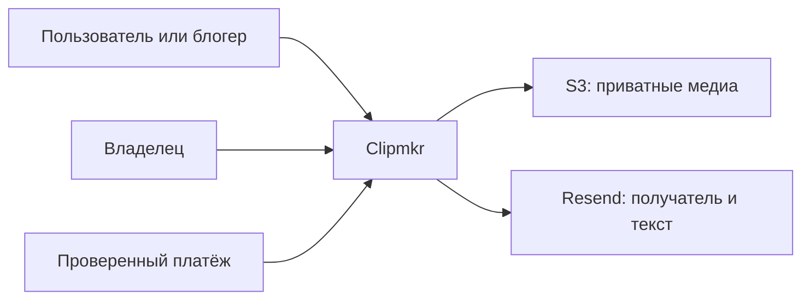
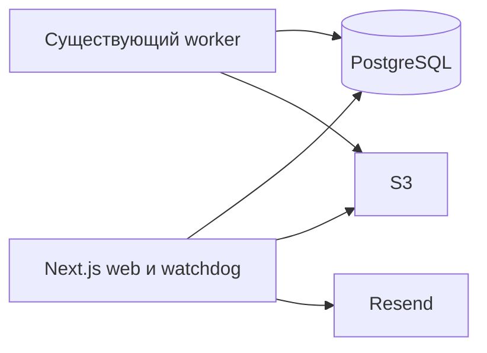
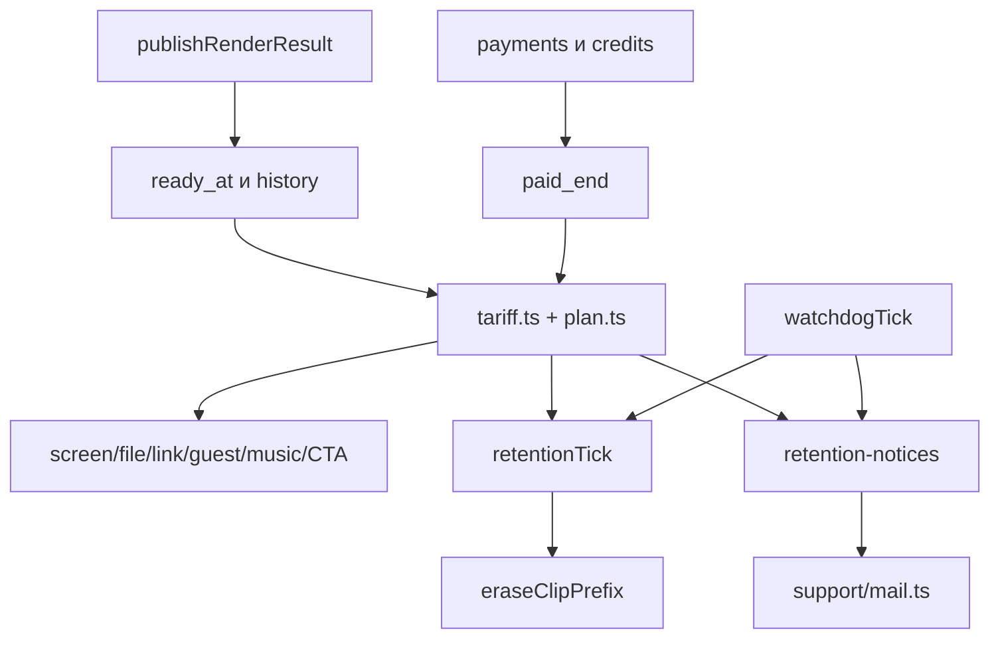

# Архитектура хранения результатов

Статус: proposed. Реализация/runtime не менялись. Требует ADR/QCSD/plan checkpoints и K1/K2; макет ведёт координатор. Это развитие текущей архитектуры, без нового сервиса/очереди/SDK.

## C4 Context

Граница доверия: клиент/роль не определяет срок; платёж доверен только после существующей серверной проверки; приватные keys и подписанные URL не входят в напоминания/логи.

## C4 Container

Redis очередь обработки остаётся существующей; новую retention очередь не создавать.

## C4 Component

Правило — существующий shared/domain API и его SQL projection. Transport не читает права и не принимает решения о сроке. Cleanup не изменяет финансовые факты. Notification error не прерывает другие задачи watchdog.

## Sequence flows
```mermaid
sequenceDiagram
  participant P as payment
  participant D as PostgreSQL
  participant W as retentionTick
  participant S as S3
  P->>D: account lock, принять оплату, commit
  W->>D: account → video → clip locks
  W->>D: повторно проверить deadline
  alt продление принято до claim
    D-->>W: deadline в будущем, skip
  else срок истёк
    W->>D: deletion_started_at, cancel rerender, commit
    W->>S: eraseClipPrefix free/paid/thumbs
    alt все префиксы подтверждены
      W->>D: null keys + media_deleted_at
    else отказ или crash
      Note over W,D: claim остаётся; следующий tick повторяет независимо от нового paid_end
    end
  end
```
Чтение: авторизация → lifecycle/deadline на одном asOf → только затем подпись file/thumbnail. Unknown legacy ready не вызывает destructive cleanup. Mail: короткий notice lease → повторная актуальность → сеть вне transaction → accepted/failed/unknown; restart сохраняет logical key. Платёж после claim не восстанавливает байты; граница закреплена FR-2/FR-5.

## Data & storage
Добавляющая `packages/db/migrations/028_clip_retention.sql`: clip.ready_at, provenance исторической даты, deletion_started_at, media_deleted_at, media_recheck_at с due-индексом claimed, ограниченный индекс кандидатов и retention_notice. Номер предварительный, проверить свободный перед кодом. Backfill min успешного non-rerender render finished_at, fallback video.finished_at с пометкой; ни now(), ни created_at не выдавать за готовность. Первая принятая публикация пишет ready_at через COALESCE; rerender не обновляет.

Не удалять video.object_key, transcript/video/clip/job историю. Старые явные expires_at и пустые ключи классифицировать до destructive действия; S3 HEAD/инвентаризация при неполной истории — отдельная операция, не утверждать её выполнение. Cached deadline не вводится. Guest pack сохраняет отдельный 14-дневный срок ссылки: эффективный доступ ограничен и pack expiry, и конкретным clip deadline; нельзя обещать гостю 14 суток файла при раннем clip expiry.

## API design
Новых маршрутов нет. Расширить ClipScreen существующего screen API признаками ready_at/deletion_started_at/media_deleted_at либо закрытым availability reason с теми же фактами. `expires_at` в response — текущий вычисленный deadline ISO UTC, UI показывает дату МСК с зоной. Статус рендера done не заменять на failed после удаления. Public file/link продолжает одинаково скрывать чужое/недоступное; сохранить presigned playback, новые signed URLs ограничить min(существующий TTL, floor(remainingSeconds)); менее секунды — не выдавать. Старые ссылки/активные загрузки/локальные копии задним числом не отзываются. UI: «Доступно до … МСК», единое состояние по согласованному макету. Для sign dependencies передавать абсолютный notAfter через file/thumbnail/short-link-handler/showcase-file, screen-runtime и /c/[code] route до существующего generateDownloadUrl; signer вычисляет floor TTL от того же точного signingDate, который передаёт AWS SDK, и ограничивает notAfter=min(clip deadline, guest/link deadline). Задержка между чтением и подписью не продлевает срок; остаток<1секунды не выдаёт URL; не вводить owner media proxy.

## Observability
INFO: aggregate tick counts candidates/claims/deleted/notices accepted/superseded; WARN: unknown_ready, mail unknown/unavailable; ERROR: storage/DB/transport failure с безопасным кодом и количеством. Не логировать email, media title, object keys, signed URLs и credentials. Считать backlog/oldest deletion claim и pending notice age; без нового monitoring продукта использовать действующие логи/диагностику.

Внешний симптом: дата есть, файл закрыт по expiry; при S3 отказе карточка показывает недоступность, физическое удаление pending; почтовый сбой не выдаётся за отправку. Разработчик/оператор замечает ERROR/WARN и backlog; пользователь видит точный deadline и неизменяемую историю. SLO физического удаления и доставка inbox не были согласованы — не выдумывать проценты/сроки.

## Уточнение UX от владельца 10.11.2026

Expired и deleted различаются только внутри системы/поддержки. Пользователь видит одно состояние «Срок хранения закончился» с историей и без недоступных действий. Восстановление/продление не предлагается без проверки сохранности файлов и допустимости операции. Это уточнение заменяет противоречащие пользовательские тексты выше; внутренний lifecycle не объединяется.

## Уточнения QCSD и существующие source dependencies
QL-001/RET-RISK-001: media_deleted_at не терминальный селектор. Claim и media_recheck_at живут после первого sweep/null keys. Каждый hourly tick берёт bounded fair due batch, до сети переносит due на следующий interval; все три clip prefixes повторно очищаются, failure/crash сохраняют due. Поздний PUT после первого sweep и crash worker до компенсации достигается этим durable reconciliation без изменения worker. Backlog может увеличить задержку физической очистки, доступ всегда закрыт. Источник/история сохраняются. Existing dependencies: `packages/db/src/render.ts`, `apps/worker/src/workers/render.ts`, `apps/worker/src/render/storage.ts`, `packages/s3/src/erasure.ts`; последние три читаются/проверяются без planned source edits.
CRT-TST-001: SQL первая sending lease атомарно пишет неизменный first_attempt_at до первого network; catch-up eligibility отдельно, retry age только от этого якоря. SEC-01: перед каждым call сверить notice/video/current active account + verified email == immutable to; иначе superseded/recipient_changed, без изменения payload/key/нового key. SEC-02: absolute notAfter и настоящий signingDate связаны в signer; fake clock test пересекает deadline между чтением и подписью. Нового proxy нет.
UI разрешён владельцем «да, хорошо!» → «действуй дальше»; `docs/design/2026-11-10-retention.md`. Существующий стиль сохраняется, одна строка даты/одно конечное состояние; это не обход code gates.
