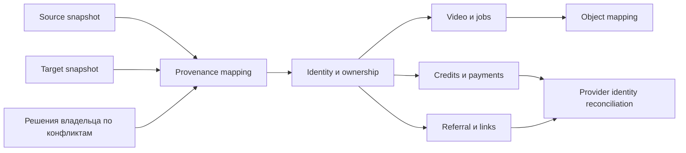

# Доменная модель консолидации

Статус: проект, требует независимого QCSD и фактической инвентаризации.

## Карта контекстов
Identity, media/jobs, credits/payments, referrals/guest links, storage и operations — существующие границы. Консолидация вводит операционную область translation/reconciliation, а не новый продуктовый сервис. Source/target связываются через anti-corruption mapping: сходство schema не стирает происхождение.

## Язык модели
| Термин | Определение |
|---|---|
| Source dataset | Состояние БД/объектов принятого clipmkr.ru, отдельно от Git main |
| Target dataset | Все существующие данные c до переноса, включая неактивные/исторические |
| Consolidated dataset | Проверенный итог, сохраняющий target и разрешённый source graph |
| Identity decision | Доказательство, кем владеется account; email/UUID не достаточны |
| Provenance map | Полная таблица dataset/type/source ID→target ID/reason/evidence |
| External identity | Provider/shop/mode/payment/order ID, неизменяемый контракт вне БД |
| Object mapping | Bucket/prefix/logical key→target physical key + expected bytes/checksum |
| Reconciliation | Сверка содержимого и семантики, не только количества строк |
| Fence | Доказанный запрет всех writers с учётом поздних событий |
| Cutover | Смена единственного authoritative application/data binding |

## Агрегаты и сущности
| Агрегат/контекст | Existing entities | Инвариант переноса |
|---|---|---|
| Account | account, session, operator_action, support_email_token, support_operator, support_audit | Identity/privileges/credentials не объединяются по email; source session не становится активной c |
| Video/job | video, transcript, clip, job_attempt | Общий owner, timeline/cut_plan, billing snapshots, attempts/fences и objects согласованы |
| Entitlement | credit_grant, video_credit_charge, credit_allocation, quota_counter | Остатки/резервы/циклы/expiry/глобальные квоты не заменяются одним balance |
| Payment | payment_intent, payment_event, payment | Один внешний факт/один эффект, snapshots и order lookup сохранены |
| Referral | partner, partner_code, attribution, growth_event | Код и история принадлежат правильному аккаунту, даты и blockers сохранены |
| Public sharing | clip_link, guest_pack, guest_pack_clip | Origin/code→правильная сущность, consent/expiry/revocation сохранены |
| Storage | references в media/packshot/showcase и объектные bytes | Logical и physical namespace различаются; checksum не равен proof ownership |

Proposed operational records: run manifest с source/target snapshots/release hashes; identity/entity/object decisions; row-level reconciliation; writer fence/cutover state. Это логическая модель, не уже созданные таблицы. Физический формат/имена до K1 и полного inventory остаются открытыми. Mapping version immutable; изменение входов создаёт новую версию, а не переписывает receipt старой операции.

## Отношения

## Соответствие коду и скрытые связи
SQL source of truth: `packages/db/migrations/001_init.sql`, 021/022/026/027 и остальные applied migrations. Runtime: `packages/db/src/payments.ts`, `credits.ts`, `blogger-report.ts`, `apps/web/src/server/auth-store.ts`, `packages/s3/src/client.ts`.
Полный schema inventory включает все таблицы и constraints: начальная модель выше не разрешает исключить неизвестную таблицу. Особо проверить FK-less `original_entitlement_ref`, textual credit source_key/quota scope_key, provider metadata.order_id, JSON upload_parts/cut_plan и Redis payloads. Прямой import `video` запускает billing trigger; after-import audit обязателен. Target rows не получают source privileges. email_verified_at из023 сохраняется с происхождением; не заменяет сопоставление личности. Source reset/verify tokens не активируются на новом origin; support mail rate-limit history и audit targets проверяются. Отсутствующие credentials/identity proof остаются конфликтом.
