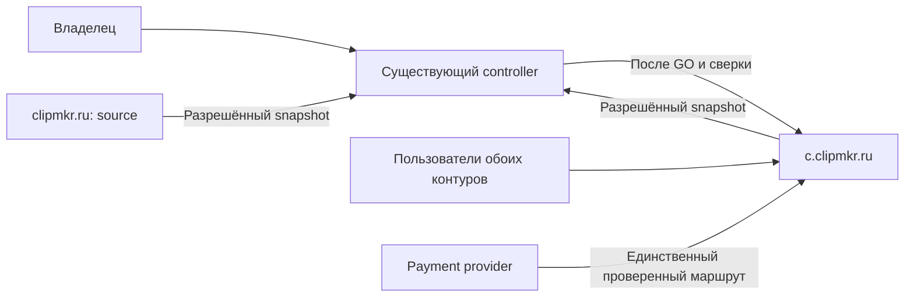
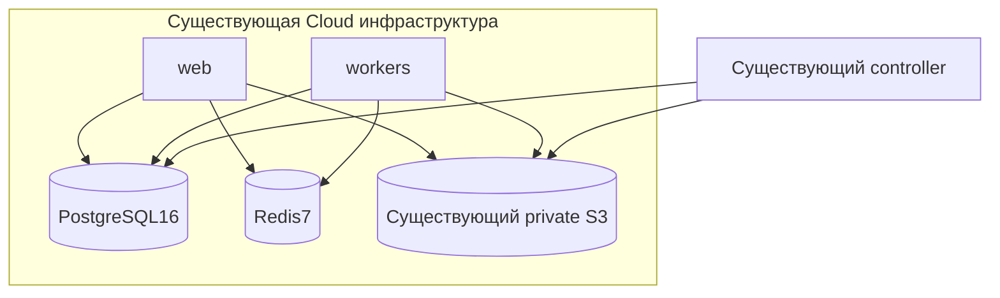
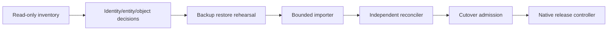
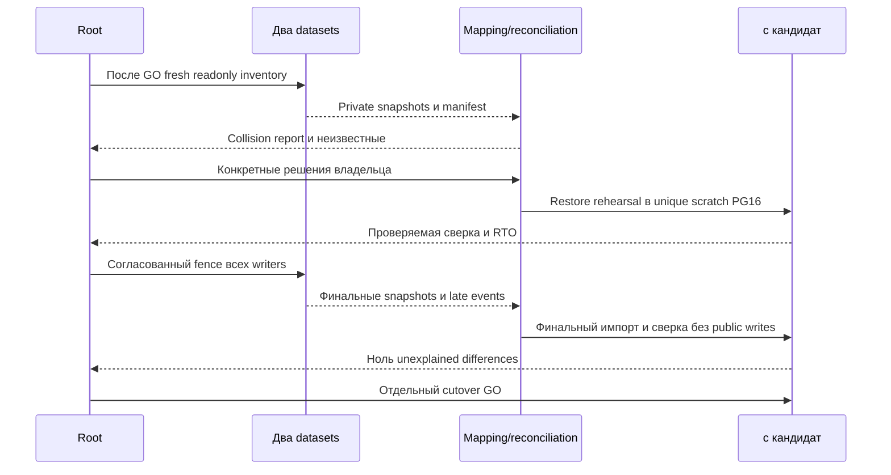

# Архитектура консолидации

Статус: proposed; исполнение и final plan checkpoint не разрешены этим scaffold.

## C4 Context
Controller, источник clipmkr.ru и Cloud c — три разные роли, значения адресов остаются в задании/приватном registry. UI/recovery/E2E и ручная приёмка source предшествуют переносу. Main80cab4e — docs base; заданный source web9ec8231 не заменяет fresh accepted release manifest. Root-readonly probe 19:30 UTC подтверждает Cloud app revision877ec806 и доступ; root B1/B2–B5 затем установили binding/schema descriptors и текущие агрегаты, не консистентный migration baseline (см.live-observations.md). Ни один прошлый SSH/restore receipt не принимается за свежий probe.

Границы доверия: каждый SSH target подтверждается host/container/DB/volume fingerprint; controller private evidence отделён от Git. Public email/URL не proof личности. Provider response и authenticated account — отдельные источники истины.

## C4 Container

Без новых контейнеров, Redis или MinIO. В существующем PG16 после отдельного GO предлагаются уникальные scratch/candidate databases при доказанной capacity. Не использовать n5_test и не восстанавливать поверх c. Никакие данные другого проекта не попадают в migration allowlist.

## C4 Component

Existing manifests, target bindings, disk guards, immutable artifacts и receipts переиспользуются. Importer/reconciler — обязанности будущих узких модулей, не подтверждённые exports. У `release-candidate.mjs` есть legacy empty-Cloud и schema-transition ограничения: новый merger не обходит их фальшивым profile/admission. Независимый reconciler не должен повторять тот же ошибочный mapping алгоритм как единственный oracle.

## Последовательности

Ошибка: conflict/unknown writer/missing object/checksum mismatch/stale manifest → STOP до switch, target before-image сохраняется. Crash import → продолжение только того же run binding/идемпотентных записей, затем повтор полной сверки; неполный импорт не получает ready.
Async: pending upload/job/payment имеет отдельный disposition и durable receipt. Воркеры, watchdog, retention, webhook и операторы входят в fence; отсутствие active jobs само по себе не доказывает отсутствие writers. Поздний webhook сохраняется для одного авторитетного replay, не теряется при паузе. Детальная реализация durable admission остаётся задачей после inventory.
Rollback: до новых writes вернуть предыдущий binding после проверки late-event backlog. После new-write marker — запрет слепого restore; новый snapshot, reconciliation acknowledged writes и forward recovery. Новые accounts/videos/payments/deletions нельзя потерять ради возврата image SHA.

## Данные и хранение
Все source/target строки входят в inventory или явно доказанное законное отсутствие; любые неизвестные таблицы требуют решения. Identity mapping контролирует FK/semantic references, source_key/quotas/UUID в JSON и provider order IDs. Constraints/triggers не отключаются глобально ради импорта. Candidate schema выводится из обоих journals с неизменными историческими hashes; drift блокирует migrator.
Target objects неизменны; source copied objects получают разрешённые logical keys с проверкой каждого checksum. Существующий prefix и private auth сохраняются. Retention/delete tombstones согласованы; versioning не включается. Срок хранения backup/candidate/source и budget фиксируются владельцем по фактическому объёму.

## API
Новый публичный API этим пакетом не вводится. Старые `/c/`, `/g/`, referral и provider callback paths требуют compatibility table по origin. `__Host-n5_session` привязан к origin, source cookie нельзя «перенести» на c; новый вход — ожидаемое действие. Сохранение target secret не означает право source tokens. При одинаковом link code на разных origin требуется отдельный adapter/alias contract, не безусловный redirect на code. Signed URLs регенерируются после проверки владельца; долгоживущие публичные ссылки сохраняют смысл.

## Observability
Runtime сейчас не меняется. Будущий INFO journal: run/release/snapshot digest, phase, counts импортировано/сверено/отложено; WARN: конфликт/unknown/drift, ERROR: отказ сверки/cutover. В logs нет email/password/token/raw URLs. Private row-level evidence хранится отдельно с ограниченным доступом.
Основные counters: unexplained row/object differences, duplicate financial effects, pending external events, active writers после fence. Внешний симптом ошибки: неверный владелец/недоступный клип/баланс/повторная оплата; root и владелец получают проверку сразу до допуска writes и после первого CJM. 24h и30d контроль, регулярный restore drill и проверка обоих maintenance путей после отдельного разрешения. Частота дальнейших проверок и ответственный за on-call уточняются до handover.
