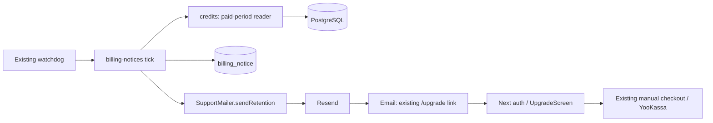

# Архитектура light — ручные напоминания

Proposed; ADR-001/FR-1..9. Ни code admission, ни runtime gate этим документом не объявлены.

## Компоненты

Email link делает GET и не запускает оплату; кнопка existing UI отдельно инициирует ручной checkout. API/body/routes остаются прежними; Yoo adapter добавляет только boolean save_payment_method:false.

## Paid-period reader
`packages/db/src/credits.ts`: payment grants с валидными entitlement_start/end, base **и addon**, без remaining_seconds filter. Legacy plan_source=payment/plan_paid_until у credits_v1 моделируется (-infinity,end): отдельного start в account нет. Trial/recovery не покупка.
Объединить sorted intervals при next.start<=end; выбрать компоненту start<=now<end. Её unclamped end — identity; disconnected future не продлевает текущий срок. Нет current component→NULL. Маленькая SQL projection running max/gap grouping, без изменения fulfillment/windows.
Eligibility: active,credits_v1,verified email,!owner_unlimited,не paid operator/none,manual checkout доступен,нет account payment refunded/needs_review. Suppression не меняет grants. Legacy_daily_v1 исключён: каталог может не разрешать покупку. Addon-only участвует, промежуточные expiry не спамят.

## Journal и протокол
Additive030 billing_notice: UUID id,account FK CASCADE,end timestamptz,offset1|3,state pending/sending/accepted/failed/unknown/superseded,payload JSONB/hash,unique provider_key,due_at,attempts0..3,first/last_attempt_at,lease_until,provider_receipt,last_error,created/updated_at. UNIQUE(account,end,offset); sending iff lease_until not null; first_attempt null iff attempts0. Индекс due_at,id для нетерминальных записей. Не мигрировать финансовую историю/старые receipts. Accepted/superseded tombstone сохраняется до erasure, чтобы email change не оживил event.
1. Flag=false/mailer.retentionSender=null/checkout unavailable → skip. Candidate batch100 (1..1000), актуальные eligibility+offset, INSERT ON CONFLICT DO NOTHING. Logical key без email: billing_SHA256(account|exact UTC end|offset).
2. Непосредственно перед каждым HTTP: короткий transaction блокирует account FOR NO KEY UPDATE, затем existing creditAccountLock, затем notice FOR UPDATE; перечитывает business facts, часы/offset/lease и state. Локальная очередь не является авторизацией отправки. Изменённые facts → superseded; до first attempt новый verified recipient заменяет payload; после первой попытки recipient change → superseded без нового event. Revalidate использует свежий clock после ожидания lock.
3. Claim атомарно ставит sending, attempts+1, lease2min и frozen payload/hash/first timestamp. Claims отправляют только pending/failed/unknown, max3, пауза1h, `0<=now-first<23h`, `now>=last_attempt`; при exhausted budget terminal superseded (последний known/unknown outcome сохранён как причина). Не отправлять при уже истёкшем окне. После commit сразу HTTP, без дальнейшей очереди/таймера; transaction на HTTP не держать.
4. Transport8s; result accepted/failed/unknown, exception=unknown. Completion CAS по id,state,attempt,last_attempt; чужой/запоздалый результат игнорируется. Expired lease→unknown, не новый key. Любое retry сохраняет все transport bytes и key. До3 попыток/23h; нет автоматического воскрешения после суток.
Граница: изменения, committed до финальной claim-транзакции, учитываются; после её commit отправка считается начатой, а конкурентная покупка/erasure может завершиться до HTTP receipt. Общая транзакция с provider отсутствует; already accepted mail не отозвать. Допущение: часы не расходятся с provider на1h; явный backward clock подавляет retry. Accepted — принятие, не inbox delivery.

## Письмо и конфигурация
Subject3: «Оплаченный период скоро закончится»; subject1: «Оплаченный период закончится в течение суток». Body: «Ваш оплаченный период действует до {дата/время МСК}. Автоматических списаний нет. Следующий пакет можно купить самостоятельно. Остатки каждого пакета действуют до его срока; бессрочные кредиты сохраняются. Актуальные условия и даты — в кабинете». Text/HTML равнозначны/escaped; CTA «Купить следующий пакет»→publicOrigin+/upgrade. Без устаревших цен/обещания удалить клипы.
Единственный optional web flag N5_BILLING_REMINDERS_ENABLED=false: shared config/environment allowlists/queue-runtime и neighboring tests. No required worker mail env. Mail catch не ломает startup/health/checkout/media; default-off до приёмки.

## Observability
Info: агрегированный tick result generated/accepted; warn: unavailable/unknown/budget-exhausted/superseded с finite reason codes. Никогда email,payload,key,provider response или auth headers. Counts accepted/unknown+exhausted из journal: «письма принимаются или теряются?». Симптом — нет письма; maintainer сверяет закрытый receipt/aggregate. Новый metrics service не нужен. Accepted≠delivered.

## Проверяемость и поставка
AC-A..C из01: real PG+HTTP+Next/auth/browser, barriers/clock/negative+positive controls. Source-handler pin только при изменении handler. Legal87/map/§10.2 отдельный gate. Rollback=flag off, additive journal сохраняется, data restore не нужен.06 только после QCSD.

Reuse E2E: tests/browser/per-account-test-checkout-next.test.ts, repeat-registration-next.test.ts и tests/fixtures/payment-test-transport.mjs (сообщено координатором). Расширять test-only transport на mail socket лишь с NODE_ENV=test/loopback guards; новый product test endpoint запрещён. Existing QA PG/Redis namespaces подготовлены координатором,секреты здесь не читаются. S3 не используется и не считается проверенным.
