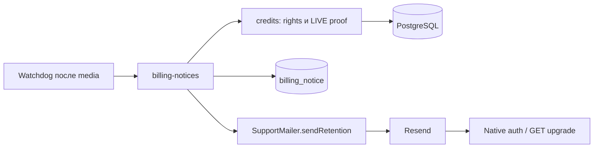

# Архитектура light r2

Proposed; ADR-001/FR-1..9. Requirements/ADR и fresh QCSD нормативного контракта идут параллельно завершению payment-environments. 06 — после QCSD; код/031 — только после merge final accepted030 source, фактического recheck/pins и K1/K2. Поставка feature2 предшествует поставке feature3. Gates пока не выполнены.

## Компоненты

Тик/ссылка не вызывают checkout. Возможен только отсутствующий save_payment_method:false в existing adapter, без API/receipt/grant изменений.

## Права и отправка
Reader рядом с credits.ts объединяет payment grants с валидными start/end: base/addon, любой TEST/unknown provenance и remaining0. Sorted intervals объединяются при next.start<=end; выбирается компонента start<=now<end. Tail unclamped; disconnected future/trial/recovery/bonus не добавляют срок.
Legacy payment plan_paid_until у credits_v1 сохраняет фактическое право до end, но start в account неизвестен: без доказанной связи legacy окна с payment identity suppress send, не уменьшать права. Не изобретать LIVE/start из текущего config/даты.
LIVE proof отдельно от union: shared `verifiedLivePaymentSql(pAlias,iAlias)` из `packages/db/src/payment-provenance.ts`. Ниже нормативный контракт для QCSD; sibling candidate прочитан, но final accepted source/pins пока pending. Обе строки payment_environment=live, matching nonnull payment_merchant_id; p.provider=i.payment_provider=yookassa; exact intent/account/provider_payment_id/amount, p succeeded/nonreview, i succeeded/fulfilled. Helper без creditSKU filter; report ограничения не копируются. Достаточно proof одного интервала компоненты, включая смежный future LIVE; чистоTEST/unknown→no send, LIVE+TEST-tail→полный end. Поля/helper/source SHA повторно проверить после merge final accepted030; при влияющем на QCSD расхождении проверить затронутую дельту независимо до кода.
Eligibility: active,credits_v1,verified email,!owner_unlimited,не paid operator/none,checkout доступен. Недоказанный участвующий legacy/legacy_daily_v1→skip. Refund/review лишает соответствующий payment LIVE proof; спорный payment у ещё действующего/future интервала компоненты либо неполный LIVE proof временно suppresses dispatch до сверки, сохраняя возможность повторной проверки того же нетерминального event. Ни отсутствие proof, ни сам defer не дают права на HTTP; после сверки нужны полный verified LIVE proof и все остальные условия. Старый истёкший/несвязанный refund не блокирует account. Grants эта фича не меняет.

## Journal и транзакции
031 additive billing_notice: UUID id, account FK CASCADE, authoritative_paid_end,offset1|3,state pending/sending/accepted/failed/unknown/superseded,payload/hash,unique provider_key,due_at,attempts0..3,first/last_attempt_at,lease_until,provider_receipt,last_error,created/updated_at. UNIQUE(account,end,offset); sending iff lease exists; first_attempt NULL iff attempts0; partial due index. Terminal tombstones до erasure; старые migrations не меняются.
1. Disabled/missing sender/checkout unavailable→skip. Discovery≤100; INSERT ON CONFLICT DO NOTHING; это DB batch, не send batch. Key=billing_SHA256(account|exact UTC end|offset), без email. Native per-pool cursor как recoveryCursor не даёт busy кандидату держать всю очередь.
2. Непосредственно перед HTTP: native transaction с LOCAL lock_timeout100ms/statement_timeout1s; account FOR NO KEY UPDATE→creditAccountLock→notice FOR UPDATE. Success/refund/email уже берут account lock; provenance backfill должен сохранить этот порядок. Не брать payment-advisory/notice→account. Busy/SQL timeout→rollback/defer, без attempt; остановить текущую волну при DB outage. После locks перечитать business facts и fresh clock. Изменённый tail/offset, отсутствие current interval, истёкшее окно либо недопустимый status/recipient→superseded. До first attempt обновить verified recipient можно; после неё изменение адреса→superseded без нового event. При остальных действующих условиях relevant refund/review/неполный LIVE proof→defer без HTTP/нового attempt/key: сохранить существующий pending/failed/unknown, payload/hash/key, attempts и first/last_attempt_at. Новое состояние не вводится; terminal accepted/superseded не открываются, sending ждёт lease recovery из п.4. Следующий подход использует тот же event и полную проверку под теми же locks. Снятие неопределённости разрешает claim только при том же end/offset и ещё действующем окне; лимиты из п.3 остаются обязательными. Erasure удаляет journal по CASCADE.
3. Claim атомарно ставит sending,attempts+1,lease2min и frozen bytes/hash/first timestamp. Только pending/failed/unknown, attempts<3 и полная eligibility, включая восстановленный LIVE proof без relevant refund/review. Для attempts>0 обязательны пауза1h,0<=now-first<23h,now>=last_attempt; defer не сбрасывает timestamps/attempts и не размораживает payload/key. Для attempts0 первые timestamps/bytes фиксируются при первом claim. Exhausted→superseded с reason; backward clock→no send. После commit сразу HTTP; claimed event не ставить в другую очередь.
4. Transport8s; exception/потеря ответа→unknown. Completion CAS(id,state,attempt,last_attempt), stale result игнорировать. DB completion failure оставляет lease для recovery; expired lease→unknown. Повтор только с теми же bytes/key; не создавать новый key после23h. Network внеTX.
Commit claim — dispatch authorization: изменения до него учтены, после него покупка/refund/email/erasure могут опередить receipt. Already accepted письмо не отозвать атомарно; durable accepted не равно inbox delivery.

## Нагрузка и часы
Billing после media/cleanup; old retention-mail algorithm вне scope. Existing single-flight watchdog60s. ≤4HTTP/tick,≤2concurrent (две волны, не generic pool); shared mailer cap4. Monotonic admission budget20s, отдельно от business Date; проверить до claim и после locks до commit. Budget/busy не расходует attempt и не freezes unsent payload. In-flight bounded8s sends дождаться, без fire-and-forget.
20s ограничивает admission, не весь watchdog. Native connect3s, LOCAL statement1s/lock100ms; при DB timeout прекратить новые claims. Healthy PG+8s mail fixture: две волны≈16s, media уже выполнена; следующий тик продолжает backlog. Cursor/progress проверяются positive control.
Retry использует fresh wall clock, now<first/last→no send; monotonic budget истекает и при rollback wall time.23h запас относительно24h Resend предполагает корректные часы, не гарантирует exactly-once при произвольном дрейфе.

## Контент и wiring
Subject3 «Период доступа по пакетам скоро закончится»; subject1 «Период доступа по пакетам закончится в течение суток». Body: «Текущий непрерывный период доступа по пакетам закончится {дата/время МСК}. Автоматических списаний нет. Следующий пакет можно купить самостоятельно. Остатки каждого пакета действуют до его срока; бессрочные кредиты сохраняются. Актуальные условия и даты — в кабинете». Text/HTML escaped; CTA «Купить следующий пакет»→publicOrigin+/upgrade. Без цен из старого письма/обещания удалить клипы.
Optional N5_BILLING_REMINDERS_ENABLED=false: config/environment/queue-runtime и sibling allowlists; mail failure локально caught, startup/health/checkout и worker env не зависят от новой почты. Оферта/даты/notice не target.

## Observability
Info: aggregate generated/attempted/accepted/deferred/backlog; warn:finite unknown/exhausted/unavailable reasons. Без email,payload,key,raw provider response/auth. Accepted≠delivered. Симптом — нет письма; maintainer сверяет journal/закрытый receipt без нового metrics service.

## Проверка и поставка
AC-A..C в01: real PG barriers, clock/CAS, relevant refunds/LIVE controls, slow mail/budget/cursor. Планируемый сквозной тест до first attempt и после unknown: review/неполный proof→0HTTP/attempt delta0, тот же pending/failed/unknown→cleared same end/offset/window→одна отправка same event/key; проверить frozen payload/recipient, неизменный retry budget и запрет resume при expired/exhausted/email-change. Capture текста двух пакетов с разными ends подтверждает общий период без продления индивидуальных сроков. Эти проверки пока NOT RUN. Reuse actual Next per-account-test-checkout-next/repeat-registration-next и payment-test-transport.mjs; mail loopback override только test child/NODE_ENV=test, не product endpoint. Native auth→mail socket→upgrade GET:0paymentPOST/intents; S3 не используется. Owned QA DB/Redis14 root, secrets не читать. Rollback flag off,031 остаётся. Независимая ветка: нормативные requirements/ADR→fresh QCSD→06. Зависимая ветка перед кодом: final accepted030 source merge→фактический recheck proof/locks/false/migrations→final pins и K1/K2→source/031. Candidate не закрывает эту ветку. Поставка2→поставка3; source recheck не объявляет поставку выполненной.
