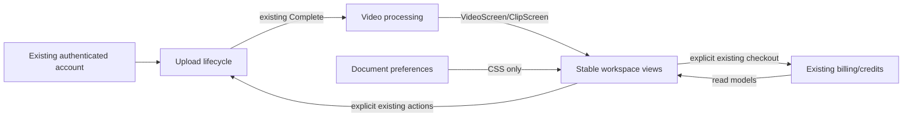

# Доменная модель представления

Статус: draft execution model; новые backend aggregates/DB/API не вводятся.

## Bounded context map
Upload recovery остаётся владельцем TransferAttempt и v2 resume manifest. Existing video/clip processing владеет VideoScreen/ClipScreen/version. Existing billing владеет credit balance/purchaseWindows/SKU/idempotency. Workspace preferences — document-scoped view values, не права аккаунта. Новый код только представляет эти существующие контексты.

## Ubiquitous language
| Термин | Значение | Не означает |
|---|---|---|
| Подтверждено байтов | Сумма уникальных частей с ETag из server receipt/PUT | Отправлено в TCP или готовый processing job |
| Последнее наблюдение | Подтверждение текущей вкладки до pause | Durable истина после reload |
| Unknown progress | Число ещё не подтверждено | Ноль/потерянные данные |
| Выбранный клип | clip_id текущего UI выбора | GuestPreselect или новый render job |
| Published version | Версия реально доступного media | theme/layout или индекс массива |
| Компоновка | Cabinet/Montage presentation | Новый project/account/session |
| Баланс | server available_seconds/60 | Суточная quota или лимит90/120мин |

## Aggregates / Entities / VOs
Existing TransferAttempt: scope+generation+AbortController; protected File, key, server videoId/partSize, immutable options, full Complete manifest. Presentation VO TransferProgress={kind,confirmedBytes?,totalBytes?}, ephemeral, не сохраняется вv2.
Existing VideoDetail: videoId + poll/current clips. Presentation VO selectedClipId; derived current available/expired state. ClipCard сохраняет DOM/fileVersion и собственные download/copy/music feedback. Один owner selectedClipId, ни global store, ни new database entity.
Existing UpgradeScreen: per-SKU keys, busy/error, actual current plan/windows. Presentation variations не создают новых payment identities.

## Relationships

## Codebase mapping
Uploader/upload-parts/upload-resume → TransferAttempt/progress observation; VideoDetail/ClipCard/GuestPacks → media selection/actions; LimitsPanel/remainingLimits/readCreditBalance → authenticated summary; UpgradeScreen/shared tariff → packages; workspace-layout/WorkspaceSettings → existing preferences. No migration, new provider, new business enum or changed account boundary.

## Invariants
Progress cannot authorize Complete. Layout cannot create key/session/payment or change selectedClip. Poll cannot reset selection or replay guest nonce. Preferences cannot authenticate/upgrade. All fallback unknown states are labelled and preserve existing recovery/error action.
