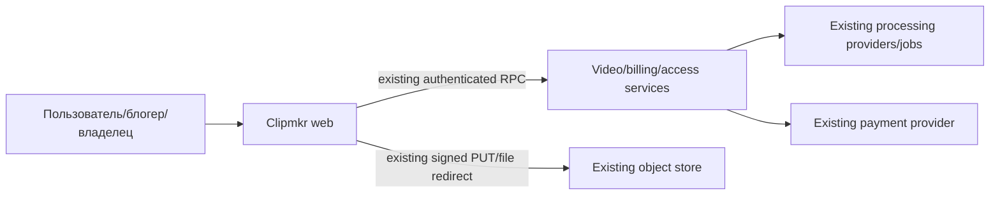
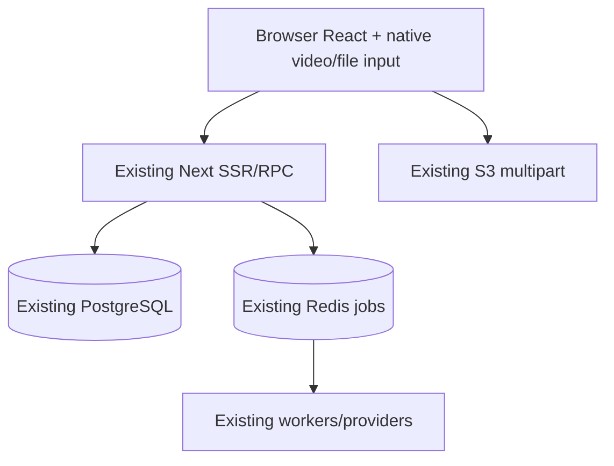
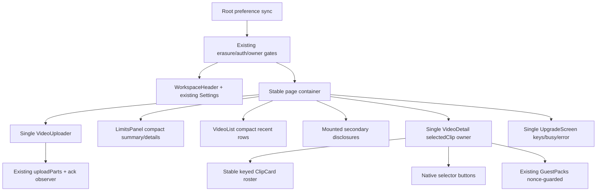

# Архитектура исполнения согласованного макета

Статус: draft для actual QCSD/native snapshot; existing approval относится к макетам, не к автоматическому PASS этого документа. Inputs:01_requirements,02_research,03_adr/001–004,04_domain_model.

## C4 Context

Тема/компоновка/selectedClip/progress observer принадлежат browser trust boundary. Auth, ownership, SKU/credit policy и jobs authority остаются server-side.

## C4 Containers

Новых контейнеров, API/таблиц и migrations нет. Existing app-only deployment сохраняет все stateful services/data.

## C4 Components and stable tree

CSS меняет grid и visibility presentation; ancestor/type/key активных state owners не зависят отlayout/theme. Cabinet выбранная card + list; Montage тот же roster в gallery + intro. Selection changes pause prior player; layout changes не вызывают pause/play. Native file dialog использует прежний mounted input; visible trigger ref принимает recovery focus при hidden input.

## Data flow and storage
Request-scoped authenticated summary reuse: existing remainingLimits для dashboard/detail; один React.cache wrapper исключает дублирование header/page reads, account является аргументом, cache не persistent. Upgrade получает credit summary только через existing authenticated readCreditBalance, без нового SQL/API, read-count/error behavior проверяется отдельно. Server-only module не импортируется клиентом. Header presentation принимает snapshot; нет document-wide mutable account/balance store.
U resume v2, account_scope create precondition, ContentSHA256, key/options/full parts сохраняются. Progress — ephemeral observed metadata, partial parts не попадают вpersisted full manifest. Preferences используют нынешние cookie/store/meta sync без новой схемы. Selected clip не persisted server-side.

## Happy/async upload flow
```mermaid
sequenceDiagram
 actor U as User
 participant UI as Existing Uploader
 participant T as Existing uploadParts
 participant S as Existing server/S3
 U->>UI: Native picker/reselect
 UI->>UI: full SHA256; ready; no network
 U->>UI: Separate Create/Continue
 UI->>S: existing same-key create/account_scope
 S-->>UI: receipt/completed parts
 UI->>T: existing File, signal, refresh, ack observer
 T->>S: PUT missing part
 S-->>T: 2xx+ETag
 T-->>UI: fenced unique acknowledged bytes
 T-->>UI: full ordered parts
 UI->>UI: durable full manifest
 UI->>S: existing Complete once
 S-->>UI: actual acceptance/result
 UI->>UI: owned detail navigation
```

## Main error/pause flow
Pause invalidates generation/aborts like baseline, clears File/native input, retains lastObserved label. Late callbacks no-op. Hard reload incomplete manifest→unknown progress; reselect only hashes, separate Continue reconciles server parts. Storage refusal blocks next mutation, Complete unknown warns server may already process. Нет timeout-generated percent or early processing screen.

## Media/preferences and checkout sequence
Selected ID changes only explicit selection or removal of current ID; polling arrays do not reset it. Theme/layout updates document attributes only, no RSC/RPC. In controlled test, same playing second clip survives toggle and two ticks with strictly increasing time; guest focus/scroll stays stable. Busy checkout сохраняет exact SKU key/request/error through toggles; один delayed request, explicit rejection/retry.

## Presentation/access boundaries
All additional options/guest/owner/blogger actions remain reachable through named native disclosures/links; child forms remain mounted. Purchase conditions/errors, upload warnings and relevant availability remain visible with action. Public /,/c/,/g/,/upgrade/return retain previous scope/CSP/data. Erasure/auth/foreign404 and owner controls checked independently, never selected by CSS or browser cookie.

## Observability
Новых production logs/PII событий нет. Existing request/jobs/credit logs остаются источником server proof. Browser evidence считает attributed create/PUT/Complete/checkout and selected player identity; symptoms — wrong layout/empty balance/frozen progress/reset player/duplicate mutation. User sees accurate status/error; root/independent QE notice via paired screenshots and named assertions. No fake analytics count for success.

## Verification boundary
144 base paired cases + explicit flow/role/mobile states and breakpoint checks; clipmkr.ru actual Next/source-image identity required before acceptance. Geometry finds legacy layout; paired review judges composition; functional regression checks real actions. Local fake transport cannot prove S3/provider/payments; full existing business CJM remains separate acceptance evidence. Root controls native snapshots/K1/K2 and independent QCSD; no code before gates.


## QCSD clarification: real boundary and delivery oracles
QC-QUOTA из01 применяется к существующему server policy без новых APIs/schema: реальный ordinary5400s→готовый clip и5401s→duration reject; blogger default7200s→готовый clip; owner-set9000s→accept и9001s→reject, clear override→7200s. Private evidence хранит ffprobe/server duration, account/role/effective cap, достаточный credits/day allowance, request/job outcomes и source/image/origin. Owner assignment и unprivileged ordinary/blogger attempts используют разные browser contexts; запрещённая role/limit mutation не меняет persisted/effective cap, upload hints не повышают его. Labels/mock/provider-short-baseline не закрывают этот gate. Для каждого случая отдельные PASS/FAIL/BLOCKED/UNEXECUTED; full featureGO не выдаётся при пробеле обязательного core-cjm.
Реальные content variants и exact computed palette checks QC-CONTENT/QC-PALETTE выполняются на прежних components, с wrap/gallery row continuation и negative controls; новых продуктовых состояний/палитр не вводится. Target QC-ORIGIN: clipmkr.ru194.85.249.105/n5-clipmaker; read-only revalidation непосредственно перед разрешённым app-only update, E2E, manual acceptance, затем Cloud.77.83.87.178 остаётся dev. Existing data/config/volumes сохраняются, DNS/production отдельно не переключаются.
