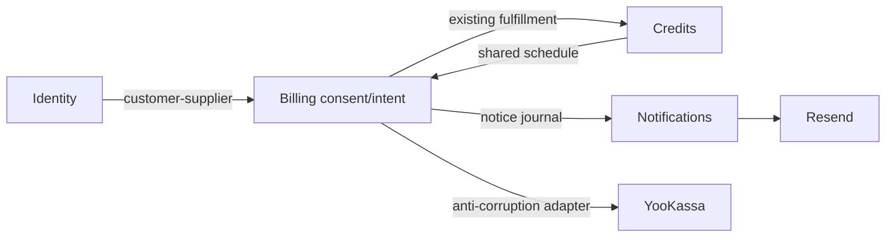

# Доменная модель

Proposed, AR-20261111-1. Расширяется existing Billing; новые bounded contexts не нужны.

## Язык

Согласие — разрешение на конкретные SKU/цену/кредиты/30d/revision, не факт сохранённой карты. T — конец committed base-очереди, не addon/нулевой баланс. Attempt — один intent(account,T), не каждый HTTP. Dispatch — committed разрешение вызова, не доказательство списания. Accepted notice — receipt Resend, не доставка. Paused — нет новых auto до нового согласия. Unknown/review — исход неизвестен, не отказ.

## Aggregates / entities / VO

**Account**: existing root сериализации active/erasing/policy/verified email. Write-lock order: account → consent → intent либо notice → native credit lock/grant. Existing payment-event advisory может предшествовать account; новые пути не берут тот же advisory после account.

**billing_consent** (новая таблица): id/account/source_intent UNIQUE; immutable terms `{SKU,price_minor,RUB,grant_seconds,cadence_days=30,offer_revision,consent_revision,text_sha256,agreed_at,merchant_shop_id,test_mode}`. Mutable state/timestamps/reason и bounded opaque provider_method_id/type только backend. Partial UNIQUE account WHERE state IN(pending,active).

Transitions: absent→pending при verified opt-in; pending→active только canonical succeeded+saved+fulfillment; pending→paused при canceled/saved=false; pending/active→revoked при cancel; pending/active→superseded при новом opt-in; active→paused при failure/notice/offer drift/missed window. Paused/revoked/superseded не возвращаются в active; нужна новая запись. Initial consent указывает source intent; initial intent не ссылается обратно на consent, циклического FK нет.

**payment_intent** existing: nullable extension kind/manual|renewal, method_snapshot, consent_id (только renewal), renewal_boundary, renewal_state, dispatch_at/lease_until/attempt_no/last_attempt_at/next_attempt_at. UNIQUE(account,T) WHERE renewal независимо от SKU/consent. Initial method VO: merchant/test, save boolean, immutable return_url; renewal: merchant/test/method_id без redirect. Existing receipt/offer/price/grant/referral snapshots сохраняются. CHECK/trigger фиксируют terms/request, mutable result/lease — CAS.

Renewal: dispatching→unknown при потере ответа; dispatching/unknown→pending|action_required после ID; nonterminal→succeeded по verified success или failed по verified canceled; unknown→review при cutoff/revoke/namespace drift. До dispatch пропущенный цикл — pause reason, financial intent не нужен. Success после cancel выдаёт пакет, не consent. State created/succeeded/canceled основного intent остаётся совместимым.

**billing_notice** (вторая новая таблица): identity(account,T,kind,offset,consent revision,recipient generation), NULLS NOT DISTINCT либо эквивалентный index. kind=precharge/manual_reminder/renewal_failed/renewal_paused. Recipient generation — email+email_verified_at. Frozen после first attempt: payload/hash/provider_key. Mutable state pending/sending/accepted/failed/unknown/superseded/suppressed, due_at, attempts, first/last_attempt, lease, provider_receipt, accepted_at. Snapshot email — PII.

Existing Payment/PaymentEvent/CreditGrant/Attribution остаются financial truth. Два отдельных успешных base intent дают последовательные периоды; duplicate одного факта не даёт новый grant. Общий schedule projection возвращает `paid_base_tail` без clamp к now и `purchase_start=max(now,tail)`. T=tail; использовать `nextCreditBaseStart(now)` после T как новую identity нельзя. Tail NULL означает отсутствие цикла; addon исключён.

## Отношения и mapping

Existing `db/payments.ts`, `credits.ts`, provider adapter и watchdog; новые small `db/billing-consent.ts`, `db/renewals.ts`, `server/billing-notices.ts`, `renewal-tick.ts`, `renewal-handler.ts` — proposed до K1. Одна additive миграция после029: две таблицы и extension. Индексы current consent, notice(state,due_at), renewal(boundary,state); legacy consent/token backfill запрещён.

Logical events ConsentRecorded/Activated/Revoked, NoticeAccepted, RenewalDispatched/Unknown/Failed/Succeeded — PG transitions/logs, без event bus. Token только functional consent/request snapshot, не audit/public view. Cancel исключает его из новых POST, immutable dispatched snapshot сохраняется для reconciliation. Existing erase удаляет notice/consent/token-bearing intents в FK-порядке; financial retention остаётся existing. Аккаунт erasing не может активироваться/получить grant. Точные DDL — после QCSD в плане.
