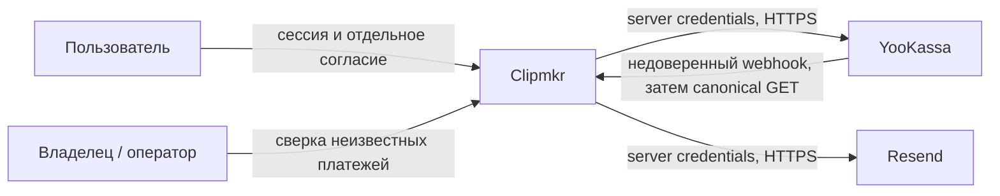
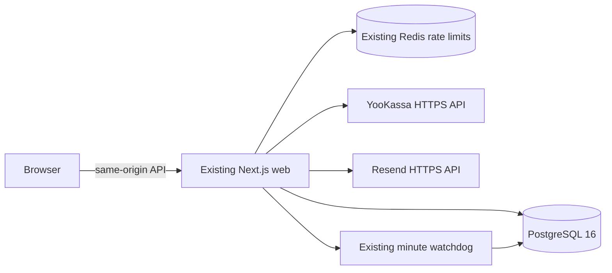
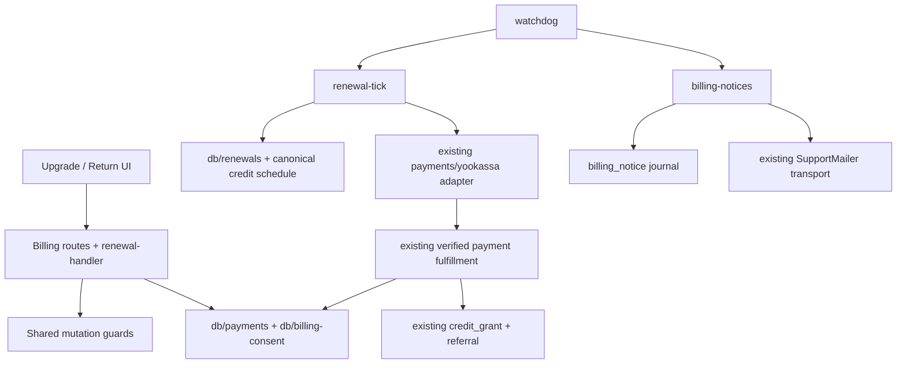
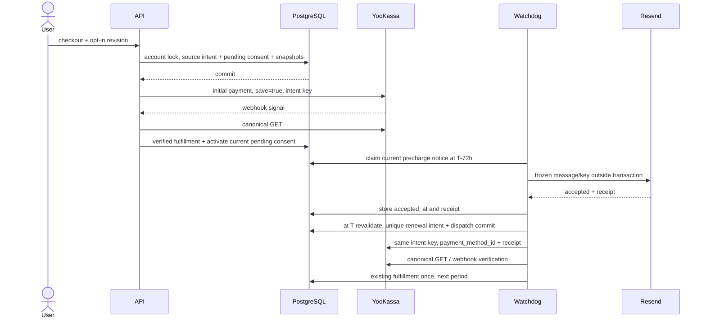

# Архитектура добровольного продления

Статус: proposed, AR-20261111-2. Макет утверждён по owner-authority; незакрытые QCSD conditions и K1/K2 пока запрещают coding. ADR-001..003 — авторитетные решения; OpenSpec хранит requirement delta. Ordinary live checkout существующего артефакта включён отдельно, покупка владельцем не проверена; recurring default off.

## C4 Context



## C4 Container



Новых services/queues нет. Browser/webhook недоверенные; adapter проверяет merchant/test/amount/order, saved method только из canonical GET. Redis не financial truth; watchdog — existing функция web.

## C4 Component и targets



Proposed до K1: `server/renewal-handler.ts`, `renewal-tick.ts`, `billing-notices.ts`; `db/billing-consent.ts`, `renewals.ts`. Existing handler/deps/runtime/config/watchdog — wiring, shared guards без monolith. Один credit projection возвращает unclamped paid_base_tail=T и purchase_start=max(now,tail); tail NULL — цикла нет, addon исключён. Existing Resend transport переиспользуется через совместимое нейтральное имя, fetch не копируется.

## Sequence: согласие и успешное продление



## Sequence: потерянный ответ и отключение

```mermaid
sequenceDiagram
 participant W as Worker
 participant P as PostgreSQL
 participant Y as YooKassa
 actor U as User
 W->>P: dispatch authorized, commit
 W->>Y: POST intent key
 Y--xW: response lost / process crash
 U->>P: revoke consent, commit
 W->>P: restart, lease expired → unknown
 Note over W,P: consent revoked: no further POST, no second key
 W->>Y: GET only if provider ID known
 Y-->>W: verified late success
 W->>P: grant once; consent stays revoked
```

Обратная очередность cancel commit до dispatch commit даёт 0 payment POST. SQL-lock на YooKassa/Resend не удерживается. Cancel не обещает удалённую отмену: уже разрешённая попытка может завершиться после ответа UI. Network timeout не доказывает отказ. Вызов known-ID GET никогда не создаёт новый платёж; without-ID после cutoff/revoke требуется операторская сверка.

## Data & storage

Две новые таблицы consent/notice и existing payment_intent extension — `04_domain_model.md`. Initial consent→source_intent; обратный consent_id только у renewal, циклического FK нет. Один SQL commit; CHECK/trigger запрещают смену snapshot и обходы NULL/JSON null/extra fields.

Write-lock: account FOR NO KEY UPDATE → consent → intent/notice → native credit lock/grant. Existing payment-event/advisory порядок не инвертировать. Candidate scan без lock; claim всё перечитывает, multiworker safety в PG. Result CAS содержит attempt+lease token; stale result не меняет terminal state, canonical success проходит existing fulfillment.

T — unclamped committed base tail; account lock сериализует manual fulfillment, refund, erasure и dispatch. Refund-first (любой verified полный/partial base refund, native needs_review) паузит pending/active consent и suppress precharge/manual notices; auto/opt-in запрещены до операторского review-resolution. Grants/T не удаляются и не масштабируются автоматически; после решения перечитываются. Manual работает по existing политике. Dispatch-first допускает одну ранее разрешённую попытку; late result идёт в native ledger, consent не оживает. Новый auto только через новое согласие. Это инженерный fail-closed default, не правовой вывод о возврате.

Erasing-first запрещает новый dispatch и любое retry-решение. Dispatch-first не отменяет in-flight; erasure не ждёт HTTP. После erasing/deletion late payment — native financial review без grant/activation/новых token или PII; recovery не восстанавливает удалённые строки.

Canonical confirmed canceled renewal в общей terminal transaction сохраняет failed, pause связанного current consent и unique failure notice(intent_id,kind). Все GET/webhook terminal observers используют её; ошибка INSERT откатывает transition. Crash после commit оставляет outbox для existing tick, повтор observation дедуплицируется. Unknown/pending не создают failure notice. No sender — запись ждёт, transport attempts не расходуются; восстановление запускает bounded same-key send. После лимита retry UI+оператор, доставки не обещаем.

Mail identity/recipient переходы — ADR-003/DDD. Manual reminder UNIQUE(account,T,offset); смена email только до first dispatch обновляет ту же запись. После accepted — без resend; sending/unknown→suppressed при смене email, без нового key. In-flight result сохраняет receipt с fencing, но не возвращает suppressed в отправляемое состояние. Два claims сериализуются account+notice lock; смена T создаёт другое событие. Failure notice сообщает факт прошлой попытки и переживает cancel/manual purchase; каждый send всё равно требует active/verified recipient.

## API design

`POST /api/checkout`: прежнее `{idempotency_key,sku}` допускается. Для opt-in добавляется только `{autorenew:{enabled:true,consent_revision}}`; explicit false либо отсутствие означает обычную покупку. Сервер берёт current terms/price/merchant/email, сравнивает revision; неизвестные поля/token/price/account отвергаются. Повтор сравнивает canonical consent selection и revision; сменить галочку под уже отправленным ключом нельзя. UI после attempted checkout фиксирует этот выбор до known terminal/reconciliation; не выдаёт новый key на timeout. New checkout c новым согласием supersedes старое; failure не восстанавливает его скрыто.

`GET /api/billing/autorenew`: own state off|pending|active|paused, SKU/price/cadence, next_charge_at, current_paid_until, reason, optional in-flight intent id; без token/receipt/email/snapshot. `POST /api/billing/autorenew/cancel` с пустым закрытым телом: same-origin/session/rate, idempotent 200 `{state:'off',in_flight:boolean}`. Pending также отменяется; cancel доступен при feature off и неподтверждённом email. Идентификатор account не принимается из тела.

Status/return existing intent остаются каноническими. Provider требует confirmation — action_required с нормализованным HTTPS URL через existing own-intent continuation; никаких redirect из webhook body. Invalid extra auth requirement, waiting_for_capture вне текущего capture=true контракта или pending старше 24h переводятся в review/paused и GET-only, не объявляются failed без terminal provider status. Unknown result запрещает новый base checkout, UI предлагает проверить существующую оплату; existing bound manual продолжение и addon сохраняются.

## Configuration и безопасность

Один proposed `N5_AUTORENEW_ENABLED` (false по умолчанию; invalid значение ошибка соответствующего config): отличается для сред и включается операционно после merchant confirmation. Трасса `environment.ts → shared/config.ts → runtime → billing deps + watchdog` проверяется seam-тестом. Никакой связи flag с отключением existing manual checkout/webhook/health. Mail unavailable блокирует charge и объясняет pause, но не обычную продажу.

Решение каждого нового dispatch/retry под account FOR NO KEY UPDATE требует status=active и отсутствие unresolved base refund review. Erasing/missing account запрещает POST; предыдущий authorized in-flight может завершиться. Перед новым/повторным POST сверяются merchant/test scope, enable flag, consent validity, immutable request и `0≤now−created_at<23h`; после async work cutoff перепроверяется непосредственно перед fetch. Допущение внешнего окна: ошибка clocks+process pause+remote delivery <1h; при известном нарушении времени автоматика STOP. Bound GET остаётся доступен без cutoff, но только в том же merchant namespace. Token/PII никогда не выбираются public API; логи — только bounded reason, internal intent/consent IDs. Выключение не превращает исходный request body и не теряет уже состоявшийся платёж.

## Observability

INFO: consent/renewal/notice transitions; WARN: pause, unknown, cutoff/refund review, merchant mismatch; ERROR: очищенный wiring/DB/transport reason. Только internal IDs/bounded state, без token/email/body. Existing logs/SQL считают due-unresolved renewal, due-unaccepted notice, failed/suppressed notices. Новая monitoring платформа не нужна.

Пользователь видит pending/paused/«проверяем» и фактический исход; failure mail следует durable policy ADR-003, accepted не означает delivery. Оператор видит review/backlog в штатных logs/read-only SQL. Перед live recurring назначаются ответственный и порядок order_id сверки; операция ещё не выполнена.

## Дискриминирующие оракулы для QCSD и будущего плана

Все ниже **NOT RUN**: это критерии, не отчёт о прохождении. База — изолированный PostgreSQL16 `*_test`, отдельная schema; payment/mail socket только localhost, synthetic addresses. Новые test names предложены, не объявлены существующими. Команда будущего набора: `npm test -- tests/autorenew.integration.test.ts tests/autorenew-consent.integration.test.ts tests/autorenew-provider.test.ts tests/billing-notices.integration.test.ts`; selector уже собирает `tests/**/*.test.ts`, browser отдельно штатным Playwright runner.

| ID / связь | Риск / сценарий и наблюдаемый оракул | Что должно сделать тест RED |
|---|---|---|
| QT-1 FR-1,2,13 | API+browser: unchecked/reload/manual checkout, opt-in unverified 422, manual unverified успешно reaches socket; addon crafted opt-in 422 | Удаление verified/base guard либо обязательный opt-in для manual |
| QT-2 FR-2,3 | PG positive consent + missing/JSON null/extra/invalid snapshot поля; UPDATE immutable terms/token provenance; conflicting idempotency selection | Ослабление CHECK/trigger; same key с другим consent не 409 |
| QT-3 FR-3 | Socket GET и webhook содержат разные method IDs/saved; сохраняется только canonical GET; wrong account/order/shop/test не активирует | Чтение token из body; activation до fulfillment; обход namespace |
| QT-4 FR-3,6 | PG barriers pending activation vs revoke/replacement, обе очередности; late source success даёт 1 grant, consent не оживает | unconditional pending/active UPDATE по source intent |
| QT-5 FR-4 | Уже committed два будущих base+addon; T=max base end; manual success перед claim переносит T; next base не накладывается | Query только current active grant либо включает addon |
| QT-6 FR-5 | Полная decision table accepted/unknown/failed/late/stale recipient/consent/T/offer; timely+same positive control создаёт 1 POST | Удаление одного accepted/verified/current match guard |
| QT-7 FR-5,10 | Независимые fixtures T−72h±1ms, T−24h±1ms, T±1ms, T+5min±1ms; clock jump/future/invalid | Неправильная граница или catch-up после dispatch window |
| QT-8 FR-6,7 | Два настоящих PG clients: observe blocker wait; cancel-first 0 POST, dispatch-first 1 разрешённый POST; cancel completes пока socket held | SQL-lock на HTTP; неатомарный check/claim; lease даёт второй identity |
| QT-9 FR-7 | Socket фиксирует accepted POST до drop; kill/restart handler/worker; сравнить bytes/key, snapshot после изменения config/email/offer; 1 provider ID | Rebuild payload или fresh key; test только mocked fetch не считается |
| QT-10 FR-7 | Отдельный unbound intent для 23h−1ms/exact/+1ms/24h/future/NaN; positive ранний POST не связывает следующий fixture; bound GET после cutoff | `>=`→`>`; cutoff удалён; new key на review |
| QT-11 FR-8 | PG barriers: полный/partial refund source/другого base до dispatch ⇒ 0 POST/paused; dispatch-first ⇒ ≤1 authorized POST+late verified result. Native grants/T не меняются автоматически. После operator review-resolution manual positive; auto без нового consent не возобновляется. Duplicate/permuted payment/refund:1 grant/payment, unchanged referral | Удаление refund-review guard; без-refund positive обязан сделать POST; concurrent successes теряют/накладывают периоды |
| QT-12 FR-9,12 | Confirmed canceled/permission_revoked: 1 failure notice+pause, 0 новых payment POST; crash before/after terminal commit+restart и duplicate observations дают 1 событие. Mail outage→recovery: запись сохранена, socket accepted один key; exhaustion остаётся в UI. Unknown/pending:0 failure notices; confirmation тот же intent, offer drift pause | Неатомарный failure outbox; неверное unknown=decline; removal dedup; hidden payment retry. Positive terminal/mail path должен реально достичь socket |
| QT-13 FR-10,11 | PG+mail socket: смена email до claim обновляет одну строку и sends новый адрес; accepted→смена:0 extra sends; sending/unknown→смена:0 retries/new keys, in-flight ≤1 logical event. Concurrent claims с observed lock:одна identity; неизменный email+unknown positive retry same bytes/key (<23h,≤3) | Recipient в UNIQUE создаёт второе событие; suppressed revive; freeze/CAS bypass. Смена T — positive нового события |
| QT-14 FR-7,11,NFR-4 | Real PG barriers erasing-first vs dispatch/retry ⇒ 0 POST; dispatch-first+held socket: erasure завершается, ≤1 authorized POST. Restart, actual erase, late success: financial review без grant/new token/PII; active positive делает POST | Удаление active guard на initial или retry; token-row recreation; SQL-lock на HTTP/mail. Existing erase удаляет consent/notice/request PII |
| QT-15 FR-8,13 | Existing receipt tests + runtime wiring/config/guard negative suites; live missing receipt 0 POST, manual save=false, optin true boolean, unknown legacy не дооснащается | Новый recurring ввод обходит receipt/live guard или выключает manual |
| QT-16 NFR-1,5 | UI keyboard/mobile/error/reload, wrong-session 404, cross-origin/rate/extra fields, logs API scan synthetic token/email sentinel | Утечка token/PII, inactive consent выглядит active, cancel теряется после reload |

До кода — originating QCSD verification. После — RED/GREEN mutations unique renewal, accepted/current consent, active-account/refund guards, failure outbox, mail identity, cutoff и base-tail. Тестируется поведение real PG/socket, не source strings. Fault model: crash до/после commit/remote accept/GET, stale lease, duplicate/reordered callback, cancel/refund/erase/manual races, email/offer/time drift, outage.

Регрессии: billing unit/integration/guards, receipts unit/integration, credit packages, retention notices, legal и browser. Финальные typecheck/lint/build, релевантный полный test run, independent review/fleet и anti-drift — по плану. DB skip=NOT RUN. Provider TEST и ручная приёмка после разрешённой поставки; local sockets не доказывают merchant capability.

## E2E-1: связанный пользовательский путь (AR-T-2)

Обязателен `tests/browser/autorenew.e2e.test.ts` через реально запущенный Next app, реальные routes/auth/runtime и изолированный PG schema/*_test; YooKassa и Resend — localhost socket fixtures с captured requests. Production endpoints/credentials заблокированы в тестовом harness; synthetic email. Existing DI передаётся только тестовой сборке процесса, без нового runtime-сервиса или production API-base env. Clock DI/данные сроков сдвигаются test harness, не публичной debug route. Static SSR и page.route mock бизнес-API не заменяют E2E.

Независимые аккаунты: (A) вход UI→unchecked/reload→manual checkout→synthetic provider confirmation/webhook→return→1 grant, consent off, save=false. (B) verified вход→opt-in→initial provider/verified callback→active после reload→tick precharge→captured accepted receipt→T→renewal→1 дополнительный последовательный grant→reload→cancel→off→следующий due tick без POST. SQL и socket counters проверяют один initial и один renewal financial identity; actual duplicate callback не увеличивает права.

(C) unknown accepted POST/drop/restart через app: UI «проверяем», ни ложного success, ни нового key/платежа/повторной base покупки; canonical recovery даёт один grant. (D) terminal declined renewal: UI paused, captured failure mail/outbox,0 grant и0 новых payment POST следующих ticks. Сбой mail даёт durable pending/unknown, не обещание доставки. Удаление consent/accepted/dedup/active-account guard должно нарушить соответствующий count/state oracle. Это future acceptance, NOT RUN; narrow PG/socket negative tests сохраняются.
