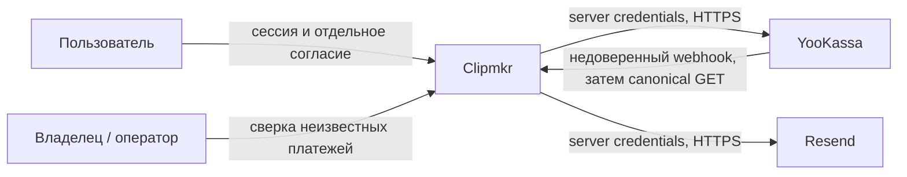
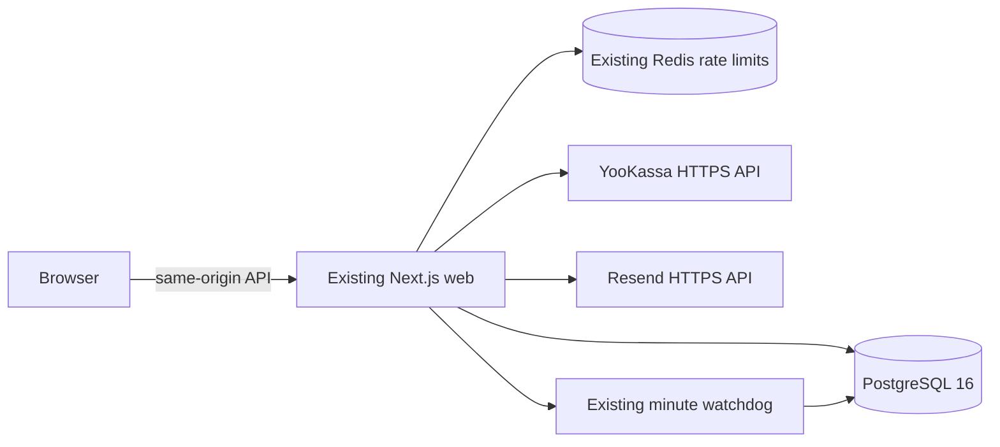
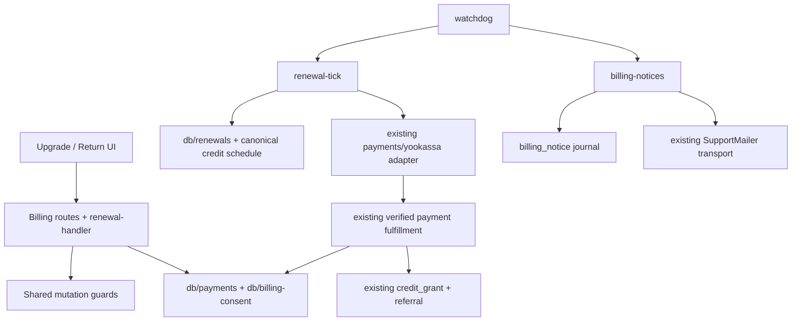
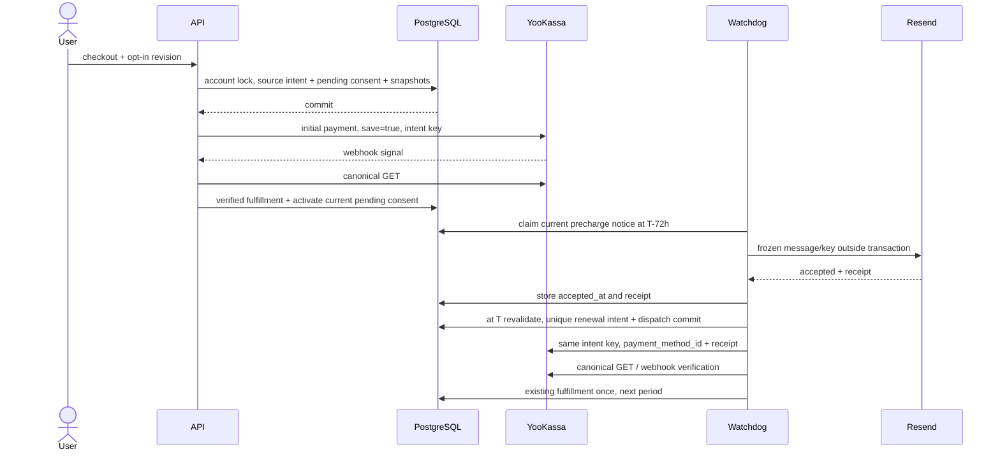

# Архитектура добровольного продления

Статус: proposed, AR-20261111-1. Архитектура до QCSD, макетов и K1/K2 не разрешает coding. ADR-001..003 — авторитетные решения; OpenSpec хранит requirement delta. Существующий продукт может отдельно принимать обычные live-платежи; recurring default off.

## C4 Context



## C4 Container



Нет новых containers/services/queues. Browser недоверенный, webhook тоже; provider adapter проверяет merchant/test/amount/order, а saved method принимается только из canonical GET. Redis не хранит финансовую truth. Watchdog внутренняя функция web, стрелка не новый сетевой hop.

## C4 Component и targets



Предлагаемые маленькие модули: `apps/web/src/server/renewal-handler.ts`, `renewal-tick.ts`, `billing-notices.ts`; `packages/db/src/billing-consent.ts`, `renewals.ts`. Existing provider/handler/deps/runtime/config/environment/watchdog меняются только в точках wiring и typed contracts. `billing-handler` guard вынести для shared use при необходимости, новый monolith не создавать. Native `nextCreditBaseStart` разложить в один projection: unclamped `paid_base_tail` и `purchase_start=max(now,tail)`. T=tail, не purchase_start: после T значение now не должно сдвигать renewal identity. Tail NULL — цикла нет. Один SQL для worker/UI, addon исключён. Mail transport нейтрально переименовать с совместимостью retention API, не копировать fetch. Имена пока proposed: K1 проверит availability перед планом.

## Sequence: согласие и успешное продление



## Sequence: потерянный ответ и отключение

```mermaid
sequenceDiagram
 participant W as Worker
 participant P as PostgreSQL
 participant Y as YooKassa
 actor U as User
 W->>P: dispatch authorized, commit
 W->>Y: POST intent key
 Y--xW: response lost / process crash
 U->>P: revoke consent, commit
 W->>P: restart, lease expired → unknown
 Note over W,P: consent revoked: no further POST, no second key
 W->>Y: GET only if provider ID known
 Y-->>W: verified late success
 W->>P: grant once; consent stays revoked
```

Обратная очередность cancel commit до dispatch commit даёт 0 payment POST. SQL-lock на YooKassa/Resend не удерживается. Cancel не обещает удалённую отмену: уже разрешённая попытка может завершиться после ответа UI. Network timeout не доказывает отказ. Вызов known-ID GET никогда не создаёт новый платёж; without-ID после cutoff/revoke требуется операторская сверка.

## Data & storage

Две необходимые новые таблицы: `billing_consent` хранит независимое согласие/отзыв и token; `billing_notice` хранит mail acceptance/idempotency. Renewal использует `payment_intent`, новый invoice/payment ledger не создаётся. Схема и transitions — `04_domain_model.md`. В начальном checkout consent указывает на source_intent; `payment_intent.consent_id` заполняется только у renewal, поэтому циклических FK при создании initial payment нет. IDs и строки создаются в одной транзакции. Snapshot immutability проверяется DB CHECK+trigger; NULL/JSON null/лишние поля не обходят ограничения.

Новые mutation/dispatch берут account FOR NO KEY UPDATE, чтобы сериализоваться друг с другом и existing fulfillment. Общий порядок write-lock: account → consent → payment_intent либо notice → existing credit lock/grant. Native payment-event/advisory порядок сохраняется без обратного запроса того же advisory из account-held нового пути. Candidate scan без lock, claim перечитывает всё под account lock; два workers не полагаются на in-process guard. Result CAS содержит attempt number + lease token, stale results не перезаписывают terminal факт; canonical success всё равно проходит existing fulfillment.

Нет caching финансовых decisions. T вычисляется из committed base grants, не из уменьшающегося credit balance. Для исходной попытки T берётся до создания нового периода; renewal intent сохраняет T навсегда. Новый base success до dispatch меняет T и supersedes notice; после dispatch existing fulfillment сериализует последовательные периоды. Paused consent не возобновляется от GET/webhook.

## API design

`POST /api/checkout`: прежнее `{idempotency_key,sku}` допускается. Для opt-in добавляется только `{autorenew:{enabled:true,consent_revision}}`; explicit false либо отсутствие означает обычную покупку. Сервер берёт current terms/price/merchant/email, сравнивает revision; неизвестные поля/token/price/account отвергаются. Повтор сравнивает canonical consent selection и revision; сменить галочку под уже отправленным ключом нельзя. UI после attempted checkout фиксирует этот выбор до known terminal/reconciliation; не выдаёт новый key на timeout. New checkout c новым согласием supersedes старое; failure не восстанавливает его скрыто.

`GET /api/billing/autorenew`: own state off|pending|active|paused, SKU/price/cadence, next_charge_at, current_paid_until, reason, optional in-flight intent id; без token/receipt/email/snapshot. `POST /api/billing/autorenew/cancel` с пустым закрытым телом: same-origin/session/rate, idempotent 200 `{state:'off',in_flight:boolean}`. Pending также отменяется; cancel доступен при feature off и неподтверждённом email. Идентификатор account не принимается из тела.

Status/return existing intent остаются каноническими. Provider требует confirmation — action_required с нормализованным HTTPS URL через existing own-intent continuation; никаких redirect из webhook body. Invalid extra auth requirement, waiting_for_capture вне текущего capture=true контракта или pending старше 24h переводятся в review/paused и GET-only, не объявляются failed без terminal provider status. Unknown result запрещает новый base checkout, UI предлагает проверить существующую оплату; existing bound manual продолжение и addon сохраняются.

## Configuration и безопасность

Один proposed `N5_AUTORENEW_ENABLED` (false по умолчанию; invalid значение ошибка соответствующего config): отличается для сред и включается операционно после merchant confirmation. Трасса `environment.ts → shared/config.ts → runtime → billing deps + watchdog` проверяется seam-тестом. Никакой связи flag с отключением existing manual checkout/webhook/health. Mail unavailable блокирует charge и объясняет pause, но не обычную продажу.

Перед новым/повторным POST сверяются merchant/test scope, enable flag, consent validity, immutable request и `0≤now−created_at<23h`; после async work cutoff перепроверяется непосредственно перед fetch. Допущение внешнего окна: ошибка clocks+process pause+remote delivery <1h; при известном нарушении времени автоматика STOP. Bound GET остаётся доступен без cutoff, но только в том же merchant namespace. Token/PII никогда не выбираются public API; логи — только bounded reason, internal intent/consent IDs. Выключение не превращает исходный request body и не теряет уже состоявшийся платёж.

## Observability

INFO: consent activated/revoked, renewal dispatched/succeeded, notice accepted (IDs + bounded state, без адреса/token/body). WARN: paused_notice, method_unsaved, offer_changed, pending_action, lease_unknown, cutoff_review, merchant_mismatch. ERROR: DB/transport wiring failure с очищенным reason; тело провайдера и секреты не логируются. Счётчики из existing logs/SQL: due renewals без результата; due precharge без accepted receipt; failures/review по причинам. Новая monitoring платформа не требуется.

Внешний симптом: кабинет показывает «ожидает подключения», «проверяем оплату» или конкретную паузу с CTA; неуспех — транзакционное письмо, если transport доступен. Пользователь видит состояние; оператор видит WARN/review backlog штатными журналами и read-only запросом. При provider outage не выдумывается success/decline. Отдельный live support runbook до включения должен назвать ответственного оператора и способ сверки order_id в YooKassa; этот проект не утверждает, что операция уже выполнена.

## Дискриминирующие оракулы для QCSD и будущего плана

Все ниже **NOT RUN**: это критерии, не отчёт о прохождении. База — изолированный PostgreSQL16 `*_test`, отдельная schema; payment/mail socket только localhost, synthetic addresses. Новые test names предложены, не объявлены существующими. Команда будущего набора: `npm test -- tests/autorenew.integration.test.ts tests/autorenew-consent.integration.test.ts tests/autorenew-provider.test.ts tests/billing-notices.integration.test.ts`; selector уже собирает `tests/**/*.test.ts`, browser отдельно штатным Playwright runner.

| ID / связь | Риск / сценарий и наблюдаемый оракул | Что должно сделать тест RED |
|---|---|---|
| QT-1 FR-1,2,13 | API+browser: unchecked/reload/manual checkout, opt-in unverified 422, manual unverified успешно reaches socket; addon crafted opt-in 422 | Удаление verified/base guard либо обязательный opt-in для manual |
| QT-2 FR-2,3 | PG positive consent + missing/JSON null/extra/invalid snapshot поля; UPDATE immutable terms/token provenance; conflicting idempotency selection | Ослабление CHECK/trigger; same key с другим consent не 409 |
| QT-3 FR-3 | Socket GET и webhook содержат разные method IDs/saved; сохраняется только canonical GET; wrong account/order/shop/test не активирует | Чтение token из body; activation до fulfillment; обход namespace |
| QT-4 FR-3,6 | PG barriers pending activation vs revoke/replacement, обе очередности; late source success даёт 1 grant, consent не оживает | unconditional pending/active UPDATE по source intent |
| QT-5 FR-4 | Уже committed два будущих base+addon; T=max base end; manual success перед claim переносит T; next base не накладывается | Query только current active grant либо включает addon |
| QT-6 FR-5 | Полная decision table accepted/unknown/failed/late/stale recipient/consent/T/offer; timely+same positive control создаёт 1 POST | Удаление одного accepted/verified/current match guard |
| QT-7 FR-5,10 | Независимые fixtures T−72h±1ms, T−24h±1ms, T±1ms, T+5min±1ms; clock jump/future/invalid | Неправильная граница или catch-up после dispatch window |
| QT-8 FR-6,7 | Два настоящих PG clients: observe blocker wait; cancel-first 0 POST, dispatch-first 1 разрешённый POST; cancel completes пока socket held | SQL-lock на HTTP; неатомарный check/claim; lease даёт второй identity |
| QT-9 FR-7 | Socket фиксирует accepted POST до drop; kill/restart handler/worker; сравнить bytes/key, snapshot после изменения config/email/offer; 1 provider ID | Rebuild payload или fresh key; test только mocked fetch не считается |
| QT-10 FR-7 | Отдельный unbound intent для 23h−1ms/exact/+1ms/24h/future/NaN; positive ранний POST не связывает следующий fixture; bound GET после cutoff | `>=`→`>`; cutoff удалён; new key на review |
| QT-11 FR-8 | Webhook/GET duplicate, success/refund permutation, concurrent manual/renewal successes: 1 grant/payment, periods non-overlap, referral snapshot неизменен | Удаление existing unique event/grant guard или перезапись attribution |
| QT-12 FR-9,12 | canceled/permission_revoked → 0 новых POST на следующих ticks; pending/confirmation/expired pending → own continuation/GET-review; price/consent changed → pause | Hidden retry после decline, новый confirmation intent, silent amount change |
| QT-13 FR-10,11 | PG+Resend socket: accepted/drop/restart, same key/payload, ≤3 attempts,<23h, clock windows; cancel/manual purchase/email changed между generate и claim | Новый key для unknown; stale notice отправляется до claim revalidation |
| QT-14 FR-11,NFR-4 | Реальный erase со строками consent/notice/token snapshot; account erasing vs late payment; DB connection остаётся доступен при held mail socket | Token/PII сирота, grant erasing аккаунту, блокировка account на send |
| QT-15 FR-8,13 | Existing receipt tests + runtime wiring/config/guard negative suites; live missing receipt 0 POST, manual save=false, optin true boolean, unknown legacy не дооснащается | Новый recurring ввод обходит receipt/live guard или выключает manual |
| QT-16 NFR-1,5 | UI keyboard/mobile/error/reload, wrong-session 404, cross-origin/rate/extra fields, logs API scan synthetic token/email sentinel | Утечка token/PII, inactive consent выглядит active, cancel теряется после reload |

Acceptance до кода: independent QCSD должен оспорить эти оракулы и границы cancellation/receipt/time. После кода: targeted RED/GREEN mutations для unique renewal, accepted gate, consent guard, 23h cutoff и base-tail query; один зелёный happy path не считается. Проверки boundaries проводят через реальные функции и PG/socket, не source-string assertions. Fault model: crash before/after dispatch commit, accepted POST+lost response, after GET before DB commit, duplicate/reordered callback, stale lease worker, simultaneous cancel/manual fulfillment, deadline/email/price changes, provider pending/decline, downtime clock jump.

Регрессии: `billing.integration`, `billing.unit`, `payments-guards`, `yookassa-receipts.unit/integration`, `credit-packages.integration/UI`, `retention-notices.integration`, `legal-pages`, browser billing. Финальные `typecheck`, `lint`, `build`, полный релевантный `npm test`, независимое review/fleet и anti-drift запускаются по плану. Отсутствующий DATABASE_URL/skip — NOT RUN, не PASS. Provider TEST интеграция и ручная owner acceptance потребуются после разрешённой поставки; локальные sockets не доказывают включённую merchant capability.
