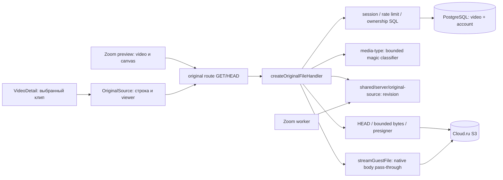

# Light architecture: доступ к исходнику

Статус: frozen-кандидат для независимой QCSD; Step5 checkpoint ещё не выполнен. База `e66d9addfad16e1b6dcd7bd07bf06c5abb1343f1`. ADR-001 — `03_adr/001-serve-original-through-owned-route.md`.

## Компоненты

`original-runtime.ts` связывает существующие runtime/auth/pool/redis/S3 зависимости; route только экспортирует GET/HEAD. Нет нового service, queue, auth type, env или persistent model. `VideoDetail` держит выбор клипа и режим source; `OriginalSource` владеет только строкой/metаdata/media state. Zoom не получает импорт UI исходника и не пишет в его worktree.

## API design

Все ответы, включая 404/409/416/429/503: `Cache-Control: private, no-store`, `Referrer-Policy: no-referrer`, `X-Content-Type-Options: nosniff`; route динамический, без shared cache. При HEAD тело всегда отсутствует. Никакого 302 на S3.

| Запрос | Результат |
|---|---|
| `GET /api/videos/:videoId/original?metadata=1` | 200 JSON состояния после ownership; нет подписей, keys, upstream URL и срока хранения |
| `GET /api/videos/:videoId/original` | 200 или 206 inline body с проверенными MIME и headers |
| `GET ...?download=1` | тот же оригинальный body, безопасный attachment; browser navigation/anchor, без Blob |
| `HEAD /api/videos/:videoId/original` | те же auth/готовность/type/full Content-Length, без подписи GetObject и без media body; Range на HEAD игнорируется, 200 полной metadata |
| unauthorized/foreign/unknown/deleted/inactive | одинаковый 404 `Запись не найдена`; ни HEAD, ни bytes, ни signer |
| media request при incomplete / missing / provider error | 409 / 404 / 503 соответственно, короткое безопасное сообщение |
| некорректный или multi-range | 416 без storage; валидный неудовлетворимый Range отдаёт upstream 416 с `Content-Range: bytes */N` |

Metadata: `OriginalSourceMetadata` — discriminated union. Общие `videoId`, `state`, `available`; ready: `state:'ready', available:true, sourceRevision:string, media:{kind:'video'|'audio'|'unknown',mime:string,extension:string,bytes:string,durationSeconds:number|null}`. Остальные: `state:'incomplete'|'missing'|'error', available:false, unavailableReason:'upload_incomplete'|'source_missing'|'temporarily_unavailable'`, без sourceRevision/media. 429 остаётся HTTP429, 404 ownership не превращается в metadata200. Source key не является DTO. HEAD bytes сериализуются десятичной строкой; duration берётся только из `video.duration_seconds`, null остаётся null.

Параметры `metadata=1` и `download=1` вместе → 400; не принимать `key`, `url`, `g`, `sig`, `until` как полномочия. Неизвестные параметры не влияют на key/auth. Единственный источник объекта — строка DB, выбранная ownership query.

Порядок: session+UUID → существующий rate limit → `video JOIN account` по `v.id=$1 AND v.account_id=$2 AND v.deleted_at IS NULL AND a.status='active'` → upload gate → HEAD → bounded sniff → metadata/HEAD/sign+stream. Роль owner не расширяет WHERE. SQL read-only, без транзакции через сеть. Account/session отзываются для последующих запросов; уже открытый response не обещает мгновенного отзыва.

Upload gate: `status='uploading'` → incomplete даже при существующем object; отсутствующий key или `actual_bytes` null/≤0 → unavailable без подписи; `actual_bytes>0` и status в queued/transcribing/selecting/rendering/done/failed допускают проверку. `failed` не отрезает загруженный source из-за ошибки downstream; too_large/not_media с ещё не завершённой cleanup не допускаются. `upload_enqueued_at` не является единственным gate: очередь может ещё не подтвердить публикацию после завершённой загрузки. HEAD size0 или несовпадение с actual_bytes → error, не «удалён». HEAD NoSuchKey/404 → missing; 403/timeout/5xx/неизвестная ошибка → error. Никаких изменений lifecycle/retention.

## Source revision и Zoom seam

`originalSourceRevision` экспортируется только из нового backend-only leaf `packages/shared/src/server/original-source.ts`; web handler и Zoom worker импортируют `@clipmaker/shared/server/original-source`. Existing `packages/shared/package.json` wildcard `./*` покрывает этот subpath без изменения exports или зависимостей. Не добавлять re-export в `shared/src/index.ts` и не импортировать leaf в browser: его `node:crypto` предназначен только для server/worker. Original владеет helper и тестами; Zoom только импортирует, без worker→web зависимости и без второй реализации. Root зафиксировал это конкретное инженерное размещение 11.11.2026 до QCSD; пользователь не называл этот путь.

Формула неизменна: SHA-256 UTF-8 от `JSON.stringify(['original-source-v1', videoId, objectKey, uploadId ?? null, String(actualBytes)])`. Это пять элементов JSON, включая фиксированный version tag, и четыре поля принятой DB identity. Helper получает scalar arguments `videoId`, `objectKey`, `uploadId`, `actualBytes`; account/ownership проверяются вызывающим backend до их передачи. Возвращает lowercase hex; сериализация и порядок фиксированы. Это opaque идентификатор принятой загрузки, не hash содержимого и не etag. В принятом контракте source key после upload immutable; его перезапись не входит в обеих фичах. Смена upload identity меняет revision; `updated_at`/CTA/clip rendering её не меняют.

Для tests добавить один exact alias `@clipmaker/shared/server/original-source` → `packages/shared/src/server/original-source.ts` в `vitest.config.ts`: unit/integration должны проверять текущий source, а не stale dist. Browser DTO импортируется только как type и не тянет helper. Shared package build/typecheck использует существующий `src/**/*.ts`; новый runtime не создаётся.

Zoom backend пересчитывает revision при сохранении/применении; UI строит относительный src `/api/videos/${encodeURIComponent(videoId)}/original`. Каждый Range снова авторизуется; видео и canvas находятся на origin приложения. Изменения clip cutPlan/start/end/render version относятся только к Zoom. Для незагруженного/недоступного source preview не открывается. Согласовано с `/root/zoom_focus_architecture` 11.11.2026: отдельный ETag HEAD не нужен при запрете accepted source overwrite; никаких новых колонок.

## MIME и скачивание

Расширить существующий `media-type.ts` классификатор `detectOriginalMedia`, сохранив результаты `isAllowedMedia` на прежних fixtures. Истина — magic первых ≤4096 bytes: ftyp M4A → audio/mp4 `.m4a`; qt/старые QuickTime atoms → video/quicktime `.mov`; поддержанные MP4 brands → video/mp4 `.mp4`; EBML DocType webm → video/webm `.webm`; проверенный ID3/MPEG audio → audio/mpeg `.mp3`. Container не доказывает codec, наличие видео/звука и декодирование; это проверяет browser. Suffix ключа/HEAD octet-stream не переопределяют magic. Неопознанное содержимое: application/octet-stream `.bin`, kind unknown, просмотр показывает unsupported, скачивание остаётся возможным.

Нативный audio для подтверждённого M4A/MPEG, video для MP4/MOV/WebM. MP4 audio-only без M4A brand не объявляется доказанным video track: native элемент допускает аудио, а label отражает контейнер. Не добавлять ffprobe/job/transcode только ради просмотра.

Имя генерируется, исходное filename отсутствует: ASCII fallback `source.<extension>` и RFC5987 UTF-8 `Исходник <videoId>.<extension>` с encodeURIComponent и percent-encoding `['()*]`. Никакие ФИО/заголовки пользователя или control chars не интерполируются в header. inline/attachment отличаются disposition; safe filename одинаков. `generateDownloadUrl` остаётся побайтово прежним; для server fetch вызывается без filename, MIME/disposition выставляет защищённый ответ после stream. Legacy `clip.mp4` не меняется.

`getObjectBytes(ctx,key,'bytes=0-4095',4096)` получает новый optional `maxBytes`: при его наличии проверяет ContentLength и читает stream с подсчётом, останавливает и отменяет body до накопления сверх лимита. Ровно прежний путь без четвёртого аргумента сохраняется. Игнорирование Range с большим ответом → error/503, не полное чтение. Это проверяется HTTP stream fixture и Cloud.ru, а не только SDK mock.

## Передача и timeout

`streamGuestFile(url,request, options?)`: для прежних вызовов сохраняется нынешний общий timeout120000мс. Original передаёт `{headersTimeoutMs:15000}`: deadline до ответа headers, после headers timer очищен, остаётся request.signal и native body cancellation/backpressure. Не копировать chunks в массив, Blob или temporary file. Механика cleanup на success/error/abort обязательна. Optional режим проверяется медленным потоком после deadline и downstream abort.

Обязательный дискриминирующий тест OT-TEST-1: `original_stream_survives_header_deadline_and_aborts` в `tests/original-file.test.ts`, explicit per-case timeout **150000 мс** (глобальные15000 не менять). Настоящий loopback HTTP server немедленно flushes headers, затем отдаёт редкие маленькие heartbeat chunks и уникальный marker только через **125000 мс после headers**, сохраняя body открытым; общий объём каждого response ≤1024bytes. Настоящий native fetch/stream original consumer обязан прочитать marker при монотонно измеренном elapsed>120000, затем downstream request AbortController отменяется, и server наблюдает upstream socket close в течение2000мс. В finally очищаются server/sockets/timers/readers даже при падении. Без fake clocks, mocked fetch, подмены undici timers или сокращения этой границы до15–30с.

В этом же wall-clock окне второй consumer вызывает legacy `streamGuestFile` без options: ожидается фактический abort около120с до125с marker. Это отрицательный контроль сохранения guest default; он не удваивает длительность. Если original ошибочно сохраняет общий `AbortSignal.timeout(120000)`, чтение его позднего marker падает — тест RED. Отдельные короткие проверки покрывают headers, не пришедшие до deadline, `response.body.cancel()`, уже отменённый request и cleanup. Один125с case необходим из-за реального native timeout; запускать на стабильном snapshot в принадлежащей исполнителю сессии до terminal outcome, с измеренным временем. При исправлении повторять этот затронутый case, а не весь suite без дополнительного риска.

Upstream URL приходит только из собственного signer; `redirect:'error'`, только Range из browser, без Cookie/Authorization/произвольных request headers. Для различения гонки HEAD→GET missing добавить `StorageStreamError` с числовым upstreamStatus и прежним безопасным message; original маппит404 в missing, остальные upstream failures в503. Во внешние logs не выводится Error/cause/url. Уже начавшийся обрыв media body проявляется native error; новый retry только явным действием пользователя, без бесконечного цикла. S3 подпись ≤900с создаётся заново на каждый media GET и никогда не возвращается клиенту. GET, начатый до expiry, может продолжаться дольше900с; следующий seek получает свежую авторизацию. Срок исходника не известен, clip deadline не подставляется.

## UI composition

Нормальный macro-layout pinned `mockup.html`; дополнение `states.html` SHA256 `6521026a864be1ca323cd082ecb402360062bd12b65a1e5fae71ab67ffe10953` требует настоящего owner approval до frontend. Строка под VideoHeader. Viewer в прежнем месте selected clip; список клипов/ClipCard не переносятся в DOM, не размонтируются ради source. Source mode скрывает выбранный clip player и pause; возврат/выбор клипа pause+unload source, сохраняет selection и возвращает focus. Только один слышимый media; скрытие CSS без pause недостаточно.

Metadata загружается один раз при mount и при явном retry; допускается одно повторение после наблюдаемого перехода video.status из uploading в другое состояние, не на каждом poll. Abort/generation guard исключает поздние ответы для другого videoId. «Смотреть/Слушать» не autoplay. Download — обычная ссылка на защищённый route, не скрытый fetch файла. Unsupported = browser decode/not-supported или unknown magic; network error сначала актуализирует metadata один раз, а не объявляет codec неподдержанным. Повторная попытка открывает тот же URL с новой серверной подписью; special refresh UI нет.

### Ноль клипов: OQ-QUALITY-1

`selectedClipId=null` при пустом `clips` — действительное состояние, не ошибка. Source viewer занимает существующий slot `clip-grid` внутри `.workspace-result-regions`, где ещё нет ClipCard; новые глобальные viewer/panel/sidebar не создаются. Existing empty paragraph скрыт только пока source открыт; header/progress остаются. «К клипам» pause+unload source, возвращает прежний empty paragraph по актуальному `video.status` и focus на ранее нажатое «Смотреть/Слушать»; при недоступном trigger fallback — существующий headingRef. Никакого выдуманного клипа, пустой карточки или title «Выбранный клип» при нуле клипов. Обычный список не показывается без элементов.

Source opening не присваивает selectedClipId. Если во время source poll приносит первые клипы, существующий selection reconciliation выбирает первый доступный/первый клип; source остаётся открыт до явного действия. Возврат показывает фактический текущий selectedClipId, а клик появившегося clip selector сразу закрывает source и сохраняет focus на нажатом selector. При >0 клипах существующий selected ID/ClipCard DOM сохраняется как раньше; новые clips не сбрасывают прежний валидный выбор.

Browser oracle `original_handles_zero_clips_and_late_results`: rendering+ready+clips[] → watch → один native source без autoplay, нет clip selector/фиктивного ID → back → прежнее empty-state и focus watch, source paused/unloaded. Затем poll добавляет clips при открытом source → back/selector показывает корректный clip, один слышимый media, ранее существовавшие nodes не пересозданы. Мутации null→фиктивный ID, потеря back focus или remount сохранённого ClipCard обязаны ломать соответствующую ветку.

### Media error и однократная проверка: OQ-QUALITY-2

Decode/not-supported либо unknown magic → прежний unsupported pattern; сетевой обрыв/неизвестная media ошибка не выдаётся за codec. Ожидаемый abort при switch/back/unmount игнорируется по generation guard. Первый неожиданный media error каждой явной попытки pause+unload источник, сохраняет last currentTime/paused и запускает **не больше одной metadata проверки**. На время проверки остаётся viewer с «Проверяем исходник…», источник не играет. Duplicate error events этой попытки не создают новые запросы.

| Результат единственной проверки | Строка и существующий viewer | Следующее действие |
|---|---|---|
| ready | Строка ready сохраняет Смотреть/Слушать и Скачать. Viewer: «Не удалось воспроизвести исходник» и «Нажмите «Смотреть» ещё раз или скачайте файл» (audio: «Слушать»). Причина неизвестна; не unsupported/missing и не успешное воспроизведение | Прежнее Смотреть/Слушать — одна новая явная попытка, никакого auto reload |
| incomplete | Строка «Передача исходника не завершена», source действия скрыты. Viewer повторяет это сообщение; «К клипам» доступно | Вернуться к существующему progress/empty/clip state; обычный наблюдаемый переход из uploading может обновить metadata один раз |
| missing | Строка/viewer «Исходный файл недоступен», source действия скрыты; без даты/обещания восстановления | «К клипам», обычная навигация записи |
| error, transport failure или malformed metadata | Строка «Не удалось проверить исходник» + прежнее Повторить. Viewer: «Не удалось проверить доступ к исходнику. Повторите проверку»; media остановлено | Повторить делает одну metadata проверку; ready восстанавливает row actions, но viewer остаётся в playback-error до явного Смотреть/Слушать |
| HTTP404 | Как unavailable: «Исходный файл недоступен», без объяснения существования/владельца, source actions скрыты | «К клипам»; не превращать403/503 в404 |
| HTTP429 | Строка/viewer «Слишком много запросов. Повторите через минуту», прежнее Повторить остаётся единственным retry | Одна metadata проверка по явному нажатию; без автоматического таймера/retry-loop |

«К клипам» всегда остаётся доступным в viewer, клипы независимы от ошибки source. Ready metadata после любой проверки не стирает playback-error, не восстанавливает воспроизведение и не вызывает media.load/play. Новая явная попытка через прежнее Смотреть/Слушать сбрасывает только budget одной metadata проверки, загружает тот же URL; позиция восстанавливается после loadedmetadata в допустимые границы. Paused state сохраняется; если ранее шло воспроизведение, возобновление допускается лишь этим явным нажатием и успешным native play. Pending/error не исчезает до фактического loadeddata/canplay/play; ошибка новой попытки снова останавливает media и не начинает третью попытку сама. Никакого нового retry control внутри viewer.

Browser oracle `original_media_error_ready_does_not_restart`: настоящий React/native media с контролируемым обрывом loopback response после начальных playable bytes; проверить один refresh несмотря на повторные error events, ready metadata при остановленном media и видимом честном сообщении, отсутствие auto reload/play/новых запросов в последующем наблюдаемом окне. Явный клик прежнего Смотреть вызывает ровно одну новую загрузку и ограниченную обработку её ошибки. Тот же тест параметризован incomplete/missing/error/HTTP404/HTTP429/malformed ответами по таблице. Контролируемая ошибка моделирует transport; decoded media и начало воспроизведения нельзя заменять фиктивным metadata ready. Новый screenshot package включает no-clips и playback-error, owner approval pending.

## Observability

Без новых метрик, дублирующих HTTP access logs: existing logs считают original responses503 и416; operator сравнивает их с успешными200/206. Backend пишет только фиксированное событие `original_read_failed`, phase HEAD/sniff/stream и безопасную категорию error; не raw Error, query string, key, account name или signed URL. UI показывает временный отказ/unsupported по реальной причине; рост этих отказов замечает владелец при тестовой приёмке и оператор по HTTP логам. Отсутствие dashboards/production измерений прямо остаётся ограничением до поставки.
