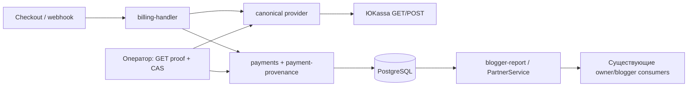

# Архитектура: payment environments (M light)

## Component

Server options задают readonly identity; remote проходит прежние raw.test/recipient guards. Payments владеет TX; payment-provenance содержит validation/CAS/SQL predicate, без сети и ключей.

## Data & storage
Миграция `030_payment_environments.sql`: поля из ADR, CHECK допустимых сочетаний и one-way immutable trigger отдельно от offer/receipt invariants. Старые строки unknown. `ON DELETE SET NULL` связей payment сохраняется; provenance переживает erasure без account PII. Не обновлять amount/status/credits при миграции/backfill.

`verifiedLivePaymentSql(pAlias,iAlias)` в db: обе identity LIVE/yookassa, равный nonnull merchant; exact p.intent_id=i.id/account/provider_payment_id/amount; p succeeded/nonreview, i succeeded/fulfilled. Только константные alias из source. Оба report callers используют helper и сохраняют creditSKU/self-referral/referral snapshot predicates. Helper не фильтрует SKU: последующая reminders-фича может добавить свою entitlement eligibility без второго определения LIVE. Owner month/Moscow bounds и blogger all-time semantics остаются прежними.

## Runtime flow и consistency
New checkout сохраняет server identity до POST. Known mismatch текущего provider даёт conflict до POST/redirect; receipt/23h guards прежние. Retry GET проверяет id/order/amount/identity до redirect/cancel; unknown pending повышается только по remote proof. Unbound unknown без proof не делает POST. Status polling не меняет pending при mismatch. Canonical origin/GET/claim checks сохраняются; сеть полностью вне TX.

### RISK-002: общий порядок locks
Для webhook/refund, bind и backfill одной операции: `pg_advisory_xact_lock(payment:provider:remoteId)` → существующий account `FOR NO KEY UPDATE` → intent `FOR UPDATE` → payment reread/row update/CAS. Первое чтение owner/link только находит кандидата; после locks перечитать account/status, intent/provider ID/offer/identity и payment/links/identity, проверить proof по текущим строкам. Bind/backfill не берут intent/payment row lock раньше account. Несколько кандидатов — отдельные TX, не накопление locks. Credits lock остаётся после account/intent как сейчас; это также сериализует будущий reminder claim с backfill через account.

Baseline success/refund уже имеет payment advisory→account→intent; event claim до advisory не заменяет этот порядок. В новом тракте claim делать после locks/проверки identity в той же TX. Conflict/deadlock/serialization failure обязаны откатить всю TX, включая claim и promotion; не возвращать обычный success из транзакции после конфликта. DB failure — retryable503 без side effects; следующий webhook повторяется целиком. Duplicate/refunded возвращается лишь после проверки доступного proof; tombstone не перелинковывается.

Если account/intent исчезли во время ожидания, перечитать payment: не восстанавливать удалённое. Для refund применять erased-строку матрицы; bind/backfill без требуемой пары завершаются без writes; success не выдаёт credits удалённому account. Callback-before-bind и unknown pending promotion входят в одну TX с bind/grant. PG test удерживает account lock другим connection, наблюдает реальное ожидание bind/backfill и success/refund, освобождает lock, затем проверяет один grant/согласованность; отдельный конфликт после reread оставляет claim свободным. Timeout сам по себе не positive control.

### RISK-003: достаточное refund proof
Во всех строках canonical GET refund+payment проверяет refund.payment_id=payment.id, succeeded/paid, RUB, допустимую сумму возврата и configured raw.test/shop; запись ищется по `(provider, provider_payment_id)`. Финансовая сумма строки сверяется с исходным payment.amount, не суммой частичного refund. Known merchant/environment совпадают с remote; mismatch → rollback. Matrix:

| Состояние после locks | Требуемое proof и эффект |
|---|---|
| Linked payment+intent, known/unknown | Exact order=intent.id, account/link, provider ID и amount=p.amount=i.price; все known identity совпали. Только refund status/review; terminal unknown не классифицировать. |
| Intent есть, payment ещё нет | Exact remote order/price/provider ID (NULL или тот же); known identity совпала либо pending unknown повышается по remote proof. Создать linked refunded tombstone, без grant. |
| Intent/account стёрты, payment есть | Exact canonical provider ID+сохранённый amount; known identity должна совпасть. Потерянный FK/order не требовать. Пометить именно эту строку refunded; unknown оставить unknown, links NULL, без восстановления/credits. |
| Нет ни payment, ни intent | Полный canonical refund/payment proof позволяет unlinked refunded tombstone с verified identity и amount. Не связывать его с другой intent позднее; success того же provider ID никогда не даёт grant. |
| Не хватает proof либо сохранённые поля противоречат remote | Retryable503/reconciliation без любых writes, включая event claim; не угадывать identity/order. |

Для повторного success/refund уже unlinked tombstone достаточно exact provider ID/amount и known identity: order из исчезнувшей связи не восстанавливается. Любая попытка rebound не обновляет links/grants. Проверки: обе очередности refund/success, каждая строка matrix, erased known/unknown, partial refund, duplicate и conflicting ID/amount/merchant/order где order сохранён.

## Historical classification
Оператор: canonical GET exact shop, explicit private список кандидатов, dry-run по умолчанию. Apply: RISK-002 locks/reread и exact provider/id/order/amount/links; CAS пары только unknown→verified или равное known(no-op), конфликт откатывает пару. Нет order proof после erasure — не классифицировать (это не запрещает refund по RISK-003). Нет provider POST/refund и финансовых writes; private proof/keys/responses не в Git. Concurrent LIVE неизменён, сбой сети оставляет unknown.

## RISK-001: cutover и rollback
Перед поставкой инвентаризировать действующие процессы/реплики и пути записи payment/intent/event: checkout create/bind, success/refund webhook (включая test route), retry/poll cancel, recovery/ops/backfill. Native writers — payments.ts, fulfillment credits.ts, retention erasure; фактическую топологию здесь не проверяли. Отдельно подтвердить, что остальные шесть сервисов не выполняют payment writers; тогда их не останавливать.

Порядок: закрыть новые checkout существующим механизмом → остановить старый web и все найденные старые payment writer процессы, дождаться in-flight → подтвердить отсутствие процессов/реплик и ноль их PG sessions/transactions (по проверенной принадлежности, не общему shared user) →030→запустить только новый artifact→проверить версии/health→открыть продажи. Если session ownership/zero не доказан, миграция/открытие не продолжаются. Не оставлять старый webhook/refund/bind рядом с новым. Пауза webhook даёт retryable503; принятый перед остановкой callback сверяется через canonical GET и event/intent/payment, не повторной покупкой. Старые unknown terminal записи выявляются reconciliation, не объявляются LIVE.

Смешанные writer версии не поддерживаются. После новых денежных событий нельзя откатывать DB или запускать старый writer поверх known identity. При deployment failure сохранить совместимый новый backend/схему и закрыть NEW sales; при невозможности — остановить writers и вернуть503 до восстановления. Даже до анализа downgrade нужны полный freeze всех payment путей, drain/zero sessions и reconciliation; checkout-off один недостаточен. Проверить этот барьер на изолированной старой схеме с удержанным in-flight callback: gate не открывается до drain; после030 старый процесс не обслуживает ни один payment route, pending завершается новым writer ровно один раз.

## API design
Прежние routes/body/response; identity только внутренняя в provider/remote/create/bind/VerifiedPayment. Fake=test/null merchant. Новых public API нет.

## Observability
Sanitized warning identity mismatch/reconciliation; backfill aggregate scanned/classified/no-op/conflict. Read-only count unknown/conflicts проверяет оператор; внешние симптомы — pending/conflict или исключённая недоказанная выручка. Без ID/email/shop/key/raw payload. PG+HTTP+Next проверки в01; настоящий магазин ими не доказан, runtime NOT RUN.
