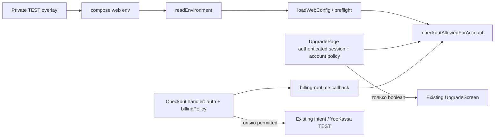

# Архитектура тестового исключения checkout

Статус: проект перед независимым QCSD, ADR-001. Без runtime изменений.

## C4 Component

## Config contract
Новая optional переменная только web: `N5_TEST_CHECKOUT_ACCOUNT_ID`.
В `.env.example` объявить пустое `N5_TEST_CHECKOUT_ACCOUNT_ID=` и русский комментарий:
исключение только для TEST при `N5_CHECKOUT_ENABLED=false`; реальный UUID задаётся private.
Существующий template default `N5_CHECKOUT_ENABLED=true` не менять: пустой exception безопасен.
Compose `${N5_TEST_CHECKOUT_ACCOUNT_ID-}` передаёт пустое безопасное значение без настройки.
readEnvironment перечисляет ключ явно; loadWebConfig возвращает `testCheckoutAccountId: string|null`.
Undefined/empty → null; whitespace, non-UUID, uppercase, список/JSON/wildcard → preflight fail.
Nonempty требует global checkout=false, credits_v1, real ЮKassa driver с `testMode=true` и test-key.
Config error сообщает имя переменной и правило, не UUID/key/value. Workers новую переменную не получают.
Секрет и UUID загружаются root из private overlay после проверенного артефакта; значения не входят в Git.
Synthetic fixture UUID допустим только в тесте; никакого literal реального аккаунта в коде.

## Canonical eligibility
Вход: validated config, authenticated accountId, прочитанная account billingPolicy, providerReady.
Общая policy в существующем shared/config используется только server callers.
| Состояние | Результат |
|---|---|
| provider отсутствует / session отсутствует | false (HTTP provider-off прежний 404, anonymous 401 после guard) |
| global true, exception null | прежний глобальный режим; остальные domain guards сохраняются |
| global false, exception null | false для всех |
| global false, exact A, TEST, account/config credits_v1 | true только A |
| global false, B или policy не credits_v1 | false |
| global false, testMode false/off/fake | false; configured UUID ещё и отвергается preflight |
| global true + nonempty exception | preflight fail, не глобальное расширение запроса |

Существующий POST порядок: provider → guardMutation(rate/origin/session) → existing billingPolicy
→ обязательный checkoutAllowed callback → bounded strict body → intent → provider вне транзакции.
Отрицательный результат — прежний 503 checkout_paused; для anonymous/Origin остаются прежние коды.
Billing policy читается один раз и переиспользуется ниже для credit SKU; новая SQL-функция не нужна.
SSR получает session и active billing через прежние readers, вычисляет salesEnabled общей policy
с сохранением credits_v1/catalogOnly/purchaseWindows/owner guards. UI получает только booleans.
Response/body не принимает account/email/testMode. GET status проверяет owner как прежде.
Webhook не проверяет allowlist: он проверяет источник, provider requery, raw.test, amount и intent;
новый запрет checkout не должен терять уже подтверждённые уведомления.

## Existing UI
Каталог, три кнопки, цены, TEST label, ошибки и return route уже существуют. JSX-компонент и CSS
не редактируются. В этой задаче SSR только включает существующие действия для A и оставляет их
disabled для B. Для SSR-теста нужны валидные purchaseWindows и credits_v1 у обоих, иначе проверка пустая.
Server-specific UUID не попадает в HTML, props, JS bundle или лог. После logout/login действует новая сессия;
существующий account-key/remount/abort lifecycle сохраняется, его regression выполняется.

## Storage and operational boundary
Нет DB/schema/credit/role writes от изменения конфигурации. Intent создаёт только прежний checkout.
Provider driver готовится TEST overlay: global false обязателен; это отдельный root deployment шаг.
Отзыв: очистить exception + restart web. Production/DNS/Cloud.ru и реальные списания не входят в работу.
До активации root сверяет текущую source-базу с параллельными принятыми изменениями, не затирает их.

## Observability
Повторно используем HTTP 401/403/503 checkout_paused и существующий sanitized billing log.
Не логируем allowlist, реальные identities, cookies, UUID или credentials; новые counters не нужны.
Внешний симптом для B — существующие disabled-кнопки и отказ POST; для A ошибка provider остаётся
честной ошибкой. Координатор замечает drift сравнением двух synthetic sessions и result counts
intent/provider в тестовом контуре. TEST label берётся из существующего validated provider режима.
Метрики correctness: denied intent delta=0/provider calls=0, allowed id принадлежит только A,
repeat webhook не увеличивает credits. Это проверки, не новые runtime-метрики.

## QCSD: фактические оракулы QL-01/QL-02/QT-001
Конкурентный local fixture: read body → test barrier → без await atomic byKey lookup/create/set.
Проверка раздельно наблюдает HTTP create attempts, keys, unique payment ids, intent rows и grants;
один intent без provider uniqueness недостаточен. Один ключ соответствует intent.id во всех overlap calls.
Webhook negative после отзыва UUID: валидный source notification, настоящий YooKassa adapter requery
локального HTTP payment c test=false → rejection до DB ledger; baseline payment_event/payment/grant
снимается после создания intent, до notification. Затем test=true → один grant; duplicate не добавляет.

Native privacy test использует существующие собранный Next и preflight, отдельный loopback child process
через Node22, изолированный *_test PG schema и существующий Redis test namespace, без контейнеров.
AuthService/PgAuthStore создают synthetic A/B; действительные session cookies подаются в HTTP/browser
контексты. Для HTTP loopback допустим test-only Cookie header: это не приёмка production Secure-cookie.
Сборка и Next process получают только synthetic shop/key/session secret и local service endpoints.
`payment-test-transport.mjs` загружается --import ДО runtime: global fetch разрешает только loopback;
единственный YooKassa API origin переписывает на существующий local fixture, остальные внешние URL
отклоняет. Callback/config/provider adapter не заменяются: проверяется настоящая wiring цепочка.
S3 client не вызывается на этом пути, upload не запускается; unexpected external transport → FAIL.
Не вводить N5_PROVIDER_API_BASE или другой production override ради теста.
Начальная /upgrade выдача: сохранить/проверить полное body, включая inline Flight. Затем открыть
/dashboard и нажать существующий Next Link «Тарифы»; перехватить непустой text/x-component response
и проверить его bytes. Если Flight не получен — NOT RUN/FAIL, а не отсутствие UUID по пустому списку.
Проверить synthetic private UUID/key и их JSON/URL-escaped формы в HTML/Flight/props/server logs.
Raw evidence остаётся локально, отчёт содержит только synthetic data и counts; секреты не печатаются.
Если UUID ключа подтверждён в ответе, inline opaque HMAC key устраняет его сериализацию; no UI change.
Проверить A→B actual navigation/новые controls и отдельно existing stale-response lifecycle regression.
Native process имеет bounded readiness/timeout и finally teardown; PG/Redis данные только own test scope.
