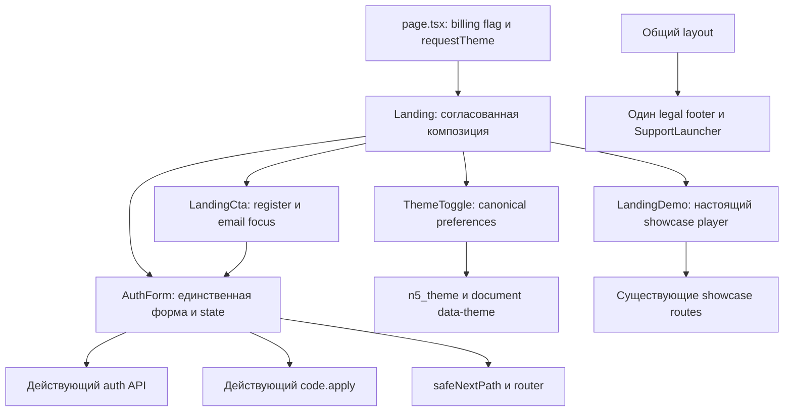

# Публичный вход — лёгкая архитектура M

05.11.2026. Предварительная схема для QCSD 3.5; завершение Step 5 допустимо только после
его настоящего вердикта и включения находок. Этот файл не является квитанцией stage/gate.
Опирается на FR-1…09 и ADR-001; новая domain model не требуется.

## Компоненты

`Landing` — client presenter, определяет порядок, public CSS boundary и UI mode через inline union
`'register'|'login'`. Mode/callback передаются существующим `LandingCta`/`AuthForm` через props;
`AuthForm` единолично владеет credentials DOM, busy/error/signedIn/pendingRegistration и сообщает
доступность переключения presenter. Второй auth state machine или remount формы не вводятся.
Программный focus выполняется
после выбора режима и не сбрасывает введённые значения. Конкретный local prop/callback контракт
фиксируется в Step 6; новый shared event framework не вводится. SSR markup через renderToStaticMarkup
остаётся доступным для существующей browser fixture; browser-interaction suite проверяет hydration.

`ThemeToggle` допускает opt-in text label, сохраняя старое default поведение; данные формы не
попадают в preferences. Цвета публичного shell сопоставляются существующим workspace tokens,
а тема остаётся `data-theme` с SSR/cookie и действующим store. Светлая тема макета не меняет
существующий dark default без explicit preference. Общие footer/support только стилизуются
в контексте public shell, не дублируются. Scoped styles не перестраивают кабинет и legacy routes.

## Действующие API и последовательность
1. Native validation + регистрационный UTF-8 bytes guard; невалидный ввод не делает fetch.
2. `POST /api/auth/register|login` с `{email,password}` только когда ещё нет signedIn.
3. `rpc('code.apply', explicit ? {code} : {}, true)` — в том числе при отсутствующем manual code.
4. `observeSignup()` для завершённой регистрации ровно один раз; затем
   `router.push(safeNextPath(next) ?? '/dashboard')`, `router.refresh()`.
5. Если auth прошёл, а apply упал, сохранён signedIn; retry повторяет только apply.
   «Продолжить без применения кода» вызывает `{discard_referral:true}` явно.

Busy защищает от повторной операции; ошибки auth/network/JSON/RPC остаются видимыми и
сбрасывают busy. Смена режима во время in-flight/signedIn retry не подменяет ожидаемое действие.
Hash/CTA focus и lifecycle cleanup не могут терять safe next query или накапливать listeners.
Эти API/серверные политики не редактируются. Никаких schema/DB/storage изменений.

## Реальные runtime-различия с HTML
Удаляются только offline notice/fake submit/disclaimer/dialog substitutes. Legal/support/forgot
переходят на настоящие routes. Компактный example сохраняет реальный LandingDemo с native controls,
poster/file/caption/link; preload=none, no autoplay, playsinline обязательны. Небольшая нативная
динамика player не меняет первый экран, порядок формы или approved palette/layout.
Для `/` только video-above-fold и desktop-CTA-hidden старого контракта заменяются FR-9.

## Observability
Новая runtime телеметрия/логирование credentials не добавляются. Сохраняется `observeSignup`
после реального завершения регистрации; события support identity и серверные ошибки остаются
в существующих механизмах. UI показывает busy/error/retry, а ошибки хранения темы — действующий status.
Показатели проверочного прогона: число успешных auth→dashboard из попыток и число JS errors;
счётчики вызовов auth/apply в изолированном QE доказывают отсутствие дублей. Production dashboard
для них не заявляется и не создаётся в этой дельте.
Внешний симптом отказа: CTA открывает неверный режим, форма застряла busy, redirect не произошёл,
атрибуция пропущена или demo недоступно. Это замечают пользователь и QA через видимый alert/сценарий;
координатор проверяет тестовый web smoke и отчёт независимого reviewer перед передачей владельцу.

## Проверка границ и поставка
Новый browser module + существующие responsive/demo suites покрывают 01 BDD и ADR Confirmation.
Критические negative controls: неверный auth mode, пропущенный apply, обход safeNext, огромный пароль,
desktop CTA hidden и потеря keyboard/reflow; фактическое красное→зелёное evidence сохраняет QE.
Сетевые фикстуры не доказывают real backend, delivery mail или полный Core CJM.
Только тестовый web `194.85.249.105 / n5-clipmaker`; backup/config/data/preserve-controllers до apply.
Cloud.ru `176.109.111.98` — после отдельной owner manual acceptance, не в этом архитектурном разрешении.
