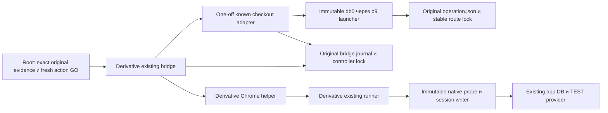

> **PROPOSED PRIVATE DRAFT — FR6 + QE2 repair, 06.11.2026.** Planning only; W/native/code неизменны. Source afc6 не принят: KCQE-04…09 unresolved. Adoption, originating reviews/gates и implementation допускаются только отдельно.

# Light architecture: known checkout recovery

**DRAFT, terminal-origin delta после read-only observation06.11.2026,11:08:37Z.** Все прежние решения по QCSQ-01, RISK-01/RISK-02, QT-01–QT-04 сохранены; новый snapshot требует originating verification. Основания:01, ADR-001,02; OpenSpec hashes закреплены в01. Бизнескод приложения и canonical db0/b9/f15/native/collector не меняются. Исторический callback QE4 CLOSED сохраняется. Никакого runtime допуска этот документ не выдаёт.

Reuse input binding: `features/recover-known-checkout-response/02_reuse_inventory.md`, SHA-256 `5030b383aeb5a3c1cc6ab3b4513592701e3dcc1c780a14efb6663833c759be52`. Это actual PRIVATE PROPOSED bytes, не W approval. Этот exact источник содержит dependency SHA roster; его изменение требует нового design snapshot, даже если default ideation scanner не включает имя02_reuse автоматически.

## C4 Component

Adapter — проверка и metadata transition одной известной попытки, с distinct proposed administrative kindD3; bridge — существующий consume/callback transport; browser/runner — прежний UI/native путь с явным typed recovered input. Нет новой службы, API приложения, очереди или общего recovery engine.

## A. Identity и доверенные входы

Одна связка включает original operation ID/directory/runtime binding/execution, original open ticket+callback request digest, original case/kind, baseline/GO/creation window, helper SHA и failed result, digest parsed-request projection с original case/source provenance и actual `idempotency_key`, original operator `request_key`, exact main account/intent/provider/shop/TEST/SKU/amount/currency. Значения ключей различаются и никогда не переписываются. Case `completed=false/lastActionFailed=open`, original `used[open]=consumed_unknown`, original execution/runtime_binding сохраняются.

Факты creation binding: original saved POST request и201 evidence; fixed SELECT с exact account+browser key возвращает ровно один intent, а ID совпадает с separately read provider GET, `metadata.order_id`, TEST shop, currency/minor amount/SKU. Сырые SQL/result/provider/input файлы и их sources/digests проверяются, а не заменяются caller boolean. Для pending — отсутствие target payment/event/grant подтверждается отдельно. Отсутствие table/column, неизвестная транзакция read-only, неполная выборка,0/2matches или mismatch → STOP. Application status GET может писать и не служит read-only inventory.

Fresh BOTH-store inventory с repeat stability и часовыми bounds нужен до recovery и каждого follow-up; whole raw сохраняется. Bounded admission определяется полным conjunction ниже, а не одним24h сравнением. Исключение допускает только `known_target_pending` вместо terminal/no_pending для единственного exact исходного intent; pending не вырезается из raw. Это **не** canonical full-cutover GO.

| Часть predicate | Все обязательные проверки; unknown/missing → STOP |
|---|---|
| Isolation | Actual canonical `isolation`: global=false, test=true, test_key_prefix=test_, approved непустой, allowlist ровно[approved], shop известен; equality с original approved_isolation |
| Полнота/время | stores строго[main,legacy], complete=true, stable_repeat=true; fixed bounded scans без truncation, repeat stable identity/business rows; finite observed_at,0≤now−observed_at≤90; фактические clocks/uncertainty известны |
| Действия в полёте | no_inflight=true и no_uncontrolled_checkout=true доказаны независимо от provider.status; pending **не** переписывает эти поля вtrue. Незавершённый HTTP/callback/helper или неизвестная внешняя completion блокирует действие |
| Intent/provider | Pending path: exact known target pending/unpaid с0target payment/event/grant и complete ownership/history. Direct terminal-only path C: exact canceled/unpaid/expired_on_confirmation, preserved DB created/unfulfilled,0target payment/grant и полная actual event history, без pending exemption. Другой pending/unknown либо неучтённая запись → STOP. Исторические terminal debts остаются DEFERRED_UNRESOLVED |
| Каждое actual event, включая связанное с target при его появлении | owner_known=true, store_known=true, shop_test_amount_known=true, terminal=true, history_complete=true, active_delivery=false; safe_ack существует, неunknown и неunknown_intent_200; значениеnot_relied_on допускается только при independently proven отсутствии active delivery и истёкшем24h окне, не как доказательство safe ACK поHTTP200 |
| Event clock | time_basis толькоprovider_event/event_receipt_upper_bound/terminal_observation_upper_bound; finite event_bound иclock_error_seconds≥0; event_bound+86400+clock_error_seconds<now. Равенство границе, created_at intent или неизвестная upper bound отказывают |

Pending intent без event не создаёт фиктивное event/ACK/time proof и не наследует возраст старого события. Если target получает event/доставку/terminal во время admission, re-read меняет classification: pending follow-up прекращается; automatic переход в другой action не выполняется. Native source cutover170–181 задаёт минимальную политику; adapter сохраняет все её conjuncts и дополнительно запрещает отсутствующий safe_ack. Для полного terminal reconciliation вызывается сам неизменённый canonical `cutover` без исключений. Provider status GET сам не webhook event: fresh canceled observation не создаёт event и обязательные24h от каждого GET. Отсутствие actual events допустимо лишь при independently complete whole history/delivery proof; refresh11:08:37Z не читал events/grants и этого не доказывает. Для каждого actual relevant event сохраняются row, ACK/delivery и clock predicate; неизвестная history/bound либо ещё не истёкшие24h → STOP, intent.created_at не заменяет event bound.

Original creation window immutable. Fresh recovery/action GO имеет отдельные start/deadline и exact original reference; max30мин, fresh observations≤90сек, один callback≤300сек и не позднее deadline. Original ticket/GO может уже истечь **как полномочие**: сохранённое historical evidence остаётся допустимым, только если исходный click/201/creation находились в его настоящем окне. Оно не разрешает новый callback. Active recovery/action deadline и source-set authorization проверяются на текущем времени; истечение любого из них → STOP, без приравнивания к возрасту архивных bytes.

Область A0/A1 creation-window proof — existing recovery modes. Proposed FR6/D3 сохраняет original raw window/clock fields как недоказанную forensic history и требует свой independently complete current terminal predicate; это не альтернативный способ объявить A0 установленной. Shared identity/isolation/history/source/partial guards обязательны всем kinds.

### A0. Explicit original evidence kind и составной derivative witness

Clarification KCQE-03: existing `origins` содержит ровно восемь keys `case,manifest,callback,browser_request,http,helper,go,cleanup`. Raw case/helper/go/cleanup сохраняются без дописывания. Manifest — original later manifest. Callback — единственный actual `type=callback` frame из bridge-output JSONL, не execute-command; сохраняются whole JSONL SHA, frame index, exact line digest, deterministic parsed-frame digest. Проверяется request_sha по pinned protocol. Browser_request — deterministic JSON **case.request**, its SHA означает projection bytes, не wire bytes. `http` хранит extraction metadata, case/helper SHA и projection SHA отдельно от original raw.

Два explicit kinds: `observed_response` только для действительно measured точного status/request/response timestamp; `inferred_201_from_pinned_helper` для c12 содержит inferred_status=201, method=POST, request_basis=parsed_postDataJSON, time_basis=controller_causal_interval, original_response_captured=false. В inferred kind response_at отсутствует, не равен completion/mtime. Proof checkout_response_bound=false и response:null; original failed case/consumed_unknown не меняются. Это не вход old response-bound admission.

Дополнительный конечный DATA roster: bridge-output JSONL, bridge-process, bridge-open-execute, open-helper-attempt/result, bridge-completion, bridge-launch-data/его manifest, pinned launch-witness bytes, initial runtime-spec, необходимые clock/history receipts. Role→raw SHA/field selectors и digest whole roster связываются с http/proof; paths не executable и не plugin/query authority. Exact source bytes capture/readback обязателен, неизвестные/дублированные роли STOP. Raw sources плюс derivative extraction snapshots сохраняются create-only с file/directory fsync/readback **до первой canonical persist** по AM-8; summaries не заменяют original raw.

Проверяемая цепочка: exact launch witness1f2350→captured812/manifest→один callback→совпавшие requestSHA256/ticketId attempt→failed helper-result/c12/case→bridge STOP→completion после source bridge wait. Execute context и callback должны совпасть с original operation request. Launcher реально пишет completion после p.wait; отдельно требуется связь именно этого helper failure с завершением bridge, не просто два exitCode1. C12 сначала проверяет201, затем сохраняет parsed request: это доказательство status inference при authentic binding, не timestamp.

Lower_raw=case.checkoutClickAt; upper_raw=bridge-completion.completedAt. Raw case.windowStart и click обязаны совпасть с proof и original GO semantics. Process.startedAt и attempt.attemptedAt — recorded controller fields, не response_at. Весь интервал с conservatively propagated clock uncertainty должен лежать внутри intersection original GO и callback ticket window; clamp к deadline запрещён. Root numeric candidate внутри окна пока не approved clock proof. Нужны historical process/clock-domain identity, continuity/uncertainty и causal links. Unknown → RECOVERY_ORIGIN_TIME_NOT_ESTABLISHED до authorization; mtime/текущее чтение/guessed point/нулевая uncertainty без доказательства запрещены.

DB created_at и source checkout_started_at не сравниваются с controller числами как causal order. Для точного same-clock synthetic case допустим click<=creation<=response; обратный response<=creation неверен. Реальному случаю нужны отдельно causal request→exact intent→response и clock offset interval для conservative mapping creation целиком в original window. Нельзя выбрать удобную точку интервала. Root offset bracket пока candidate: launcher startedAt пишется ПОСЛЕ Popen, поэтому сам этот source не доказывает, что recorded start предшествует remote program start; дополнительные causal/clock witnesses обязательны. Если source/clock bound не устанавливается — STOP/NOT ESTABLISHED без новой покупки. Existing point controls и inferred controls не смешиваются.

### A1. Exact-key/confirmation source в уже planned derivative runner

`K/run.private.py` содержит один fixed read-only collector для recovery, в том же pinned source; новый runtime файл не добавляется. Existing transport/config admission переиспользуется. В exact main store: `BEGIN ISOLATION LEVEL REPEATABLE READ READ ONLY`, local statement_timeout5сек, проверка transaction_read_only=on и store identity. Parameterized SELECT: `SELECT id,account_id,idempotency_key,sku,price_minor,grant_seconds,status,provider_payment_id,created_at::text AS created_at,fulfilled_at::text AS fulfilled_at FROM payment_intent WHERE account_id=$1 AND idempotency_key=$2 ORDER BY id LIMIT 2`. Bind `$1=original approved account`, `$2=actual browser key`; ровно1row, затем compare original window/expected intent/provider/SKU/amount, без фильтра по expected ID, скрывающего duplicate. Target grants: `SELECT id,account_id,payment_ref,source_key,total_seconds FROM credit_grant WHERE payment_ref=$1 OR source_key=$2 ORDER BY id LIMIT 2`, где `$1=exact intent`, `$2='intent:'+intent`; для pending требуется0rows, включая чужого owner. Whole collector покрывает payment/events. ROLLBACK всегда; никакого mutating application status GET.

После positive exact row — один authenticated GET fixed provider `/v3/payments/{exact provider_payment_id}` через existing native TEST credentials/config/fetch,5сек/64KiB, no redirects/no retries; ID не становится произвольным URL. Сохраняются actual status200/raw bytes и source/request/response digests private0600. Проверитьid/test/recipient.account_id/metadata.order_id/amount/currency против exact SQL+original shop; RUB amount разбирается как exact decimal minor units, без округленияfloat. Сначала классифицировать provider: pending допускает только pending path; canceled/paid=false/cancellation_details.reason=expired_on_confirmation допускает рассмотрение отдельного explicit terminal-only GO поC/D, без URL/browser; иной direct terminal outcome или unknown → STOP. Для pending follow-up дополнительно требовать `confirmation.type=redirect` и непустой `confirmation.confirmation_url`. Допустимы HTTPS exact provider hosts/subdomains из прежнего browser allowlist, без userinfo/нестандартного port; URL берётся **только** из этого body. Native/collector projections безURL не удовлетворяют pending URL входу. Hash URL bound to raw body; fullURL остаётсяprivate. Перед каждым допускаемым follow-up fresh GET/recheck; при terminal или любом mismatch — STOP follow-up, без автоматической смены authority на reconcile.

Проверен maintained donor `apps/web/src/server/payments/yookassa.ts`: `createYooKassaProvider(...).getPayment` уже возвращаетconfirmationUrl, проверяетshop/test/exact amount и задаёт5сек/64KiB/no-redirect. Его `RemotePayment` отбрасывает raw shop/test/confirmation.type, нужные независимому recovery proof. Поэтому здесь выбран уже имеющийся native rawGET transport с теми же пределами/проверками и private raw capture внутри runner; не новыйHTTPframework/SDK и не параллельный финансовыйdispatcher. Compile donor с dependency graph и observer-fetch ради одногоGET добавил бы scope; application source остаётся READONLY.

Root06.11.2026 проверил primary [ЮKassa: «Процесс платежа», Redirect](https://yookassa.ru/developers/payment-acceptance/getting-started/payment-process): redirect использует confirmation_url из объекта pending; expires_at в контексте waiting_for_capture не является TTL этой формы. Архитектор не выполнял сетевую проверку. **Вывод проекта для pending path:** fresh authenticated authoritative URL даёт допуск к одной навигации GET на существующую форму; это current validation, не обещание будущей жизни URL. Отсутствие expires_at само по себе не ошибка и срок не придумывается. Затем actual Chrome проверяет TEST banner, exact redirect/provenance/context, отсутствие expired/error формы и доступность ожидаемых полей **до submit**; fresh native provider всё ещё pending/unpaid. Неизвестная/истёкшая/изменённая форма, отсутствующий URL или неизвестный source → STOP follow-up без submit/нового checkout. Terminal-only path формы не открывает и URL не требует. Нельзя заявлять, что reconstructed URL равен потерянному original body.

### A2. Различимые полномочия

Historical original ticket/callback/case/source должны присутствовать в captured исходных bytes и связываться digest/equality; unknown ticket не становится известным от совпаденияcase. `used[original_open]=consumed_unknown` — ожидаемая историческая provenance, не replay authority. Новое active recovery authorization связывает этотorigin и exact frozen source-set; отдельный unused follow-up ticket связывает recovery receipt/action/case/helper и свой deadline. Все отказы до нового authorization save/callback/provider navigation/session: source mismatch не подменяетсяexpired error; replay отличается от original consumed_unknown. Source hashes сами не имеют срока, срок имеет разрешение использовать source-set в текущем recovery/action.

### A3. Независимо доказанная empty history и historical owner

KCQE-06: tagged history `actual_events` либо `independently_empty`; missing/unknown/неполная выборка никогда не empty. Actual events сохраняют каждый canonical ownership/store/shop/history/ACK/delivery/clock/24h predicate A. Для independently_empty event anchor/time/ACK row не создаются: нужны полные source-bound raw scans/count equality, coverage/retention, repeat stability, независимые delivery/no-inflight proofs. Пустая таблица сейчас не доказывает отсутствие удалённой/неполученной истории. Provider GET не delivery inventory. Неизвестный coverage/gap/retention/clock → STOP. Полный неизменённый canonical cutover вызывается в обоих случаях; чужой event age не наследуется.

Initial baseline — canonical hash original runtime-spec.inventory == original operation.inventory_sha; raw spec hash/source identity проверяются отдельно. Actual-prepared-20261106T070155Z/runtime-spec.inventory equality локально подтверждена. Later manifest.inventory сохраняется как более поздний snapshot, его равенство initial не требуется. Соседние old raw-inventory first/second лишь read-only candidates: source/digest/store/config/coverage/временная связь должны быть доказаны. Не создавать baseline row/event задним числом. Если projection initial inventory не содержит row, нужен подлинный existing archival raw row/account/store proof до origin; иначе STOP.

Sole action allowlist остаётся [approved], global=false/test=true. Known historical other owner разрешён только для immutable DEFERRED_UNRESOLVED, никогда для callback/session/checkout/fulfill/grant/relay. Положительно проверить actual account в exact store, row.account_id, historical provenance, intent/provider/order/shop/test/amount/currency/SKU, всю BOTH-store payment/grant/event историю и отсутствие cross-store collision/unknown. Непустой account_id или terminal provider не proof. Missing/deleted owner требует независимого archival identity evidence либо STOP. Corrected valid main observation: один approved owner из четырёх, все четыре correlation совпадают; INVALID initial extraction исключён. Это не ownership/history GO. Historical succeeded/unfulfilled не превращается в canceled и не исполняется: прежние payment/grant consistency predicates и DEFERRED_UNRESOLVED сохраняются.

Только existing planned runner получает bounded fixed reads, без нового executable/SQL interpreter. На каждом exact store: READ ONLY REPEATABLE READ, statement_timeout, transaction_read_only и actual database/schema/server identity/clock capture; fresh repeat и независимые delivery/inflight witnesses. Existing full bounded payment_intent/payment/payment_event scans/count equality сохраняются (cap128/truncation/schema gap STOP). Fixed ownership query: `SELECT id,status FROM account WHERE id=ANY($1::uuid[]) ORDER BY id LIMIT 128`; ids — все collected owners, exact set equality, без credentials/approved-only фильтра. Grants: `SELECT id,account_id,payment_ref,source_key,total_seconds FROM credit_grant WHERE payment_ref=ANY($1::uuid[]) OR source_key=ANY($2::text[]) ORDER BY id LIMIT 128` плюс exact count; bind все собранные intent IDs/intent:keys, включая cross-store/wrong-owner matches. Actual schema обоих stores проверяется; отсутствие таблицы/колонки не zero. Provider correlation — прежний fixed authenticated GET. Все queries здесь только будущая спецификация, не runtime разрешение. Эти reads не гарантируют delivery/retention proof: при отсутствии его источника admission остаётся STOP.

### A4. QE2: целостная BOTH-store корреляция и collector → admission

**KCQE-06.** До отдельной классификации debt построить из всех raw rows обоих stores единое соответствие `(provider, shop, TEST, provider_payment_id) ↔ (store, intent_id, account_id)`. Один provider object либо intent ID в разных stores, даже с двумя положительно известными owners, — collision/STOP; identical duplicate также не автоматически merge. Все payment/grant/event ссылки должны иметь ровно одного согласованного владельца в этом соответствии. Historical owner может отличаться от sole approved action account только в неизменяемом DEFERRED_UNRESOLVED, без fulfill/grant/action. Независимо пустая history остаётся допустимой; ни event, ни baseline anchor не создаётся.

Каждый actual event сверяется с raw ledger row (id/provider/provider_event_id/payload_sha256/created_at), authenticated payload/receipt, intent/provider metadata и exact store/account. Любые supplied account_id/intent_id/store annotations обязаны совпасть с этой цепочкой; нельзя игнорировать противоречие и пересчитать «правильный» flag. `owner_known/store_known/...` — проверенные результаты, не основания доверия. Event omission/duplicate, unknown provider relation, payload mismatch либо unknown ACK/delivery/clock → STOP; прежние actual-event 24h остаются.

**KCQE-09, фиксированный SELECT contract.** Existing runner `_whole_read` и adapter `inventory/_history_sources/historical_debt` изменяются согласованно, без SQL interpreter/new path. В обеих read-only REPEATABLE READ транзакциях обязательны actual DB/schema/server/clock identity, statement timeout, schema check, bounded rows и COUNT с тем же WHERE. Whole `payment_intent`, `payment`, `payment_event` scans не фильтруются approved owner. Payment projection содержит все реально потребляемые поля: `id,intent_id,account_id,provider,provider_payment_id,amount_minor,status,needs_review,created_at`; missing/null required field не превращается в false. Schema из maintained migrations021/022 — reference, actual BOTH-store schema всё равно проверяется.

После получения whole intent/payment/event references **обоих** stores в тех же снимках определить global bounded sets intent IDs/source keys; затем прочитать scoped grants. Для accounts набор owners определяется **отдельно для каждого store** из всех его intent/payment/event references и выбранных grants, без фильтра approved. Accounts: `SELECT id,status FROM account WHERE id=ANY($1::uuid[]) ORDER BY id LIMIT 128`, точный scoped COUNT и exact owner set equality. Grants: прежние `payment_ref=ANY($1::uuid[]) OR source_key=ANY($2::text[])` с global intent/key sets; дополнительно `OR account_id=$3::uuid` для sole target, чтобы не потерять прежний запрет target grant с чужой/null ссылкой. Те же WHERE/args для COUNT; projection `id,account_id,payment_ref,source_key,total_seconds`. Both stores используют одинаковые global intent/key sets для grants, поэтому wrong-store/owner grant не скрывается. Accounts проверяются по exact local referenced-owner set; owner другого store не обязан существовать в этой DB. Cross-store identity collision независимо запрещён global correlation выше. Scoped grants/accounts completeness помечается exact selector/args digest, не выдаётся за whole-table scan; whole financial intents/payments/events completeness сохраняется. Пустой набор аргументов — реально выполненный bounded zero-match запрос, не fabricated empty. Cap <128, malformed/unknown schema/count mismatch → STOP, no pagination/fallback/all-accounts scan.

Raw SELECT rows остаются неизменными. `payment_event` не имеет account/intent/ACK columns: нельзя просить несуществующие поля или считать flags данными SQL. Existing `history_read`/history data role возвращает source-bound event provenance для каждого raw event (плюс coverage/delivery); empty map допустим только при доказанном отсутствии events. Нормализованный `inv.events` — детерминированная one-to-one projection raw event+подлинного provenance, сохраняющая original row digest и все ссылки. Consumer заново проверяет exact bijection/count/digests/correlation, затем canonical event predicates; прежняя защита omission сохраняется, буквальное равенство raw SQL row и enriched event не требуется. Отсутствующий provenance не достраивается из provider GET. Это локальное уточнение existing history callback/data contract, не новый API или файл.

**Честное время наблюдений.** Вместо возвратного `time.time()` как будто это coverage каждого store: runner фиксирует actual collection start (wall+monotonic/current clock basis), реальные интервалы reads и per-store `evidence_cut` после его DB/provider observations, **до** запроса history. History source обязан подлинно покрывать этот уже прошедший cut с upper clock bound и retention до original chain; его `coverage.to` не меняется. Источник не обязан покрывать более поздний collector return. Глобальный `observed_at` определяется как recorded conservative lower bound collection start, а не как время единого атомарного BOTH-store snapshot; все per-source readings имеют собственные времена и freshness. `collected_at` при наличии — actual return observation только для диагностики, не coverage proof. Если clocks нельзя связать или store coverage не покрывает свой cut, STOP; нельзя выбирать точку/обрезать interval/подставлять min(to) для прохождения.

Две bounded whole DB read passes (включая dependent scoped reads) дают equal rows/counts/digests; provider/history receipts остаются отдельными actual observations. Source-bound quiescence/no-inflight/delivery и permanent writer fence должны покрывать весь collection interval до admission; равенство двух SELECT само по себе не доказывает отсутствие промежуточных событий. Изменение при повторе, актуальная доставка между cut и admission, несвязанная retention или elapsed > прежних freshness/collection limits → STOP. Canonical cutover получает conservative observed_at и прежние flags/events только после этих проверок. Это не новый historical A0 clock proof. Для independently empty никакого event timestamp не появляется. Пока actual источники не обеспечивают эту coverage/quiescence, runtime остаётся NOT_ESTABLISHED, даже если synthetic roundtrip проходит.

## B. Source identity, permanent protocol fence и разрешённые входы

Старые sources из02 остаются immutable. Derivatives и adapter имеют отдельные measured SHA; original `operation.execution` и `journal.binding.execution` по-прежнему db0/b9. Bridge захватывает old namespace через неизменённый b9; adapter отдельно читает strict0600 bytes без symlink, проверяет exact reviewed SHA и компилирует captured bytes в isolated namespace. Никаких dynamic plugin imports/monkey-patch/подмены `EXECUTION`/переноса `CONFIRMED` между процессами. New bridge invocation bytes и adapter/helper/runner/native/collector SHAs входят в recovery source-set; public manifest показывает SHA, private evidence — actual paths/captured bytes.

Ниже recovery slots/closure описывают прежние C/D modes; D3 использует тот же permanent B1 fence, но distinct administrative slot и typed phase predicate вместо recovery slot. Никакой fallback между kinds.

Исходный binding B0 равен `{runtime:runtime_binding(spec),execution:db0_EXECUTION}`. Под обоими стабильными locks одноразовая миграция создаёт B1: те же **неизменённые** runtime/execution плюс `recovery_protocol:{version:1,source_set_sha,origin_binding_sha,origin_open_ticket_sha}`. Исходные bytes journal/B0 сохраняются create-only с режимом0600 и digest; одновременно с B1 журнал получает recovery slot `consumed_unknown`. Поля не удаляются после completion; неизвестные version/source-set → STOP. Source-set hash вычисляется из фактически captured bytes и ролей, а не произвольного утверждения caller. Сохранение original values не означает побайтного равенства всего обновлённого journal.

В actual old812 проверка `journal['binding']==binding` до `operate` сравнивает весь dict и отвергает дополнительное поле recovery_protocol. Его source не изменяется. Новый bridge проверяет exact B1/protocol/original digest/captured source-set и текущие recovery/operation closure **до** любого canonical business call. B0 принимается только для явной миграции exact original incomplete_pending с нетронутым used, а не для обычного checkout. После B1 нет fallback к прежнему binding. Исходный execution остаётся db0/b9; миграция executor SHA не производится.

Порядок fence: controller lock → route lock → source/identity/origin admission → create-only snapshots → atomic journal B1+consumed_unknown с actual file/directory fsync и readback → route revalidate/binding. Direct terminal branch C вставляет первый canonical revalidate/fullcutover **после snapshots и до B1**; после B1 остаётся повторная проверка. До B1 business всё ещё incomplete_pending без new_checkout, хотя canonical health trace может изменить live operation bytes; crash не разрешает checkout. После B1 старый bridge всегда отказывает, новый проверяет exact phase D2 либо D3; ordinary не получает admission до соответствующих двух closure и witness. Уже работающий старый bridge держит тот же controller lock всю session: миграция не происходит, пока он активен; locks не удаляются и не захватываются принудительно. Partial snapshot/.next/readback/fsync или kill → STOP и отдельная read-only сверка, не automatic retry. Откат B1 к B0 или смена directory не поддерживаются.

| Реальная точка входа/роль | Enforcement в этом scope |
|---|---|
| Новый bridge: ordinary checkout/follow-up/recovery/reconcile | До financial callback требует B1 и exact source-set. Recovery ordinary: journal terminal_reconciled **и** matching operation history/reconciled + D1. Distinct admin first ordinary: только D3 typed joint/resync/full freshgate/one-time consume+archive. Partial/other unknown →0callback |
| Actual historical812 bridge напрямую либо через прежние prepare/launch transport wrappers | Strict binding equality отвергает B1 **до operate/ready/callback**; при B0 original incomplete_pending и отсутствие new_checkout блокируют canonical новый checkout/follow-up. `launch-bridge.private.py` только передаёт captured812, не dispatches helpers |
| b9 captured launcher → db0 `main` | CLI вызывает только `operate` apply/revalidate/recover, не `operator_business`; business callback/checkout/session отсутствуют. Config recovery сохраняет halt/incomplete и не снимает B1. Financial action в spec отвергается; tests проверяют0callbacks |
| Новый adapter: standalone import/call | Неавторизующий leaf: mutable/global fallback и standalone dispatch отсутствуют. Entry function требует caller-held original locks/source-set и exact typed state: B0 только initial producer C/D либо D3, затем B1; иначе STOP |
| Old/current browser/run helper CLI как callback leaf | Ранее разрешённый direct recovery case scope — только original decline, original files/keys; old open отказывает при existing case, old submit/cancel/reload — при missing intent/wrong case; old session-create — при existing revoked session record. Guard/probe только read-only; paid-job/relay не входят в recovery. Новые derivatives требуют exact unused callback ticket + соответствующий typed recovery либо D3 admin/current phase digest до session/browser действия. Произвольный новый kind/workspace/GO не является разрешённым входом |
| Native probe / compiled auth writer | Только leaf существующего captured runner и exact emitted callback/cleanup; самостоятельный stdin с новыми token/intent/action не является controller authority и в scope не входит |

Это граница конкретных авторизованных launch commands, не OS sandbox от root. Прямой вызов exported `operator_business` собственным Python, изготовление fresh GO/другого case или удаление B1 — произвольное изменение программы/authority, не разрешённая CLI альтернатива. Root до code сверяет actual inventory: если существующий разрешённый autonomous dispatcher или direct helper с правом **нового** checkout/session минует эти guards, scope NOT ESTABLISHED и ADR пересматривается; нельзя просто назвать такой вход leaf. В fixtures historical812 и каждый перечисленный вход исполняются actual captured bytes с otherwise valid synthetic admissions в его законном scope; proof не заменяется проверкой строк. Positive после closure — новый bridge → explicit derivative D2 → real canonical primitives; historical812 остаётся запрещённым навсегда.

Дополнительный READONLY transport witness: original case `launch-bridge.private.py`, SHA256 `1f23509d0f41b7d679b809693325f4ac801fd74f691fb03024fe2e39d5e3a54d`; его изменение не входит в4 runtime targets. Root binding inventory учитывает эту affected dependency при проверке входов. Новый entrypoint/command/service не добавляется.

Private execution workspace может содержать frozen derivative browser/runner, immutable native copy и recovery-specific own-session evidence. Это workspace артефактов, не новая financial namespace: operation directory, lock paths, original case/open ticket/keys неизменны. Canonical f15 и его paid-media consumers остаются byte-identical; recovery branch не вызывает paid-job-probe/relay.

## C. Одноразовый recovery journal

Единственный authoritative recovery slot добавляется в **тот же** `controller-bridge.json`, с фиксированной связью original open ticket; пользовательский новый recovery ID не может создать второй slot. Proof `kind=known-checkout-recovery-v1` содержит original snapshots/digests/identities, оба ключа, actual201 known, `original_response_captured=false`, fresh evidence/source-set и отдельный current metadata/action window. `checkout_response_bound` отсутствует/false; `new_checkout` не создаётся. Старый `admit/operator_business` не получает reconstructed context.

1. Тот же controller lock → тот же route lock; canonical identity/mode/owner/inode/baseline checks. Отозвать локальный CONFIRMED при входе; не наследовать authority после fork/ошибки. Валидация inputs/source/proof выполняется до записи допуска.
2. Capture immutable original case/helper/operation/journal snapshots и доказательства; потребовать exact failed/open/consumed_unknown, отсутствие old new_checkout и другого recovery/active_case. Выполнить B0→B1 fence migration изB: одна atomic запись B1+recovery slot `consumed_unknown` с intent/bindings **до** transition/side effect. Canonical persistence:0600, fsync файла и директории, readback; snapshot files create-only, не заменять исторические bytes.
3. В том же process/lock scope вызвать canonical `revalidate` с actual fresh control/identity/health/backup/config checks; сверить unchanged original business attempt и current source-set. Только затем одним journal save установить `recovery.state=bound` и `active_case=original_case`, сохранив весь `used`.
4. `bound` означает `creation_known/payment_pending/binding_recovered`, не successful helper/payment. Recovered browser input — отдельная projection с proof digest; original case остаётся failed. Отсутствующий/несогласованный projection даёт STOP, не попытку восстановить его и повторить action автоматически.
5. Существующий `consumed_unknown` **нового recovery/action slot**, partial file/temp, недоказанный fsync/rename/readback, crash либо повтор recovery → STOP до отдельной read-only сверки. Original open `consumed_unknown` остаётся обязательной исторической provenance и сам по себе не блокирует первое binding. Автоматическое завершение interrupted recovery или смена namespace запрещены.

**Прямая terminal-only ветка для expired origin:** explicit finite metadata GO и proof того же kind с `mode=terminal_from_origin` выбираются до admission; pending sequence steps3–4 не исполняется. Эта ветка никогда не создаёт `bound`, `active_case`, recovered browser projection или action ticket/callback/session. Под прежними controller→route locks порядок обязателен:

1. Bridge до обычного startup `operate/revalidate` проверяет captured source/origin, current metadata/source-set authority и исходный business; clear CONFIRMED. До **любой первой canonical persist** снять exact raw operation envelope и bridge journal B0/used, а также case/helper origin, в уже предусмотренные create-only0600 snapshots с file/directory fsync и readback/digests. Это pre-revalidation bytes, не повторная JSON serialization и не поздний снимок уже обновлённой operation. Failure/partial snapshot запрещает вызов revalidate; existing snapshots не перезаписываются. Early capture — не recovery authorization и не standalone adapter dispatch.
2. Выполнить fresh read-only A/A1 и held-FD revalidation boundary D2a с actual canonical control/health/backup/config/persist primitives. Canonical db0 revalidate390–403 вызывает persist138–145: live operation может получить `revalidated_health`, `last_completed=revalidated`, route transition и новый envelope SHA; stored state остаётся canonical `healthy_unconfirmed/applied=false`, CONFIRMED только process-local. Разрешён этот trace, а не изменение business/attempt/business_history/new_checkout/execution/runtime_binding; сравнение с captured origin проверяет эти поля и отсутствие новых authorization records. Journal B0/used пока неизменен. Caller `terminal=true/no_pending=true` не заменяет raw evidence и выполненные проверки.
3. Требовать exact provider canceled/unpaid/expired_on_confirmation, DB created/unfulfilled,0target payment/grant, complete BOTH-store history и полный canonical cutover со всеми actual events; вновь проверить current authority/source/evidence freshness. При early event/incomplete-history/unknown → STOP: **нет B1/recovery slot/business authorization/closure**, исходные operation bytes остаются в snapshots, допустимая canonical health trace в live operation сохраняется и не rollback. Это запрет authorization transition, а не обещание byte-identical live operation после revalidate.
4. Только после fullgate, при unchanged origin business/journal и прежних source/locks, записать atomic B1+recovery consumed_unknown с digests ранних snapshots. Повторная canonical revalidate и current authority/unchanged-evidence/source проверка ведут сразу к D reconciling_unknown и двум durable closure. B1 migration/old812 fence и все checksB сохраняются. После consume любой expiry/drift/kill → partial STOP без automatic retry.

Kill до/во время/после первой actual persist проверяет границу, предшествующую B1: durable snapshots не теряются, partial `.next`/readback не удаляются новым автоматическим запуском, health trace не считается binding или completion. До B1 old business incomplete_pending блокирует новый checkout; после B1 действует permanent fence/joint closure. Повтор после interrupted preflight останавливается для отдельной read-only сверки, не наследует CONFIRMED и не перезаписывает origin evidence. Fresh metadata window отдельно от historical creation; истёкший original ticket допустим только как provenance с creation в прежнем окне, не как current authority.

## D. Follow-up и terminal reconcile

Bound receipt сам не запускает provider. Root допускает один exact action согласно original case и fresh facts; для decline при фактически pending target — существующий TEST decline submit по тому же provider ID/confirmation URL. Если target terminal, submit/cancel запрещены; разрешена read-only classification и только отдельно допущенный metadata reconcile. Текущий expired target формы/action не имеет. Обычный old ticket не переписывается: восстановленный pending action имеет отдельный unused authorization, связанный с original unused intended action/ticket digest, case и recovery digest; никакого retry original open. Новые action deadlines/helper SHA записываются отдельно от старого manifest.

Bridge при recovered action требует `active_case` + bound proof/source set и phase PENDING_BOUND изD2. На guarded entry caller однократно берёт original controller→route locks и явно передаёт тот же held route FD через adapter/revalidation/derived boundary; host FD передаётся отдельно. Fresh canonical revalidation использует существующие primitives без recursive open/flock или отпускания route. Оба locks сохраняются через consume→callback→reply/positive own cleanup. До callback штатный journal сохраняет action `consumed_unknown`; callback reply требует exact id/request/context/helper/evidence hashes. Allowed actions ограничены исходным case и проверкой результата; checkout/relay/paid-job недоступны. Неизвестный reply/result/cleanup → STOP, без повторного callback. Положительная запись относится только к новому action; original open остаётся failed/consumed_unknown.

Browser/runner получают typed recovery projection. Original creation window передаётся только immutable native probe как trusted `extra.windowStart`; fresh `run.window` проверяет текущую опубликованную identity/GO. Derivative runner не принимает произвольный historical intent: proof/source/case/account проверяются до native вызова. Read-only collector A1 — единственный источник recovered confirmation URL. Для follow-up используется native own-session writer; новый token имеет отдельные recovery-owned files, исходная revoked session не оживляется. Cleanup проверяет exact own account и positive native revoke, сохраняет receipt даже при failed action. Ошибка revoke оставляет `cleanup_unknown`, completion не выставляется.

Terminal reconcile — отдельный явный metadata action. Он требует exact provider terminal (`succeeded` или `canceled`) и соответствующих intent/payment/event/grant данных; decline подтверждается cancellation reason, не одним UI. Для текущего decline/cancel —0target grants; success требует canonical correlated unique grant. Затем **полный** fresh BOTH-store `cutover`, без pending exemption, со всеми relevant event bounds и24ч, no_pending/no_inflight и isolation equality. Новое terminal event получает своё окно; создание intent давно не сокращает это ожидание.

Для direct `terminal_from_origin` допускается только narrow expired combination изC: DB created/unfulfilled сохраняется в raw evidence и history вместе с exact provider canceled/unpaid и0target payment/grant. `no_pending` означает отсутствие actual нерешённого provider/financial outcome при complete correlated history, не вымышленное изменение DB status. Unknown local/provider discrepancy, неизвестная доставка/запись или grant → STOP; mutating application status GET/SQL cleanup запрещены. `expired_on_confirmation` сохраняется как `outcome=expired_before_recovery`, decline/manual-cancel NOT VERIFIED; ни original open, ни intended follow-up не становятся completed. Положительный previous own-session revoke proof остаётся проверяемым historical evidence; direct branch не создаёт session и не фабрикует новый cleanup receipt. Succeeded/иной direct outcome не расширяет этот branch. Post-bound terminal reconcile сохраняет прежний contract.

Под теми же locks adapter сначала durably ставит journal `reconciling_unknown`, затем canonical `persist` добавляет в `business_history` original `attempt` и failed raw snapshot hashes, `response:null`, typed `recovery` и terminal reconciliation. `new_checkout` не появляется. Историческая форма сохраняет `history.attempt.request.request_key`, используемый old checkout reuse guard. `operation.business=reconciled/reconciled_at` устанавливается только после этой проверки; `execution/runtime_binding` остаются прежними. Затем bridge journal фиксирует `terminal_reconciled` и снимает active_case лишь если он существовал в pending path; в direct path его отсутствие сохраняется. Direct mode требует origin/B1/fullgate и matching closures, а не fictional bound/follow-up. Crash между writes → partial state, no automatic retry и no next checkout; новый bridge перед любым action проверяет отсутствие такой незавершённой recovery записи.

Следующий обычный checkout разрешается через новый bridge только после обеих durable завершённых записей и matching witness D1, fresh GO/baseline/full inventory и explicit caller-held derivative D2 с прежними canonical predicates. Наличие `operation.business=reconciled` без bridge closure не разрешает новый запуск: новый bridge проверяет joint state, historical812 отказывает по permanent B1. Reconcile не снимает fence и не переписывает old ticket/source-set. Никакого grant/SQL cleanup/исторического relay. Emergency route restore остаётся canonical с business halt; recovery receipt не отменяет этот halt.

### D1. Finalization barrier и точка admission

Обе business closure необходимы, но недостаточны для POST_RECOVERY ordinary/session entry: требуется один data-only `recovery-finalization.private.json` в **original financial namespace**, bound к единственному origin/recovery. Это audit data, не source output/новый helper/WAL/framework. B1 permanent. Все recover/joint/ordinary/session/action/reconcile entrypoints перед первым canonical operate/revalidate/save проверяют phase/source/locks, .next/partial/snapshot status и unknown всех предыдущих actions, независимо от нового ticket. Partial bytes не удаляются; законный complete snapshot не partial. Неавторизованный direct b9 revalidate не объявляется защищённым: если root допускает его в обход guard, affected admission STOP. Immutable db0 save неизменён.

Под прежними locks: live metadata/source authority → durable reconciling_unknown → actual operation closure file/directory I/O + readback → authority check → actual journal business closure file/directory I/O + readback → authority/source/lock/phase check. **L** — последнее наблюдение ПОСЛЕ успешных real completion/readback ОБЕИХ closure при ещё live metadata/source authority. Проверяются wall-clock bounds и monotonic elapsed/clock mapping; unknown/backward jump STOP. Начало последнего fsync не L. Late business I/O/readback не формирует confirmation; terminal-looking поля в файлах не разрешают следующий checkout.

Только после L frozen producer формирует неизменяемый payload: version/kind, operation/open-ticket/origin/source-set/authority digests/windows, actual observed completion/readback times двух closure, L и clock basis, raw closure digests и stable business/history/recovery projection digests. Время читается после реального syscall/readback, не до него и не реконструируется новым процессом. Projection исключает лишь собственный confirmation и volatile health trace, сохраняет exact business history/execution/runtime. Один общий projection contract, не broad ignore. Source-order evidence защищает разрешённый producer/crash model, не arbitrary root forgery.

После L — один bounded create-only atomic audit write0600 с actual file/directory fsync/readback. Его persistence может закончиться после истечения старого окна: это attestation prior L, не новый action и не продление GO. После expiry нельзя повторять business writes/наблюдать L заново/менять payload time. Producer сообщает completion только после audit durability/readback. Отсутствующий, partial, conflicting witness или .next на следующем entry → STOP даже при двух closure; confirmation не достраивается автоматически из terminal полей. Complete surviving witness без partial является только кандидатом: exact prior-L/closure/source/authority bindings не доказывают его собственный producer fsync/readback. Принятие возможно лишь после обязательного reader resync ниже; killed producer не объявляется успешно завершившимся. Рекурсивного witness собственного fsync нет: свидетельствуется prior L, не будущая собственная запись. Exception в памяти/компенсация не safety barrier.

**RISK-03: обязательный audit-only reader resync на каждом POST_RECOVERY ordinary/session entry.** Ранние producer/pending phases определены вD2 и не требуют ещё не созданный witness; это не разрешение resume после crash. Payload остаётся неизменным доказательством prior L; собственную durability record не удостоверяет. Новый reader обеспечивает её сам, не реконструирует прежний writer outcome. Алгоритм ограничен одним существующим witness и исходным namespace:

1. Проверить fresh exact GO и current source authority, взять прежние controller→route locks; повторить authority после ожидания каждого lock. До любого canonical operate/revalidate/persist/business callback выполнить existing partial/unknown/action guards. Absent, .next, truncated, conflicting witness или неизвестная phase → STOP без удаления, rename, достройки, нового snapshot/confirmation или terminal write.
2. Через held verified original parent directory FD открыть **существующий** witness с O_NOFOLLOW/O_CLOEXEC (без O_CREAT/O_TRUNC); regular file, exact path/dev/inode, expected owner/mode0600/nlink1 и bounded length. Parent directory/path chain привязаны к original operation, без symlink/replacement. Прочитать exact bytes с held FD, проверить frozen prior L/clock/source/authority digests/windows, обе closure и exact phase/projections по D1; current GO не заменяет historical L proof. Проверки after blocking open/read и перед каждым дальнейшим syscall; неизвестность/ошибка STOP.
3. Не меняя ни одного byte, выполнить **реальный fsync held witness FD**, дождаться результата; проверить fresh authority, locks и file/path identity. Затем **реальный fsync held parent-directory FD**, дождаться результата; снова authority и identities. Затем exact bounded readback из того же held FD (сначала rewind) и независимое O_NOFOLLOW открытие исходного pathname через тот же bound directory: dev/inode/owner/mode/nlink/length и bytes/digests должны совпасть с первоначально проверенными. Parent path всё ещё должен соответствовать held directory. Проверить отсутствие partial/conflict и closure/phase drift. После каждого blocking шага и непосредственно перед переходом к business снова проверить fresh GO/source authority; любую late/unknown completion считать STOP, даже если fsync фактически состоялся.
4. Только successful real fsync→directory fsync→readback/identity chain, завершённая при live current authority в **этом** process/lock scope, удовлетворяет reader barrier. Далее прежние fresh baseline/fullgate/canonical admission и action guards; никакого callback на основании одного surviving payload. Разрешение reader не сохраняется в новом файле, не наследуется после fork/kill и не переносится в другой процесс/lock scope. На каждом новом entry полный reader resync повторяется для complete witness. Это синхронизация готовых подтверждённых данных, не automatic resume absent/partial свидетельства. Если платформа не может выполнить/подтвердить fsync held FD или directory — STOP, без fake success/альтернативного writer.

Producer normal success по-прежнему требует собственные file/directory fsync/readback; resync не утверждает, что убитый producer успел их выполнить. Producer kill до/после file fsync, rename, directory fsync и readback проверяется отдельным fresh reader. Особые cases: rename уже убрал .next, полный witness виден, но producer погиб до dir fsync либо readback — positive возможен **только после reader actual resync**. Reader SIGKILL до/после open/validation/filefsync/dirfsync/readback и перед business →0business до completed barrier; новый reader начинает resync заново. У reader нет rename/write, их count=0; producer rename boundary достигается fixture реально. Independently observed syscall returns/FD/inode/order, bytes/L/time/closure unchanged обязательны. Late-reader-fsync/dirfsync/readback при otherwise-valid inputs, real I/O failure, inode replacement, unknown/partial →0business. Skip-filefsync/skip-dirfsync/skip-readback/early-business mutations должны нарушить наблюдаемый порядок/counters, а не просто выдать unrelated exception.

POST_RECOVERY ordinary/session entry проверяет witness **до** canonical persist и требует fresh ordinary GO/baseline/fullgate. До первого subsequent business transition сравниваются raw closure digests; после законного canonical trace — неизменяемые closure/history projection и exact phase chain с сохранённым raw provenance. Новый GO не исправляет missing witness. Kill до/после каждого closure fsync/readback/L и confirmation write/rename/dirfsync/readback: absent/partial →0nextcallback. Late-final-business-fsync →0confirmation/0nextcheckout. Отдельный positive: обе business closure/readback+L были live, только audit persistence delayed; сохранённый complete witness после reader actual resync при live fresh authority может разрешить лишь **новый** обычный admission с новымGO/fullgate. Это явная linearization семантика, не случайное exception после позднего durable terminal.

Для distinct administrative kindD3 D1 durability algorithm переиспользуется с собственными typed administrative closures/projection. Он не утверждает operation.business=reconciled, A0 или recovery success. Existing recovery witness kind/projection не меняются; kind mismatch/conflict STOP.

### D1a. KCQE-04: подтверждение завершения каждого действия в existing journal

**PROPOSED D1a-v1; не implementation/verification.** D1 final recovery/admin witness не удостоверяет позднее действие. Исправление противоречия: **все** final business/admission markers, включая `canonical_returned`, `ordinary.state=response_bound/reconciled`, active_case, response/cleanup и operation/business/history, записываются **до** L_action. До exact valid completion они для **каждого** consumer означают UNRESOLVED. После L разрешено добавить только immutable completion; post-L promotion какого-либо marker/phase запрещён. Original failed open остаётся exact origin exception, никогда completed action.

#### D1a.1 Порядок и граница допуска

1. До session/callback — full phase/source/whole-held-scope admission, проверка всего previous unknown ledger и capacity, затем durable own `consumed_unknown` (ordinary: вместе с binding D1a.2 до startup persist/session/callback); до ordinary metadata reconcile — own `ordinary.state=reconciling_unknown`. Active exception относится только к текущему durably consumed invocation. Reader, `_partial`, `_ordinary`, `recovered_action`, `reconcile_bound`, `joint/_resync`, runner `own_session/native_leaf` и остальные разрешённые entries используют один смысл UNRESOLVED. Чужой valid unused ticket не обходит его. Old source остаётся fenced B1.
2. Один actual callback, exact response/business/history guards, guarded canonical operation persist, reply evidence, positive exact-own cleanup и их реальные fsync/rename/parent-dir fsync/exact readback. Последний business journal persist уже содержит **окончательные** markers/phase и binding результата. Whole guard после каждого blocking boundary и до каждой persist. Все эти I/O, cleanup и postchecks должны завершиться при live action/metadata/source authority. Видимый final marker при late business I/O, failed postcheck или kill остаётся unresolved; L/completion нет, новый callback запрещён. Никакой компенсации или backdated L.
3. После последнего business readback producer ещё раз проверяет обе original lock ownership/FD/path/inode, host/source/control/phase/current record, отсутствие partial и все live windows. Только этот живой producer фиксирует настоящий L_action, замораживает payload ниже и прекращает business writes. L не выводится из mtime/markers/cleanup после crash и не создаётся/не передвигается после expiry.
4. Audit пишет один absent completion leaf в existing journal. Удаление **только этого leaf** из post-audit JSON обязано дать byte-identical `encoded(pre_audit_journal)`; все прочие поля, health trace и прежние completion равны прежним canonical bytes/значениям. Operation raw bytes тоже неизменны на audit interval. Не допускаются marker promotion, новый used/ticket/ordinary container, изменение previous entry, callback/session/new business. Для metadata пустой `ordinary.completions={}` создаётся business write **до L**, audit вставляет только один key. Реальный audit I/O может закончиться поздно после genuine live L; это лишь candidate. Source/locks/path/integrity checks сохраняются, expiry не расширяет business authority. Producer success отдельно: только после собственного actual audit fsync/rename/dirfsync/readback и live return checks; иначе STOP, включая killed producer.
5. Перед новым legitimate effect fresh reader под собственным fresh GO и обоими original locks проверяет schema, snapshots, chain/current phase/source/authority/L и отсутствие unresolved. Затем выполняет реальный `fsync(held controller-bridge.json FD) → fsync(bound parent directory FD) → exact FD/path readback + identity`, с whole guard вокруг blocking boundaries. Файл перечитывается через bound parent, сравниваются bytes и dev/inode; wrong FD, replacement, partial, expiry/error → STOP/0effects. Только затем новый отдельный ticket/fullgate. Никакой записи «reader completed». D1/D3 finalization-file resync остаётся отдельно обязательным по phase.

#### D1a.2 Закрытая schema и canonical bytes

Здесь задаётся data contract в existing bridge/adapter/runner, без нового command/module/export/path/schema-framework. Источники: actual bridge `encoded/_partial/_projection/_ordinary/recovered_action`, runner `cleanup_result/own_session`, immutable db0 `persist/loadrecord` из02. Current source ещё **не** реализует этот контракт.

`C(x)` — ровно existing Python `json.dumps(x, sort_keys=True, separators=(',', ':'), ensure_ascii=True, allow_nan=False).encode('utf-8')`, без newline. Duplicate JSON keys, NaN/Infinity, invalid Unicode/surrogates, bool вместо integer/number, неизвестные keys/version → STOP. Hash `H(label,x)=SHA256(b"clipmkr/action-completion/v1/" + ASCII(label) + b"\x00" + C(x))`, lowercase64hex. Существующие source/ticket/raw hashes остаются обычным SHA256 их actual raw bytes либо C(value), как в pinned sources; domain hash их не подменяет. Object order canonical; array order сохраняется, map keys не нормализуются, absent отличается от null. Snapshot хранит значения, не serializer-specific whitespace; raw source/operation bytes отдельно связаны SHA256.

Типы: `Digest`=64 lowercase hex; `Id`=непустая UTF-8 string≤128 bytes; `Case`=`success|decline|cancel`; `Num`=finite int/float (не bool); `UInt`=int≥0 (не bool). `Const(v)` означает exact recursive value **и type/key presence**, совпадающие с source-bound frozen value; это закрытая instance schema, не разрешение произвольных дополнительных полей. Все перечисленные ниже keys обязательны, additionalProperties=false на каждом новом object. Null допустим **только** где указан; отсутствие любого обязательного key запрещено. Completion leaf до audit **absent**, не null/пустой object.

| Object | Ровно keys и типы |
|---|---|
| Completion | `kind: "action-completion-v1"`, `version: 1`, `generation: UInt≥1`, `slot: Slot`, `operation_id: Id`, `origin_sha: Digest`, `source_set_sha: Digest`, `phase: "PENDING_BOUND"|"POST_RECOVERY"`, `case: Case`, `action: "submit"|"cancel"|"reload"|"checkout"|"POST"|"mutating-status"|"reconcile"`, `helper: string|null`, `helper_sha: Digest|null`, `ticket: object|null`, `ticket_sha: Digest|null`, `context: object`, `context_sha: Digest`, `metadata_proof_sha: Digest|null`, `authority: Authority`, `anchor: Anchor`, `predecessor: Digest`, `before: Snapshot`, `after: Snapshot`, `before_sha: Digest`, `after_sha: Digest`, `operation_raw_sha: Digest`, `cleanup: Cleanup|null`, `io: IO`, `L: Observation` |
| OrdinaryDescriptor | `id: Id`, `phase: "POST_RECOVERY"`, `case: Case`, `helper: "browser.open"|"browser.submit"|"browser.cancel"|"browser.reload"`, `helper_sha: Digest`, `source_set_sha: Digest` |
| OrdinaryBinding | `ticket: object` (exact ordinary ticket ниже), `context_sha: Digest`, `authority: Authority` |
| OrdinaryGO | `source_set_sha: Digest`, `origin_sha: Digest`, `start: Num`, `deadline: Num`, `ordinary: GOJoin` |
| GOJoin | `roster_sha: Digest`, `descriptor_sha: Digest`, `context_sha: Digest`, `ticket_sha: Digest`, `expected_generation: UInt`, `expected_head: Digest` |
| Slot | `store: "recovery.actions"|"used"|"ordinary.completions"`, `key: Id|Digest` (ticket id для первых двух, derived Digest для metadata) |
| Snapshot | `operation: object`, `journal: object`, `prior_entries: [EntryRef,…]` |
| EntryRef | `generation: UInt≥1`, `store: Slot.store`, `key: Slot.key`, `sha256: Digest`; порядок строго generation, без duplicates |
| Anchor | `kind: "pending-origin"|"recovery-finalization"|"administrative-terminal-finalization"`, `operation_id: Id`, `origin_sha: Digest`, `source_set_sha: Digest`, `basis_sha: Digest`, `base_sha: Digest`, `roster_sha: Digest` |
| Authority | `metadata_go: Window`, `source_authority: Window`, `action_window: Window|null`, `metadata_go_sha: Digest`, `source_authority_sha: Digest`, `action_ticket_sha: Digest|null`, `expected_generation: UInt`, `expected_head: Digest` |
| Window | `source_set_sha: Digest`, `start: Num`, `deadline: Num`; это exact projection из whole original GO/source/ticket, чьи ordinary SHA связаны выше; whole original authority objects читаются из existing bound proof/ticket inputs по их SHA; обязательны exact raw-value equality и прежняя source-bound schema, без inference из Window |
| Observation | `wall: Num`, `monotonic: Num`, `pid: UInt>0`, `wall_start: Num`, `monotonic_start: Num`; exact producer samples existing `_authority`, не timestamps fs metadata |
| IO | `operation: Observation`, `journal: Observation`, `cleanup: Observation|null`; каждый sample снят **после** actual final successful соответствующих I/O/readback, operation sample для read-only action после revalidation persist/readback |
| Cleanup | `account: Id`, `revoked: true`, `verified: true`; exact `runner.cleanup_result` result, bound к actual own-session `account/ticket_sha/recovery_sha`, не foreign/original session |

Recovered ticket имеет ровно actual keys `phase,id,action,case,intended_ticket_sha,helper_sha,recovery_sha,source_set_sha,start,deadline,source_authority`; их types соответственно enum PENDING_BOUND, Id, submit/cancel/reload, Case, Digest×4, Num×2, source Window. Original intended ticket — exact member frozen origin manifest, не заново выпущенный ticket. Ordinary ticket имеет ровно existing `id,helper,helper_sha,case,context_sha,deadline` плюс обязательные D2a `phase:POST_RECOVERY,source_set_sha:Digest`; helper — один из four existing browser helpers, context_sha — Digest для open либо literal `new_checkout` для follow-up. Последний literal не oracle: exact active response/its digest проверяется через whole context. Новые fields этих ticket schemas требуют explicit source-bound adoption; неизвестные keys отвергаются, legacy ticket сам не upgraded. `ticket_sha=SHA256(C(ticket))`, `context_sha=SHA256(C(context))`; повтор id или intended ticket digest запрещён независимо от generation. Slot recovery.actions iff PENDING_BOUND (helper=browser.+action); slot used iff POST_RECOVERY action с ticket (browser.open→checkout, browser.submit/cancel→POST, browser.reload→mutating-status); slot ordinary.completions iff POST_RECOVERY reconcile без ticket. Controlled relay не входит ни в один variant. Case/helper restrictions existing manifest сохраняются, в частности cancel только case=cancel, submit не case=cancel. Slot.key совпадает с ticket.id либо metadata derived key; operation_id/origin_sha/source_set_sha и case совпадают во всех anchor/snapshots/proof/ticket bindings. Generation ограничена N ниже; expected_generation=generation−1, expected_head=predecessor. Для metadata `ticket/ticket_sha/helper/helper_sha/authority.action_window/authority.action_ticket_sha/cleanup/io.cleanup=null`, action=reconcile, phase=POST_RECOVERY, `metadata_proof_sha=SHA256(C(context))`. Для action эти nullable keys non-null кроме metadata_proof_sha, который null. `context` — whole действительный admitted proof/context (Const исходного source-bound input, не caller-selected subset); ordinary follow-up равен точному captured current response, recovered input имеет existing proof/source/recovery binding. Completion не расширяет actual input schema: whole nested context проходит прежние typed predicates D2/D2a и exact equality с captured source input; неизвестный input kind/shape STOP. В metadata slot key=`H("metadata-slot", {operation_id, case, attempt_sha, metadata_proof_sha})`, где attempt_sha=SHA256(C(before.operation.attempt)); только один metadata completion на данный ordinary open/attempt. Это не новый financial key.

**Уточнение06.11.2026 после actual roster/context RED; proposed.** Только будущий ordinary POST_RECOVERY: existing captured ordinary manifest содержит ordered immutable `OrdinaryDescriptor` roster, а не будущие полные tickets. Descriptor равен exact projection ticket без `context_sha,deadline`; id не новый financial key. Case/helper/source/phase фиксируются заранее; descriptor ids уникальны и не пересекают original used/intended ids. Historical original и pending/recovered ticket schemas/bindings выше неизменны. Existing full tickets/history не преобразуются в descriptors и не переписываются; legacy roster не silently upgraded.

**QT-07: exact byte/order contract.** `S(x)=SHA256(C(x))`. D — exact unused frozen descriptor; R — whole descriptor roster. P — **весь** source-bound аргумент `p` canonical business body, без удаления/замены полей. В actual frozen db0 checkout `p.go` — boolean true, `p.go_at` — Num, не object внешнего authority GO. Для open P содержит ровно existing keys `account,shop,test,sku,amount,request_key,baseline_at,go_at,baseline_sha,isolation,inventory,go,baseline,route_healthy,expected_sku,expected_amount`; все прежние predicates действуют. Follow-up P — whole exact captured current response, не этот open keyset. Никакие bytes полного authority GO не входят в P: это прежний отдельный input `s.recovery_authority.metadata_go`; если supplied P имеет иной shape/встроенный GO, STOP, а не вырезание keys перед hash.

Порядок до effects: (1) для open после actual prior reconcile получить actual fresh baseline; follow-up берёт whole current response без переписи baseline. При подготовке scope снять current clock sample g, для open P.go_at=g и reconciled_at<P.baseline_at≤g; зафиксировать C(P). (2) Выбрать live d, создать один T=D+`{context_sha:S(P),deadline:d}` (follow-up literal `new_checkout` в T, whole S(P) отдельно); зафиксировать C(T). (3) Существующий независимый источник ordinary authority выдаёт G типа OrdinaryGO в прежнем metadata_go: start=g, deadline по finite GO; source/origin прежние, ordinary=`{roster_sha:S(R),descriptor_sha:S(D),context_sha:S(P),ticket_sha:S(T),expected_generation,expected_head}`. Head/generation берутся из **independently authorized lineage**, не inferred journal; actual G bytes capture по прежнему proof/source contract. Новый issuer/service/file не вводится. (4) Authority.metadata_go_sha=S(G), metadata_go — exact Window G; action_ticket_sha=S(T), action_window=`{source_set_sha:T.source_set_sha,start:g,deadline:d}`; expected fields exact G. Source authority целиком прежняя, с whole SHA. Требуются g≤now<d≤min(G.deadline,source.deadline), d−g≤300 и прежние GO/source≤1800s. G выдаётся после P/T и не меняет их; P.go=true сам не permission. Все hashes имеют finite DAG R,D,P→T→G→Authority→binding, ни G, ни binding не вставляются в P/T. Для metadata reconcile без ticket прежний GO contract; recovered/pending не меняются.

Consumer до binding отдельно сравнивает captured G, его full SHA/GOJoin, source/origin/descriptor/roster, S(P),S(T), fresh independently bound head/generation и actual current chain; затем D2 predicates. Missing/mismatch → STOP, receipt не authority. Для unused descriptor T создаётся и связывается только один раз. Под непрерывными original locks после phase/fullgate/reader/capacity checks и до startup persist/session/callback единственный journal write создаёт `used[id]={ticket_sha,state:consumed_unknown,binding:OrdinaryBinding}`. Binding хранит exact ticket, SHA256(C(whole context)) и Authority; её hashes/windows/head совпадают с actual captured GO/source/ticket. Actual file+dir fsync/readback и live postguard обязательны до следующих effects. Before snapshot предшествует этой записи; binding включён в after и все subsequent snapshots, не исключён projection. Completion ticket/context_sha/authority обязаны exact совпасть с binding; ordinary.tickets содержит тот же полный ticket.

После начала consume slot занят навсегда, даже при crash/expiry/unknown; rebind/extend-deadline/replay запрещены, partial сохраняется. Ни future timestamps, ни вычитание fresh fields из context, ни обновление frozen descriptor/старого ticket не допустимы. Foreign head, changed descriptor/new slot, exhaustion, absent binding перед effect или expired authority перед binding дают STOP/0effects; expiry внутри binding I/O оставляет unresolved bytes и0следующих effects, не обещание отмены physical write. Старый ticket с новым context по-прежнему STOP.

**QT-07/08 Confirmation, нормативные rows existing AM-17/public test `stop replay and partial recovery before callback`.** Actual captured positive после real reconcile строит P→T→G→Authority→binding именно выше, independent observer сверяет C(P),C(T),C(G) и ordered hashes; frozen R unchanged, впервые unused D даёт callback1. Это будущий actual-source test, не pure construction proof. Отдельные otherwise-valid negatives: G.ordinary.descriptor_sha от другого descriptor → `RECOVERY_ORDINARY_GO_BINDING`; P изменён на другой допустимый unique request_key и T/hash пересчитаны, G.ordinary.ticket_sha пересчитан, но G.ordinary.context_sha сохранён → `RECOVERY_ORDINARY_CONTEXT_BINDING`; G.ordinary.expected_head отличается от independently supplied current head при согласованной Authority → `RECOVERY_ORDINARY_HEAD_BINDING`. Для каждого пересчитаны все зависимые hashes кроме единственной намеренно нарушенной equality, source/case/phase/windows/remaining predicates valid; до bind0startup/session/callback/checkout. Skip соответствующей equality допускает конкретный forbidden effect; другая ранняя ошибка не kill.

QT-08 — **отдельно** live own invocation сразу после genuine durable consume/binding и до startup/session/callback: positive с исходным T доходит до callback1. В paired negative передать T′, отличающийся **только** deadline d′>d; d и d′ ещё live и укладываются в неизменные G/source windows и300s. Descriptor/context/head/G и stored binding bytes неизменны; S(T′) вычислен честно. Текущий invocation имеет обычное узкое own-consume exception, поэтому generic replay/previous-unknown guard не причина отказа. Effect boundary сверяет exact C(T′) с stored binding.ticket и G.ordinary.ticket_sha: `RECOVERY_ORDINARY_DEADLINE_REBIND`,0последующих startup/session/callback/checkout, old binding/journal/operation неизменны. Directed mutant нормализует **только deadline** presented T к stored d для equality/hash/GO comparison, но использует presented d′ как action deadline: он обязан нарушить zero-effect oracle на этом же otherwise-valid input. Parser/source/phase/replay/expiry отказ не mutant kill. Продление stored binding запрещено отдельно; first-unused positive и expiry внутри уже начатого binding I/O (unknown/0следующих effects) сохраняются.

`metadata_go_sha/source_authority_sha` связывают whole original objects, не только Window; для recovered metadata_go равен actual synthetic **projection ticket window** существующего API, а source authority взята из ticket, без выдуманного нового GO. Для ordinary — actual fresh GO/source. Whole proof/context и raw ticket доступны по existing captured inputs, их отсутствие/несовпадение → STOP. Authority expected_generation/head обязаны совпасть с latest previously accepted chain, отдельно связанной свежим existing GO; значения нельзя заполнять из недоверенного journal в обход GO. Это добавление данных существующему authority contract, не новая служба/путь.

Все windows satisfy start≤каждый applicable IO.wall≤L.wall<deadline; action≤300s, metadata/source≤1800s. Все samples одного producer pid/start pair, монотонны по wall/monotonic, abs((wall−wall_start)−(monotonic−monotonic_start))≤0.1. IO.operation/cleanup могут быть в различном порядке, но оба≤IO.journal≤L; после последнего blocking boundary новый whole check. No clock-domain continuity/bounds → STOP. Cleanup после expiry разрешён только existing exact-own contract; он не создаёт eligible IO.cleanup/L и не снимает unresolved. Producer audit timestamps не входят в completion и не утверждают его собственную durability.

#### D1a.3 Exact projections и сохранность старых фаз

Для новых state objects любой optional key имеет только явно указанный type; null вместо отсутствующего запрещён. Nullable current ordinary response используется только при reconcile; absent new_checkout/attempt после обычного reconcile сохраняется absent, не заменяется null. Unknown origin/preimage shape нельзя принять лишь потому, что он хэширован.

`Snapshot.operation` — **whole stored envelope.record** после проверки exact envelope keys `{record,sha256}` и `sha256=SHA256(C(record))`, минус ровно пять top-level keys `_projection`: `state,applied,last_completed,transitions,revalidated_health`. Envelope SHA не business projection и не исключает проверку raw envelope. Нельзя брать process-local normalized `loadrecord` за stored bytes: db0 persist добавляет transition `{at,state,applied,last_completed}`, хранит `healthy_unconfirmed/applied=false` при applied producer и использует CONFIRMED только in-process. Все пять health fields валидируются отдельно actual canonical guards; их исключение разрешает **только lawful revalidate между actions**, не изменения в audit interval. Ни один иной field, в частности business/attempt/new_checkout/history/source, не исключён.

Закрытая operation instance schema: исходный exact keyset/value из pinned preimage сохраняется для всех keys кроме явно перечисленных transition fields. Реальный db0 core: `host_path,operation_id,responsible,at,execution,runtime_binding,inode,old_sha,old_length,candidate_sha,candidate_length,fragment_sha,backup_path,backup_sha,backup_mode,identity,control,inventory_sha,approved_isolation,before_health,caddy_version,docker_version,after_health` — `Const(origin value)` с тем же absent/present; `cjm_halted,recovery_from,restore_health,failure,incident` если присутствуют сохраняются exact и их canonical STOP semantics не отключаются. Allowed business keys **только** `business,checkout_started_at,attempt,new_checkout,business_history,reconciled_at,administrative_disposition`. Business enum not_started/incomplete_pending/reconciled; times Num; attempt exact `{request}` с request keys `account,shop,test,sku,amount,request_key,baseline_at,go_at,baseline_sha,isolation`, types Id,Id,true,nonempty string,positive finite number,nonempty string,Num,Num,Digest,Const(approved_isolation). `new_checkout` — Const(whole actual captured canonical response), не parsed subset; его exact source-produced keyset и canonical admit/request equality должны быть установлены **до** бизнес-перехода, неизвестный shape → STOP. History — ordered full array; existing prefix Const, новый ordinary row ровно `{attempt,response,reconciliation}`, все три whole admitted/captured values; recovery/admin rows только already accepted C/D/D3 frozen forms. `administrative_disposition` — Const(D3 slot), кроме уже согласованного D3 first ordinary archive transition; D1a не расширяет D3. Новые/пропущенные operation keys вне этих closed transitions STOP. Если actual pinned preimage не соответствует этому roster, STOP schema/scope, не dynamic whitelist.

`Snapshot.journal` — whole journal, минус **ровно** `recovery.actions[id].completion`, `used[id].completion` для всех admitted roster ids и весь data-only map `ordinary.completions`. Все удалённые **предыдущие** completion представлены `prior_entries`: каждый actual payload хэшируется `H("entry", completion)` и проверяется целиком по schema; никаких других исключений. Empty completion map container считается обязательным business field при ordinary metadata и сохраняется при реконструкции; `ordinary` целиком никогда не удаляется. До текущего audit candidate этих leaf ещё нет; current slot не включается в собственные prior_entries. Projection не содержит собственного payload/digest и не рекурсивно копирует предыдущие snapshots.

Закрытые journal shapes: top-level required `{binding,used}`, optional только `active_case,recovery,ordinary,administrative_disposition`. Binding exact `{runtime,execution,recovery_protocol}` для B1; первые два Const(B0), protocol exact existing `{version:1,source_set_sha,origin_binding_sha,origin_open_ticket_sha}` либо already accepted distinct D3 discriminator/core, никаких расширений D1a. Used original entries — Const(B0), включая existing historical evidence/response_sha и original consumed_unknown unchanged; новые ordinary entries ровно `{ticket_sha:Digest,state:enum consumed_unknown/response_received/canonical_returned,binding:OrdinaryBinding,cleanup?:Cleanup,completion?:Completion}`. Final stage требует cleanup и canonical_returned, до audit completion absent. Actual `_ordinary` не сохраняет historical evidence/response_sha в new used: D1a не выдумывает их; whole response/context, operation/history и hashes входят в snapshots/payload. Intermediate cleanup_unknown не соответствует final schema и блокирует admission. Recovery action entry ровно `{state:enum consumed_unknown/response_received/canonical_returned,ticket_sha:Digest,intended_ticket_sha:Digest,response_sha?:Digest,cleanup?:Cleanup|"cleanup_unknown",completion?:Completion}`; final stage требует response_sha/Cleanup и canonical_returned. Unknown variants не completed.

Recovery slot имеет ровно actual base keys `state,proof_sha,mode,origin_snapshots,case,intent,origin_ticket,origin_sha,historical_debts,intended_actions`; optional только `projection,actions,receipt,reconciled_at`. Base objects whole Const(bound recovery/D1 values); `actions` — map exact intended roster, schema выше; projection exact existing `{kind,proof_sha,source_sha,case,intent,classification,confirmation_url,observed_at,creation_start}`, frozen source input values (fresh observed_at допускается лишь в captured invocation input, не перепись origin). Receipt/reconciled_at/state изменяются только C/D finalization, с D1 bridge ниже. Ordinary slot required exact `{state,case,tickets,witness_sha,response,business_sha,completions}`; state=response_bound/reconciled/reconciling_unknown, case=Case, tickets=ordered once-bound full ordinary tickets≤32 append-only (история использованных descriptor slots, не frozen roster), witness_sha=existing D1/D3 raw digest, response=Const(current captured new_checkout) или null при reconcile, business_sha=SHA256(C(operation projection)); completions — bounded metadata map. Existing pre-D1a ordinary без этого contract не silently migrated; STOP/adoption. Active_case absent при reconciled, exact current case при response_bound. D3 disposition сравнивается целиком по его accepted core/first_ordinary, не маскируется. Unknown key/null вместо absent/потеря history, used, intended_actions или prior entry → STOP.

`before` сохраняет whole validated predecessor state **до own consume**, `after` — final business state после всех I/O **до audit**. before_sha=H("snapshot",before), after_sha=H("snapshot",after). Они embedded immutable values, не указатель на будущую mutable operation. После lawful next phase старые snapshots сравниваются с их сохранёнными digest и successor.before, а текущие operation/journal — с latest after; old after не сравнивается ошибочно с новой фазой. Разрешённые delta строго existing transition: recovered action добавляет один action entry без изменения original used/operation business; ordinary action добавляет один used с immutable binding и ровно один полный ticket suffix своего unused descriptor, open создаёт attempt/new_checkout/active_case, follow-up сохраняет exact current response/case, reconcile архивирует ровно current attempt/response и удаляет active_case/new_checkout по db0, append-only metadata completion. FR6 first ordinary archive/reservation — только точная D3 delta. Все иные поля Const(previous); нет универсального allow-drift. Health projection проверяется отдельно как выше.

#### D1a.4 Anchor, predecessor, generations, finite capacity

Первый pending action: anchor.kind=pending-origin, basis_sha=SHA256(C(exact bound recovery slot без actions)), base_sha=H("snapshot",before), origin/source/operation из B0/B1 и immutable origin snapshots, roster_sha=SHA256(C(actual origin manifest tickets)). Первый ordinary: kind=recovery-finalization либо administrative-terminal-finalization, basis_sha=SHA256(actual existing D1/D3 finalization file), base_sha=H("snapshot",его подтверждённый base с latest prior completions), roster_sha=SHA256(C(whole separately approved ordinary manifest descriptor roster)). Anchor derived из actual existing provenance, не caller nonce. Initial predecessor=H("anchor",anchor); далее predecessor=H("entry",previous completion). Digest самого entry **не поле entry**. Generation глобально1..N для этой original operation, никогда не reset по case/session/новому GO. Смена pending→ordinary допускается только через actual D1 closure/witness, который содержит exact unchanged pending completion set и связывает pending latest after с своим final projection по C/D; следующий ordinary predecessor остаётся last pending digest. Если pending actions не было, predecessor — ordinary anchor. D1 и D3 не заменяются action chain; попытка иной anchor/source migration STOP.

Reader собирает все completion из трёх exact stores, требует единственную непрерывную последовательность generation, правильный predecessor, exact original/roster, совпадение каждого before/after с разрешённой delta; prior_entries содержит **ровно** весь предыдущий prefix, включая payload digests/locations. Повтор ticket id/digest, intended_ticket digest, metadata attempt, generation или два successor одного head, dropped field/projection/prior entry, reorder/fork/rollback относительно сохранённого fresh authority head → STOP. Каждый successor.before воспроизводит previous.after плюс только завершённый previous audit leaf (в prior_entries), либо exact C/D/D3 bridge выше. Partial current transition не пропускается ради более старого valid prefix. Original history/entries не перезаписываются и не удаляются.

**Граница rollback:** hash chain сама не обнаруживает замену *всего* согласованного набора journal/operation/witness/authority на прежние bytes. Existing fresh GO обязан независимо закреплять expected_generation/head из сохранённой authorized lineage; reader сравнивает их, не доверяет одному surviving journal. Если такой bound fresh authority недоступен, rollback guarantee NOT_ESTABLISHED и следующий effect STOP. Arbitrary root/согласованный откат всех anchors вне разрешённой crash/writer model, не скрытый proof и не повод вводить новый внешний checkpoint/WAL.

Конечный budget: R=число exact permitted intended recovered tickets исходного manifest (≤32), O=число descriptors **одного** captured approved ordinary roster, замороженного до первого D1a effect за lifetime operation (≤32), M=число browser.open в нём (≤O), N=R+O+M≤96. Каждый unused descriptor допускает ровно один fresh binding D1a.2; consumed slot не переиспользуется. Fresh GO/session не добавляет/replenish roster и не reset N/generation/head. Metadata≤1 на каждый open/attempt, отсутствие подходящего open → STOP. Отдельных action records для session-create/revoke нет: они входят в один ticket. Direct recovery/admin finalization использует existing D1 file, не ещё один D1a slot.

Конкретная conservative byte policy для этого proposal: existing LIMIT=1,048,576 bytes сохраняется для whole journal/operation; business-only journal shell (после точных completion exclusions)≤262,144 bytes. Для N>0 per-entry budget B=floor((1,048,576−262,144)/N), включая binding, slot-key/container serialization overhead; N=0 запрещает D1a action. Во **всём** lifetime резервируется N×B; каждый immutable payload со своими snapshots должен влезать в B, без compression/minify/truncation/history deletion. Все canonical bytes считаются после C, включая escaping и prior_entries. До binding/первого эффекта каждого invocation обязательны descriptor/count check, точный candidate полного ticket/context/Authority без записи и верхняя граница final operation/shell/payload bytes по уже captured inputs и bounded actual reply schema; остаток и резерв B должны покрывать весь переход, включая required cleanup/evidence. Нет доказанной upper bound или достаточного headroom → STOP_CAPACITY/SCOPE до consume/health/session/callback, не «попробовать и обрезать после ответа». Проверка размера повторяется перед каждым persist; неожиданный выход за bound после внешнего эффекта остаётся unresolved, не completion. Budget — ограничение допуска, **не заявление**, что полный обязательный набор cases уже помещается: если accepted roster/required snapshots не укладываются, STOP scope issue до реализации/эффектов; нельзя уменьшать mandatory acceptance или очищать историю ради лимита. Private<700/public lint≤500 и6private+3public по05T ещё требуют actual verification.

Почему нет witness-of-witness: payload удостоверяет предшествующие business I/O и genuine live L; собственную durability обеспечивает producer либо fresh reader реальными syscall/readback. Late BUSINESS → no L/no completion/STOP даже с visible final markers. Live L + late AUDIT → только candidate до fresh reader resync, без прежнего callback и без claimed producer success. Missing/partial proof не реконструируется. Named AM-17 regressions ниже обязательны, но здесь NOT_RUN.

### D2. Explicit phase admission и caller-held boundary

Таблица D2 описывает existing recovery kinds и их ordinary continuation. Proposed D3 имеет отдельный закрытый discriminator и собственные phase rows; общий origin/source/lock/partial/current-authority guard остаётся перед dispatch. D3 не удовлетворяет recovery predicate видом admin closure и не выбирается автоматически после отказа A0.

Один original controller→route acquisition на guarded entry; оба locks непрерывно удерживаются до завершения разрешённых эффектов, включая consume→callback→reply/positive own cleanup. Тот же verified held route FD явно передаётся adapter/revalidation/derived boundary; host/source FD отдельные. Handoff/reopen/recursive flock original route запрещены. Startup использует existing adapter `_revalidate` и actual canonical primitives; необходимая explicit body adaptation и original compatibility control описаны D2a. Relocking `operate/operator_business` не вызывается. Прежний bounded copied body548–590 в existing adapter сохраняется для обычных response-bound effects, без monkeypatch/AST/new export/path.

Общие проверки **каждой** фазы до первого эффекта: exact explicit phase + entry/state/operation/case/ticket/source chain, captured source/held FD identity, regular0600/owner/nlink/NOFOLLOW/path↔inode locks и host/source, runtime/execution/origin binding, existing partial/snapshot/`.next`/previous unknown/ownership guards; fresh applicable GO/source/ticket authority, clock continuity, actual control/health. Их повторяют после каждого blocking boundary, непосредственно перед persist/callback/native session и после возврата. Historical original open consumed_unknown сохраняется как provenance; только собственная текущая transition живого producer имеет прежнее узкое разрешение продолжиться, previous unknown/replay не игнорируются. Отсутствующая/неизвестная/fake phase, mismatch или недоказанная цепочка → STOP, не выбор менее строгой строки.

| Exact phase/entry | Положительный admission и единственные эффекты | Closure/witness |
|---|---|---|
| INITIAL_RECOVERY: initial metadata/direct terminal | Exact failed origin + original B0/snapshots/current fresh proof; partial/unknown guards до authorization. Действует весьC/D predicate, full cutover для direct terminal; initial pending binding сохраняет только уже определённыйC known-target predicate, не получает ordinary admission. B0→permanent B1 поC, только permitted metadata. Direct terminal:0checkout/0callback/0session. | EXPECTED_ABSENT только в доказанной исходной phase. Live producer может поC/D создать свои две closure, затем live L и confirmation. Existing terminal-looking/partial closure без confirmation после crash → STOP, без reconstruction. |
| PENDING_BOUND: recovered own follow-up/session | Existing B1 bound + exact original pending case, unused permitted action ticket/current authority + special known-target-pending **полный** inventory, shared ownership/partial/unknown guards. Только собственная session для этого action, один permitted callback и positive own cleanup; никакого нового checkout/foreign case/window/false no_pending. | Final joint/witness ещё не создан и не требуется. Cleanup существующей own session не становится новой action authority. |
| ACTIVE_RECONCILE: bound/direct terminal metadata | Exact own phase и preexisting record chain, fresh authority, полныйC/D terminal predicate/full cutover. Только существующий typed adapter metadata producer под обоими locks;0callback/0new session/0checkout. Direct branch не требует fictional bound/action/response. | Producer сам создаёт closure→L→witness поD1; preexisting final witness не prerequisite. Crash/partial/unknown/replay → STOP; строка не позволяет продолжить чужой прерванный producer. |
| POST_RECOVERY: новый ordinary/session-for-new-checkout | **До любого** нового ordinary session/checkout и его startup persist: BOTH durable closure + valid immutable final witness с actual reader resyncD1 + fresh ordinary GO/baseline/fullgate/source/phase chain. Только затем прежние ordinary effects. | Missing любая closure/witness → STOP до effects. После своего разрешённого checkout сохраняются prior recovery history/witness и точная current canonical phase; old L не удостоверяет новый checkout. |

Effect inventory зависит от строки, а не выдаёт общий допуск: startup health trace допускается только после соответствующего phase admission и snapshots-before-first-persist; consume/reply/terminal journal saves — только своей transition; native create/browser callback — только PENDING_BOUND exact action либо POST_RECOVERY ordinary admission; lost-response terminal writes — INITIAL_RECOVERY→ACTIVE_RECONCILE existing typed adapter. Все прежниеC/D event/24h/isolation/fullinventory/no-inflight и permanent B1 после его записи неизменны.

Copied business body обслуживает POST_RECOVERY ordinary checkout, его exact response-bound follow-up и ordinary response-bound reconcile. Сохраняются donor loadrecord/applied/not-halted/runtime_binding/execution, isolation/cutover/equality, GO/baseline/order, owner/shop/TEST/SKU/amount, correlation/dedup/no-pending, exact request/response/time, admit, pre-callback incomplete_pending persist и guarded response persist. Его reconcile branch использует настоящий canonical reconcile **только с настоящим new_checkout** и соответствующим current phase admission. Lost-response metadata reconciliation выполняет прежний typed adapterC/D без fabricated response; recovered pending follow-up — прежний typed branch, не canonical admit с поддельным response. Relay/paid-job/новые actions запрещены.

Callback не вызывает writer executor, который повторно берёт route lock. Внешние read-only/native/browser boundaries не являются writers controller/route journal; собственные native session create/revoke остаются actual существующими функциями со своими guards. Все финансовые journal writes выполняет удерживающий locks caller через existing primitives. Если actual callback требует отдельного relocking route-writer и этого разделения существующими primitives нет — STOP/NOT ESTABLISHED, positive не заявляется и bypass не разрешён. Positive cleanup не отзывает foreign/expired/preexisting user session и не расширяет action window.

Timeout/EOF/identity/authority loss → STOP. Persist допускается только при live precheck; expiry/error внутри I/O → postcheck STOP без success/completion/следующего action; уже записанный final marker остаётся UNRESOLVED поD1a; возможный unknown/partial защищён прежними consume-before-action иD1. No compensation/fake prior completion/backdated L. Strict source/identity и continuous locks общие всем фазам; final reader barrier применяется только там, где требуется завершённый recovery.

### D2a. KCQE-07/08: whole held scope и exact transition до первого эффекта

Один guard, захваченный existing bridge для конкретного invocation, проверяет не только time authority, но обе original controller/route flock ownership и FD/path/inode, held host/source/control identity, phase/current record/source chain, все `.next`/snapshot/previous unknown и D1/D1a reader barriers по текущей phase. Нельзя передать adapter reconcile `check=_authority`; передаётся **whole scope check** и exact held FDs. Он вызывается после каждого blocking read/call, перед каждым canonical persist, после его I/O/readback и до native/callback. Внутреннее active exception привязано к уже durably consumed **этому** invocation/phase/ticket, не к caller string. Loss route **или** controller после `reconciling_unknown` и до operation persist → STOP с unchanged operation/business/history; прежний durable unknown остаётся.

В B0 прежде snapshots и canonical health persist читать весь used ledger: допустим ровно один exact original consumed_unknown, доказанный raw ticket/case/source digest. Любой дополнительный consumed_unknown/response_received/cleanup_unknown/terminal-looking без D1a proof → STOP до snapshot/health/B1. Эта проверка не зависит от наличия journal.recovery. Valid B0 original exception сохраняет initial producer positive. Snapshot failures по-прежнему сохраняют artifacts; проверка не удаляет их.

**Необходимая bounded seam в existing adapter `_revalidate`.** Immutable db0 `revalidate` (body386–403, тот же SHA из02) выполняет blocking final readfd после последнего Runtime.control, затем внутренний persist без caller hook. Runtime wrapper не может честно закрыть этот промежуток. Поэтому proposed repair расширяет честно объявленный reuse ровно на это короткое тело в уже существующем `_revalidate`: explicit direct adaptation без нового function/path/dispatcher, с теми же actual control/bound/read/visible/validate/health/CONFIRMED semantics и canonical `persist`, но whole held-scope guard после final read и непосредственно до persist, затем readback/postguard. Original body/source не меняется, direct original call в этом guarded path не заявляется. Первая прежняя копия business548–590 остаётся. Это второе конкретное frozen body, не generalized copy framework; monkeypatch globals/functions, proxy record side effects и AST generation запрещены. Original `n.revalidate` выполняется как самостоятельный compatibility control, а production derivative и actual canonical primitives проходят ту же ordered I/O/kill matrix. Если требуется именно literal original call без такой seam, полный pre-persist invariant при текущем immutable API недоказуем: STOP, не скрытая подмена.

Admission point каждого persist — последний whole guard **перед вызовом** неизменённого canonical I/O. Expiry/lock error внутри уже начатого I/O не обещает отменить физические bytes: postcheck запрещает terminal confirmation/следующий effect по D1/D1a. Проверка перед вызовом не выдаётся за атомарный deadline filesystem commit. Cleanup использует отдельный exact-own contract и не может создавать L/снимать unknown после expiry.

| Entry | Положительная связь, обязательная до startup persist/session/callback |
|---|---|
| Initial recovery/admin | Exact initial phase из durable B0/origin, kind/proof/ticket/source совпадают; правила C/D либо D3, no generic phase fallback |
| Pending recovered action | Durable bound + active original case + intended unused action ticket с `phase=PENDING_BOUND`, exact helper/action/context/source/recovery digest; не ordinary |
| Fresh ordinary checkout | `phase=POST_RECOVERY` в fresh authority **и ticket**, helper=browser.open/action=checkout, разрешённый свежим ordinary scope case/context; previous current case действительно reconciled/нет active pending. Case может законно отличаться от уже закрытого предыдущего. Recovery D1 либо exact one-time admin D3 lineage и durable once-bound descriptor/ticket D1a.2 до effects |
| Ordinary follow-up/session | Та же POST_RECOVERY phase, ticket case == durable active_case == ordinary current case; context разрешается в exact captured current response и его digest, не доверие literal `new_checkout` caller. Wrong case/helper/action/source/ticket chain STOP |
| Ordinary reconcile | Bound current case/response/phase и explicit current terminal metadata proof; нельзя выбрать reconcile только строкой action; D1a подтверждения previous actions обязательны |

FR6 first ordinary является типизированной веткой fresh POST_RECOVERY entry, выбираемой из stored admin joint/unused reservation, а не из caller phase. Fresh authority/ticket включают exact future case и admin origin digest. One-time consume/archive допускается только для этого binding; другой case или повтор reservation не fallback. New ordinary case разрешён лишь как действительно новый согласованный сценарий после closure, а follow-up никогда не перепривязывается. Unknown/fake/absent phase, additional B0 unknown, partial или same-source expired control дают конкретный STOP before effects. Никаких новых UI/API/roles или canonical changes.

### D3. FR6: administrative terminal disposition — PROPOSED, отдельный контракт

**Цель и dispatch.** `kind=administrative-terminal-disposition-v1` — не `known-checkout-recovery-v1` и не новый mode `terminal_from_origin`. Root planning decision допускает только design. Вход применим ровно к единственному original failed target в этой operation: original business=incomplete_pending/no new_checkout, B0/used original consumed_unknown, exact case/proof/source bytes, отсутствуют recovery/admin slot, finalization witness и partial/interrupted preflight. Вся иная previous/current action unknown блокирует. Если уже начат recovery/admin либо B1 от interrupted producer — STOP, не переименование/авторезюмирование. Выбор kind явный до admission; unknown/fake kind или fallback с failed A0 запрещён. После successful admin B1 permanent.

**Неизменяемое forensic ядро.** Non-temporal identity переиспользует exact origin operation/ticket/case/account/store/browser key/operator key/intent/provider/shop/TEST/SKU/minor amount/currency, source bytes и pinned schemas. Raw case.completed=false, used[original]=consumed_unknown, original proof/keys/source/windows сохраняются. Saved request только parsed projection,201 только inferred c12; response_at/offset/clock proof не заполняются, `historical_a0=NOT_VERIFIED`, original decline/manual-cancel NOT_VERIFIED. Checks digest/provenance/context/key uniqueness не пропускаются вместе с `_chronology`; они выделяются из existing origin validation с сохранением поведения recovery. Recovery kinds всегда исполняют A0 и остаются STOP на unknown. Original financial status не доказывается chronology, а независимо проверяется свежими фактами ниже.

#### D3.1 Полный admission predicate до administrative authorization

| Conjunct | Источник/проверяемое содержание; unknown → STOP |
|---|---|
| Identity/coverage | Fixed exact-key read-only sourceA1 + whole retained BOTH-storeA3: единственная actual row и exact provider relation; неизменяемые raw receipts/digests/transaction/store/query provenance. Никакого filter по ожидаемому ID, скрывающего duplicate; no arbitrary SQL interpreter. Retention/coverage должны включать origin по доказанной source/record chain независимо от A0 offset; свежий now не датирует old coverage. Все другие historical owners положительно доказаны только как неизменяемый debt; sole action allowlist не меняется. |
| Provider finality | Fresh authenticated GET exact existing provider ID: canceled, paid=false, cancellation reason expired_on_confirmation, TEST/shop/order/amount/currency identity. Официальная status semantics плюс exact raw object, не caller noncapturable=true. Pending/waiting_for_capture/succeeded/иная cancel reason/unknown требуют STOP. No capture/cancel/refund/relay/request retry. |
| No financial effects/obligations | Полная source-bound BOTH-store payment/grant/credit/provider correlation:0target payments/grants, no fulfillment/allocation/refund/capture/delivery obligations; нет второго неопределённого provider object/intent или несогласованной row. DB intent=created сохраняется, не переписывается в canceled/reconciled. Связи/отсутствие выводятся из raw, не из UI или paid=false отдельно. |
| History/delivery | ExistingA3 full coverage/retention/repeat stability, independently empty≠missing. Каждый actual relevant event сохраняет owner/store/ACK/terminal/delivery/time-bound+86400+clockerror predicatesA; no unknown_intent_200. GET не event; no fake event anchor, no чужой event age. Нет active delivery/неразрешённых obligations; неизвестная полнота/будущая допустимая доставка с неустановленным эффектом STOP. |
| Quiescence/entries | Fresh bounded census всех разрешённых source writers/helpers/callbacks/queues/timers/inflight requests, authoritative source/process identity, no uncontrolled checkout. Проверяются также исходящие provider creates с неизвестным завершением/ошибкой local persist: пустая DB не исключает orphan provider object. Нужна положительная полнота exact original request/provider correlation и quiescence; один GET/список процессов не достаточен. Единственный текущий producer имеет явный scope, остальные old-action entry permanently fenced поB. Canceled не доказывает отсутствие ещё исполняющегося create; неизвестный permitted actor/independent dispatcher или незавершённый request → STOP. No arbitrary-root guarantee. |
| Current authority | Exact final source-set + app/route/control/health + original controller→route FD identity, current clock-domain/continuity/bounds, finite metadata/source GO и freshness≤90сек. GO≤30мин; source/control/clock после каждого blocking boundary и до/после persist. Historical clock неизвестность не заменяется current sample. Source drift/expiry/unknown STOP. |

[ЮKassa: жизненный цикл платежа](https://yookassa.ru/developers/payment-acceptance/getting-started/payment-process) относит canceled к окончательным статусам без последующего перехода; capture относится к waiting_for_capture. [Причины отмены](https://yookassa.ru/developers/payment-acceptance/after-the-payment/declined-payments) связывают expired_on_confirmation с незавершённой вовремя оплатой. Проверено только чтением официальной документации06.11.2026; это semantic input, не observation target. Документация не доказывает merchant history/нет delivery/нет другого actor. Её рекомендация нового платежа не авторизует retry original; future agreed scenario отдельно. Если current evidence/семантика расходятся — STOP.

**Reuse evidence.** Existing `origins` raw8 и existing runner/data roster используются без новой raw namespace или baseline: case/manifest/callback/browser_request/http/helper/go/cleanup сохраняют прежние bytes/labels. Admin http observation явно inferred/unverified chronology, не bounded-clock-proof. `creation` raw identity/DB fields сохраняются как evidence, created_at не преобразуется в historical bound; initial_runtime_spec/history сохраняют реальные baseline/coverage bindings. Historical clock role для admin не fabricated/не обязателен; fresh clock/control observations относятся только к текущим authority и existing fixed runtime/history inputs. Каждая financial projection детерминирована из whole raw + exact source digest/field selectors. Фиксированный roster/лимиты/paths из existing flows, no dynamic executable path/query/новый файлhelper. Original raw не редактируется, новые observations используют существующий fresh-read contract и отдельно помечаются текущими.

#### D3.2 Две записи и finalization без recovery success

Closed proposed slot `administrative_disposition` в operation и controller journal: одинаковое immutable core (kind, exact origin digest, original snapshot digests, evidence/source-set/authority digests, forensic status) и own state. Полный core сравнивается exact, extra/unknown fields отказывают. Только journal slot дополнительно содержит `first_ordinary`: первоначально null, затем ровно один раз immutable binding current ticket/context/helper/source/deadline. В operation этого поля нет; common core/state closure не меняется при consume. Последующее состояние current ticket ведётся существующим `used`/current phase, а reservation никогда не очищается/переписывается; это один consumer, не coordinator. Slot identity детерминирован exact original, новый caller ID не создаёт второй slot. Runtime/execution values исходной operation/B0 неизменны; B1 recovery_protocol получает explicit disposition kind/source/origin binding, понятный только новому bridge, old812 отвергает whole binding доoperate.

1. Под continuous original locks/source/current authority проверить исходную phase/no partial/no other unknown, non-temporal identity и D3.1 fresh financial/actor evidence. Сохранить original exact raw operation/journal+evidence snapshots existing способом **до первой persist**. Затем held-host-FD revalidation boundary D2a с actual canonical primitives/control/health; no route reopen/flock. Повторить весь fresh admission после blocking I/O. Permissible health trace не authorization, business/attempt/used остаются; invalid fullgate →0admin authorization/closure, следы raw/health не удаляются.
2. Только полный predicate допускает journal B1 + admin preparing_unknown, durable write/readback. Текущий live producer может последовательно выполнить свои transitions; любой новый process при preparing/partial/unknown STOP. `journal.recovery` не создаётся и не становится bound/terminal_reconciled, callback/session/checkout count=0.
3. Guarded canonical persist записывает operation.administrative_disposition.state=quarantined_terminal_unverified с full core, сохраняя business=incomplete_pending/attempt/new_checkout absent и прежнюю history. Затем matching journal.administrative_disposition.state; original used/case/proof unchanged. Каждая запись file+directory fsync/readback + current authority checks. Если последний business/metadata I/O поздний — нет L/confirmation/success, no compensation.
4. L_admin — real completion/readback **обоих admin closures** при live source/metadata authority, clock continuity и неизменных FD/phase/evidence. Existing `recovery-finalization.private.json` принимает distinct `kind=administrative-terminal-finalization-v1`, origin/core/digests/authority/actual observations/L. Путь тот же, не новый witness file; existing conflicting record → STOP, не overwrite. Audit persistence после L может закончиться позже окна какD1, но не позволяет новое action или смену L. Producer success только после own real durability/readback; killed producer не объявляется completed.
5. Reader под fresh GO/original locks проверяет kind + обе admin closures и original core и делает actual held witness FD fsync→directory fsync→exact readback/identity. Absent/partial/.next/conflict/late → STOP без достройки. Existing recovery witness нельзя использовать как admin witness и наоборот. Raw closure digests сверяются до первого subsequent effect; subsequent health trace меняет только прежнюю разрешённую volatile projection. No new reader-completed marker.

#### D3.3 Один first fresh ordinary, затем прежний lifecycle

| Phase | Допуск и эффект |
|---|---|
| ADMIN_INITIAL / ADMIN_PRODUCING | Только stepsD3.2, no preexisting final witness prerequisite.0callback/session/checkout. Любой mismatch/other unknown/прерванный producer STOP. |
| ADMIN_FINALIZED / first unused | Совпавшие typed closures+witness/resync, новый отдельный exact ordinary GO/baseline/full BOTH-store gate, unchanged source/FD/forensic core. До этого запрещены и new ordinary session, и startup persist/checkout. |
| FIRST_ORDINARY_CONSUMED текущего live caller | До первого native session/callback durable journal.used[current ticket]=consumed_unknown + administrative_disposition.first_ordinary immutable binding(ticket/context/helper/source/deadline). Только этот же guarded execution может продолжить; restart/replay/другой ticket STOP. Positive own cleanup не превращается в новое action. |
| CURRENT_RESPONSE_BOUND | После actual captured ordinary response, всех business I/O и live L_action + completion/reader contract D1a — current canonical_returned/active_case. Только normal exact current response follow-up/reconcile; old forensic exception consumed permanently, no second first admission. После обычного current reconcile следующие ordinary используют штатный not_started/reconciled admission с fresh GO. |

Тот же caller-held derivative body имеет **одно explicit state-admission exception**: original business=incomplete_pending может пройти вместо donor not_started/reconciled только при exact ADMIN_FINALIZED/own first-consume chain. Это новая semantic branch, не утверждение буквального вызова original operator. Все остальные donor isolation/cutover/go/baseline/owner/shop/TEST/SKU/amount/correlation/response/admit/history/dedup сохраняются. Baseline после L_admin в доказанном current time domain; не restamp original baseline. Existing recovery POST_RECOVERY gate не видит административный слот как generic closure.

До first checkout persist/callback добавить ровно один history entry с exact original attempt/request, original business=incomplete_pending, response:null, failed case/snapshots, forensic A0/decline/manual-cancel NOT_VERIFIED и admin core reference. Сохранить все прежние history entries. Новая archive row имеет donor-compatible `attempt.request.request_key` плюс explicit forensic/admin tag; `response:null` никогда не передаётся canonical reconcile/admit как actual response. Derivative валидирует полный tagged archive и оба original keys перед каждым subsequent entry; unchanged donor historical-request-key predicate продолжает видеть old key. Same canonical operation persist затем записывает **новый фактический** current attempt/incomplete_pending/checkout_started_at. Original-record snapshot/used/proof/case/keys/windows immutable; это archive, не reset/completed. Key dedup учитывает old operator key и origin browser key; old request/URL не переиспользуются. Browser обычного будущего сценария сохраняет actual fresh response; узкий typed binding в existing target допустим только если без него нельзя удержать old-key/fresh-context guard, не UI/framework change.

Crash после consume до archive/persist/callback оставляет unknown и0retry. После callback failure/late reply/native cleanup unknown — STOP без повторного вызова; result не считается success по факту admin closure. После response-bound current path old state exception недоступен. Admin witness prior L не переписывается: для последующих phases его fixed core связывается с original snapshot и exactly-once archived entry; current first_ordinary/used/attempt transitions проверяются отдельно по полной phase chain, а не исключаются broad ignore. Перед первым transition raw closures exact; после перехода допустимы только перечисленные изменения с exact digests. Recovery witness projection остаётся прежней.

Ни callback, ни runner/native/browser leaf не вызывает separate route writer/relocking executor. Один controller→route acquisition сохраняется через consume→native own-session→callback→reply/cleanup. Actual leaf несовместим с этим порядком — STOP, не fake positive/передачаlock. Никаких новых runtime sourcepaths/public exports/raw financial namespaces; test-only05T отдельно. Logical atomicity обеспечивается existing unknown barriers+twojournal/D1, не third WAL. Safe predicate не доказан — STOP даже при root GO. Если existing bounded raw sources не дают retention/orphan-provider/delivery/actor coverage, нужны отдельное read-only evidence решение root и admission до реализации; нельзя заменить факт boolean или незаметно добавить новый source path.3-role/paidclip/decline/cancel acceptance не меняется.

## E. Capture будущего checkout response

Derivative browser ставит route handler до click только на exact origin/path `/api/checkout`, POST; один matching request. Handler capture original request method/url/body/headers в private evidence, forwards **тот же** request через existing Playwright `route.fetch({maxRetries:0,maxRedirects:0})` без замены URL/method/body. Response bytes/status/headers сохраняются до отдачи странице; body разбирается из сохранённых bytes, не позднего CDP `Response.json`. Bounded length/time, expected201/shape и provider URL проверяются. Один durable save с file+directory fsync/readback предшествует `route.fulfill({response})` с actual upstream response.

Второй matching POST блокируется; redirect/HTTP error/разрыв/invalid JSON/fsync failure → safe error code и STOP. Нельзя fallback к `continue`/повторному fetch после неясного отправления. Route handler сообщает own error через awaited completion promise, чтобы общий catch не маскировал capture failure. Browser helper `completed` всё ещё требует остальные штатные проверки; сохранённый201/body сам по себе не означает provider outcome. Headless actual Chrome остаётся, но transport отмечается `instrumented_forward`; baseline normal app code/network behavior не меняется.

### E1. Независимо наблюдаемый порядок capture

`capture-fixtures.private.mjs` запускает actual captured browser helper в отдельном процессе и настоящий Chrome с локальной синтетической страницей. Локальный server считает upstream POST и сохраняет его exact method/body/status/response. Страница сразу после получения и разбора response делает отдельный `/client-observed` GET, затем немедленную навигацию. Этот запрос наблюдает родительский fixture server, а не исполняемый helper; его handler независимо открывает evidence с O_NOFOLLOW и сверяет точные request/status/body bytes/digests.

Fixture observer оборачивает только границу Node fs calls и передаёт **реальные** open/write/fsync/rename/read calls в исходные функции; никакого fake fsync/PASS, замены записанных данных или альтернативной реализации capture. Отдельный pipe передаёт родителю фактические успешные syscall returns, FD/inode/path и последовательность. На `/client-observed` уже должны наблюдаться успешные file fsync → atomic rename → directory fsync → чтение нового exact файла; итоговый файл без этой последовательности не проходит. Observer сверяет inode/path, чтобы fsync чужого FD не удовлетворял проверку. Это доказательство actual syscall/order, не эксперимент физического power loss.

Детерминированные FIFO barriers удерживают helper перед file fsync, перед directory fsync и перед readback completion; Chrome остаётся работающим. Пока barrier закрыт, `/client-observed` и переход на provider page отсутствуют, upstream count=1. После каждого barrier выполняются отдельные release и SIGKILL cases; ранний fulfill делает `/client-observed` видимым до durable evidence и даёт RED. Parent barrier timeout конечен; ошибка child/pipe не становится PASS. Positive release проходит до наблюдения страницы и сохранения правильных bytes. Skip-fsync, fsync wrong FD, readback-after-fulfill и fulfill-before-persist — отдельные executable mutations, обязанные дать RED.

Fault cases исполняют реальный отказ owned FD/FS или kill на barrier; наблюдающий wrapper не подменяет результат syscall. После reset, redirect, rejected handler, write/fsync/readback error и double click сервер считает ровно один отправленный POST (либо0, если отказ до первой отправки), отсутствие retry/fallback и отсутствие success у страницы. Old source c12 и candidate сравниваются на той же immediate-navigation/fsync fixture20/20; local transport и данные SYNTHETIC, не настоящий TEST платёж.

## F. Discriminating provenance/authority fixtures

База P-origin: подлинные синтетические original ticket/callback/case/source, их окно уже истекло сейчас, но исходный201/creation были внутри него; completed=false и used=consumed_unknown, два разных корректных ключа, fresh current recovery GO/source-set. **Positive**: исторический возраст не мешает metadata binding; callback/session/checkout=0. База P-action: B1+bound receipt, fresh exact unused action ticket, current source-set и safe inventory; до допуска действия все контексты валидны. Внешние boundaries явно SIMULATED.

Каждый negative меняет только указанное независимое основание; зависимые digest пересчитываются там, где это необходимо, чтобы не получить отказ от случайного checksum mismatch. Ожидается конкретный diagnostic class и0authorization-save/callback/provider-navigation/session/checkout, original failed bytes сохранены. Удаление соответствующей проверки должно превратить именно этот case в RED, а не оставить его rejected другим испорченным полем.

| Отдельный case | Positive control и минимальная мутация |
|---|---|
| Unknown original ticket | P-origin; ticket ID отсутствует в сохранённом original manifest, остальные ссылки self-consistent |
| Original ticket digest mismatch | P-origin; неверен digest actual preserved ticket при неизменных остальных identity |
| Unknown/mismatched callback | P-origin; callback отсутствует либо его actual request digest не связывает original ticket/context |
| Case mismatch | P-origin; иной original case/kind при валидном ticket и текущем recovery GO |
| Original source mismatch | P-origin; archival helper/source bytes не совпадают с сохранённым original source witness; нынешний source-set всё ещё валиден |
| Historical window violation | P-origin; actual original201/creation вне исходного GO/ticket window. Отдельный positive с давно expired historical window и creation внутри него обязателен |
| Expired current recovery GO/source authorization | P-origin; один current deadline истёк, original history и остальные current сроки валидны; timestamp source bytes не используется как срок |
| Wrong action ticket | P-action; unused ticket принадлежит другому action/case/recovery digest, остальных повреждений нет |
| Consumed/replayed action | P-action; exact action уже consumed_unknown/response_received/completed; вся остальная история валидна. Original open consumed_unknown остаётся допустимым в P-origin |
| Expired action deadline | P-action; только deadline текущего action истёк, recovery GO/source authorization/inventory ещё свежи |
| Changed current source-set | P-action; ровно один actual captured dependency SHA отличается, его часы и оригинальные source bytes корректны |
| Swapped windows | P-action; original creation window подставлен как current authority либо current action start как нижняя граница создания; противоположное окно остаётся неизменным |

Real two-process flock и SIGKILL после каждого durable fence/bind/action/reconcile шага дополняют эту таблицу. После kill новый запуск не повторяет callback; historical812 отказывает поB1, newbridge — поjointstate. После двух подтверждённых terminal closure positive fresh ordinary GO черезnewbridge вызывает actual derivative checkout boundary D2 ровно1раз в SIMULATED boundary. Это будущие checks, не выполненные тесты.

AM-7, test `reconcile expired origin without pending binding or actions` в существующем public test file: actual captured adapter/bridge и real temp files/locks. Positive P-terminal: fresh authorized source-bound exact failed origin, provider canceled/unpaid/expired_on_confirmation безURL, DB created/unfulfilled,0payment/grant, complete BOTH-store history без actual events и independently no delivery/inflight; полный canonical cutover проходит без выдуманного24h отGET. Обе closure сохраняют DB/raw failed history/keys, response:null, mode/outcome, original consumed_unknown, без bound/active_case; callback/session/provider mutation/browser navigation/checkout counters=0. Вторая positive имеет actual relevant event с полным ACK/history и истёкшим24h. Самостоятельные negatives: pending/unknown/инойreason, wrong original key/provider/source, stale identity/control/GO, incomplete history, unknown bound, active delivery/inflight, target payment/grant, actual event на24h boundary/моложе. Все остальные данные валидны; digests согласованы; отказ до authorization/closure с конкретным diagnostic. Kill после B1, reconciling_unknown, operation persist и до journal closure → partial STOP, historical812/newbridge не обходят fence; next checkout лишь после обеих closure и нового обычногоGO. Возврат обязательного pending+URL/bound ломает positive; удаление source/fullcutover/terminal guard, создание active_case/callback или false decline PASS ломает соответствующий negative/assertion. Fixtures не являются observed TEST outcome.

AM-8/QCSQ-02 расширяет тот же test `reconcile expired origin without pending binding or actions`: fixture сохраняет **actual captured db0 revalidate** как compatibility control и исполняет actual candidate boundary D2a, его real canonical persist/save и actual bridge/adapter, с real temp config/backup/operation/journal FD; только внешние control/health adapters SIMULATED. Внешний observer заранее читает origin bytes, затем проверяет create-only snapshot digest/readback до первого persist. Otherwise-valid revalidate действительно меняет live operation health/transition/envelope; отдельно early actual event и incomplete history дают fullgate STOP, оставляя exact snapshot, допустимый trace, original business/attempt/execution и B0/used,0B1/recovery/business authorization/closure/callback/session/checkout. Rollback trace запрещён. FIFO/real SIGKILL — до snapshot durability, перед первой persist, во время её actual `.next`/replace/directory-fsync и после неё, затем до/после B1. Observer делегирует реальные syscalls, не подменяет persist/revalidate успехом; safe rerun не продолжает автоматически и не удаляет partial evidence. Перестановка snapshot после revalidate, skip snapshot fsync/readback, B1 до fullgate, rollback trace или принятие trace за authorization ломают соответствующий case. Root synthetic observation доказала только вызванный persist, не этот future revalidate fixture.

AM-9/QT-05 уточняет **P-terminal** для AM-7 и расширяет existing test `distinguish expired origin evidence from active recovery authority`: actual-source direct branch начинает с original ticket/GO, уже expired **сейчас**, но original click/201/creation были внутри их исходного окна. Current metadata GO и current source-set authorization независимо live, exact SHA верны, полный terminal gate валиден. Positive завершается обеими closure, без pending/action tickets, bound/active_case/callback/session/provider mutation/navigation/checkout; failed origin не становится completed. Три отдельные minimal mutations: (a) creation вне historical window при валидных остальных данных → `RECOVERY_ORIGIN_WINDOW_MISMATCH`; (b) только current metadata GO deadline истёк, source authorization live → `RECOVERY_METADATA_AUTH_EXPIRED`; (c) только source-set authorization deadline истёк, metadata GO live и actual source SHA верен → `RECOVERY_SOURCE_AUTH_EXPIRED`. Зависимые digests пересчитываются; остальные окна/inventory/control валидны, source bytes age не deadline. Каждый negative отказывает до authorization/closure с0B1/recovery slot/callback/session/provider mutation/navigation/checkout и сохранённой origin provenance. Изменение guard или подстановка historical/current окна ломает соответствующий negative/positive. Это direct-branch controls, не повтор P-origin pending/P-action и не новый fixture файл.

## T. Test-only packaging (supporting QA revision3, PROPOSED)

Единственное новое repo module: `tests/fixtures/recover-known-checkout-response.integration.ts`, export `knownCheckoutIntegrationCases`. Это только existing Python testcase text в String.raw, без import/I/O/test registration/API. Existing public test импортирует строку и подставляет её на прежнее место внутри integrationChecks; порядок/байты rendered Python сохраняются в pure packaging pass, тот же isolated process/namespace/profile/captured functions. Это не седьмой private source, не product service; runtime sourceSet/profile/public bindings.sources остаются ровно6. Helper пиннится существующим native code-target manifest через06 EXPECTED_CODE_TARGETS, без нового manifest/hash framework/profile field.

Основание — сохранённый ed810 public SHA b6ad490298bd857a4a271a5c9d59d368fb33d5afe7775b27c811951e146e0805. Verbatim contiguous lines363–572: `_clock_cases`…`_completion_matrix`,210lines/21191UTF8 bytes, SHA abd386b5b7f83489bc1e61df32f05a16208cf839ee0d167f17f1f16199a1e552. Чтобы не добавить LF, при отдельной interpolation строке helper не включает только последний LF chunk, восстановленный literal. Все вызовы остаются после definitions; extraction всего534line literal отвергнут по cap. При одном import и одной interpolation строке оценка parent≈477/helper≤212 physical, lint≤478/213 (реальный scripts/lint.mjs считает split('\n').length≤500), не actual generated bytes/PASS. Не применять частичный fixture/IOhelper refactor; production4 и privatefixtures2 возвращаются/сверяются с ed810 после отдельного разрешения root.

До нового файла обязательны принятие семи docs, originating проверка всех14 existing design meanings, reviewed approved S installation и actual project K1 для basename `recover-known-checkout-response.integration`/export `knownCheckoutIntegrationCases`, затем K2 и scoped admission. K1 NOT_ESTABLISHED; статический поиск не FREE. Старый CLOSED3 S не имеет четвёртого round: route/owner exception решает root, не этот draft. Native main CODEQE2:9 conditions/NO-GO04–09, rounds2/3, sequence7 сохраняются; packaging не CODEQE3/reset/GO.

Confirmation pure packaging — TASK-8: exact reconstruction equality всего прежнего Python literal,17titles,70old/128current assertion intents/всеmatrix counts и native Chrome/FD/process positives/negatives неизменны; hashes/profile/immutable8/auth2/Chrome/paid сверяются отдельно. Actual whole project lint, focused types, полная operational17/17 network-off bwrap/Chrome и независимый review обязательны; позднее root reread actual W/gates. Если readable TS≤500/private<700/parity или current installed K1 не устанавливаются → STOP до нового scope решения. Никаких executable bodies вJSON/MD ради cap.

QCSQ-04: exact byte/assertion parity и запрет новых production edits/testcase bodies относятся только к pure packaging pass ed810; ed810 не independent accepted baseline. Затем TASK-9/10 обязаны фактически проверить все AM-14…20 и9KCQE, включая unresolved04–09. Только actual findings могут потребовать authorized scoped fixes через действующие gates/решения владельца; без допуска или доказуемой возможности — STOP. Packaging parity не запрещает такое последующее исправление и не доказывает completeness. Новые правки заранее не предписываются, assertions/guards и14existing+QCSQ-04 meanings сохраняются; CODEQE budget не reset.

## Observability
FR6 добавляет в existing safe diagnostic/result stream только kind/phase и digest references без секретов/IDs: отдельно administrative disposition и historical A0 NOT_VERIFIED, counts admin_authorization/closure/first_consume/callback/session/checkout. Admin success имеет0последних трёх; next ordinary counter отдельно. Missing conjunct/partial/replay/late выдаёт различимый STOP без false recovery/PASS. Root замечает по existing private receipts и named fixture counters; новый metrics service не нужен для one-off QA.

Private INFO: source-set/digest, original/recovery correlation, state transition, explicit observed/inferred HTTP status basis и known timestamps/bounds. ERROR: закрытые коды `CAPTURE_BODY_UNAVAILABLE`, `CAPTURE_PERSIST_FAILED`, `RECOVERY_BINDING_MISMATCH`, `RECOVERY_PARTIAL_STOP`, `RECOVERY_CLEANUP_UNKNOWN`; raw exception/URL/token в stdout/stderr запрещены. Private raw diagnostics сохраняют stack только после secret-safe обращения и никогда не публикуются целиком.

Счётчики в bounded receipt: forwarded checkout POST (ровно1 при fresh capture,0 при recovery), blocked duplicate, recovery/action attempts (не более1 на соответствующий slot). Внешний symptom — STOP/exit1, pending/unknown state без success. Root видит receipt и не продолжает; независимый QE проверяет counts/history/cleanup. Никаких новых dashboards/telemetry services.

## Граница доказательства

Named tests и команды —06. Local real Chrome/FD fixtures должны подтвердить harness behavior; SIMULATED external adapters не доказывают фактический TEST магазин, terminal outcome или native callback. Exact live exception неизвестен. Runtime E2E остаётся отдельным последующим этапом после approved requirements/ADR/QCSD/plan/K1/K2/source review. Прежние review conditions сохраняют свои решения; terminal-origin delta ожидает originating verification нового snapshot. Code/QE/runtime/K1/K2 этим документом не объявляются выполненными.
