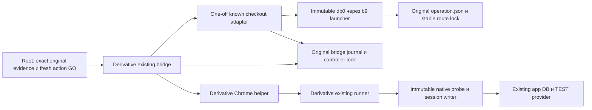

# Light architecture: known checkout recovery

**DRAFT, design rework R1 после actual ideation evaluate exit1.** QCSQ-01, RISK-01/RISK-02, QT-01–QT-04 ожидают собственной повторной проверки originating reviewers. Основания:01, ADR-001,02; OpenSpec hashes закреплены в01. Бизнескод приложения и canonical db0/b9/f15/native/collector не меняются. Исторический callback QE4 CLOSED сохраняется. Никакого runtime допуска этот документ не выдаёт.

Reuse input binding: `features/recover-known-checkout-response/02_reuse_inventory.md`, SHA-256 `a5a40126f05b307541083f28281f24e21df64c2178a4c3d7061f1d95d7d0c0e2`. Этот exact источник содержит dependency SHA roster; его изменение требует нового design snapshot, даже если default ideation scanner не включает имя02_reuse автоматически.

## C4 Component

Adapter — проверка и metadata transition одной известной попытки; bridge — существующий consume/callback transport; browser/runner — прежний UI/native путь с явным typed recovered input. Нет новой службы, API приложения, очереди или общего recovery engine.

## A. Identity и доверенные входы

Одна связка включает original operation ID/directory/runtime binding/execution, original open ticket+callback request digest, original case/kind, baseline/GO/creation window, helper SHA и failed result, browser request raw digest и actual `idempotency_key`, original operator `request_key`, exact main account/intent/provider/shop/TEST/SKU/amount/currency. Значения ключей различаются и никогда не переписываются. Case `completed=false/lastActionFailed=open`, original `used[open]=consumed_unknown`, original execution/runtime_binding сохраняются.

Факты creation binding: original saved POST request и201 evidence; fixed SELECT с exact account+browser key возвращает ровно один intent, а ID совпадает с separately read provider GET, `metadata.order_id`, TEST shop, currency/minor amount/SKU. Сырые SQL/result/provider/input файлы и их sources/digests проверяются, а не заменяются caller boolean. Для pending — отсутствие target payment/event/grant подтверждается отдельно. Отсутствие table/column, неизвестная транзакция read-only, неполная выборка,0/2matches или mismatch → STOP. Application status GET может писать и не служит read-only inventory.

Fresh BOTH-store inventory с repeat stability и часовыми bounds нужен до recovery и каждого follow-up; whole raw сохраняется. Bounded admission определяется полным conjunction ниже, а не одним24h сравнением. Исключение допускает только `known_target_pending` вместо terminal/no_pending для единственного exact исходного intent; pending не вырезается из raw. Это **не** canonical full-cutover GO.

| Часть predicate | Все обязательные проверки; unknown/missing → STOP |
|---|---|
| Isolation | Actual canonical `isolation`: global=false, test=true, test_key_prefix=test_, approved непустой, allowlist ровно[approved], shop известен; equality с original approved_isolation |
| Полнота/время | stores строго[main,legacy], complete=true, stable_repeat=true; fixed bounded scans без truncation, repeat stable identity/business rows; finite observed_at,0≤now−observed_at≤90; фактические clocks/uncertainty известны |
| Действия в полёте | no_inflight=true и no_uncontrolled_checkout=true доказаны независимо от provider.status; pending **не** переписывает эти поля вtrue. Незавершённый HTTP/callback/helper или неизвестная внешняя completion блокирует действие |
| Intent/provider | Exact known target допускается pending/unpaid с0target payment/event/grant и complete ownership/history; другой pending/unknown либо неучтённая запись → STOP. Исторические terminal debts остаются DEFERRED_UNRESOLVED |
| Каждое actual event, включая связанное с target при его появлении | owner_known=true, store_known=true, shop_test_amount_known=true, terminal=true, history_complete=true, active_delivery=false; safe_ack существует, неunknown и неunknown_intent_200; значениеnot_relied_on допускается только при independently proven отсутствии active delivery и истёкшем24h окне, не как доказательство safe ACK поHTTP200 |
| Event clock | time_basis толькоprovider_event/event_receipt_upper_bound/terminal_observation_upper_bound; finite event_bound иclock_error_seconds≥0; event_bound+86400+clock_error_seconds<now. Равенство границе, created_at intent или неизвестная upper bound отказывают |

Pending intent без event не создаёт фиктивное event/ACK/time proof и не наследует возраст старого события. Если target получает event/доставку/terminal во время admission, re-read меняет classification: pending follow-up прекращается. Native source cutover170–181 задаёт минимальную политику; adapter сохраняет все её conjuncts и дополнительно запрещает отсутствующий safe_ack. Для полного terminal reconciliation вызывается сам неизменённый canonical `cutover` без исключений.

Original creation window immutable. Fresh recovery/action GO имеет отдельные start/deadline и exact original reference; max30мин, fresh observations≤90сек, один callback≤300сек и не позднее deadline. Original ticket/GO может уже истечь **как полномочие**: сохранённое historical evidence остаётся допустимым, только если исходный click/201/creation находились в его настоящем окне. Оно не разрешает новый callback. Active recovery/action deadline и source-set authorization проверяются на текущем времени; истечение любого из них → STOP, без приравнивания к возрасту архивных bytes.

### A1. Exact-key/confirmation source в уже planned derivative runner

`K/run.private.py` содержит один fixed read-only collector для recovery, в том же pinned source; новый runtime файл не добавляется. Existing transport/config admission переиспользуется. В exact main store: `BEGIN ISOLATION LEVEL REPEATABLE READ READ ONLY`, local statement_timeout5сек, проверка transaction_read_only=on и store identity. Parameterized SELECT: `SELECT id,account_id,idempotency_key,sku,price_minor,grant_seconds,status,provider_payment_id,created_at::text AS created_at,fulfilled_at::text AS fulfilled_at FROM payment_intent WHERE account_id=$1 AND idempotency_key=$2 ORDER BY id LIMIT 2`. Bind `$1=original approved account`, `$2=actual browser key`; ровно1row, затем compare original window/expected intent/provider/SKU/amount, без фильтра по expected ID, скрывающего duplicate. Target grants: `SELECT id,account_id,payment_ref,source_key,total_seconds FROM credit_grant WHERE payment_ref=$1 OR source_key=$2 ORDER BY id LIMIT 2`, где `$1=exact intent`, `$2='intent:'+intent`; для pending требуется0rows, включая чужого owner. Whole collector покрывает payment/events. ROLLBACK всегда; никакого mutating application status GET.

После positive exact row — один authenticated GET fixed provider `/v3/payments/{exact provider_payment_id}` через existing native TEST credentials/config/fetch,5сек/64KiB, no redirects/no retries; ID не становится произвольным URL. Сохраняются actual status200/raw bytes и source/request/response digests private0600. Проверитьid/test/recipient.account_id/metadata.order_id/amount/currency против exact SQL+original shop; RUB amount разбирается как exact decimal minor units, без округленияfloat. Требоватьpending,paid=false, `confirmation.type=redirect` и непустой `confirmation.confirmation_url`. Допустимы HTTPS exact provider hosts/subdomains из прежнего browser allowlist, без userinfo/нестандартного port; URL берётся **только** из этого body. Native/collector projections безURL не удовлетворяют этому входу. Hash URL bound to raw body; fullURL остаётсяprivate. Перед каждым допускаемым follow-up fresh GET/recheck, при terminal или любом mismatch — STOP.

Проверен maintained donor `apps/web/src/server/payments/yookassa.ts`: `createYooKassaProvider(...).getPayment` уже возвращаетconfirmationUrl, проверяетshop/test/exact amount и задаёт5сек/64KiB/no-redirect. Его `RemotePayment` отбрасывает raw shop/test/confirmation.type, нужные независимому recovery proof. Поэтому здесь выбран уже имеющийся native rawGET transport с теми же пределами/проверками и private raw capture внутри runner; не новыйHTTPframework/SDK и не параллельный финансовыйdispatcher. Compile donor с dependency graph и observer-fetch ради одногоGET добавил бы scope; application source остаётся READONLY.

Root06.11.2026 проверил primary [ЮKassa: «Процесс платежа», Redirect](https://yookassa.ru/developers/payment-acceptance/getting-started/payment-process): redirect использует confirmation_url из объекта pending; expires_at в контексте waiting_for_capture не является TTL этой формы. Архитектор не выполнял сетевую проверку. **Вывод проекта:** fresh authenticated authoritative URL даёт допуск к одной навигации GET на существующую форму; это current validation, не обещание будущей жизни URL. Отсутствие expires_at само по себе не ошибка и срок не придумывается. Затем actual Chrome проверяет TEST banner, exact redirect/provenance/context, отсутствие expired/error формы и доступность ожидаемых полей **до submit**; fresh native provider всё ещё pending/unpaid. Неизвестная/истёкшая/изменённая форма, отсутствующий URL или неизвестный source → STOP без submit/нового checkout. Нельзя заявлять, что reconstructed URL равен потерянному original body.

### A2. Различимые полномочия

Historical original ticket/callback/case/source должны присутствовать в captured исходных bytes и связываться digest/equality; unknown ticket не становится известным от совпаденияcase. `used[original_open]=consumed_unknown` — ожидаемая историческая provenance, не replay authority. Новое active recovery authorization связывает этотorigin и exact frozen source-set; отдельный unused follow-up ticket связывает recovery receipt/action/case/helper и свой deadline. Все отказы до нового authorization save/callback/provider navigation/session: source mismatch не подменяетсяexpired error; replay отличается от original consumed_unknown. Source hashes сами не имеют срока, срок имеет разрешение использовать source-set в текущем recovery/action.

## B. Source identity, permanent protocol fence и разрешённые входы

Старые sources из02 остаются immutable. Derivatives и adapter имеют отдельные measured SHA; original `operation.execution` и `journal.binding.execution` по-прежнему db0/b9. Bridge захватывает old namespace через неизменённый b9; adapter отдельно читает strict0600 bytes без symlink, проверяет exact reviewed SHA и компилирует captured bytes в isolated namespace. Никаких dynamic plugin imports/monkey-patch/подмены `EXECUTION`/переноса `CONFIRMED` между процессами. New bridge invocation bytes и adapter/helper/runner/native/collector SHAs входят в recovery source-set; public manifest показывает SHA, private evidence — actual paths/captured bytes.

Исходный binding B0 равен `{runtime:runtime_binding(spec),execution:db0_EXECUTION}`. Под обоими стабильными locks одноразовая миграция создаёт B1: те же **неизменённые** runtime/execution плюс `recovery_protocol:{version:1,source_set_sha,origin_binding_sha,origin_open_ticket_sha}`. Исходные bytes journal/B0 сохраняются create-only с режимом0600 и digest; одновременно с B1 журнал получает recovery slot `consumed_unknown`. Поля не удаляются после completion; неизвестные version/source-set → STOP. Source-set hash вычисляется из фактически captured bytes и ролей, а не произвольного утверждения caller. Сохранение original values не означает побайтного равенства всего обновлённого journal.

В actual old812 проверка `journal['binding']==binding` до `operate` сравнивает весь dict и отвергает дополнительное поле recovery_protocol. Его source не изменяется. Новый bridge проверяет exact B1/protocol/original digest/captured source-set и текущие recovery/operation closure **до** любого canonical business call. B0 принимается только для явной миграции exact original incomplete_pending с нетронутым used, а не для обычного checkout. После B1 нет fallback к прежнему binding. Исходный execution остаётся db0/b9; миграция executor SHA не производится.

Порядок fence: controller lock → route lock → source/identity/origin admission → create-only snapshots → atomic journal B1+consumed_unknown с actual file/directory fsync и readback → route revalidate/binding. До B1 operation всё ещё incomplete_pending без new_checkout; crash не разрешает checkout. После B1 старый bridge всегда отказывает, новый требует completed transition. Уже работающий старый bridge держит тот же controller lock всю session: миграция не происходит, пока он активен; locks не удаляются и не захватываются принудительно. Partial snapshot/.next/readback/fsync или kill → STOP и отдельная read-only сверка, не automatic retry. Откат B1 к B0 или смена directory не поддерживаются.

| Реальная точка входа/роль | Enforcement в этом scope |
|---|---|
| Новый bridge: ordinary checkout/follow-up/recovery/reconcile | До financial callback требует B1 и exact source-set; ordinary checkout требует journal terminal_reconciled **и** matching operation history/reconciled. Partial/unknown →0callback |
| Actual historical812 bridge напрямую либо через прежние prepare/launch transport wrappers | Strict binding equality отвергает B1 **до operate/ready/callback**; при B0 original incomplete_pending и отсутствие new_checkout блокируют canonical новый checkout/follow-up. `launch-bridge.private.py` только передаёт captured812, не dispatches helpers |
| b9 captured launcher → db0 `main` | CLI вызывает только `operate` apply/revalidate/recover, не `operator_business`; business callback/checkout/session отсутствуют. Config recovery сохраняет halt/incomplete и не снимает B1. Financial action в spec отвергается; tests проверяют0callbacks |
| Новый adapter: standalone import/call | Неавторизующий leaf: mutable/global fallback и standalone dispatch отсутствуют. Entry function требует caller-held original locks, B1/source-set и typed state; иначе STOP |
| Old/current browser/run helper CLI как callback leaf | Ранее разрешённый direct recovery case scope — только original decline, original files/keys; old open отказывает при existing case, old submit/cancel/reload — при missing intent/wrong case; old session-create — при existing revoked session record. Guard/probe только read-only; paid-job/relay не входят в recovery. Новые derivatives требуют exact unused callback ticket + recovery digest до session/browser действия. Произвольный новый kind/workspace/GO не является разрешённым входом |
| Native probe / compiled auth writer | Только leaf существующего captured runner и exact emitted callback/cleanup; самостоятельный stdin с новыми token/intent/action не является controller authority и в scope не входит |

Это граница конкретных авторизованных launch commands, не OS sandbox от root. Прямой вызов exported `operator_business` собственным Python, изготовление fresh GO/другого case или удаление B1 — произвольное изменение программы/authority, не разрешённая CLI альтернатива. Root до code сверяет actual inventory: если существующий разрешённый autonomous dispatcher или direct helper с правом **нового** checkout/session минует эти guards, scope NOT ESTABLISHED и ADR пересматривается; нельзя просто назвать такой вход leaf. В fixtures historical812 и каждый перечисленный вход исполняются actual captured bytes с otherwise valid synthetic admissions в его законном scope; proof не заменяется проверкой строк. Positive после closure — новый bridge → old canonical business; historical812 остаётся запрещённым навсегда.

Дополнительный READONLY transport witness: original case `launch-bridge.private.py`, SHA256 `1f23509d0f41b7d679b809693325f4ac801fd74f691fb03024fe2e39d5e3a54d`; его изменение не входит в4 runtime targets. Root binding inventory учитывает эту affected dependency при проверке входов. Новый entrypoint/command/service не добавляется.

Private execution workspace может содержать frozen derivative browser/runner, immutable native copy и recovery-specific own-session evidence. Это workspace артефактов, не новая financial namespace: operation directory, lock paths, original case/open ticket/keys неизменны. Canonical f15 и его paid-media consumers остаются byte-identical; recovery branch не вызывает paid-job-probe/relay.

## C. Одноразовый recovery journal

Единственный authoritative recovery slot добавляется в **тот же** `controller-bridge.json`, с фиксированной связью original open ticket; пользовательский новый recovery ID не может создать второй slot. Proof `kind=known-checkout-recovery-v1` содержит original snapshots/digests/identities, оба ключа, actual201 known, `original_response_captured=false`, fresh evidence/source-set и отдельный action window. `checkout_response_bound` отсутствует/false; `new_checkout` не создаётся. Старый `admit/operator_business` не получает reconstructed context.

1. Тот же controller lock → тот же route lock; canonical identity/mode/owner/inode/baseline checks. Отозвать локальный CONFIRMED при входе; не наследовать authority после fork/ошибки. Валидация inputs/source/proof выполняется до записи допуска.
2. Capture immutable original case/helper/operation/journal snapshots и доказательства; потребовать exact failed/open/consumed_unknown, отсутствие old new_checkout и другого recovery/active_case. Выполнить B0→B1 fence migration изB: одна atomic запись B1+recovery slot `consumed_unknown` с intent/bindings **до** transition/side effect. Canonical persistence:0600, fsync файла и директории, readback; snapshot files create-only, не заменять исторические bytes.
3. В том же process/lock scope вызвать canonical `revalidate` с actual fresh control/identity/health/backup/config checks; сверить unchanged original business attempt и current source-set. Только затем одним journal save установить `recovery.state=bound` и `active_case=original_case`, сохранив весь `used`.
4. `bound` означает `creation_known/payment_pending/binding_recovered`, не successful helper/payment. Recovered browser input — отдельная projection с proof digest; original case остаётся failed. Отсутствующий/несогласованный projection даёт STOP, не попытку восстановить его и повторить action автоматически.
5. Существующий `consumed_unknown` **нового recovery/action slot**, partial file/temp, недоказанный fsync/rename/readback, crash либо повтор recovery → STOP до отдельной read-only сверки. Original open `consumed_unknown` остаётся обязательной исторической provenance и сам по себе не блокирует первое binding. Автоматическое завершение interrupted recovery или смена namespace запрещены.

## D. Follow-up и terminal reconcile

Bound receipt сам не запускает provider. Root допускает один exact action согласно original case и fresh facts; для текущего decline — существующий TEST decline submit по тому же provider ID/confirmation URL. Если target terminal, submit/cancel запрещены; только read-only classification. Обычный old ticket не переписывается: восстановленный action имеет отдельный unused authorization, связанный с original unused intended action/ticket digest, case и recovery digest; никакого retry original open. Новые action deadlines/helper SHA записываются отдельно от старого manifest.

Bridge при recovered action требует `active_case` + bound proof/source set; adapter повторно получает route lock и canonical fresh revalidation. До callback штатный journal сохраняет action `consumed_unknown`; callback reply требует exact id/request/context/helper/evidence hashes. Allowed actions ограничены исходным case и проверкой результата; checkout/relay/paid-job недоступны. Неизвестный reply/result/cleanup → STOP, без повторного callback. Положительная запись относится только к новому action; original open остаётся failed/consumed_unknown.

Browser/runner получают typed recovery projection. Original creation window передаётся только immutable native probe как trusted `extra.windowStart`; fresh `run.window` проверяет текущую опубликованную identity/GO. Derivative runner не принимает произвольный historical intent: proof/source/case/account проверяются до native вызова. Read-only collector A1 — единственный источник recovered confirmation URL. Для follow-up используется native own-session writer; новый token имеет отдельные recovery-owned files, исходная revoked session не оживляется. Cleanup проверяет exact own account и positive native revoke, сохраняет receipt даже при failed action. Ошибка revoke оставляет `cleanup_unknown`, completion не выставляется.

Terminal reconcile — отдельный явный metadata action. Он требует exact provider terminal (`succeeded` или `canceled`) и соответствующих intent/payment/event/grant данных; decline подтверждается cancellation reason, не одним UI. Для текущего decline/cancel —0target grants; success требует canonical correlated unique grant. Затем **полный** fresh BOTH-store `cutover`, без pending exemption, со всеми relevant event bounds и24ч, no_pending/no_inflight и isolation equality. Новое terminal event получает своё окно; создание intent давно не сокращает это ожидание.

Под теми же locks adapter сначала durably ставит journal `reconciling_unknown`, затем canonical `persist` добавляет в `business_history` original `attempt` и failed raw snapshot hashes, `response:null`, typed `recovery` и terminal reconciliation. `new_checkout` не появляется. Историческая форма сохраняет `history.attempt.request.request_key`, используемый old checkout reuse guard. `operation.business=reconciled/reconciled_at` устанавливается только после этой проверки; `execution/runtime_binding` остаются прежними. Затем bridge journal фиксирует `terminal_reconciled` и снимает active_case. Crash между writes → partial state, no automatic retry и no next checkout; новый bridge перед любым action проверяет отсутствие такой незавершённой recovery записи.

Следующий обычный checkout разрешается через новый bridge только после обеих durable завершённых записей, fresh GO/baseline/full inventory и canonical старого `operator_business`. Наличие `operation.business=reconciled` без bridge closure не разрешает новый запуск: новый bridge проверяет joint state, historical812 отказывает по permanent B1. Reconcile не снимает fence и не переписывает old ticket/source-set. Никакого grant/SQL cleanup/исторического relay. Emergency route restore остаётся canonical с business halt; recovery receipt не отменяет этот halt.

## E. Capture будущего checkout response

Derivative browser ставит route handler до click только на exact origin/path `/api/checkout`, POST; один matching request. Handler capture original request method/url/body/headers в private evidence, forwards **тот же** request через existing Playwright `route.fetch({maxRetries:0,maxRedirects:0})` без замены URL/method/body. Response bytes/status/headers сохраняются до отдачи странице; body разбирается из сохранённых bytes, не позднего CDP `Response.json`. Bounded length/time, expected201/shape и provider URL проверяются. Один durable save с file+directory fsync/readback предшествует `route.fulfill({response})` с actual upstream response.

Второй matching POST блокируется; redirect/HTTP error/разрыв/invalid JSON/fsync failure → safe error code и STOP. Нельзя fallback к `continue`/повторному fetch после неясного отправления. Route handler сообщает own error через awaited completion promise, чтобы общий catch не маскировал capture failure. Browser helper `completed` всё ещё требует остальные штатные проверки; сохранённый201/body сам по себе не означает provider outcome. Headless actual Chrome остаётся, но transport отмечается `instrumented_forward`; baseline normal app code/network behavior не меняется.

### E1. Независимо наблюдаемый порядок capture

`capture-fixtures.private.mjs` запускает actual captured browser helper в отдельном процессе и настоящий Chrome с локальной синтетической страницей. Локальный server считает upstream POST и сохраняет его exact method/body/status/response. Страница сразу после получения и разбора response делает отдельный `/client-observed` GET, затем немедленную навигацию. Этот запрос наблюдает родительский fixture server, а не исполняемый helper; его handler независимо открывает evidence с O_NOFOLLOW и сверяет точные request/status/body bytes/digests.

Fixture observer оборачивает только границу Node fs calls и передаёт **реальные** open/write/fsync/rename/read calls в исходные функции; никакого fake fsync/PASS, замены записанных данных или альтернативной реализации capture. Отдельный pipe передаёт родителю фактические успешные syscall returns, FD/inode/path и последовательность. На `/client-observed` уже должны наблюдаться успешные file fsync → atomic rename → directory fsync → чтение нового exact файла; итоговый файл без этой последовательности не проходит. Observer сверяет inode/path, чтобы fsync чужого FD не удовлетворял проверку. Это доказательство actual syscall/order, не эксперимент физического power loss.

Детерминированные FIFO barriers удерживают helper перед file fsync, перед directory fsync и перед readback completion; Chrome остаётся работающим. Пока barrier закрыт, `/client-observed` и переход на provider page отсутствуют, upstream count=1. После каждого barrier выполняются отдельные release и SIGKILL cases; ранний fulfill делает `/client-observed` видимым до durable evidence и даёт RED. Parent barrier timeout конечен; ошибка child/pipe не становится PASS. Positive release проходит до наблюдения страницы и сохранения правильных bytes. Skip-fsync, fsync wrong FD, readback-after-fulfill и fulfill-before-persist — отдельные executable mutations, обязанные дать RED.

Fault cases исполняют реальный отказ owned FD/FS или kill на barrier; наблюдающий wrapper не подменяет результат syscall. После reset, redirect, rejected handler, write/fsync/readback error и double click сервер считает ровно один отправленный POST (либо0, если отказ до первой отправки), отсутствие retry/fallback и отсутствие success у страницы. Old source c12 и candidate сравниваются на той же immediate-navigation/fsync fixture20/20; local transport и данные SYNTHETIC, не настоящий TEST платёж.

## F. Discriminating provenance/authority fixtures

База P-origin: подлинные синтетические original ticket/callback/case/source, их окно уже истекло сейчас, но исходный201/creation были внутри него; completed=false и used=consumed_unknown, два разных корректных ключа, fresh current recovery GO/source-set. **Positive**: исторический возраст не мешает metadata binding; callback/session/checkout=0. База P-action: B1+bound receipt, fresh exact unused action ticket, current source-set и safe inventory; до допуска действия все контексты валидны. Внешние boundaries явно SIMULATED.

Каждый negative меняет только указанное независимое основание; зависимые digest пересчитываются там, где это необходимо, чтобы не получить отказ от случайного checksum mismatch. Ожидается конкретный diagnostic class и0authorization-save/callback/provider-navigation/session/checkout, original failed bytes сохранены. Удаление соответствующей проверки должно превратить именно этот case в RED, а не оставить его rejected другим испорченным полем.

| Отдельный case | Positive control и минимальная мутация |
|---|---|
| Unknown original ticket | P-origin; ticket ID отсутствует в сохранённом original manifest, остальные ссылки self-consistent |
| Original ticket digest mismatch | P-origin; неверен digest actual preserved ticket при неизменных остальных identity |
| Unknown/mismatched callback | P-origin; callback отсутствует либо его actual request digest не связывает original ticket/context |
| Case mismatch | P-origin; иной original case/kind при валидном ticket и текущем recovery GO |
| Original source mismatch | P-origin; archival helper/source bytes не совпадают с сохранённым original source witness; нынешний source-set всё ещё валиден |
| Historical window violation | P-origin; actual original201/creation вне исходного GO/ticket window. Отдельный positive с давно expired historical window и creation внутри него обязателен |
| Expired current recovery GO/source authorization | P-origin; один current deadline истёк, original history и остальные current сроки валидны; timestamp source bytes не используется как срок |
| Wrong action ticket | P-action; unused ticket принадлежит другому action/case/recovery digest, остальных повреждений нет |
| Consumed/replayed action | P-action; exact action уже consumed_unknown/response_received/completed; вся остальная история валидна. Original open consumed_unknown остаётся допустимым в P-origin |
| Expired action deadline | P-action; только deadline текущего action истёк, recovery GO/source authorization/inventory ещё свежи |
| Changed current source-set | P-action; ровно один actual captured dependency SHA отличается, его часы и оригинальные source bytes корректны |
| Swapped windows | P-action; original creation window подставлен как current authority либо current action start как нижняя граница создания; противоположное окно остаётся неизменным |

Real two-process flock и SIGKILL после каждого durable fence/bind/action/reconcile шага дополняют эту таблицу. После kill новый запуск не повторяет callback; historical812 отказывает поB1, newbridge — поjointstate. После двух подтверждённых terminal closure positive fresh ordinary GO черезnewbridge вызывает oldcanonical checkout ровно1раз в SIMULATED boundary. Это будущие checks, не выполненные тесты.

## Observability

Private INFO: source-set/digest, original/recovery correlation, state transition, received HTTP status и timestamps. ERROR: закрытые коды `CAPTURE_BODY_UNAVAILABLE`, `CAPTURE_PERSIST_FAILED`, `RECOVERY_BINDING_MISMATCH`, `RECOVERY_PARTIAL_STOP`, `RECOVERY_CLEANUP_UNKNOWN`; raw exception/URL/token в stdout/stderr запрещены. Private raw diagnostics сохраняют stack только после secret-safe обращения и никогда не публикуются целиком.

Счётчики в bounded receipt: forwarded checkout POST (ровно1 при fresh capture,0 при recovery), blocked duplicate, recovery/action attempts (не более1 на соответствующий slot). Внешний symptom — STOP/exit1, pending/unknown state без success. Root видит receipt и не продолжает; независимый QE проверяет counts/history/cleanup. Никаких новых dashboards/telemetry services.

## Граница доказательства

Named tests и команды —06. Local real Chrome/FD fixtures должны подтвердить harness behavior; SIMULATED external adapters не доказывают фактический TEST магазин, terminal outcome или native callback. Exact live exception неизвестен. Runtime E2E остаётся отдельным последующим этапом после approved requirements/ADR/QCSD/plan/K1/K2/source review. QCSD R1 действительно выполнен и дал unresolved; эта правка — author design rework, не originating closure. Code/QE/runtime/K1/K2 этим документом не объявляются выполненными.
