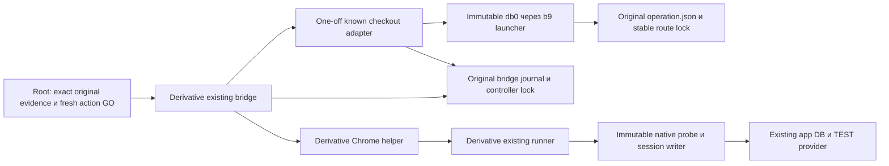

# Light architecture: known checkout recovery

**DRAFT, terminal-origin delta после read-only observation06.11.2026,11:08:37Z.** Все прежние решения по QCSQ-01, RISK-01/RISK-02, QT-01–QT-04 сохранены; новый snapshot требует originating verification. Основания:01, ADR-001,02; OpenSpec hashes закреплены в01. Бизнескод приложения и canonical db0/b9/f15/native/collector не меняются. Исторический callback QE4 CLOSED сохраняется. Никакого runtime допуска этот документ не выдаёт.

Reuse input binding: `features/recover-known-checkout-response/02_reuse_inventory.md`, SHA-256 `bcb327ea166e6ef4f6be3e16c15b376c57368ebd4d7d553d646bf7fe0e2e9ceb`. Этот exact источник содержит dependency SHA roster; его изменение требует нового design snapshot, даже если default ideation scanner не включает имя02_reuse автоматически.

## C4 Component

Adapter — проверка и metadata transition одной известной попытки; bridge — существующий consume/callback transport; browser/runner — прежний UI/native путь с явным typed recovered input. Нет новой службы, API приложения, очереди или общего recovery engine.

## A. Identity и доверенные входы

Одна связка включает original operation ID/directory/runtime binding/execution, original open ticket+callback request digest, original case/kind, baseline/GO/creation window, helper SHA и failed result, digest parsed-request projection с original case/source provenance и actual `idempotency_key`, original operator `request_key`, exact main account/intent/provider/shop/TEST/SKU/amount/currency. Значения ключей различаются и никогда не переписываются. Case `completed=false/lastActionFailed=open`, original `used[open]=consumed_unknown`, original execution/runtime_binding сохраняются.

Факты creation binding: original saved POST request и201 evidence; fixed SELECT с exact account+browser key возвращает ровно один intent, а ID совпадает с separately read provider GET, `metadata.order_id`, TEST shop, currency/minor amount/SKU. Сырые SQL/result/provider/input файлы и их sources/digests проверяются, а не заменяются caller boolean. Для pending — отсутствие target payment/event/grant подтверждается отдельно. Отсутствие table/column, неизвестная транзакция read-only, неполная выборка,0/2matches или mismatch → STOP. Application status GET может писать и не служит read-only inventory.

Fresh BOTH-store inventory с repeat stability и часовыми bounds нужен до recovery и каждого follow-up; whole raw сохраняется. Bounded admission определяется полным conjunction ниже, а не одним24h сравнением. Исключение допускает только `known_target_pending` вместо terminal/no_pending для единственного exact исходного intent; pending не вырезается из raw. Это **не** canonical full-cutover GO.

| Часть predicate | Все обязательные проверки; unknown/missing → STOP |
|---|---|
| Isolation | Actual canonical `isolation`: global=false, test=true, test_key_prefix=test_, approved непустой, allowlist ровно[approved], shop известен; equality с original approved_isolation |
| Полнота/время | stores строго[main,legacy], complete=true, stable_repeat=true; fixed bounded scans без truncation, repeat stable identity/business rows; finite observed_at,0≤now−observed_at≤90; фактические clocks/uncertainty известны |
| Действия в полёте | no_inflight=true и no_uncontrolled_checkout=true доказаны независимо от provider.status; pending **не** переписывает эти поля вtrue. Незавершённый HTTP/callback/helper или неизвестная внешняя completion блокирует действие |
| Intent/provider | Pending path: exact known target pending/unpaid с0target payment/event/grant и complete ownership/history. Direct terminal-only path C: exact canceled/unpaid/expired_on_confirmation, preserved DB created/unfulfilled,0target payment/grant и полная actual event history, без pending exemption. Другой pending/unknown либо неучтённая запись → STOP. Исторические terminal debts остаются DEFERRED_UNRESOLVED |
| Каждое actual event, включая связанное с target при его появлении | owner_known=true, store_known=true, shop_test_amount_known=true, terminal=true, history_complete=true, active_delivery=false; safe_ack существует, неunknown и неunknown_intent_200; значениеnot_relied_on допускается только при independently proven отсутствии active delivery и истёкшем24h окне, не как доказательство safe ACK поHTTP200 |
| Event clock | time_basis толькоprovider_event/event_receipt_upper_bound/terminal_observation_upper_bound; finite event_bound иclock_error_seconds≥0; event_bound+86400+clock_error_seconds<now. Равенство границе, created_at intent или неизвестная upper bound отказывают |

Pending intent без event не создаёт фиктивное event/ACK/time proof и не наследует возраст старого события. Если target получает event/доставку/terminal во время admission, re-read меняет classification: pending follow-up прекращается; automatic переход в другой action не выполняется. Native source cutover170–181 задаёт минимальную политику; adapter сохраняет все её conjuncts и дополнительно запрещает отсутствующий safe_ack. Для полного terminal reconciliation вызывается сам неизменённый canonical `cutover` без исключений. Provider status GET сам не webhook event: fresh canceled observation не создаёт event и обязательные24h от каждого GET. Отсутствие actual events допустимо лишь при independently complete whole history/delivery proof; refresh11:08:37Z не читал events/grants и этого не доказывает. Для каждого actual relevant event сохраняются row, ACK/delivery и clock predicate; неизвестная history/bound либо ещё не истёкшие24h → STOP, intent.created_at не заменяет event bound.

Original creation window immutable. Fresh recovery/action GO имеет отдельные start/deadline и exact original reference; max30мин, fresh observations≤90сек, один callback≤300сек и не позднее deadline. Original ticket/GO может уже истечь **как полномочие**: сохранённое historical evidence остаётся допустимым, только если исходный click/201/creation находились в его настоящем окне. Оно не разрешает новый callback. Active recovery/action deadline и source-set authorization проверяются на текущем времени; истечение любого из них → STOP, без приравнивания к возрасту архивных bytes.

### A0. Explicit original evidence kind и составной derivative witness

Clarification KCQE-03: existing `origins` содержит ровно восемь keys `case,manifest,callback,browser_request,http,helper,go,cleanup`. Raw case/helper/go/cleanup сохраняются без дописывания. Manifest — original later manifest. Callback — единственный actual `type=callback` frame из bridge-output JSONL, не execute-command; сохраняются whole JSONL SHA, frame index, exact line digest, deterministic parsed-frame digest. Проверяется request_sha по pinned protocol. Browser_request — deterministic JSON **case.request**, its SHA означает projection bytes, не wire bytes. `http` хранит extraction metadata, case/helper SHA и projection SHA отдельно от original raw.

Два explicit kinds: `observed_response` только для действительно measured точного status/request/response timestamp; `inferred_201_from_pinned_helper` для c12 содержит inferred_status=201, method=POST, request_basis=parsed_postDataJSON, time_basis=controller_causal_interval, original_response_captured=false. В inferred kind response_at отсутствует, не равен completion/mtime. Proof checkout_response_bound=false и response:null; original failed case/consumed_unknown не меняются. Это не вход old response-bound admission.

Дополнительный конечный DATA roster: bridge-output JSONL, bridge-process, bridge-open-execute, open-helper-attempt/result, bridge-completion, bridge-launch-data/его manifest, pinned launch-witness bytes, initial runtime-spec, необходимые clock/history receipts. Role→raw SHA/field selectors и digest whole roster связываются с http/proof; paths не executable и не plugin/query authority. Exact source bytes capture/readback обязателен, неизвестные/дублированные роли STOP. Raw sources плюс derivative extraction snapshots сохраняются create-only с file/directory fsync/readback **до первой canonical persist** по AM-8; summaries не заменяют original raw.

Проверяемая цепочка: exact launch witness1f2350→captured812/manifest→один callback→совпавшие requestSHA256/ticketId attempt→failed helper-result/c12/case→bridge STOP→completion после source bridge wait. Execute context и callback должны совпасть с original operation request. Launcher реально пишет completion после p.wait; отдельно требуется связь именно этого helper failure с завершением bridge, не просто два exitCode1. C12 сначала проверяет201, затем сохраняет parsed request: это доказательство status inference при authentic binding, не timestamp.

Lower_raw=case.checkoutClickAt; upper_raw=bridge-completion.completedAt. Raw case.windowStart и click обязаны совпасть с proof и original GO semantics. Process.startedAt и attempt.attemptedAt — recorded controller fields, не response_at. Весь интервал с conservatively propagated clock uncertainty должен лежать внутри intersection original GO и callback ticket window; clamp к deadline запрещён. Root numeric candidate внутри окна пока не approved clock proof. Нужны historical process/clock-domain identity, continuity/uncertainty и causal links. Unknown → RECOVERY_ORIGIN_TIME_NOT_ESTABLISHED до authorization; mtime/текущее чтение/guessed point/нулевая uncertainty без доказательства запрещены.

DB created_at и source checkout_started_at не сравниваются с controller числами как causal order. Для точного same-clock synthetic case допустим click<=creation<=response; обратный response<=creation неверен. Реальному случаю нужны отдельно causal request→exact intent→response и clock offset interval для conservative mapping creation целиком в original window. Нельзя выбрать удобную точку интервала. Root offset bracket пока candidate: launcher startedAt пишется ПОСЛЕ Popen, поэтому сам этот source не доказывает, что recorded start предшествует remote program start; дополнительные causal/clock witnesses обязательны. Если source/clock bound не устанавливается — STOP/NOT ESTABLISHED без новой покупки. Existing point controls и inferred controls не смешиваются.

### A1. Exact-key/confirmation source в уже planned derivative runner

`K/run.private.py` содержит один fixed read-only collector для recovery, в том же pinned source; новый runtime файл не добавляется. Existing transport/config admission переиспользуется. В exact main store: `BEGIN ISOLATION LEVEL REPEATABLE READ READ ONLY`, local statement_timeout5сек, проверка transaction_read_only=on и store identity. Parameterized SELECT: `SELECT id,account_id,idempotency_key,sku,price_minor,grant_seconds,status,provider_payment_id,created_at::text AS created_at,fulfilled_at::text AS fulfilled_at FROM payment_intent WHERE account_id=$1 AND idempotency_key=$2 ORDER BY id LIMIT 2`. Bind `$1=original approved account`, `$2=actual browser key`; ровно1row, затем compare original window/expected intent/provider/SKU/amount, без фильтра по expected ID, скрывающего duplicate. Target grants: `SELECT id,account_id,payment_ref,source_key,total_seconds FROM credit_grant WHERE payment_ref=$1 OR source_key=$2 ORDER BY id LIMIT 2`, где `$1=exact intent`, `$2='intent:'+intent`; для pending требуется0rows, включая чужого owner. Whole collector покрывает payment/events. ROLLBACK всегда; никакого mutating application status GET.

После positive exact row — один authenticated GET fixed provider `/v3/payments/{exact provider_payment_id}` через existing native TEST credentials/config/fetch,5сек/64KiB, no redirects/no retries; ID не становится произвольным URL. Сохраняются actual status200/raw bytes и source/request/response digests private0600. Проверитьid/test/recipient.account_id/metadata.order_id/amount/currency против exact SQL+original shop; RUB amount разбирается как exact decimal minor units, без округленияfloat. Сначала классифицировать provider: pending допускает только pending path; canceled/paid=false/cancellation_details.reason=expired_on_confirmation допускает рассмотрение отдельного explicit terminal-only GO поC/D, без URL/browser; иной direct terminal outcome или unknown → STOP. Для pending follow-up дополнительно требовать `confirmation.type=redirect` и непустой `confirmation.confirmation_url`. Допустимы HTTPS exact provider hosts/subdomains из прежнего browser allowlist, без userinfo/нестандартного port; URL берётся **только** из этого body. Native/collector projections безURL не удовлетворяют pending URL входу. Hash URL bound to raw body; fullURL остаётсяprivate. Перед каждым допускаемым follow-up fresh GET/recheck; при terminal или любом mismatch — STOP follow-up, без автоматической смены authority на reconcile.

Проверен maintained donor `apps/web/src/server/payments/yookassa.ts`: `createYooKassaProvider(...).getPayment` уже возвращаетconfirmationUrl, проверяетshop/test/exact amount и задаёт5сек/64KiB/no-redirect. Его `RemotePayment` отбрасывает raw shop/test/confirmation.type, нужные независимому recovery proof. Поэтому здесь выбран уже имеющийся native rawGET transport с теми же пределами/проверками и private raw capture внутри runner; не новыйHTTPframework/SDK и не параллельный финансовыйdispatcher. Compile donor с dependency graph и observer-fetch ради одногоGET добавил бы scope; application source остаётся READONLY.

Root06.11.2026 проверил primary [ЮKassa: «Процесс платежа», Redirect](https://yookassa.ru/developers/payment-acceptance/getting-started/payment-process): redirect использует confirmation_url из объекта pending; expires_at в контексте waiting_for_capture не является TTL этой формы. Архитектор не выполнял сетевую проверку. **Вывод проекта для pending path:** fresh authenticated authoritative URL даёт допуск к одной навигации GET на существующую форму; это current validation, не обещание будущей жизни URL. Отсутствие expires_at само по себе не ошибка и срок не придумывается. Затем actual Chrome проверяет TEST banner, exact redirect/provenance/context, отсутствие expired/error формы и доступность ожидаемых полей **до submit**; fresh native provider всё ещё pending/unpaid. Неизвестная/истёкшая/изменённая форма, отсутствующий URL или неизвестный source → STOP follow-up без submit/нового checkout. Terminal-only path формы не открывает и URL не требует. Нельзя заявлять, что reconstructed URL равен потерянному original body.

### A2. Различимые полномочия

Historical original ticket/callback/case/source должны присутствовать в captured исходных bytes и связываться digest/equality; unknown ticket не становится известным от совпаденияcase. `used[original_open]=consumed_unknown` — ожидаемая историческая provenance, не replay authority. Новое active recovery authorization связывает этотorigin и exact frozen source-set; отдельный unused follow-up ticket связывает recovery receipt/action/case/helper и свой deadline. Все отказы до нового authorization save/callback/provider navigation/session: source mismatch не подменяетсяexpired error; replay отличается от original consumed_unknown. Source hashes сами не имеют срока, срок имеет разрешение использовать source-set в текущем recovery/action.

### A3. Независимо доказанная empty history и historical owner

KCQE-06: tagged history `actual_events` либо `independently_empty`; missing/unknown/неполная выборка никогда не empty. Actual events сохраняют каждый canonical ownership/store/shop/history/ACK/delivery/clock/24h predicate A. Для independently_empty event anchor/time/ACK row не создаются: нужны полные source-bound raw scans/count equality, coverage/retention, repeat stability, независимые delivery/no-inflight proofs. Пустая таблица сейчас не доказывает отсутствие удалённой/неполученной истории. Provider GET не delivery inventory. Неизвестный coverage/gap/retention/clock → STOP. Полный неизменённый canonical cutover вызывается в обоих случаях; чужой event age не наследуется.

Initial baseline — canonical hash original runtime-spec.inventory == original operation.inventory_sha; raw spec hash/source identity проверяются отдельно. Actual-prepared-20261106T070155Z/runtime-spec.inventory equality локально подтверждена. Later manifest.inventory сохраняется как более поздний snapshot, его равенство initial не требуется. Соседние old raw-inventory first/second лишь read-only candidates: source/digest/store/config/coverage/временная связь должны быть доказаны. Не создавать baseline row/event задним числом. Если projection initial inventory не содержит row, нужен подлинный existing archival raw row/account/store proof до origin; иначе STOP.

Sole action allowlist остаётся [approved], global=false/test=true. Known historical other owner разрешён только для immutable DEFERRED_UNRESOLVED, никогда для callback/session/checkout/fulfill/grant/relay. Положительно проверить actual account в exact store, row.account_id, historical provenance, intent/provider/order/shop/test/amount/currency/SKU, всю BOTH-store payment/grant/event историю и отсутствие cross-store collision/unknown. Непустой account_id или terminal provider не proof. Missing/deleted owner требует независимого archival identity evidence либо STOP. Corrected valid main observation: один approved owner из четырёх, все четыре correlation совпадают; INVALID initial extraction исключён. Это не ownership/history GO. Historical succeeded/unfulfilled не превращается в canceled и не исполняется: прежние payment/grant consistency predicates и DEFERRED_UNRESOLVED сохраняются.

Только existing planned runner получает bounded fixed reads, без нового executable/SQL interpreter. На каждом exact store: READ ONLY REPEATABLE READ, statement_timeout, transaction_read_only и actual database/schema/server identity/clock capture; fresh repeat и независимые delivery/inflight witnesses. Existing full bounded payment_intent/payment/payment_event scans/count equality сохраняются (cap128/truncation/schema gap STOP). Fixed ownership query: `SELECT id,status FROM account WHERE id=ANY($1::uuid[]) ORDER BY id LIMIT 128`; ids — все collected owners, exact set equality, без credentials/approved-only фильтра. Grants: `SELECT id,account_id,payment_ref,source_key,total_seconds FROM credit_grant WHERE payment_ref=ANY($1::uuid[]) OR source_key=ANY($2::text[]) ORDER BY id LIMIT 128` плюс exact count; bind все собранные intent IDs/intent:keys, включая cross-store/wrong-owner matches. Actual schema обоих stores проверяется; отсутствие таблицы/колонки не zero. Provider correlation — прежний fixed authenticated GET. Все queries здесь только будущая спецификация, не runtime разрешение. Эти reads не гарантируют delivery/retention proof: при отсутствии его источника admission остаётся STOP.

## B. Source identity, permanent protocol fence и разрешённые входы

Старые sources из02 остаются immutable. Derivatives и adapter имеют отдельные measured SHA; original `operation.execution` и `journal.binding.execution` по-прежнему db0/b9. Bridge захватывает old namespace через неизменённый b9; adapter отдельно читает strict0600 bytes без symlink, проверяет exact reviewed SHA и компилирует captured bytes в isolated namespace. Никаких dynamic plugin imports/monkey-patch/подмены `EXECUTION`/переноса `CONFIRMED` между процессами. New bridge invocation bytes и adapter/helper/runner/native/collector SHAs входят в recovery source-set; public manifest показывает SHA, private evidence — actual paths/captured bytes.

Исходный binding B0 равен `{runtime:runtime_binding(spec),execution:db0_EXECUTION}`. Под обоими стабильными locks одноразовая миграция создаёт B1: те же **неизменённые** runtime/execution плюс `recovery_protocol:{version:1,source_set_sha,origin_binding_sha,origin_open_ticket_sha}`. Исходные bytes journal/B0 сохраняются create-only с режимом0600 и digest; одновременно с B1 журнал получает recovery slot `consumed_unknown`. Поля не удаляются после completion; неизвестные version/source-set → STOP. Source-set hash вычисляется из фактически captured bytes и ролей, а не произвольного утверждения caller. Сохранение original values не означает побайтного равенства всего обновлённого journal.

В actual old812 проверка `journal['binding']==binding` до `operate` сравнивает весь dict и отвергает дополнительное поле recovery_protocol. Его source не изменяется. Новый bridge проверяет exact B1/protocol/original digest/captured source-set и текущие recovery/operation closure **до** любого canonical business call. B0 принимается только для явной миграции exact original incomplete_pending с нетронутым used, а не для обычного checkout. После B1 нет fallback к прежнему binding. Исходный execution остаётся db0/b9; миграция executor SHA не производится.

Порядок fence: controller lock → route lock → source/identity/origin admission → create-only snapshots → atomic journal B1+consumed_unknown с actual file/directory fsync и readback → route revalidate/binding. Direct terminal branch C вставляет первый canonical revalidate/fullcutover **после snapshots и до B1**; после B1 остаётся повторная проверка. До B1 business всё ещё incomplete_pending без new_checkout, хотя canonical health trace может изменить live operation bytes; crash не разрешает checkout. После B1 старый bridge всегда отказывает, новый требует completed transition. Уже работающий старый bridge держит тот же controller lock всю session: миграция не происходит, пока он активен; locks не удаляются и не захватываются принудительно. Partial snapshot/.next/readback/fsync или kill → STOP и отдельная read-only сверка, не automatic retry. Откат B1 к B0 или смена directory не поддерживаются.

| Реальная точка входа/роль | Enforcement в этом scope |
|---|---|
| Новый bridge: ordinary checkout/follow-up/recovery/reconcile | До financial callback требует B1 и exact source-set; ordinary checkout требует journal terminal_reconciled **и** matching operation history/reconciled. Partial/unknown →0callback |
| Actual historical812 bridge напрямую либо через прежние prepare/launch transport wrappers | Strict binding equality отвергает B1 **до operate/ready/callback**; при B0 original incomplete_pending и отсутствие new_checkout блокируют canonical новый checkout/follow-up. `launch-bridge.private.py` только передаёт captured812, не dispatches helpers |
| b9 captured launcher → db0 `main` | CLI вызывает только `operate` apply/revalidate/recover, не `operator_business`; business callback/checkout/session отсутствуют. Config recovery сохраняет halt/incomplete и не снимает B1. Financial action в spec отвергается; tests проверяют0callbacks |
| Новый adapter: standalone import/call | Неавторизующий leaf: mutable/global fallback и standalone dispatch отсутствуют. Entry function требует caller-held original locks, B1/source-set и typed state; иначе STOP |
| Old/current browser/run helper CLI как callback leaf | Ранее разрешённый direct recovery case scope — только original decline, original files/keys; old open отказывает при existing case, old submit/cancel/reload — при missing intent/wrong case; old session-create — при existing revoked session record. Guard/probe только read-only; paid-job/relay не входят в recovery. Новые derivatives требуют exact unused callback ticket + recovery digest до session/browser действия. Произвольный новый kind/workspace/GO не является разрешённым входом |
| Native probe / compiled auth writer | Только leaf существующего captured runner и exact emitted callback/cleanup; самостоятельный stdin с новыми token/intent/action не является controller authority и в scope не входит |

Это граница конкретных авторизованных launch commands, не OS sandbox от root. Прямой вызов exported `operator_business` собственным Python, изготовление fresh GO/другого case или удаление B1 — произвольное изменение программы/authority, не разрешённая CLI альтернатива. Root до code сверяет actual inventory: если существующий разрешённый autonomous dispatcher или direct helper с правом **нового** checkout/session минует эти guards, scope NOT ESTABLISHED и ADR пересматривается; нельзя просто назвать такой вход leaf. В fixtures historical812 и каждый перечисленный вход исполняются actual captured bytes с otherwise valid synthetic admissions в его законном scope; proof не заменяется проверкой строк. Positive после closure — новый bridge → explicit derivative D2 → real canonical primitives; historical812 остаётся запрещённым навсегда.

Дополнительный READONLY transport witness: original case `launch-bridge.private.py`, SHA256 `1f23509d0f41b7d679b809693325f4ac801fd74f691fb03024fe2e39d5e3a54d`; его изменение не входит в4 runtime targets. Root binding inventory учитывает эту affected dependency при проверке входов. Новый entrypoint/command/service не добавляется.

Private execution workspace может содержать frozen derivative browser/runner, immutable native copy и recovery-specific own-session evidence. Это workspace артефактов, не новая financial namespace: operation directory, lock paths, original case/open ticket/keys неизменны. Canonical f15 и его paid-media consumers остаются byte-identical; recovery branch не вызывает paid-job-probe/relay.

## C. Одноразовый recovery journal

Единственный authoritative recovery slot добавляется в **тот же** `controller-bridge.json`, с фиксированной связью original open ticket; пользовательский новый recovery ID не может создать второй slot. Proof `kind=known-checkout-recovery-v1` содержит original snapshots/digests/identities, оба ключа, actual201 known, `original_response_captured=false`, fresh evidence/source-set и отдельный current metadata/action window. `checkout_response_bound` отсутствует/false; `new_checkout` не создаётся. Старый `admit/operator_business` не получает reconstructed context.

1. Тот же controller lock → тот же route lock; canonical identity/mode/owner/inode/baseline checks. Отозвать локальный CONFIRMED при входе; не наследовать authority после fork/ошибки. Валидация inputs/source/proof выполняется до записи допуска.
2. Capture immutable original case/helper/operation/journal snapshots и доказательства; потребовать exact failed/open/consumed_unknown, отсутствие old new_checkout и другого recovery/active_case. Выполнить B0→B1 fence migration изB: одна atomic запись B1+recovery slot `consumed_unknown` с intent/bindings **до** transition/side effect. Canonical persistence:0600, fsync файла и директории, readback; snapshot files create-only, не заменять исторические bytes.
3. В том же process/lock scope вызвать canonical `revalidate` с actual fresh control/identity/health/backup/config checks; сверить unchanged original business attempt и current source-set. Только затем одним journal save установить `recovery.state=bound` и `active_case=original_case`, сохранив весь `used`.
4. `bound` означает `creation_known/payment_pending/binding_recovered`, не successful helper/payment. Recovered browser input — отдельная projection с proof digest; original case остаётся failed. Отсутствующий/несогласованный projection даёт STOP, не попытку восстановить его и повторить action автоматически.
5. Существующий `consumed_unknown` **нового recovery/action slot**, partial file/temp, недоказанный fsync/rename/readback, crash либо повтор recovery → STOP до отдельной read-only сверки. Original open `consumed_unknown` остаётся обязательной исторической provenance и сам по себе не блокирует первое binding. Автоматическое завершение interrupted recovery или смена namespace запрещены.

**Прямая terminal-only ветка для expired origin:** explicit finite metadata GO и proof того же kind с `mode=terminal_from_origin` выбираются до admission; pending sequence steps3–4 не исполняется. Эта ветка никогда не создаёт `bound`, `active_case`, recovered browser projection или action ticket/callback/session. Под прежними controller→route locks порядок обязателен:

1. Bridge до обычного startup `operate/revalidate` проверяет captured source/origin, current metadata/source-set authority и исходный business; clear CONFIRMED. До **любой первой canonical persist** снять exact raw operation envelope и bridge journal B0/used, а также case/helper origin, в уже предусмотренные create-only0600 snapshots с file/directory fsync и readback/digests. Это pre-revalidation bytes, не повторная JSON serialization и не поздний снимок уже обновлённой operation. Failure/partial snapshot запрещает вызов revalidate; existing snapshots не перезаписываются. Early capture — не recovery authorization и не standalone adapter dispatch.
2. Выполнить fresh read-only A/A1 и actual canonical revalidate/control/health/backup/config. Canonical db0 revalidate390–403 вызывает persist138–145: live operation может получить `revalidated_health`, `last_completed=revalidated`, route transition и новый envelope SHA; stored state остаётся canonical `healthy_unconfirmed/applied=false`, CONFIRMED только process-local. Разрешён этот trace, а не изменение business/attempt/business_history/new_checkout/execution/runtime_binding; сравнение с captured origin проверяет эти поля и отсутствие новых authorization records. Journal B0/used пока неизменен. Caller `terminal=true/no_pending=true` не заменяет raw evidence и выполненные проверки.
3. Требовать exact provider canceled/unpaid/expired_on_confirmation, DB created/unfulfilled,0target payment/grant, complete BOTH-store history и полный canonical cutover со всеми actual events; вновь проверить current authority/source/evidence freshness. При early event/incomplete-history/unknown → STOP: **нет B1/recovery slot/business authorization/closure**, исходные operation bytes остаются в snapshots, допустимая canonical health trace в live operation сохраняется и не rollback. Это запрет authorization transition, а не обещание byte-identical live operation после revalidate.
4. Только после fullgate, при unchanged origin business/journal и прежних source/locks, записать atomic B1+recovery consumed_unknown с digests ранних snapshots. Повторная canonical revalidate и current authority/unchanged-evidence/source проверка ведут сразу к D reconciling_unknown и двум durable closure. B1 migration/old812 fence и все checksB сохраняются. После consume любой expiry/drift/kill → partial STOP без automatic retry.

Kill до/во время/после первой actual persist проверяет границу, предшествующую B1: durable snapshots не теряются, partial `.next`/readback не удаляются новым автоматическим запуском, health trace не считается binding или completion. До B1 old business incomplete_pending блокирует новый checkout; после B1 действует permanent fence/joint closure. Повтор после interrupted preflight останавливается для отдельной read-only сверки, не наследует CONFIRMED и не перезаписывает origin evidence. Fresh metadata window отдельно от historical creation; истёкший original ticket допустим только как provenance с creation в прежнем окне, не как current authority.

## D. Follow-up и terminal reconcile

Bound receipt сам не запускает provider. Root допускает один exact action согласно original case и fresh facts; для decline при фактически pending target — существующий TEST decline submit по тому же provider ID/confirmation URL. Если target terminal, submit/cancel запрещены; разрешена read-only classification и только отдельно допущенный metadata reconcile. Текущий expired target формы/action не имеет. Обычный old ticket не переписывается: восстановленный pending action имеет отдельный unused authorization, связанный с original unused intended action/ticket digest, case и recovery digest; никакого retry original open. Новые action deadlines/helper SHA записываются отдельно от старого manifest.

Bridge при recovered action требует `active_case` + bound proof/source set и phase PENDING_BOUND изD2. На guarded entry caller однократно берёт original controller→route locks и явно передаёт тот же held route FD через adapter/revalidation/derived boundary; host FD передаётся отдельно. Fresh canonical revalidation использует существующие primitives без recursive open/flock или отпускания route. Оба locks сохраняются через consume→callback→reply/positive own cleanup. До callback штатный journal сохраняет action `consumed_unknown`; callback reply требует exact id/request/context/helper/evidence hashes. Allowed actions ограничены исходным case и проверкой результата; checkout/relay/paid-job недоступны. Неизвестный reply/result/cleanup → STOP, без повторного callback. Положительная запись относится только к новому action; original open остаётся failed/consumed_unknown.

Browser/runner получают typed recovery projection. Original creation window передаётся только immutable native probe как trusted `extra.windowStart`; fresh `run.window` проверяет текущую опубликованную identity/GO. Derivative runner не принимает произвольный historical intent: proof/source/case/account проверяются до native вызова. Read-only collector A1 — единственный источник recovered confirmation URL. Для follow-up используется native own-session writer; новый token имеет отдельные recovery-owned files, исходная revoked session не оживляется. Cleanup проверяет exact own account и positive native revoke, сохраняет receipt даже при failed action. Ошибка revoke оставляет `cleanup_unknown`, completion не выставляется.

Terminal reconcile — отдельный явный metadata action. Он требует exact provider terminal (`succeeded` или `canceled`) и соответствующих intent/payment/event/grant данных; decline подтверждается cancellation reason, не одним UI. Для текущего decline/cancel —0target grants; success требует canonical correlated unique grant. Затем **полный** fresh BOTH-store `cutover`, без pending exemption, со всеми relevant event bounds и24ч, no_pending/no_inflight и isolation equality. Новое terminal event получает своё окно; создание intent давно не сокращает это ожидание.

Для direct `terminal_from_origin` допускается только narrow expired combination изC: DB created/unfulfilled сохраняется в raw evidence и history вместе с exact provider canceled/unpaid и0target payment/grant. `no_pending` означает отсутствие actual нерешённого provider/financial outcome при complete correlated history, не вымышленное изменение DB status. Unknown local/provider discrepancy, неизвестная доставка/запись или grant → STOP; mutating application status GET/SQL cleanup запрещены. `expired_on_confirmation` сохраняется как `outcome=expired_before_recovery`, decline/manual-cancel NOT VERIFIED; ни original open, ни intended follow-up не становятся completed. Положительный previous own-session revoke proof остаётся проверяемым historical evidence; direct branch не создаёт session и не фабрикует новый cleanup receipt. Succeeded/иной direct outcome не расширяет этот branch. Post-bound terminal reconcile сохраняет прежний contract.

Под теми же locks adapter сначала durably ставит journal `reconciling_unknown`, затем canonical `persist` добавляет в `business_history` original `attempt` и failed raw snapshot hashes, `response:null`, typed `recovery` и terminal reconciliation. `new_checkout` не появляется. Историческая форма сохраняет `history.attempt.request.request_key`, используемый old checkout reuse guard. `operation.business=reconciled/reconciled_at` устанавливается только после этой проверки; `execution/runtime_binding` остаются прежними. Затем bridge journal фиксирует `terminal_reconciled` и снимает active_case лишь если он существовал в pending path; в direct path его отсутствие сохраняется. Direct mode требует origin/B1/fullgate и matching closures, а не fictional bound/follow-up. Crash между writes → partial state, no automatic retry и no next checkout; новый bridge перед любым action проверяет отсутствие такой незавершённой recovery записи.

Следующий обычный checkout разрешается через новый bridge только после обеих durable завершённых записей и matching witness D1, fresh GO/baseline/full inventory и explicit caller-held derivative D2 с прежними canonical predicates. Наличие `operation.business=reconciled` без bridge closure не разрешает новый запуск: новый bridge проверяет joint state, historical812 отказывает по permanent B1. Reconcile не снимает fence и не переписывает old ticket/source-set. Никакого grant/SQL cleanup/исторического relay. Emergency route restore остаётся canonical с business halt; recovery receipt не отменяет этот halt.

### D1. Finalization barrier и точка admission

Обе business closure необходимы, но недостаточны для POST_RECOVERY ordinary/session entry: требуется один data-only `recovery-finalization.private.json` в **original financial namespace**, bound к единственному origin/recovery. Это audit data, не source output/новый helper/WAL/framework. B1 permanent. Все recover/joint/ordinary/session/action/reconcile entrypoints перед первым canonical operate/revalidate/save проверяют phase/source/locks, .next/partial/snapshot status и unknown всех предыдущих actions, независимо от нового ticket. Partial bytes не удаляются; законный complete snapshot не partial. Неавторизованный direct b9 revalidate не объявляется защищённым: если root допускает его в обход guard, affected admission STOP. Immutable db0 save неизменён.

Под прежними locks: live metadata/source authority → durable reconciling_unknown → actual operation closure file/directory I/O + readback → authority check → actual journal business closure file/directory I/O + readback → authority/source/lock/phase check. **L** — последнее наблюдение ПОСЛЕ успешных real completion/readback ОБЕИХ closure при ещё live metadata/source authority. Проверяются wall-clock bounds и monotonic elapsed/clock mapping; unknown/backward jump STOP. Начало последнего fsync не L. Late business I/O/readback не формирует confirmation; terminal-looking поля в файлах не разрешают следующий checkout.

Только после L frozen producer формирует неизменяемый payload: version/kind, operation/open-ticket/origin/source-set/authority digests/windows, actual observed completion/readback times двух closure, L и clock basis, raw closure digests и stable business/history/recovery projection digests. Время читается после реального syscall/readback, не до него и не реконструируется новым процессом. Projection исключает лишь собственный confirmation и volatile health trace, сохраняет exact business history/execution/runtime. Один общий projection contract, не broad ignore. Source-order evidence защищает разрешённый producer/crash model, не arbitrary root forgery.

После L — один bounded create-only atomic audit write0600 с actual file/directory fsync/readback. Его persistence может закончиться после истечения старого окна: это attestation prior L, не новый action и не продление GO. После expiry нельзя повторять business writes/наблюдать L заново/менять payload time. Producer сообщает completion только после audit durability/readback. Отсутствующий, partial, conflicting witness или .next на следующем entry → STOP даже при двух closure; confirmation не достраивается автоматически из terminal полей. Complete surviving witness без partial является только кандидатом: exact prior-L/closure/source/authority bindings не доказывают его собственный producer fsync/readback. Принятие возможно лишь после обязательного reader resync ниже; killed producer не объявляется успешно завершившимся. Рекурсивного witness собственного fsync нет: свидетельствуется prior L, не будущая собственная запись. Exception в памяти/компенсация не safety barrier.

**RISK-03: обязательный audit-only reader resync на каждом POST_RECOVERY ordinary/session entry.** Ранние producer/pending phases определены вD2 и не требуют ещё не созданный witness; это не разрешение resume после crash. Payload остаётся неизменным доказательством prior L; собственную durability record не удостоверяет. Новый reader обеспечивает её сам, не реконструирует прежний writer outcome. Алгоритм ограничен одним существующим witness и исходным namespace:

1. Проверить fresh exact GO и current source authority, взять прежние controller→route locks; повторить authority после ожидания каждого lock. До любого canonical operate/revalidate/persist/business callback выполнить existing partial/unknown/action guards. Absent, .next, truncated, conflicting witness или неизвестная phase → STOP без удаления, rename, достройки, нового snapshot/confirmation или terminal write.
2. Через held verified original parent directory FD открыть **существующий** witness с O_NOFOLLOW/O_CLOEXEC (без O_CREAT/O_TRUNC); regular file, exact path/dev/inode, expected owner/mode0600/nlink1 и bounded length. Parent directory/path chain привязаны к original operation, без symlink/replacement. Прочитать exact bytes с held FD, проверить frozen prior L/clock/source/authority digests/windows, обе closure и exact phase/projections по D1; current GO не заменяет historical L proof. Проверки after blocking open/read и перед каждым дальнейшим syscall; неизвестность/ошибка STOP.
3. Не меняя ни одного byte, выполнить **реальный fsync held witness FD**, дождаться результата; проверить fresh authority, locks и file/path identity. Затем **реальный fsync held parent-directory FD**, дождаться результата; снова authority и identities. Затем exact bounded readback из того же held FD (сначала rewind) и независимое O_NOFOLLOW открытие исходного pathname через тот же bound directory: dev/inode/owner/mode/nlink/length и bytes/digests должны совпасть с первоначально проверенными. Parent path всё ещё должен соответствовать held directory. Проверить отсутствие partial/conflict и closure/phase drift. После каждого blocking шага и непосредственно перед переходом к business снова проверить fresh GO/source authority; любую late/unknown completion считать STOP, даже если fsync фактически состоялся.
4. Только successful real fsync→directory fsync→readback/identity chain, завершённая при live current authority в **этом** process/lock scope, удовлетворяет reader barrier. Далее прежние fresh baseline/fullgate/canonical admission и action guards; никакого callback на основании одного surviving payload. Разрешение reader не сохраняется в новом файле, не наследуется после fork/kill и не переносится в другой процесс/lock scope. На каждом новом entry полный reader resync повторяется для complete witness. Это синхронизация готовых подтверждённых данных, не automatic resume absent/partial свидетельства. Если платформа не может выполнить/подтвердить fsync held FD или directory — STOP, без fake success/альтернативного writer.

Producer normal success по-прежнему требует собственные file/directory fsync/readback; resync не утверждает, что убитый producer успел их выполнить. Producer kill до/после file fsync, rename, directory fsync и readback проверяется отдельным fresh reader. Особые cases: rename уже убрал .next, полный witness виден, но producer погиб до dir fsync либо readback — positive возможен **только после reader actual resync**. Reader SIGKILL до/после open/validation/filefsync/dirfsync/readback и перед business →0business до completed barrier; новый reader начинает resync заново. У reader нет rename/write, их count=0; producer rename boundary достигается fixture реально. Independently observed syscall returns/FD/inode/order, bytes/L/time/closure unchanged обязательны. Late-reader-fsync/dirfsync/readback при otherwise-valid inputs, real I/O failure, inode replacement, unknown/partial →0business. Skip-filefsync/skip-dirfsync/skip-readback/early-business mutations должны нарушить наблюдаемый порядок/counters, а не просто выдать unrelated exception.

POST_RECOVERY ordinary/session entry проверяет witness **до** canonical persist и требует fresh ordinary GO/baseline/fullgate. До первого subsequent business transition сравниваются raw closure digests; после законного canonical trace — неизменяемые closure/history projection и exact phase chain с сохранённым raw provenance. Новый GO не исправляет missing witness. Kill до/после каждого closure fsync/readback/L и confirmation write/rename/dirfsync/readback: absent/partial →0nextcallback. Late-final-business-fsync →0confirmation/0nextcheckout. Отдельный positive: обе business closure/readback+L были live, только audit persistence delayed; сохранённый complete witness после reader actual resync при live fresh authority может разрешить лишь **новый** обычный admission с новымGO/fullgate. Это явная linearization семантика, не случайное exception после позднего durable terminal.

### D2. Explicit phase admission и caller-held boundary

Один original controller→route acquisition на guarded entry; оба locks непрерывно удерживаются до завершения разрешённых эффектов, включая consume→callback→reply/positive own cleanup. Тот же verified held route FD явно передаётся adapter/revalidation/derived boundary; host/source FD отдельные. Handoff/reopen/recursive flock original route запрещены. Startup использует actual `n.revalidate(hostFD,s,runtime,record,marker)` и существующие guards, не relocking `operate/operator_business`. Прежний bounded copied body548–590 в existing adapter сохраняется для обычных response-bound effects, без monkeypatch/AST/new export/path.

Общие проверки **каждой** фазы до первого эффекта: exact explicit phase + entry/state/operation/case/ticket/source chain, captured source/held FD identity, regular0600/owner/nlink/NOFOLLOW/path↔inode locks и host/source, runtime/execution/origin binding, existing partial/snapshot/`.next`/previous unknown/ownership guards; fresh applicable GO/source/ticket authority, clock continuity, actual control/health. Их повторяют после каждого blocking boundary, непосредственно перед persist/callback/native session и после возврата. Historical original open consumed_unknown сохраняется как provenance; только собственная текущая transition живого producer имеет прежнее узкое разрешение продолжиться, previous unknown/replay не игнорируются. Отсутствующая/неизвестная/fake phase, mismatch или недоказанная цепочка → STOP, не выбор менее строгой строки.

| Exact phase/entry | Положительный admission и единственные эффекты | Closure/witness |
|---|---|---|
| INITIAL_RECOVERY: initial metadata/direct terminal | Exact failed origin + original B0/snapshots/current fresh proof; partial/unknown guards до authorization. Действует весьC/D predicate, full cutover для direct terminal; initial pending binding сохраняет только уже определённыйC known-target predicate, не получает ordinary admission. B0→permanent B1 поC, только permitted metadata. Direct terminal:0checkout/0callback/0session. | EXPECTED_ABSENT только в доказанной исходной phase. Live producer может поC/D создать свои две closure, затем live L и confirmation. Existing terminal-looking/partial closure без confirmation после crash → STOP, без reconstruction. |
| PENDING_BOUND: recovered own follow-up/session | Existing B1 bound + exact original pending case, unused permitted action ticket/current authority + special known-target-pending **полный** inventory, shared ownership/partial/unknown guards. Только собственная session для этого action, один permitted callback и positive own cleanup; никакого нового checkout/foreign case/window/false no_pending. | Final joint/witness ещё не создан и не требуется. Cleanup существующей own session не становится новой action authority. |
| ACTIVE_RECONCILE: bound/direct terminal metadata | Exact own phase и preexisting record chain, fresh authority, полныйC/D terminal predicate/full cutover. Только существующий typed adapter metadata producer под обоими locks;0callback/0new session/0checkout. Direct branch не требует fictional bound/action/response. | Producer сам создаёт closure→L→witness поD1; preexisting final witness не prerequisite. Crash/partial/unknown/replay → STOP; строка не позволяет продолжить чужой прерванный producer. |
| POST_RECOVERY: новый ordinary/session-for-new-checkout | **До любого** нового ordinary session/checkout и его startup persist: BOTH durable closure + valid immutable final witness с actual reader resyncD1 + fresh ordinary GO/baseline/fullgate/source/phase chain. Только затем прежние ordinary effects. | Missing любая closure/witness → STOP до effects. После своего разрешённого checkout сохраняются prior recovery history/witness и точная current canonical phase; old L не удостоверяет новый checkout. |

Effect inventory зависит от строки, а не выдаёт общий допуск: startup health trace допускается только после соответствующего phase admission и snapshots-before-first-persist; consume/reply/terminal journal saves — только своей transition; native create/browser callback — только PENDING_BOUND exact action либо POST_RECOVERY ordinary admission; lost-response terminal writes — INITIAL_RECOVERY→ACTIVE_RECONCILE existing typed adapter. Все прежниеC/D event/24h/isolation/fullinventory/no-inflight и permanent B1 после его записи неизменны.

Copied business body обслуживает POST_RECOVERY ordinary checkout, его exact response-bound follow-up и ordinary response-bound reconcile. Сохраняются donor loadrecord/applied/not-halted/runtime_binding/execution, isolation/cutover/equality, GO/baseline/order, owner/shop/TEST/SKU/amount, correlation/dedup/no-pending, exact request/response/time, admit, pre-callback incomplete_pending persist и guarded response persist. Его reconcile branch использует настоящий canonical reconcile **только с настоящим new_checkout** и соответствующим current phase admission. Lost-response metadata reconciliation выполняет прежний typed adapterC/D без fabricated response; recovered pending follow-up — прежний typed branch, не canonical admit с поддельным response. Relay/paid-job/новые actions запрещены.

Callback не вызывает writer executor, который повторно берёт route lock. Внешние read-only/native/browser boundaries не являются writers controller/route journal; собственные native session create/revoke остаются actual существующими функциями со своими guards. Все финансовые journal writes выполняет удерживающий locks caller через existing primitives. Если actual callback требует отдельного relocking route-writer и этого разделения существующими primitives нет — STOP/NOT ESTABLISHED, positive не заявляется и bypass не разрешён. Positive cleanup не отзывает foreign/expired/preexisting user session и не расширяет action window.

Timeout/EOF/identity/authority loss → STOP. Persist допускается только при live precheck; expiry/error внутри I/O → postcheck STOP без success/canonical_returned/следующего action; возможный unknown/partial защищён прежними consume-before-action иD1. No compensation/fake prior completion/backdated L. Strict source/identity и continuous locks общие всем фазам; final reader barrier применяется только там, где требуется завершённый recovery.

## E. Capture будущего checkout response

Derivative browser ставит route handler до click только на exact origin/path `/api/checkout`, POST; один matching request. Handler capture original request method/url/body/headers в private evidence, forwards **тот же** request через existing Playwright `route.fetch({maxRetries:0,maxRedirects:0})` без замены URL/method/body. Response bytes/status/headers сохраняются до отдачи странице; body разбирается из сохранённых bytes, не позднего CDP `Response.json`. Bounded length/time, expected201/shape и provider URL проверяются. Один durable save с file+directory fsync/readback предшествует `route.fulfill({response})` с actual upstream response.

Второй matching POST блокируется; redirect/HTTP error/разрыв/invalid JSON/fsync failure → safe error code и STOP. Нельзя fallback к `continue`/повторному fetch после неясного отправления. Route handler сообщает own error через awaited completion promise, чтобы общий catch не маскировал capture failure. Browser helper `completed` всё ещё требует остальные штатные проверки; сохранённый201/body сам по себе не означает provider outcome. Headless actual Chrome остаётся, но transport отмечается `instrumented_forward`; baseline normal app code/network behavior не меняется.

### E1. Независимо наблюдаемый порядок capture

`capture-fixtures.private.mjs` запускает actual captured browser helper в отдельном процессе и настоящий Chrome с локальной синтетической страницей. Локальный server считает upstream POST и сохраняет его exact method/body/status/response. Страница сразу после получения и разбора response делает отдельный `/client-observed` GET, затем немедленную навигацию. Этот запрос наблюдает родительский fixture server, а не исполняемый helper; его handler независимо открывает evidence с O_NOFOLLOW и сверяет точные request/status/body bytes/digests.

Fixture observer оборачивает только границу Node fs calls и передаёт **реальные** open/write/fsync/rename/read calls в исходные функции; никакого fake fsync/PASS, замены записанных данных или альтернативной реализации capture. Отдельный pipe передаёт родителю фактические успешные syscall returns, FD/inode/path и последовательность. На `/client-observed` уже должны наблюдаться успешные file fsync → atomic rename → directory fsync → чтение нового exact файла; итоговый файл без этой последовательности не проходит. Observer сверяет inode/path, чтобы fsync чужого FD не удовлетворял проверку. Это доказательство actual syscall/order, не эксперимент физического power loss.

Детерминированные FIFO barriers удерживают helper перед file fsync, перед directory fsync и перед readback completion; Chrome остаётся работающим. Пока barrier закрыт, `/client-observed` и переход на provider page отсутствуют, upstream count=1. После каждого barrier выполняются отдельные release и SIGKILL cases; ранний fulfill делает `/client-observed` видимым до durable evidence и даёт RED. Parent barrier timeout конечен; ошибка child/pipe не становится PASS. Positive release проходит до наблюдения страницы и сохранения правильных bytes. Skip-fsync, fsync wrong FD, readback-after-fulfill и fulfill-before-persist — отдельные executable mutations, обязанные дать RED.

Fault cases исполняют реальный отказ owned FD/FS или kill на barrier; наблюдающий wrapper не подменяет результат syscall. После reset, redirect, rejected handler, write/fsync/readback error и double click сервер считает ровно один отправленный POST (либо0, если отказ до первой отправки), отсутствие retry/fallback и отсутствие success у страницы. Old source c12 и candidate сравниваются на той же immediate-navigation/fsync fixture20/20; local transport и данные SYNTHETIC, не настоящий TEST платёж.

## F. Discriminating provenance/authority fixtures

База P-origin: подлинные синтетические original ticket/callback/case/source, их окно уже истекло сейчас, но исходный201/creation были внутри него; completed=false и used=consumed_unknown, два разных корректных ключа, fresh current recovery GO/source-set. **Positive**: исторический возраст не мешает metadata binding; callback/session/checkout=0. База P-action: B1+bound receipt, fresh exact unused action ticket, current source-set и safe inventory; до допуска действия все контексты валидны. Внешние boundaries явно SIMULATED.

Каждый negative меняет только указанное независимое основание; зависимые digest пересчитываются там, где это необходимо, чтобы не получить отказ от случайного checksum mismatch. Ожидается конкретный diagnostic class и0authorization-save/callback/provider-navigation/session/checkout, original failed bytes сохранены. Удаление соответствующей проверки должно превратить именно этот case в RED, а не оставить его rejected другим испорченным полем.

| Отдельный case | Positive control и минимальная мутация |
|---|---|
| Unknown original ticket | P-origin; ticket ID отсутствует в сохранённом original manifest, остальные ссылки self-consistent |
| Original ticket digest mismatch | P-origin; неверен digest actual preserved ticket при неизменных остальных identity |
| Unknown/mismatched callback | P-origin; callback отсутствует либо его actual request digest не связывает original ticket/context |
| Case mismatch | P-origin; иной original case/kind при валидном ticket и текущем recovery GO |
| Original source mismatch | P-origin; archival helper/source bytes не совпадают с сохранённым original source witness; нынешний source-set всё ещё валиден |
| Historical window violation | P-origin; actual original201/creation вне исходного GO/ticket window. Отдельный positive с давно expired historical window и creation внутри него обязателен |
| Expired current recovery GO/source authorization | P-origin; один current deadline истёк, original history и остальные current сроки валидны; timestamp source bytes не используется как срок |
| Wrong action ticket | P-action; unused ticket принадлежит другому action/case/recovery digest, остальных повреждений нет |
| Consumed/replayed action | P-action; exact action уже consumed_unknown/response_received/completed; вся остальная история валидна. Original open consumed_unknown остаётся допустимым в P-origin |
| Expired action deadline | P-action; только deadline текущего action истёк, recovery GO/source authorization/inventory ещё свежи |
| Changed current source-set | P-action; ровно один actual captured dependency SHA отличается, его часы и оригинальные source bytes корректны |
| Swapped windows | P-action; original creation window подставлен как current authority либо current action start как нижняя граница создания; противоположное окно остаётся неизменным |

Real two-process flock и SIGKILL после каждого durable fence/bind/action/reconcile шага дополняют эту таблицу. После kill новый запуск не повторяет callback; historical812 отказывает поB1, newbridge — поjointstate. После двух подтверждённых terminal closure positive fresh ordinary GO черезnewbridge вызывает actual derivative checkout boundary D2 ровно1раз в SIMULATED boundary. Это будущие checks, не выполненные тесты.

AM-7, test `reconcile expired origin without pending binding or actions` в существующем public test file: actual captured adapter/bridge и real temp files/locks. Positive P-terminal: fresh authorized source-bound exact failed origin, provider canceled/unpaid/expired_on_confirmation безURL, DB created/unfulfilled,0payment/grant, complete BOTH-store history без actual events и independently no delivery/inflight; полный canonical cutover проходит без выдуманного24h отGET. Обе closure сохраняют DB/raw failed history/keys, response:null, mode/outcome, original consumed_unknown, без bound/active_case; callback/session/provider mutation/browser navigation/checkout counters=0. Вторая positive имеет actual relevant event с полным ACK/history и истёкшим24h. Самостоятельные negatives: pending/unknown/инойreason, wrong original key/provider/source, stale identity/control/GO, incomplete history, unknown bound, active delivery/inflight, target payment/grant, actual event на24h boundary/моложе. Все остальные данные валидны; digests согласованы; отказ до authorization/closure с конкретным diagnostic. Kill после B1, reconciling_unknown, operation persist и до journal closure → partial STOP, historical812/newbridge не обходят fence; next checkout лишь после обеих closure и нового обычногоGO. Возврат обязательного pending+URL/bound ломает positive; удаление source/fullcutover/terminal guard, создание active_case/callback или false decline PASS ломает соответствующий negative/assertion. Fixtures не являются observed TEST outcome.

AM-8/QCSQ-02 расширяет тот же test `reconcile expired origin without pending binding or actions`: fixture вызывает **actual captured db0 revalidate**, его persist/save и actual bridge/adapter, с real temp config/backup/operation/journal FD; только внешние control/health adapters SIMULATED. Внешний observer заранее читает origin bytes, затем проверяет create-only snapshot digest/readback до первого persist. Otherwise-valid revalidate действительно меняет live operation health/transition/envelope; отдельно early actual event и incomplete history дают fullgate STOP, оставляя exact snapshot, допустимый trace, original business/attempt/execution и B0/used,0B1/recovery/business authorization/closure/callback/session/checkout. Rollback trace запрещён. FIFO/real SIGKILL — до snapshot durability, перед первой persist, во время её actual `.next`/replace/directory-fsync и после неё, затем до/после B1. Observer делегирует реальные syscalls, не подменяет persist/revalidate успехом; safe rerun не продолжает автоматически и не удаляет partial evidence. Перестановка snapshot после revalidate, skip snapshot fsync/readback, B1 до fullgate, rollback trace или принятие trace за authorization ломают соответствующий case. Root synthetic observation доказала только вызванный persist, не этот future revalidate fixture.

AM-9/QT-05 уточняет **P-terminal** для AM-7 и расширяет existing test `distinguish expired origin evidence from active recovery authority`: actual-source direct branch начинает с original ticket/GO, уже expired **сейчас**, но original click/201/creation были внутри их исходного окна. Current metadata GO и current source-set authorization независимо live, exact SHA верны, полный terminal gate валиден. Positive завершается обеими closure, без pending/action tickets, bound/active_case/callback/session/provider mutation/navigation/checkout; failed origin не становится completed. Три отдельные minimal mutations: (a) creation вне historical window при валидных остальных данных → `RECOVERY_ORIGIN_WINDOW_MISMATCH`; (b) только current metadata GO deadline истёк, source authorization live → `RECOVERY_METADATA_AUTH_EXPIRED`; (c) только source-set authorization deadline истёк, metadata GO live и actual source SHA верен → `RECOVERY_SOURCE_AUTH_EXPIRED`. Зависимые digests пересчитываются; остальные окна/inventory/control валидны, source bytes age не deadline. Каждый negative отказывает до authorization/closure с0B1/recovery slot/callback/session/provider mutation/navigation/checkout и сохранённой origin provenance. Изменение guard или подстановка historical/current окна ломает соответствующий negative/positive. Это direct-branch controls, не повтор P-origin pending/P-action и не новый fixture файл.

## Observability

Private INFO: source-set/digest, original/recovery correlation, state transition, explicit observed/inferred HTTP status basis и known timestamps/bounds. ERROR: закрытые коды `CAPTURE_BODY_UNAVAILABLE`, `CAPTURE_PERSIST_FAILED`, `RECOVERY_BINDING_MISMATCH`, `RECOVERY_PARTIAL_STOP`, `RECOVERY_CLEANUP_UNKNOWN`; raw exception/URL/token в stdout/stderr запрещены. Private raw diagnostics сохраняют stack только после secret-safe обращения и никогда не публикуются целиком.

Счётчики в bounded receipt: forwarded checkout POST (ровно1 при fresh capture,0 при recovery), blocked duplicate, recovery/action attempts (не более1 на соответствующий slot). Внешний symptom — STOP/exit1, pending/unknown state без success. Root видит receipt и не продолжает; независимый QE проверяет counts/history/cleanup. Никаких новых dashboards/telemetry services.

## Граница доказательства

Named tests и команды —06. Local real Chrome/FD fixtures должны подтвердить harness behavior; SIMULATED external adapters не доказывают фактический TEST магазин, terminal outcome или native callback. Exact live exception неизвестен. Runtime E2E остаётся отдельным последующим этапом после approved requirements/ADR/QCSD/plan/K1/K2/source review. Прежние review conditions сохраняют свои решения; terminal-origin delta ожидает originating verification нового snapshot. Code/QE/runtime/K1/K2 этим документом не объявляются выполненными.
