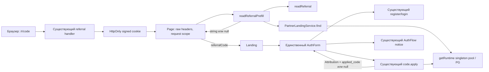

# 5. Архитектура: регистрация по приглашению

Статус: M-light R2 design repair по QCR-QUALITY-1/QCR-RISK-1/QCR-TEST-1 для originating focused verification, без разрешения Step 7. Автор — отдельная сессия `gpt-6-astra xhigh`; код пишет `gpt-6.1-sol high`. Нормативные R2 SHA в ADR-001; исходный mockup сохраняется.

## Компоненты

Новый production module только `apps/web/src/server/referral-prefill.ts`. Page выполняет wiring, Landing передаёт публичный prop, AuthForm владеет draft/edit и текущим reply, AuthFlow владеет transient сообщением вместе с подтверждённым code. В существующем PartnerService.apply расширяется только return projection: c.code из текущего locked SELECT связывается с partner_code_id результата INSERT/UPDATE и возвращается как applied_code после COMMIT. Parser, source policy, auth и transaction boundaries сохраняются. Обратных импортов клиента в сервер нет; клиент не импортирует runtime/crypto/PG.

## Поток
1. `/r` записывает событие/HttpOnly-cookie по прежним правилам и редиректит на `/`.
2. Page читает raw header в текущем запросе. Helper сначала проверяет подпись/TTL/дубликаты через readReferral, затем active код и account через find; только строка `code` попадает в HTML/RSC.
3. При первоначальном mount AuthForm заполняет input и раскрывает details для пригодного display. Поле остаётся редактируемым, type-size≥16px; summary/action≥44px. Approved hint и пояснение доступны в register mode, исчезают после ручного edit. Без приглашения сохраняются empty/closed.
4. Sticky ручной edit переживает переключение mode вместе с DOM/draft. Нет edit — `{}`; edit+непусто — `{code}`; edit+пусто — `{}`. Повторные props не перезаписывают draft уже mounted формы.
5. Новый auth → apply с additive applied_code → локальный compact reply predicate → existing AuthFlow с обеими строками макета и фактически применённым code → safe next/router.refresh. SSR A не мешает подтвердить реально применённую B. Existing-registration → existing notice без apply/signup. Login сохраняет прежний apply без нового registration notice.
6. Apply error сохраняет signedIn/pendingRegistration, retry не повторяет auth/trial/signup. Discard вызывает прежний `{discard_referral:true}` и generic notice; подтверждение не сохраняется от предыдущего ответа. Refresh/navigation/dismiss продолжают текущий notice lifecycle.

## Контракты и границы доверия
| Граница | Контракт |
|---|---|
| Request → helper | Raw Cookie header и secret остаются на сервере; duplicate rejection не теряется при cookie-map conversion |
| Helper → Page → client | Только `referralCode: string|null`, без source, owner UUID, raw cookie, подписи и secret |
| Form → apply | `{}`, `{code}` либо existing discard; client source отсутствует |
| Apply → Form | Прежний Attribution|null с additive applied_code только для positive persisted result; статус pending/activated с пригодными id/source/reject_reason и публичным applied_code даёт подтверждение только created registration |
| Notice → кабинет | «Аккаунт создан. Приглашение применено.» и «Регистрация по коду CODE учтена.»; CODE только из current server reply, не stale SSR; активация или оплата не обещаются |

Request-scoped `headers()` исключает общий статический результат. `requestTheme()` уже делает страницу динамической; server read не получает `cache`, shared Map или module-level promise. Нельзя заменить raw header на deduplicated cookie map. SSR не вызывает recordView и не меняет cookies/атрибуцию. Изменённый lookup не нужен: текущий find уже проверяет active code/account.

## Данные и API
Нет DDL, новых endpoint, env и зависимостей. Server helper имеет сигнатуру `readReferralPrefill(header: string, secret: string, links: Pick<PartnerLandingService, 'find'>): Promise<string|null>`. Параметр links обеспечивает локальный negative resource-down test без отдельного fake repository. Runtime pool уже существует; создавать новый pool или выдуманный `serverDb` нельзя.

AuthFlow Notice.kind добавляет `created_with_referral` с transient публичным code. Старые `created`/`existing` и методы recovery/notice сохраняются. `code.apply` получает только additive response field `applied_code?: string`; прежний tRPC envelope и input schema/null/error, общий тип записи Attribution и `/api/auth/register` `outcomes-v1` сохраняются. Ни RPC/context wrapper, ни новый provider не нужны. Клиент принимает код только действующего формата6–12 символов; отсутствие поля у старого сервера даёт generic created, не ложное подтверждение.

Связь доказательства: locked SELECT текущей code row → `RETURNING` attribution → проверка `result.partner_code_id === code.id`, positive status/reject_reason и not-self → successful COMMIT → прежний result + `applied_code: code.code`. Никаких повторных SELECT после COMMIT, использования request code для ответа или подстановки SSR. Если соответствия нет, additive field не выдаётся; это не меняет результат записи и не создаёт новый retry failure. При последующем отзыве ссылки notice остаётся подтверждением уже произошедшего применения.

## Канонические потребители и сквозной oracle

На том же native HTTPS fixture новый тест читает `new PartnerService(pool, secret).dashboard(bloggerId, codeId)` и `bloggerReport(pool, ownerId, month)` из `packages/db/src/blogger-report.ts`. Это те же функции, которые обслуживают `partner.dashboard` и `/api/owner/bloggers`; подменять их локальным `SELECT count(*)` нельзя. Нужен active synthetic blogger `is_blogger=true`, связанный с выбранным code, другой blogger/code и отдельный synthetic owner `owner_unlimited=true`. Участники и before snapshots создаются до чистого `/r` → регистрации; старые native contexts не переписываются.

Сразу после реального apply/notice: PG JOIN подтверждает account→partner_code→blogger и HTTP applied_code; dashboard выбранного code и owner report выбранного blogger/codes[id] дают registrations_before+1, foreign blogger/code дают прежние значения. Повторное чтение обеих функций возвращает те же counts. Dashboard all-time, owner report — месяц `created_at` атрибуции в Europe/Moscow; для устойчивости к границе месяца pre-snapshot охватывает текущий и следующий месяцы по времени PG, post выбирает месяц фактической вставки. Исходные dates не переписываются ради теста. Функции доступа/агрегаты, платежи и их fixtures не меняются; выполнение отчёта на пустых synthetic financial rows не считается тестом оплаты.

## Риски и проверки
A1/A8 — helper unit invalid/no-cookie/blocked/inactive/lookup-down; A2/A4 — реальный AuthForm с управляемым transport и expiry/manual/result negative cases; A3/A5/A6/A7 — изолированный native Next/HTTPS/PG путь плюс существующие partner/auth tests. A9 — HTTP applied_code/notice сравниваются с реальным PG JOIN, включая SSR A→applied B и missing-code. A10 — те же native signup/apply плюс обе canonical projections before/after/foreign/reread. Native fixture расширяется в том же suite, frozen LEGACY_SOURCE/SHA не меняются. Snapshot PG проверяет attribution/trial/events; нельзя считать мокнутый response доказательством persisted ownership. Source guards/mutation anchors сохраняются.

## Observability

Known404, no-cookie и malformed-cookie не шумят в логах. Unexpected lookup failure — один warn `referral_prefill_lookup_unavailable` без контекста/ошибки/секретов. Счётчик этой фиксированной категории в существующих логах отвечает на вопрос «почему приглашения не заполняются»; existing `growth_event.code_applied` и attribution отвечают на вопрос о регистрации. Новых telemetry endpoints и событий нет. Внешний симптом display outage — пустое поле при `/r`, а не падение landing; root/оператор проверяет warning и native smoke. Apply failure виден пользователю в существующем error/retry блоке.
