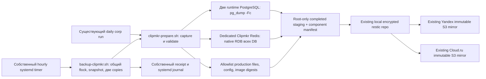

# Архитектура: ограниченный адаптер резервирования

Статус: proposed, M/light; native gates и runtime ещё не выполнены. Inputs: `01_requirements.md`, `02_reuse_inventory.md`, `03_adr/001-reuse-native-restic-without-global-retention.md`.

## Ответственности и интерфейс

- `ops/backup/clipmkr-prepare.sh` — executable manifest pre-hook: проверяет фактические источники и shared lock contract, очищает только собственный staging, проверяет capacity, создаёт уникальный staging0700, свежие dumps/RDB/files/config, checksums и component intervals; проверяет и атомарно публикует completed set. Никакого backup/copy/restore/repo-retention внутри hook.
- `scripts/backup-clipmkr.sh` — единственный hourly wrapper: root, bounded timeout, общий flock на весь run; вызывает hook, native restic, две immutable rclone copies и current snapshot readback; публикует собственный success только после всех шагов. Один CLI, без plugin framework или general-purpose config engine.
- `ops/backup/clipmkr.backup-manifest.json` — service `clipmkr`, dump-based consistency, pre-hook, один completed staging include, RPO interval1h как целевая настройка; не raw PGDATA и не весь private runtime root. Установка только собственного registry file, exact existing schema validation до записи.
- `ops/backup/clipmkr-backup.service` и `.timer` — свой root unit/почасовое расписание, ограничение runtime/IO по существующему backup convention. Не меняют corp timers/services, app/worker/DNS/платёжный режим.
- `tests/backup-clipmkr.test.ts` — focused subprocess tests: fake command boundary для отказов, actual local restic/rclone temp repo для содержимого/двух copies; без production credentials.

Новых HTTP API, таблиц, schema migration, зависимостей или контейнеров нет. Никаких runtime restore команд в timer/wrapper.

## Runtime binding и данные

Private current allocation `.../activation-20261110/allocation.private.json` сопоставляется с действующими main/helpdesk service connections и mount sources, а не выбирается по похожему имени. На прочитанном срезе main Redis DB2/helpdesk DB6, filesRoot `/var/lib/clipmkr-relocation/activation-20261110_71454d`; значения — наблюдение, не вечная config. Другие staging/legacy БД не подменяют их. PG credentials/role ownership/required extensions восстанавливаются из explicit selected role metadata/config, не всего cluster globals с чужими ролями.
Allowlist после повторного read-only подтверждения: фактические helpdesk uploads/support config, активные video/llm/stt/spend roots, private env/compose bindings и версии image IDs/дижесты. Расширение за production mounts отказывает до решения. Пары path/hash допускаются в приватном manifest, секретные значения в публичном receipt запрещены.

### Собственный staging и capacity

Единственный cleanup owner — `clipmkr-prepare.sh` под общим lock, одинаково для daily и hourly. Только root-owned `/var/lib/clipmkr-backup/staging/` и собственные прямые run-каталоги с проверенным ownership marker; root/run paths не symlink, разрешённый authoritative pointer разрешается только внутрь собственного root. Unknown path/marker, alias к production или неоднозначная ownership означают отказ, а не разрешение рекурсивного удаления. Произвольные имена из receipts/manifest не становятся delete targets.

Числовой предел: **2 набора максимум, каждый ≤1 GiB**, включая его manifest. В покое после нормального завершения — один authoritative completed; при capture — этот completed и один candidate. Взяв lock, hook сначала убирает только неавторитетные остатки собственных failed/orphan/superseded runs; новый candidate создаётся лишь после этого. Действующий include не удаляется до атомарной замены и не может использоваться конкурентным snapshot благодаря shared lock. После validation hook атомарно переключает include на candidate и удаляет прежний completed до возврата parent; publication не означает общий backup success. При capture failure/TERM удаляется только unpublished candidate. SIGKILL между шагами оставляет максимум два набора; следующий hook под lock восстанавливает этот порядок до записи. Ошибка cleanup блокирует новый capture, не маскируется. Неудача restic/copy сохраняет новый completed и старый success receipt; plaintext историю failures не храним. Last-attempt/last-success receipts заменяются атомарно, без бесконечной коллекции per-run plaintext файлов.

Read-only preflight после cleanup оценивает две БД (`pg_database_size`), Redis (`used_memory`), выбранные files по logical size и manifest; conservative estimate с запасом 25% должен укладываться в **1 GiB capture cap**. Неизвестная оценка или превышение cap дают non-success до dump/RDB/file copy. Native free-space check требует **≥8 GiB available** на staging и repo filesystems (при одном FS — одна проверка): 1 GiB новый набор + 2 GiB local repo/cache headroom + 5 GiB reserve приложения. Existing completed уже занимает диск и учитывается available space. Фактический суммарный размер набора ограничивается 1 GiB при последовательной записи, включая ограничение текущего output оставшимся budget; проверки только после безлимитной записи недостаточно. Перед restic wrapper повторно требует **≥7 GiB available** на repo FS. Cache/scratch должны входить в эти проверенные filesystems/headroom; скрытого unbounded output вне staging нет. При превышении/недостатке — failed component и прежний success, без нового snapshot. Это admission budget, не эксклюзивная резервация filesystem: параллельный рост production сохраняется как измеряемая граница. Нового quota daemon/config framework не требуется; используются существующие stat/df и native ограничения вывода.

Порог выбран с запасом к read-only наблюдению координатора: main PG 12 734 947 B, support PG 12 333 539 B, filesRoot 136 KiB, available около 25 GiB. Это sizing observation, не будущий размер dump или успешный capture. При росте свыше cap требуется пересмотр бюджета до запуска, не автоматическое повышение или удаление production данных. Cleanup не меняет restic/local/offsite retention.

### Authoritative spend JSONL и временные файлы

`model-spend.jsonl` — shared authoritative append-only ledger STT/LLM (`apps/worker/src/{stt,llm}/spend.ts`), не SQLite. Capture привязывается к действующему mount/path, открывает обычный файл без следования за symlink и фиксирует descriptor identity (`device`, `inode`), размер **S** и начало интервала. Читает ровно первые S bytes этого descriptor, находит последнюю границу LF **B≤S** и сохраняет ровно bytes `[0,B)`. Каждая непустая newline-terminated строка должна быть корректным UTF-8 JSON object; повреждённую полную строку нельзя пропустить или исправить. Неполный последний tail `[B,S)` исключается явно; при S>0 и отсутствии полной записи — отказ, при исходном S=0 допустим проверенный пустой ledger. Append за S разрешён, но не входит в этот snapshot.

Перед publication повторно подтверждаются path→тот же device/inode, размер ≥S и неизменность captured prefix на исходном descriptor; обнаруженная ротация/усечение/изменение prefix, short read или invalid record означают non-success без publication. Retry loop и остановка writers не добавляются: следующий штатный run повторит попытку. Приватный component manifest содержит source identity/path, S, B, число records, S−B excluded-tail bytes, SHA-256 сохранённого prefix, start/end и `completed-prefix` semantics. Restore проверяет checksum и заново парсит каждую строку; full-source/атомарная snapshot гарантия не заявляется.

Uploads/config — required durable files с explicit allowlist и проверкой изменения во время capture; текущий compose содержит env непосредственно, support TOML сохраняется явно, отсутствующий env_file не выдумывается. Известные `stt/llm/video` temp/workfiles **исключаются** как rebuildable/in-flight, категории/исключения фиксируются в manifest; они не входят в sizing/capture cap и не служат oracle восстановленного durable state. Незнакомый файл не объявляется scratch автоматически: runtime allowlist обязан различать durable uploads и scratch до capture. Обычный длительный processing не должен расходовать budget backup своими временными медиа. Валидный spend prefix всё равно не является coherent job/queue snapshot: перед DR запуском требуется reconciliation.

Состояния run: capture → validated completed set → local snapshot → primary verified → secondary verified → success. Любой отказ оставляет failed attempt и прежний success age; частичный staging никогда не является authoritative include. Existing daily hook получает доказанный shared lock от corp parent; hourly wrapper удерживает его сам. Существующий `BK_LOCK_HELD=1` без реального удержания lock не принимается доказательством.
Local restic tree целиком копируется существующим append-only способом; чужие данные не удаляются. Только стабильные restic tags `clipmkr`, `corp-infra`; run ID хранится в component manifest/receipt, не в tag (existing forget группирует по host,tags). Globaldaily может убрать local hourly snapshots при текущем KEEP_HOURLY0, поэтому новый локальный retention не обещается. `--phase run --service` не используется из-за global forget.

## Восстановление и границы доверия

Проверка offsite snapshot выполняется read-only native restic с совместимым `--no-lock` для append-only S3 credentials; copy identity проверяется после обеих successful copy commands. При restore сначала root-only extraction, checksums, свежие изолированные PG destinations существующего сервера, `pg_restore --exit-on-error`, затем выбранные relational checks. Production namespace запрещён, автоматического отката нет.
Native RDB всей dedicated инстанции нельзя накладывать на живой Redis. В этом scope обязательны native format check и безопасный план selective reconciliation; реальная load проба требует offline/изолированного Redis назначения, доказанного до операции. Если его нет без нового контейнера/остановки, записать ограничение и не выдавать checker за загрузку.
Две PostgreSQL согласованы каждая внутри своего pg_dump; PG/Redis/files сняты в разные моменты. При DR web/workers закрыты до сверки очередей с БД и S3; неизвестные/in-flight jobs не запускаются вслепую. S3 metadata/key list сохраняет ссылки, но не байты видео; объектная потеря этим scope не покрыта.
Recovery secrets: metadata existing `/var/lib/corp-infra/escrow/age-key.escrow.json` (проверено координатором) указывает attestation06.10.2026 и next verification04.01.2027, KeePassXC у двух holders и encrypted USB. Это attestation, а не фактический retrieval test; отдельную escrow систему не строим. VPS disaster recoverability нельзя заявлять до подтверждения доступности нужного ключа/password вне VPS и чтения snapshot в recovery контексте.

## Observability

INFO: run ID, component start/end, count/size, snapshot ID, primary/secondary verified time; ERROR: component failure/lock busy/timeout/no space/unknown binding; секреты/PII/URL не логируются. Два нужных числа: actual age последнего полного успеха и actual age каждой offsite copy (receipt), без нового metrics daemon.
Внешний симптом: текущий snapshot отсутствует в одной копии либо age растёт; оператор видит failed собственный unit/receipt. Общий corp FAIL/last-offsite marker не заменяет Clipmkr health. Реальную доставку существующего Alertmanager audit не подтвердил; каналу не приписывается работоспособность. До её проверки оператор смотрит unit/receipt; в отчёте приёмки это явное ограничение.
