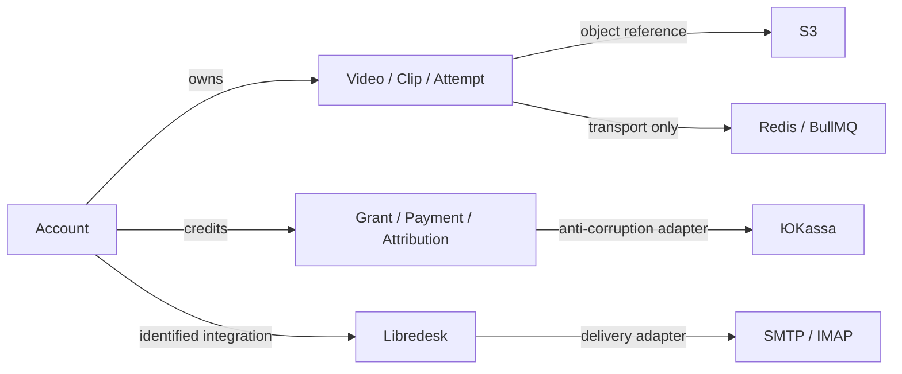

# Модель состояния переноса

09.11.2026, proposed. Новых бизнес-сущностей и таблиц нет; перенос сохраняет существующие consistency boundaries.

## Bounded context map
| Контекст | Состояние/владелец | Граница переноса |
|---|---|---|
| Основной Clipmkr | account/session, video/transcript/clip, job_attempt, quota | Полный исходный dataset переносится без смены ID |
| Кредиты и платежи | payment_intent/payment, grant/allocation/charge, attribution/partner | Та же main DB и idempotency keys; TEST callback принадлежит main |
| Медиа | S3 logical keys, multipart UploadId, номера частей/ETag | Bucket и prefix main сохраняются; физическое копирование бакета не нужно |
| Libredesk | отдельные PG, Redis, uploads, config, inbox/staff/contact mapping | Полный перенос; основной pg_dump этого не содержит |
| Локальная исходная копия | n5 с 1 аккаунтом и grant | Сохраняется отдельно; не merge и не migration source |
| Legacy n5.clipmkr.ru | отдельная n5_referral_paytest_test, Redis9, tests/site/ | Архив/restore проверяются; действующий legacy сервис и hostname сохраняются на source, не переключаются вместе с main |
| QA | свежая n5_relocation_qa_test, отдельный Redis, tests/local-ux-20261104/relocate-20261109/ | Разрешённые fixtures; без исходных pending jobs/payment_intents |

## Ubiquitous language
| Термин | Значение | Не подменять |
|---|---|---|
| Writer | web watchdog/retention, worker, webhook, support mail/queue consumer и административная запись | Только HTTP посетитель |
| Preliminary backup | Проверенная пригодность конкретного dump к restore | Frozen cross-store final snapshot |
| Manifest | Число строк и canonical row hash каждой таблицы плюс schema/sequence/migrations | Несколько totals account/video/clip |
| Freeze | Новые записи закрыты, начатые операции завершены/учтены, все writers fenced | Остановлены только workers |
| Drain | Нет active jobs/attempts/HTTP completion; waiting/delayed/multipart имеют явный outcome | Queue waiting=0 |
| R1/R2 | Возврат до / после первой target записи | Простое переключение DNS назад |

## Aggregates / Entities / VOs
- Account — identity/роль/лимит/пароль; session и support_email_token связываются с account. Ни email, ни совпадение hash не являются правилом merge.
- Video → Transcript/Clip/JobAttempt: fence и series_no определяют право принять результат; Redis job transport не заменяет PG attempt authority.
- Account credits: grant → allocation → video_credit_charge; PaymentIntent → Payment с provider ID и idempotency. Все связи переносятся одним PG snapshot.
- Partner/PartnerCode/Attribution: историческая принадлежность фиксируется, оценка вознаграждения не пересчитывается переносом.
- Storage reference (value): bucket + configured namespace + logical key; multipart (key, UploadId) должен сохранить parts после окна.
- Support: отдельный ID space Libredesk; user identity и inbox mapping сохраняются вместе с конфигурацией/JWT secret, mail delivery state и uploads.

## Relationships

## Codebase mapping
`packages/db/migrations/` и `packages/db/src/` — persisted authority; `packages/queue/src/` — BullMQ; `packages/s3/src/client.ts` — namespace; `apps/web/src/server/watchdog.ts`/`retention.ts` — скрытые writers; `apps/web/src/server/billing-handler.ts` — callback; `ops/libredesk/docker-compose.yml` — support boundary. Миграций при переносе production нет; QA schema берётся из исходного dump с 28 migration entries.

## Состояния и инварианты
SOURCE_ACTIVE → BACKUP_RESTORE_VERIFIED → TARGET_DATA_VERIFIED → QA_VERIFIED → OWNER_ACCEPTED → OWNER_CUTOVER_AUTHORIZED → WRITES_FROZEN → FINAL_STATE_VERIFIED → TARGET_ACTIVE → OBSERVED.
Подтверждён только preliminary restore четырёх архивов; полные manifest/QA/final состояния требуют собственных доказательств. Каждый transition определяется фактами, а не существованием документа. Обнаруженный конфликт или ошибка остановит зависимую ветку. После TARGET_ACTIVE возврат требует R2 даже если пользователь ещё не открыл сайт: watchdog уже writer.

## Уточнение переходов после QCSD — qtest-05
Перед первым потенциальным target writer состояние `TARGET_FROZEN_VERIFIED`: imports и все manifests согласованы, app consumers никогда не стартовали. Доказанный zero-write допускает R1. Любая попытка старта writer, включая неуспешный/неизвестный startup, переводит состояние в `R2_REQUIRED`, пока полный независимый аудит не докажет ноль изменений. Недоступность журналов/target не возвращает R1: состояние `MAINTENANCE_AWAITING_CURRENT_STATE`. Synthetic negative rehearsal обязана показать отказ «startup failed ⇒ старый snapshot»; single-writer invariant распространяется и на watchdog/support consumers.
