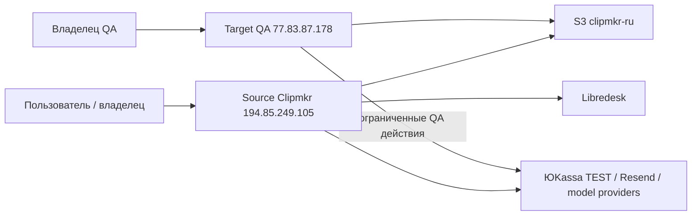
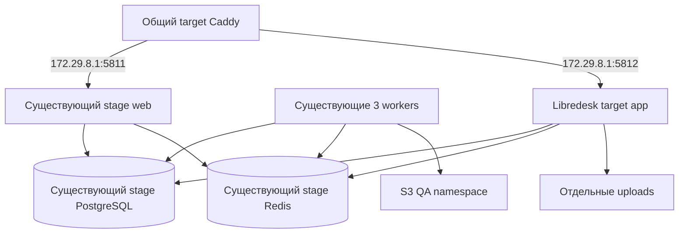
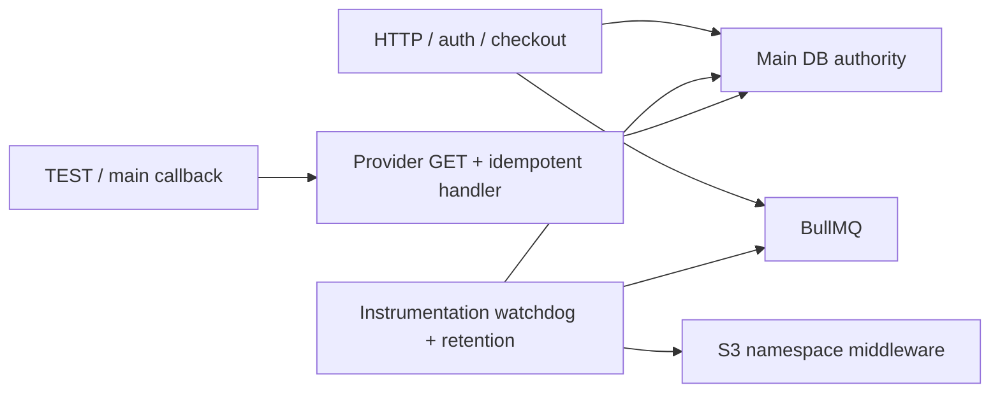
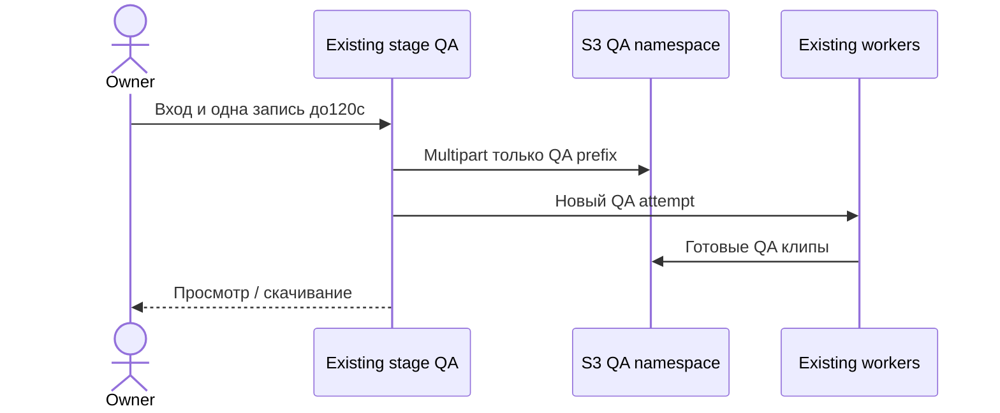
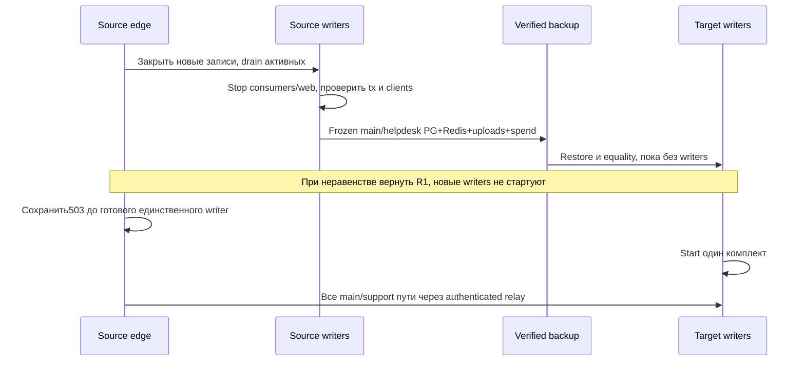
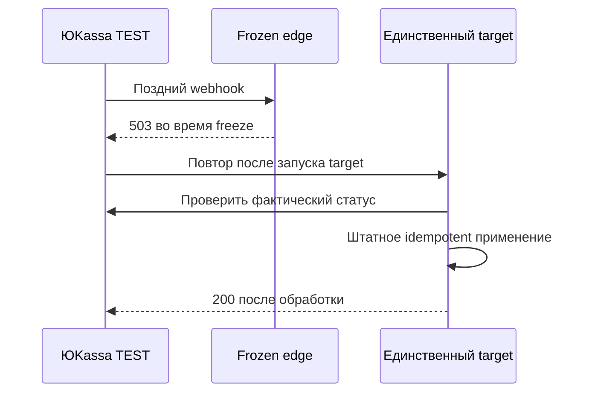

# Архитектура переноса Clipmkr

09.11.2026, proposed; runtime не применён. Источники фактов: `operations-storage.md`, `operations-routing.md`, `02_research.md`; решения: ADR-001/ADR-002/ADR-003. Разрешена подготовка target; QCSD/K1/K2 и checkpoints не объявляются пройденными. DNS/cutover, изменение merchant callback, Cloud.ru и настоящие списания не разрешены этим документом.

## C4 Context

Production ingress остаётся source во время подготовки. У владельца отдельный QA browser context, аккаунты/намерения не смешиваются. Legacy `n5.clipmkr.ru` остаётся source; архивируется отдельно, не участвует в main TEST callback.

## C4 Container

Порты5811/5812 — выбранные будущие значения; `ss`/Docker ports/firewall должны подтвердить свободу до binding. Публиковать только `172.29.8.1`, при необходимости также127.0.0.1; не0.0.0.0. PostgreSQL/Redis наружу не публикуются. Не присоединять stage `web` к `n8-interior-local_edge`: alias `web` уже принадлежит N8.

## Точные bindings и файлы
| Назначение | Выбор / наблюдение |
|---|---|
| Существующий stage | project `clipmkr-stage-20261028`, working dir `/home/clipmkr` |
| База Compose | `/home/clipmkr/docker-compose.yml` + `/home/clipmkr/ops/cloudru/compose.images.yml`; labels подтверждены |
| Новый минимальный config | `deploy/workspace-relocation.compose.yml`: override4 app services + target helpdesk service; никаких новых DB/Redis/test containers |
| Private profiles (создать после gates) | `/root/.config/clipmkr/relocate-workspace-20261109/runtime/{qa,main,helpdesk-qa,helpdesk-main}.env`, 0600; `helpdesk-{qa,main}.toml`,0600 |
| Источник env | Существующие runtime значения извлекаются в закрытый профиль; старый prepared `app.sales-off.env` не считается применённым |
| PG | `clipmkr-stage-20261028-db-1`, network `clipmkr-stage-20261028_default`, service DNS `db:5432`, volume `clipmkr-stage-20261028_pgdata`; административный existing user `n5` |
| Main import | DB `n5_relocated_20261109`, owner role `n5_relocated_owner` NOLOGIN, app role `n5_relocated_app` LOGIN без superuser/CREATEDB/CREATEROLE |
| Support import | DB `n5_helpdesk_relocated_20261109`, owner `n5_helpdesk_relocated_owner`, app `n5_helpdesk_relocated_app`; extension pg_trgm установлен администратором |
| QA | DB `n5_relocation_qa_test`, role `n5_relocation_qa`; schema-only main dump; support QA DB `n5_helpdesk_qa_test`, роль `n5_helpdesk_qa`, отдельная копия поддержки |
| Сохранить | Локальная DB `n5` и роли/volume без замены; legacy `n5_referral_paytest_test` — verified архив, сервис остаётся source |
| Redis | `clipmkr-stage-20261028-redis-1`, DNS `redis:6379`, volume `clipmkr-stage-20261028_redisdata`; DB0/15 заняты, не трогать |
| Новые Redis namespaces | main DB1, support DB3, main QA DB4, support QA DB5; каждый требует повторного DBSIZE=0 и отсутствия clients до первого использования; это назначения, ещё не применённые |
| S3 | main `clipmkr-ru`, prefix пуст; QA `tests/local-ux-20261104/relocate-20261109/`; legacy `tests/site/` не меняется |
| Main images | исходные web `sha256:4afaad4d19cad352c5ed89bae16a3c694b2d41af3abf7873fb63968d2527f8f6`, worker `sha256:6e66c8717b0f7d31c720d63db14d5841b9ec7d9cd965d9a3f2c3ac0cb1ae8800` уже локальны; подставлять полные IDs из verified inventory, никогда abbreviated IDs в Compose |
| Support image | `libredesk/libredesk:v2.9.0@sha256:e7aa3bac149323d21e8e130adc8d9dd83b2c4fc85f83bb3b08b544ffa3c7d201` |
| Target shared Caddy | container `n8-interior-local-proxy-1`; mounted `/home/2026-AUG-PU-Projects/projects/08-interior-ai-redesign/config/public/Caddyfile` |
| Source edge | `ai-hub-tls-proxy`, `/home/dz-projects-2026/edge/Caddyfile`; main project proxy имеет собственный warm mount, см. routing report |

Main/support роли создаются через private SQL stdin, passwords не в argv/выводе. Restore `--no-owner --no-acl --role=<owner>` с последующими явными schema/table/sequence grants; сравнить исходные ACL и документировать mapping. Приложение не получает роль владельца schema. QA grants допускают только собственную DB; production схемы не мигрировать. Занятые или существующие назначения не перезаписывать: STOP конкретной ветки, затем согласовать новую свободную привязку.

## C4 Component

Отдельного безопасного read-only web режима нет. Production imports остаются без web/workers; QA schema не содержит импортированных video/jobs/payment_intent, поэтому watchdog не запускает старые задания. QA prefix обязателен во всех4 процессах; пустой prefix при QA — отказ запуска операции. Production приложение/зависимости не обновляются; только QA web собирается из исходной source tree с проверенным guard patch по исключению ADR-002. Workers остаются исходными.

## Data & storage
Уже доказано: exported `REPEATABLE READ READ ONLY` PostgreSQL snapshot + `pg_dump --snapshot`; после restore совпали count и canonical row SHA всех27 main,27 legacy,57 support таблиц. Private evidence: `consistent-snapshots/summary.actual.private.json` и `*.row-equality.actual.private.json`. Проверочные БД удалены. ACL/roles и последовательности требуют отдельной проверки; Redis/S3/uploads не входят в эту атомарность. Это preliminary backup, не финальный cutover.

Основная очередь переносится DB0 source→DB1 target; support DB0 source→DB3 target. Целый source RDB/AOF поверх общего target Redis запрещён. В frozen окне сделать per-key `DUMP`+`PTTL`+source time, сохранить binary payload в private archive, восстановить `RESTORE` без REPLACE только в заранее пустой выбранной DB; TTL уменьшается на прошедшее время, исчезнувшие/истёкшие ключи учитываются. Отдельно сохранить исходные RDB/AOF/config как аварийный архив. Все типы ключей/очередей, locks, delayed и TTL сверить. Проверочный импорт выполняется в QA Redis DB только после остановки QA consumers; production consumers не стартуют до cutover.

Libredesk переносится с исходным encryption key, inbox/settings/users/conversations/messages и uploads; текущий identified=false/JWT пуст сохраняется. Source срез:20 messages/11 conversations/13 users/1 inbox, outgoing queue0, uploads/media0B; повторить финальный срез. Для support QA применить отдельные DB/Redis/uploads и изолированную внутреннюю сеть `clipmkr-relocation-support-qa` без внешнего egress; существующие PG/Redis подключить к ней отдельными aliases `relocation-db`/`relocation-redis`. Helpdesk QA app получает только эту сеть; невозможность SMTP/IMAP/HTTP наружу проверяется до старта. Inbound через порт5812 и target Caddy допустим. Production support import не запускать ради preview. На cutover service переключается на production private config/DB3/volume и existing stage network, допускающий прежние внешние подключения. Не переносить чужие сети/volumes и не запускать support schema install поверх restore.

## Sequence flows

Перед cutover live повтор проверяется отдельно. ЮKassa документирует повтор при HTTP≠200 в течение24ч от события; HTTPS443/8443 и TLS≥1.2, BasicAuth подписка настраивается в merchant UI. IP URL явно не запрещён в опубликованных требованиях, но его принятие merchant validator и доставка ещё не доказаны. Источник: [официальные входящие уведомления ЮKassa](https://yookassa.ru/developers/using-api/webhooks), прочитано09.11.2026.

## API design / TLS / XFF
Контракты приложения сохраняются. Target IP QA `/api/webhooks/yookassa-test` передаётся напрямую в одноимённый QA guard route; rewrite в canonical `/api/webhooks/yookassa` запрещён. Source текущий callback не меняется при подготовке. После working UI владельцу предъявляется точный QA callback URL для отдельного TEST окна; до изменения merchant callback настоящая TEST payment E2E остаётся блокированной, остальные проверки продолжаются. Исходную настройку merchant сохранить, проверить отсутствие незавершённых source TEST платежей перед временной сменой и восстановить после окна; исходящие TEST payload не фабриковать.

IP QA — `https://77.83.87.178`, existing валидный IP TLS, QA origin такой же. Проверка основного hostname — отдельный последовательный QA профиль с origin `https://clipmkr.ru` и Chromium host-resolver для main/www/support; одновременно два несовместимых origin не выставлять. Сохранить source `SESSION_SECRET` для проверки imported owner hash/session; QA fixtures/секреты только private. Основные imported sessions проверяются криптографически/по БД без их публикации в QA; полный перенос входа проверяется при cutover.

Target передаёт web ровно два адреса XFF, а web использует `N5_TRUSTED_PROXY_HOPS=1`; `apps/web/src/server/ip.ts` отвергает hops=0, поэтому менять его на0 нельзя; точные bytes цепочки обязаны пройти QA header probe с IPv4/IPv6 и подложным клиентским XFF. Для direct target клиента Caddy должен удалить входной XFF и сформировать `client, target-proxy` по явному `header_up X-Forwarded-For "{http.request.remote.host}, {http.request.local.host}"` template. Для future old-edge relay source edge устанавливает `X-Clipmkr-Relay-IP={http.request.remote.host}` и частный `X-Clipmkr-Relay-Key`; target принимает эту ветку только от194.85.249.105 при совпавшем ключе, формирует XFF `relay-client, target-local` и удаляет relay headers перед upstream. Все остальные запросы получают direct template независимо от входных XFF/relay headers. Source upstream — HTTPS77.83.87.178 с SNI/Host clipmkr.ru, чтобы public DNS не образовал петлю. Точный Caddy matcher/escaping проверяется adapt и live probe перед применением. Не выставлять broad trusted private ranges по догадке и не менять hops по числу контейнеров. Отсутствие доказанного заголовочного пути блокирует платежный callback/cutover.

До DNS scoped main/www/support certificate/key можно перенести с source по точному пути из routing report,600/700, без всего ACME volume; подключить ручным `tls` к target Caddy. После DNS ручной TLS заменить управляемым ACME и проверить renewal. Candidate adapt/validate и loaded/file parity обязательны, четыре чужих upstream и IP default_sni сохраняются. Main/www TTL300, support600; n5/c.clipmkr.ru не переключаются.

## Ресурсы и предел QA
QA live budget: ровно1 fresh upload длительностью≤120с, user/paid/global minutes=3, user/global LLM=1, user uploads=1, rerenders=1 и upload refunds=1; все лимиты положительные и проходят existing config validator. Workers запускаются только после проверки пустого QA backlog и правильного prefix; после одного результата или ошибки останавливаются. Повторный вызов после сбоя требует разбора причины и нового числового бюджета. 90/120-минутные граничные acceptance scenarios проверяются существующими tests как серверные ограничения; настоящий длинный UI прогон остаётся явно NOT RUN и планируется отдельным ресурсным окном, короткий тест его не подменяет.

Worker scratch и model-spend разных профилей не смешиваются: bind root `/var/lib/clipmkr-relocation/{qa,main}/` с отдельными stt/llm/video/spend каталогами; исходный model-spend переносится в main после freeze и входит в rollback. До запуска проверить UID/GID исходного образа, разрешения целевых каталогов и вычислить свободное место: input + audio + clips + запас временного ffmpeg + backups. При available RAM<4GiB, свободном диске<10GiB либо отсутствии ещё 2× измеренного scratch пика — остановить новый QA job, не чистить неизвестные Docker volumes/cache. QA получает CPU cgroup1 и ровно один fresh upload/job; существующие STT/LLM concurrency2 не меняются, несуществующий env concurrency1 не вводится; source production лимиты не изменять.

## Observability
Оператор записывает private timestamps, SHA образов/config, backup/restore duration, PG manifest equality, Redis backlog/active/locks и последний off-host backup. Существующие Caddy/web/worker logs используются с ограничением размера; secrets, email, signed URLs и payload в публичный отчёт не попадают. Основные тревоги: 5xx/ошибка входа, S3 PUT/GET403/404 для ожидаемого объекта, failed/stalled attempt, любой QA запрос вне namespace, неожиданный mail/payment или рост чужих counters. Оператор наблюдает первый QA job и всё окно cutover; независимый QE проверяет evidence, владелец видит UI и перечень ограничений.

## Preconditions и оставшиеся блокеры
До безопасного target старта: настоящие QCSD/K1/K2/checkpoints; reviewed overlay/config; свободные hostports и Redis namespaces; grants/ACL; support egress fence; resource check. До TEST payment: отдельное разрешённое merchant окно и доказанная доставка, корректный XFF. До cutover: owner acceptance и DNS разрешение, полный writer inventory/fence/drain, settled multipart, актуальные off-host backups и R1/R2 rehearsals. После whole-target-VPS loss без реплики RPO=0 не гарантируется; такой отказ оставляет maintenance до owner решения.

## Доработка дизайна по QCSD, 09.11.2026
Условия qquality-01, qrisk-01/02/03, qtest-01/02/03/04/05/06 ниже адресованы проектом; их closure устанавливают исходные независимые роли на новом revision. Runtime проверки ещё не исполнены.

### QA ingress: qquality-01, qrisk-02, qtest-01
`deploy/workspace-relocation.caddy` — один reviewed template для target. Все IP/main/support QA UI/API/assets/mutations, включая health, требуют owner/operator BasicAuth; hash — private include0600, отсутствие include/пустой auth означает отказ candidate. На основном IP разрешается отдельный точный POST TEST callback route только в merchant окне; остальные методы, пути и support не исключаются. До окна callback503. Provider handler остаётся штатным: правильный клиентский IP, GET provider state и idempotency; BasicAuth исключение не разрешает произвольную финансовую запись.

5811/5812 bind только172.29.8.1. Перед startup установить firewall fence для original-direction DNAT потоков на эти hostports: source172.29.8.2 (текущий target Caddy) разрешён, прочие источники запрещены; никакого catch-all ACCEPT для bridge/private range. При iptables backend использовать DOCKER-USER + conntrack original destination/port/ctdir ORIGINAL, при nft backend эквивалент проверяется отдельно; неизвестный backend — STOP. Docker bridge isolation не должен давать альтернативный container-IP путь. Local root operator является доверенным host admin, внешний пользователь — нет. После каждого recreate повторить container/network addresses и отрицательные probes. До доказанного fence не включать app, workers, mail/providers и не выдавать preview.

Обязательные будущие проверки: owner positive login через оба hostname и IP; anonymous/wrong BasicAuth401, spoofed XFF/Host/relay header не меняет доступ; внешний raw5811/5812 и соседний существующий контейнер не достигают app напрямую, container-IP bypass отвергается. Проверить method/path расширения callback отрицательно. `tests/workspace-relocation-config.test.ts` должен реально адаптировать Caddy v2.11.7 и parse Compose config на synthetic env, проверить guards и их removal/misconfiguration; live probes доказывают сеть. Test не создает контейнеры. Порт остаётся закрытым при провале проверки.

### S3 admission: qrisk-01
Общий ключ разрешён владельцем03.11; изоляция в существующем SDK namespace плюс отдельные QA data bindings. До live S3 требуется admission ровно4 app profiles: DB n5_relocation_qa_test, Redis4, prefix `tests/local-ux-20261104/relocate-20261109/`, без original object keys/jobs/payment_intents в QA fixture. Empty/foreign/missing prefix, неизвестный profile или разные prefixes web/worker — STOP. Compose required vars сами по себе не доказывают точное значение: actual config JSON сверяется и валидируется contract test до `up`.

Проверка использует `tests/storage-prefix.test.ts` с реальными named cases: `prefixes all object commands before serialization and signing`, `rejects malformed paths, bucket mismatch, unsupported commands and foreign responses without escaping namespace`, `validates multipart response keys and forbids foreign markers and presigned keys`; и `tests/retention-storage.test.ts`. Relocation contract повторяет serialize/presign матрицу для точного QA prefix: Put/overwrite/Delete, Get/Head, Create/Upload/List/Complete/AbortMultipart, list/markers, signed GET/PUT; outbound physical key никогда не выходит из namespace. Unsupported raw/copy пути не допускаются. Негативные cases выполняются на synthetic transport без реального production запроса. Live positive/overwrite/delete/multipart — только свежие synthetic canaries с точным private key journal данногоQA run; cleanup ограничен ими. Путь, не покрытый доказательством, блокирует live QA S3. Existing live integration hardcodes tests/cloud иtests/site: его бездумно не запускают для проверки другого prefix; offline coverage и targeted actual QA canary имеют разные пределы.

### Merchant TEST окно: qrisk-03, qtest-06
До временной настройки callback только read-only inventory определить всех creators данного shop, включая allowlisted main, legacy/admin integrations. Общность shop и уже закрытый legacy без фактов не предполагаются. Legacy n5.clipmkr.ru, c.clipmkr.ru и все source сервисы вне явно разрешённых targets не изменяются: никаких create probes, checkout/config/route mutations или остановок. Разрешение merchant callback само по себе не разрешает такие действия. Полный запрет source creation на всё окно должен быть доказан: для разрешённых targets — конкретным последующим owner решением, пересмотренным runbook, отрицательным create probe и неизменными counts; для остальных — достаточными read-only доказательствами уже действующего ограничения. Если для доказанного fence требуется изменить внешний сервис или доказательства неполны, STOP callback, TEST E2E = NOT RUN; независимая QA подготовка продолжается. Необходимое изменение требует отдельного явного owner решения о точном target/действии/восстановлении и обновлённого плана. Target Caddy template не определяет n5/c hosts и не является разрешением source изменений.

После допуска Source webhook работает для drain; по private provider/source/QA manifest сверить незавершённые и недавно завершённые IDs/statuses/amounts/grants. Наличие retry или неизвестного creator блокирует переназначение. После owner разрешения QA допускает ровно одного TEST creator; доказанный запрет source creation сохраняется весь период. Поздний source event вQA не получает ложный200:503, закрытьQA checkout, восстановить исходный callback, сверить provider/source, дождаться штатного повторного применения. При неизвестном результате QA и ранее явно разрешённые source fences остаются закрытыми; остальные сервисы не изменять, финансовые строки не чинить. Перед возвратом callback завершить QA pending/retries, после возврата проверить source delivery/reconciliation, лишь затем вернуть прежние permissions только ранее разрешённых targets. Невозможность изолировать окно оставляет TEST E2E NOT RUN без остановки прочей подготовки.

### Полная R2 репетиция и R1 admission: qtest-02/05
DRILL-R2-ALL: после synthetic QA post-switch записей/attachments/Redis keys/spend append заморозить QA и восстановить весь набор на source. Назначения: existing mainPG → n5_relocation_r2_main_test, existing supportPG → n5_relocation_r2_support_test с отдельными ролями; existing source main/support RedisDB13 только при empty/no-clients; uploads/spend/config в private `/root/.config/clipmkr/relocate-workspace-20261109/r2-drill/`. Никаких новых контейнеров и наложения на рабочие mounts. Dataset включает main account/video/TEST credit/payment marker, support conversation/message/file, Redis persistent и TTL hash/queue. Проверить rows/FK/sequences, Redis payload/type/remainingTTL, hashes uploads/spend/config, правильные восстановленные bindings и отсутствие второго writer.

Негативные варианты на копиях: BUSYKEY, повреждённый dump/file, missing manifest category, неизвестный startup. Каждый обязан оставить maintenance и запретить старое состояние; без полного roundtrip всех категорий cutover readiness отсутствует. До запуска target сохранить frozen baseline и stopped/client evidence. R1 возможен лишь при доказанном zero-write: writers никогда не стартовали и manifests совпали, либо полный аудит доказал отсутствие target изменений. Любой startup attempt с неопределённым результатом → R2_REQUIRED; невозможность получить актуальное состояние → maintenance. Ошибка startup не доказывает ноль записей watchdog/support.

### Классификация S3 и приёмка: qtest-03/04
Классифицированный baseline/frozen manifest и матрица core-CJM заданы в01 и обязательны для данной архитектуры. Сравнить каждую категорию отдельно: существующие done/failed sources и clip/thumb; исходные NULL keys; uploading с/без multipart; unknown-owner multipart; непроверенный исторический bucket scope. Новые/необъяснённые404, key/part потери и size/hash отклонения останавливают переход. Исходные65 NULL clip keys и13 missing multipart matches сохраняются как ограничения, не становятся «успешно перенесённым медиа». HEAD покрывает whitelist; репрезентативные Range GET поdone/failed, все доступныеmainclip/thumb, fullGET/play/download текущегоmainclip иновогоQAclip фиксируются отдельно с пределом выборки.

До DNS владельцу предъявляется вся матрица01 с фактическими PASS/FAIL/NOT RUN; короткий120с QA и серверные boundary tests не заменяют реальную90/120мин приёмку. Полный referral flow планируется теми же synthetic ролями и единственным owner TEST identity, с trace linkage и проверкой duplicate/visibility. После разрешённого activation, до открытия обычного ingress, проверяются доступные контрольные старые аккаунты/сессии/роли иперенесённыйsupport; неизвестные/непроверенные аккаунты не получают PASS. Ошибка держит maintenance/R2. Явное owner принятие ограничения не переименовывается в успешный тест.

### Простота конфигурационного admission
QA overlay жёстко задаёт DB host `clipmkr-stage-20261028-db-1`, имя `n5_relocation_qa_test`, роль `n5_relocation_qa`, Redis host `clipmkr-stage-20261028-redis-1`/DB4 и точный QA S3 prefix для всех4 процессов. Support QA так же фиксирует свою DB/роль/RedisDB5 и isolated network. Private env предоставляет credentials, не произвольный DATABASE_URL/REDIS_URL/другой prefix, способный незаметно выбрать production. Actual composed JSON проверяется contract test и оператором до up; неизвестные binding/shape — STOP. Для будущего main cutover после owner gate готовится отдельный private `runtime/main.override.yml` с явными reviewed production DB/Redis1/prefix и supportDB/Redis3/config, его hash входит в cutover packet. Этот файл не используется для QA, не порождает новый CLI и не расширяет текущую runtime авторизацию. Совокупный parent code scope теперь7 targets: Compose QA overlay, Caddy template и contract test плюс4 проверенных child guard files. Нового CLI/service/schema нет.

## QA guard image и прямой callback: amendment qe-primary-01

Source/cutover web остаётся `sha256:4afaad4d19cad352c5ed89bae16a3c694b2d41af3abf7873fb63968d2527f8f6`, source commit `11a90aec9d26be56849ac06c9f12a98001739a28`; worker `sha256:6e66c8717b0f7d31c720d63db14d5841b9ec7d9cd965d9a3f2c3ac0cb1ae8800` и Libredesk image выше неизменны. Только QA web получает отдельный immutable image, построенный из isolated source base+4 child code files; actual image ID вписывается в reviewed Compose/test после build, а не придумывается сейчас. Canonical payment handler/DB logic и остальные исходники не меняются; build dependencies/Dockerfile не обновляются. Base image/toolchain IDs и patch/build hashes сохраняются private.

QA Caddy при literal window=true сохраняет original URI POST `/api/webhooks/yookassa-test` до web:5811; rewrite на `/api/webhooks/yookassa` запрещён. Новый route вызывает `createRelocationTestWebhookHandler` поверх canonical factory: full provider verification → SELECT exact local intent/provider ID → financial consumer. Foreign/null/invalid/unbound/mismatch payment/refund →503 до ledger; repeated20 deliveries не фиксируют событие. При invalid profile/startup exception также503. Local known intent сохраняет canonical idempotency/refund ordering и drain после удаления checkout exception, пока TEST provider оставлен для завершения. До merchant допуска Caddy closed503 без upstream, BasicAuth/network/XFF guards сохраняются.

Strict callback profile совпадает с actual Compose: PostgreSQL container DNS/5432 + role n5_relocation_qa + DB n5_relocation_qa_test; Redis container DNS/6379 +DB4; exact QA S3 prefix; origin https://77.83.87.178; billing credits_v1; checkoutEnabled=false; actual YooKassa provider API с testMode=true и test_ key. Ни одного произвольного URL из private config вместо жёсткого binding. Открытие callback в другом hostname/profile не допускается этим исключением.

Статусы: child component closure, parent normative ideation, K1/K2/plan, isolated build/config admission, parent third repair QE, runtime merchant delivery — отдельные доказательства. Они не заменяют друг друга; original parent qe-primary-01 остаётся до собственной независимой проверки. Родительский third repair открывается только после settled7targets, code/spec anti-drift и actual image pin. Исходный handler rewrite на SOURCE — наблюдённый факт и остаётся без изменения; запрет rewrite относится к целевому QA TEST маршруту.
