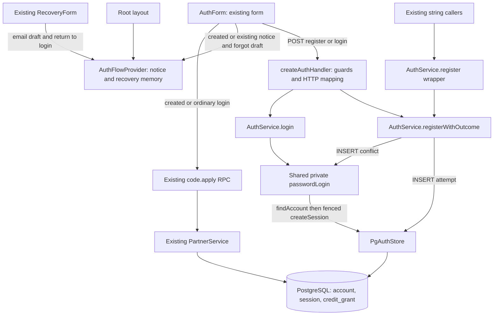

# AUTH-001 — архитектура M light

Статус: авторский проект для независимого QCSD, 10.11.2026, `gpt-6-astra xhigh`. Инженерный выбор делегирован в рамках M/AUTH-001; конкретный UI-макет согласован владельцем («Да, реализовать этот макет»), источник `owner-authority.md`. Независимый QCSD и pre-code gates ожидаются. Код, migrations и private environment автором не изменялись. ADR: `03_adr/001-reuse-password-login.md`; требования: `01_requirements.md`, точные OpenSpec revisions — `requirements-revision.json`.

## Компоненты и ответственность

`AuthForm` отвечает за валидный ответ, UI и разрешённый next; не решает, принадлежит ли пароль аккаунту. Handler сохраняет Origin/rate/body/password/cookie guards, распознаёт версию протокола и не содержит SQL. AuthService считает bcrypt, создаёт/HMAC-хэширует token и интерпретирует исходы. Store подтверждает commit и повторно проверяет hash/status при session insert. Root provider хранит UI notice и краткоживущий email draft в React memory, не является auth-store. `grantTrialTx`, PartnerService, analytics library и `safeNextPath` переиспользуются без изменения.

## Потоки и границы доверия
1. Новый адрес: handler нормализует email → service считает bcrypt hash без PG connection → store атомарно вставляет account + применимый trial + session → commit `true` → outcome created → cookie → AuthForm выполняет прежний `code.apply`, при успехе/явном discard отправляет signup один раз и автоматически переходит.
2. Повтор нового клиента с точным header `X-Clipmkr-Registration: outcomes-v1`: тот же INSERT получает конфликт → transaction завершается `false` → общий парольный алгоритм читает account и сравнивает bcrypt вне connection. Только active + совпадение + fenced session insert дают existing с настоящим token. Форма показывает notice и сразу переходит; не вызывает `code.apply`/signup даже при partner code/referral cookie. Без/с неизвестным header проигравший INSERT читает только актуальный account: active → conflict, inactive/unknown/missing → unavailable; парольный helper и session insert не запускаются. Поэтому старая вкладка с её прежним обработчиком non-2xx не выполнит side effects.
3. Неверный пароль active: нет session insert; HTTP 409 `account_exists`. AuthForm сначала сохраняет pending conflict и очищает пароль, затем **синхронно освобождает busy и `onAvailabilityChange`**, после этого вызывает `onModeChange('login')`. Иначе `Landing.requestMode` откажет, потому что `available.current=false`. Mode/focus effect переносит pending conflict в отображаемую ошибку и фокусирует пароль вместо безусловного `setError('')`; после React settle email и сообщение должны сохраниться. Существующие «Войти» и `/forgot` доступны с клавиатуры. Обязателен browser test настоящего Landing+AuthForm, не изолированная проверка callback.
4. Missing после конфликта, erasing/deleted/неизвестный status, смена hash/status перед session insert: общий 401 без подробностей удаления и без нового cookie. Exception store/bcrypt: общий 503, без ложного UI-успеха. Обычный login по-прежнему отображает все credential failures в один 401.
5. Параллельные запросы: unique email определяет победителя. С одинаковым паролем один created, остальные existing с отдельными действительными сессиями; с разными паролями только пароль победителя авторизует. Сессионный счётчик больше одного при одинаковом пароле — ожидаемый результат, не повторное создание аккаунта.

## Хранение и конкурентность
Миграций нет. Store возвращает результат существующей транзакции, не раннее обещание до commit. `false` не вызывает ни `grantTrialTx`, ни запись второй account/session внутри registration transaction. В existing branch сессия создаётся существующим `WITH active_account ... FOR SHARE ... INSERT session`: id + `status='active'` + исходный `password_hash`. Удаление/reset, зафиксированные раньше этой операции, закрывают вход со старым credential snapshot.

Проверка и первая session insert нового account остаются в одной транзакции. Порядок блокировок не меняется; bcrypt запрещён внутри transaction/после `pool.connect`. Account fields `password_hash`, role/is_blogger, plan/billing_policy, credit_grant total/remaining/reserved и attribution не обновляются в existing ветке. Trial test проверяет не только число строк, но и суммы после предварительного расходования/резерва; иначе повторное восстановление баланса осталось бы незамеченным.

## API design
| Операция / результат | HTTP body | Auth cookie |
|---|---|---|
| register created | 200 `{ok:true, registration:'created'}` | Настоящий token после commit |
| register existing authenticated | 200 `{ok:true, registration:'existing'}` | Настоящий token после fenced insert |
| register legacy active duplicate (header отсутствует/иной) | 409 `account_exists`, даже с верным паролем | Новая сессия и cookie не создаются |
| register active wrong password | 409 `{code:'account_exists', error:'Этот аккаунт уже существует. Войдите с прежним паролем или восстановите доступ'}` | Новый не выставляется |
| register unavailable | 401 прежний `LOGIN_FAILURE` | Новый не выставляется |
| login success/failure | Прежний 200 `{ok:true}` / 401 `LOGIN_FAILURE` | Прежняя логика |
| exceptions / existing guards | Прежние 503 / 429 / 403 / 413 / 422 | Новый cookie успеха не выставляется |

`Cache-Control: no-store`; cookie `__Host-n5_session`, `Path=/`, `HttpOnly`, `Secure`, `SameSite=Lax`, прежний TTL, без Domain. Token не включается в JSON. Handler явно разделяет register/login и задаёт `allowExistingLogin` по точному header. Заголовок — negotiation, не credential: он не обходит bcrypt/session guard. Старый клиент + новый сервер: created совместим, existing получает отказ до сессии/побочных эффектов. Новый клиент + старый сервер: 200 без outcome не считается успехом, хотя старый сервер мог создать сессию; показать понятную ошибку/предложить обычный вход, не запускать RPC/signup. Наличие старой cookie на отказе не означает выдачи новой и не требует её отзыва.

Общий catch пишет только `auth_request_failed` и известное action. Не сериализует exception, его message/cause/stack/вложенные поля или request; ответ остаётся фиксированным 503. Это укрепляет существующий login/register guard без изменения privacy login/forgot. Тест бросает synthetic exception с password marker во всех указанных формах и проверяет весь перехваченный console output и ответ, не предполагая фактическую утечку текущего bcrypt/PG.

Новый публичный метод класса: `AuthService.registerWithOutcome(email, password, ipPrefix, options?)`, где `options.allowExistingLogin` default true для внутренних callers. Предлагаемый type export `RegistrationOutcome` в `apps/web/src/server/auth.ts`; runtime-экспорта нового сервиса нет. `AuthStore.register` → `Promise<boolean>`; успешный `AuthService.register` остаётся `Promise<string>`. `passwordLogin` private. UI-экспорты нового `apps/web/src/app/AuthFlow.tsx`: `AuthFlowProvider`, `useAuthFlow`. Это полный предложенный список новых exports для inventory/K1; дополнительные утилиты без необходимости не создавать.

AuthForm fail-closed: для register `response.ok` недостаточно — нужны объект, `ok === true`, точный outcome created/existing; для login нужен `ok === true`. `null`, массив, пустой объект, неизвестный outcome, плохой JSON/сеть и non-2xx не устанавливают authenticated/signedIn и не вызывают analytics/RPC/redirect.

## UI после перехода
Корневой server layout оборачивает UI в небольшой client `AuthFlowProvider`. Notice state содержит outcome и target pathname; фиксированные тексты из согласованного HTML: «Аккаунт уже существует. Вы вошли.» и «Аккаунт создан. Вы вошли.». Created публикует notice непосредственно перед переходом после успешного attribution/явного discard, existing — сразу после подтверждённого auth. Provider выше сменяемой страницы сохраняется при push/refresh и работает на dashboard, upgrade и upgrade/return.

После смены pathname provider оставляет notice на назначенной странице и очищает при уходе с неё; функциональное обновление state по `usePathname` не удаляет его до первого перехода. Уведомление не исчезает по таймеру, имеет `role='status'`, `aria-live='polite'`, `aria-atomic='true'` и кнопку закрытия. Не перехватывает фокус/основные действия, использует theme tokens. На full reload UI state пуст; серверная сессия сохраняется. Password/token никогда не попадают в provider, URL или storage.

Recovery draft — отдельное поле того же context: email, safe next, флаг возврата в login. AuthForm на обычный click `/forgot` копирует только email из поля и уже проверенный `safeNextPath`, использует клиентский router; полный документный переход потерял бы память. Existing RecoveryForm(mode=forgot) получает начальное значение email, его API/сообщение антиэнумерации не меняются. «Войти»/возврат тоже клиентский: сохраняет текущий email draft и открывает `/#auth` (разрешённый next можно вернуть без email в URL). AuthForm на mount забирает draft в поле, переводит родителя в login, фокусирует пустое password и очищает draft. Через чужую страницу, успешный вход или full reload draft очищается; прямое открытие/new tab `/forgot` работает с пустым полем. Password, reset tokens и email не входят в URL/storage/cookies/logs. Тест измеряет конфликт → forgot с тем же email → возврат в login, а не только существование ссылки.

## Проверка и ограничения
- Сервис/HTTP: `tests/auth.test.ts`, существующая login anti-enumeration; guards обязательно прогоняются и для register. Точечная адаптация typed fake в `tests/bcrypt-load.test.ts`; многочисленные string fixtures без механической переписи.
- PG: `tests/database.integration.test.ts` меняет исторический dummy-cookie expectation и добавляет credits_v1/new/repeat/concurrent/race/rollback. Используются изолированная schema и обязательная БД `*_test`; никакие skip не являются подтверждением.
- Component browser: `tests/browser/public-entry-cabinet.test.ts` проверяет UI/analytics/attribution и malformed success, сохраняет прежние new/login retry cases; один transport helper теперь явно отдаёт registration created для register.
- Native browser: новый `tests/browser/repeat-registration-next.test.ts`, реальный Next + synthetic PG/Redis, настоящий request handler и защищённый cookie. Отдельно видимость notice после перехода `/dashboard`, безопасных `/upgrade?...` и `/upgrade/return?...`, reload, wrong-password/no session и пустой password. За основу setup берётся существующий `tests/browser/per-account-test-checkout-next.test.ts`, без копирования платёжного provider, проверок оплаты или новых зависимостей.
- Native fixture обязан использовать HTTPS protocol ниже; HTTP Cookie injection не является заменой.

Это схема до реализации, не QE-вердикт. K1/K2, browser integration и новые PG checks не исполнялись автором документа. Для code/spec anti-drift использовать предусмотренный проектом `docs/Specification-addendum.md`: прямо уточнить исторический FR-AUTH-001, сослаться на owner-authority/OpenSpec и добавить трассируемые delta scenarios в `docs/test-scenarios.md`. Исторический frozen SHA и 8 исходных сценариев не переписывать вслепую; header по-прежнему относится к исходной frozen спецификации, новая секция явно относится к AUTH-001 delta.

## Исполнимые протоколы после QCSD

### TST-1: PostgreSQL interleaving и rollback

`tests/database.integration.test.ts`, отдельная случайная schema в проверенной `*_test` БД. Два конкурирующих соединения и наблюдатель; test-only декоратор pool/client/store делегирует реальные SQL, не заменяет INSERT или его результат моками и не добавляет runtime hooks.

1. Winner выполняет реальный account INSERT через PgAuthStore. Декоратор после результата этого statement, но до commit, сигнализирует `winnerInserted` и ждёт разрешения. Backend PID известен через `pg_backend_pid()`.

2. После сигнала запустить loser register с тем же email и другим паролем на другом соединении. Наблюдатель опрашивает `pg_stat_activity`/`pg_blocking_pids(loserPid)` до наблюдаемой блокировки unique INSERT именно winner PID. Проверить statement и отсутствие commit-сигнала winner. Таймаут — ошибка; sleep/один Promise.all не доказывают гонку.

3. Только затем отпустить winner и дождаться обоих исходов. Winner=created, loser=conflict; один account, неизменный hash победителя, один trial при credits_v1, ноль при legacy; только winner token авторизует. Отдельно тот же interleaving с одинаковым паролем: loser=existing, две действительные сессии, один grant.

4. Reset/erasure — отдельные проходы. Декоратор existing ветки перехватывает вход в `createSession(accountSnapshot,...)` после настоящего чтения и bcrypt compare, сигнализирует snapshotReady и не делегирует SQL. Второе соединение меняет password_hash либо status, делает COMMIT; наблюдатель проверяет новое значение. Только затем отпустить настоящий PgAuthStore.createSession. Его false даёт unavailable, новых сессий ноль; assert последовательности событий исключает ранний/поздний reset. Unknown status отдельно проверяется unit store.

5. Rollback: в изолированной schema временный `BEFORE INSERT ON session` trigger бросает контролируемую ошибку после account/trial INSERT. Register/handler дают отказ без cookie; внешнее соединение после возврата видит ноль account/grant/session synthetic attempt. Trigger/schema удалить в finally. Это настоящий rollback, не mock store=false.

### TST-2: native Next HTTPS и cookie jar

`tests/browser/repeat-registration-next.test.ts` запускает собранный Next на loopback backend `127.0.0.1:3450` и локальный TLS proxy `https://127.0.0.1:3449`. Private профиль подготовлен координатором; secret values читает только runner, без печати/коммита. `N5_PUBLIC_ORIGIN` равен HTTPS origin, proxy сохраняет Origin/Host и корректную доверенную XFF-цепочку. Синтетический сертификат с SAN 127.0.0.1; browser допускает только тестовую TLS trust exception `ignoreHTTPSErrors`, transport остаётся настоящим HTTPS.

Данные — отдельная `n5_repeat_registration_20261110_test` под тестовой ролью и random schema; Redis DB14, случайный session secret создаёт отдельные rate keys. Валидатор отказывает при не-test DB/missing profile; отсутствие среды не становится успешным skip. Cleanup останавливает только созданные PID/серверы, удаляет собственную schema и известные namespaced keys, без FLUSHDB/kill чужих процессов. Подготовленная среда не означает запуска или прохождения.

Chromium и WebKit начинают с пустого cookie jar. Браузер сам отправляет HTTPS POST; Set-Cookie проверяется на имя, HttpOnly/Secure/SameSite=Lax/Path=/, TTL и отсутствие Domain. `context.cookies()` подтверждает принятие. Запрещены auth addCookies, route.fetch с Cookie, extraHTTPHeaders Cookie и ручной token transport. Реальная защищённая страница, full reload и повторный request подтверждают сессию; новый пустой context перенаправляется ко входу. Для wrong/legacy duplicate сравниваются session rows и cookies до/после; старая cookie не считается вновь созданной.

Dashboard, `/upgrade?from=clip_card` и `/upgrade/return?intent=<synthetic-uuid>` — отдельные проходы. Для return runtime имеет существующий payments service в TEST режиме и synthetic intent либо штатный not_found result; реальных платежей/запросов провайдеру нет. Payments off с 404 до auth не доказывает защищённый return. Внешние сети блокируются. Notice видим после настоящего перехода, закрывается и не возвращается после ухода/возврата; reload очищает notice, сохраняя доступ.

### TST-3, Q-01/RISK-01: невакуумные side effects и старый клиент

Existing seed: synthetic account с исходными hash, role/is_blogger, plan/policy; trial с `total > remaining + reserved`, `remaining > 0`, `reserved > 0`; attribution source=cookie либо guest_link к коду A. Подать иной действительный explicit code B и подписанный referral cookie C, которые обычный PartnerService.apply действительно смог бы применить. Отдельный existing случай — без attribution. Сравнить полные значимые account/grant/attribution строки до/после; исключать только новую session, не timestamp атрибуции.

На текущем Next наблюдать реальные запросы `/api/trpc/code.apply` и signup-сигнал: synthetic analytics counter и consent в чистом context; перехватить реальную запись `n5.acquisition.v1`/signup и/или исходящий sandbox analytics goal, блокируя внешнюю отправку. Положительный created контроль обязан вызвать code.apply и один signup; ordinary login — code.apply и не signup. Только после этих контролей existing=0 RPC/0 signup доказывает запрет. Component test дополнительно считает прямые observeSignup. Проверить notice/PG snapshots после завершившегося real next, затем reload без auth injection.

Совместимость: до правки source сохранить точные baseline bytes текущего AuthForm как фиксированный текст fixture внутри `tests/browser/repeat-registration-next.test.ts`, записать SHA и source baseline. Test-only Vite entry компилирует именно прежний компонент (reuse public-entry harness), с исходными imports, navigation adapter к реальному Next и живым same-origin HTTPS API через test proxy. Это compatibility mount старого компонента, отдельно от native Next нового UI, не исторический deployment. Без header старый компонент получает 409, не вызывает RPC/signup и не получает session/cookie: с attribution и без, с верным/неверным паролем. Positive old-created подтверждает legacy instrumentation. Header-stripping нового компонента не заменяет старый код. Отдельный component transport case нового клиента со старым `{ok:true}` подтверждает fail-closed и возможность ordinary login.

Q-02/Q-03: real wrong→forgot→login сохраняет email и safe next в client memory, очищает пароль, не пишет email/password в URL/storage; новый context/full reload не наследует draft. Created/existing показывают разные согласованные notice после next; обе темы, 390/1440px, Tab/Enter/dismiss. `tests/support-ui.test.ts` адаптируется только к provider fixture и сохраняет verify/reset/mail-disabled assertions.
