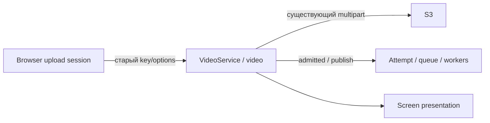

# Модель домена существующей передачи

Статус: proposed, L. Нового bounded context/DB aggregate не вводится.

## Bounded context map

Browser — локальная координация добросовестного клиента, VideoService/БД — граница
владения и идемпотентности, S3 — источник принятых частей, Processing — серверная задача.
Новая session не замещает эти серверные источники.

## Единый словарь

| Термин | Значение | Не путать |
|---|---|---|
| ContentIdentity | sha256 всех байтов + размер | name/mtime, S3 ETag, серверная аттестация |
| UploadResumeV2 | account-scoped локальный manifest прежнего upload | server recovery API/сам File |
| UploadAttempt | Локальное поколение с controller/mounted fence | video/job_attempt/render_fence |
| Upload accepted | Complete acknowledged/уже admitted | Принудительное назначение queued UI |
| Complete-ready manifest | videoId+partSize+полный ordered parts count | Только часть ETags из незавершённого PUT |
| Pause | Запрет новых локальных запросов и abort | Отмена серверного Complete/paid job |
| New-upload intent | Отдельный осознанный запуск с новым key | Retry/resume/автоматический fallback |

## Entities / value objects / consistency

Существующая entity Video: video_id, account_id, idempotency_key, status/upload_id.
Транзакционные границы и квоты не меняются; expected account_scope проверяется до входа в transaction. Client manifest — не новая DB-сущность:
version/accountScope/key/identity/options/originalFilename + optional server receipt.
ContentIdentity — VO, все поля проверяются Zod. UploadAttempt — эфемерный controller+generation,
никогда не сохраняется. File существует только в текущем browser selection, hash повторяется
при новом выборе/после mount. Recovery intent — локальная подсказка, не capability/owner token.

Серверная связь key→video сохраняется. Browser сохраняет один manifest на аккаунт в
исходной вкладке; явный новый intent может заменить активный manifest после предупреждения,
старый серверный upload не удаляется. Два account scope не читают/удаляют данные друг друга.
get/set/remove failure — типизированный исход, не отсутствие upload и не новая квота.
Legacy глобальный ключ читается лишь как свидетельство неподдерживаемой старой схемы.

## Переходы

idle/paused → выбор File → hashing → readyNew / readyResume / mismatch / recoveryUnavailable.
Pause очищает File и native input.value, сохраняет manifest; onChange немедленно сбрасывает
input.value после захвата File, поэтому повторный выбор того же пути вызывает change.
Перед picker прежняя selection сброшена; cancel → ожидание File без сети/изменения manifest.
readyResume означает только локальное совпадение hash, не разрешение сети: отдельное
«Продолжить загрузку» обязательно. originalFilename виден от manifest; статусы/действия
из таблицы FR-5 едины для текущего mount и remount. hash — локальная проверка;
unknownComplete сообщает неизвестный результат, не остановку серверной обработки.
readyNew/readyResume + явное действие → creating/transferring → savingManifest → completing
→ accepted → штатная деталь. Любой активный шаг + pause/accept-leave → paused/unknownComplete.
Storage-save failure → storageBlocked; retry save с тем же manifest; нет скрытого Complete.
Stale/unmounted attempt → ни UI write, ни storage write/clear, ни новые requests.
Серверные стадии остаются uploading→queued→transcribing→selecting→rendering→done/failed.
uploading не выдаёт знание о живом клиенте; admitted может уже быть done к HTTP ack.

## Mapping

upload-file-identity.ts: ContentIdentity computation; upload-resume.ts: strict VO/storage outcomes;
Uploader.tsx: File/intent/attempt/fence/guard; dashboard/page.tsx: доверенный accountScope;
VideoList/VideoDetail/screen.ts: представление; VideoService/S3/queue — прежний upstream.
Ожидаемый account_scope — precondition существующего create: новый v2 всегда передаёт его,
включая refresh; auth account остаётся источником прав. UUID malformed→422, mismatch→409 ДО
transaction/claim/quota/S3; File/manifest остаются, новый video/слот/подписи/PUT/Complete запрещены.
Legacy без поля совместим, Complete чужого video остаётся 404. Preflight не заменяет проверку
в том же серверном запросе. Mapping: upload-contract.ts (optional UUID), video.ts (precondition).
Новые domain events/таблицы/миграции/endpoint не нужны; create input узко расширяется. Проверка новых export names — K1.
