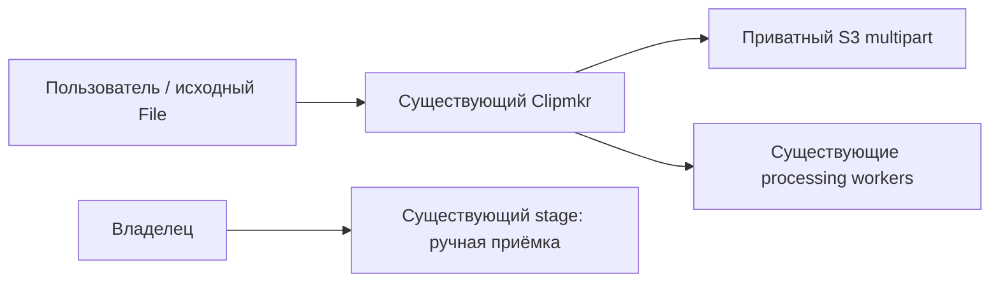
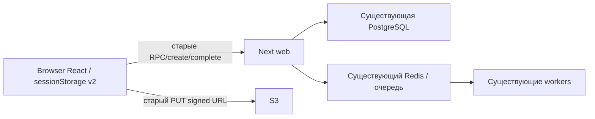
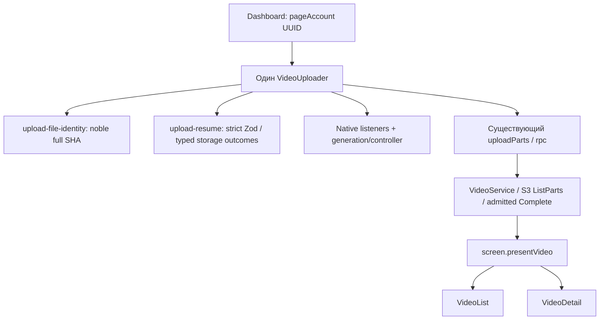
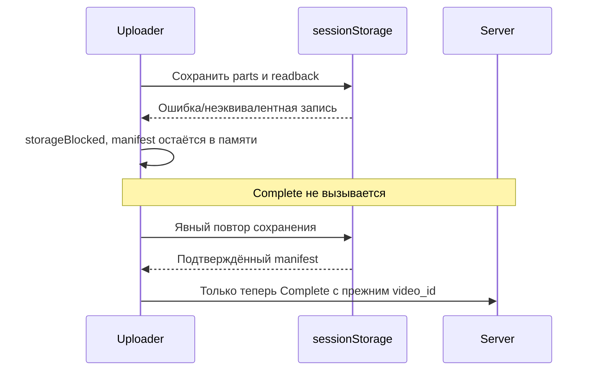
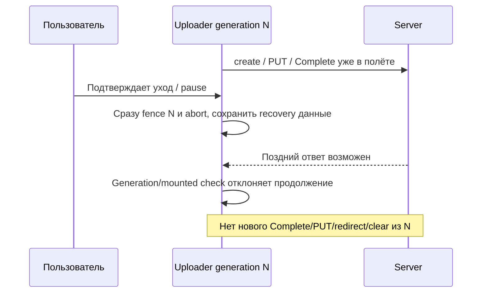

# Архитектура bounded client-resume

Статус: proposed; QC/код pending. Источники: требования, доноры, ADR-002/003,
04_domain_model и архитекторский private receipt; его старое «upload approval pending»
заменено явным новым согласованием владельца. Восьмиэкранный redesign остаётся вне scope.

## C4 Context


## C4 Container

Новых containers/DB/endpoint нет; optional account_scope расширяет существующий create input. Loopback Vite test fixture уже существует; расширение её
виртуальных маршрутов не является новым persistent тестовым стеком/DB/Redis.

## C4 Component

Guard живёт внутри Uploader, не новый provider/router. Предки/key не зависят от phase/theme/
компоновки, не два hidden Uploader. dashboard prop обязателен; account change fence/abort,
сброс File/локального resume без очистки чужой persisted session. Native capture устанавливается
один раз на mount с актуальными refs; cleanup всегда снимает listener.

## Data & storage / API

Session v2 по ADR-002: только проверяемые локальные поля/непрозрачные ETag, один scope на аккаунт,
никаких signed URLs/ключей сессии/байтов. Server account checks/UNIQUE/quota/parts остаются истиной.
Helpers не импортируют server/runtime и не изменяют DB. Пакет noble установлен только в web;
Node crypto — oracle теста, не browser polyfill. Экспортируется ограниченный helper API из ADR.
video.create сохраняет key/immutable body, добавляет optional account_scope UUID в
createVideoSchema (upload-contract.ts); новый v2 отправляет его ВСЕГДА, включая refresh
подписей после403. VideoService.create (video.ts) сравнивает expected scope с authenticated
account до transaction/claim/quota/S3; malformed→422, mismatch→409 без video/слота/signatures.
Auth определяет account; legacy отсутствие поля совместимо. UI A + cookie B не меняет File/
manifest, показывает инструкцию обновить страницу, не делает fallback/PUT/Complete/redirect.
Смена prop дополнительно fence, но preflight не заменяет серверную проверку из-за TOCTOU.
Complete ownership чужой записи остаётся404. Это узкое API amendment, прежнее «API не меняется»
отменено. Остальные запросы прежние: PUT signed URL; POST /api/upload/complete
со старым video_id/parts; video.get/clip.list для актуального экрана. Hash не добавляется в API.
Server complete count/HEAD уже есть в main12b2e17577fcabf923f37b8814046357fd12b78a (source=9b8b043); объект/очередь не чинятся UI.

## State/action и доступность

| Фаза | Видимый статус | Действие |
|---|---|---|
| paused / ожидает File | Пауза; originalFilename из session | «Выбрать исходный файл» |
| hashing | «Проверяем выбранный файл» (локально) | «Отменить проверку» |
| readyResume | «Файл совпадает. Можно продолжить загрузку» | Отдельное «Продолжить загрузку» |
| transferring | «Передаём файл» | «Приостановить загрузку» |
| mismatch | «Выбран другой файл» | Повторный выбор; отдельно новая загрузка с предупреждением |
| storageBlocked | «Не удалось сохранить данные восстановления» | «Повторить сохранение» |
| unknownComplete | «Результат завершения неизвестен. Сервер мог начать обработку» | Выбор/hash, затем отдельное Continue |

После Pause File=null и input.value=''; после захвата File в onChange input.value сразу ''.
Перед picker старая verified selection сброшена; cancel оставляет ожидание без сети и без
изменения manifest. Тот же путь можно выбрать снова в текущем mount и после remount.
Hash-match только readyResume, create/PUT/Complete=0 до самостоятельного Continue.
`pause_reselect_requires_separate_continue` проверяет порядок реальными кликами/клавиатурой.

Input имеет label «Исходный файл», aria-describedby на видимую инструкцию/ошибку и aria-invalid
при mismatch. Persistent role=status/aria-live=polite/aria-atomic=true объявляет смены hashing,
readyResume, paused, unknownComplete; mismatch/storageBlocked — отдельный role=alert без дубля.
После Pause/hash cancel/picker cancel focus на выборе File, hash-match — Continue, mismatch и
unknownComplete — выбор File, storageBlocked — retry save. Перенос один при смене доступного
действия; progress/hash ticks сохраняют activeElement. Recovery anchor → #source-file с focus
на доступном input и видимой инструкцией. `keyboard_recovery_focus_and_live_status` проходит
Tab/Enter/Space путь pause→reselect→ready→Continue и три error/recovery ветви в Chromium/WebKit,
проверяет activeElement != body/disabled, label/description, status/alert текст/роли и отсутствие
focus steal при ticks. Responsive/обе темы/200% и ручной screen-reader — отдельные доказательства.

## Последовательность нормального resume
```mermaid
sequenceDiagram
  participant U as Пользователь
  participant C as Uploader
  participant H as Full SHA helper
  participant L as Strict sessionStorage
  participant S as Существующий create/ListParts/S3
  U->>C: Повторно выбирает исходный File (сеть=0)
  C->>H: Все байты по 4MiB, yield/signal
  H-->>C: sha256+size совпадают
  C->>L: Проверить scope/key/options
  C->>C: readyResume / «Файл совпадает»; сеть=0
  U->>C: Отдельно «Продолжить загрузку»
  C->>S: create с прежним key + expected account_scope
  Note over S: UUID/auth scope check до transaction/claim/quota/S3
  S-->>C: Тот же video_id и missing parts
  C->>L: Durable server receipt
  C->>S: uploadParts missing parts
  C->>L: Durable complete-ready manifest
  C->>S: Прежний Complete
  S-->>C: Accepted acknowledgement
  C->>C: Снять guard / one-shot redirect на актуальный screen
```
Если cache уже complete-ready, после hash/action путь сразу L→Complete, без create/PUT.
Если no cache/legacy/mismatch — typed refusal и отдельный new intent; серверный lookup не выдумывать.

## Последовательность storage error

При storage отказе до create/PUT действует та же граница. Server receipt потерялся до save:
первый manifest с key уже persisted, поэтому следующий mount тем же key повторяет create;
нет необходимости нового ID. Legacy глобальный cache не мигрирует и не удаляется автоматически.

## Асинхронная гонка / уход

Если Complete уже был отправлен, сервер мог обработать его; abort не откатывает БД/job.
При retry с full manifest существующий admitted/HEAD путь признаёт успех без нового key.
Если сервер собрал объект, DB ещё uploading, а full manifest утрачен, create/ListParts может
не помочь: bounded resume не обещает recovery этого исхода, показывает ограничение.

## Native reload oracle
`active_beforeunload_reload_dismiss_and_accept` после настоящей user activation удерживает
hash/create/PUT/Complete и вызывает reload активного документа. dialog.type=beforeunload;
dismiss сохраняет document marker/URL/attempt и дальнейший PUT; accept реально меняет document,
размонтирует и оставляет прежний manifest для bounded reselect. Отдельные активные попытки
для dismiss/accept. `inactive_and_confirmed_leave_have_no_extra_beforeunload` после pause,
accepted и подтверждённого anchor проверяет снятие listener/guard и отсутствие второго диалога
(у anchor ровно один native confirm). Мутация `remove_beforeunload_registration` обязана сделать
active reload test RED. Synthetic event и reload после pause — не positive beforeunload oracle.
Chromium/WebKit и engine native ограничения отмечаются раздельно; всё в существующей fixture
и tests/browser/upload-lifecycle.test.ts, затем опубликованный Next, без нового framework.

## Честное представление
presentVideo и локальные часы детали исключают uploading из stale независимо возраста.
ProgressPanel возвращает для uploading отдельный текст с recovery anchor без progress;
VideoList делает uploading не ссылкой. Не менять user_state enum/Screen API/SQL ради этого.
Queued/transcribing/selecting/rendering сохраняют existing polling/no_response/retry логику.
Ack со status queued не является приказом откатить already done UI: новый detail читает
настоящий server screen. ClipCard/GuestPacks/checkout/paid права не меняются.

## Observability
Новых production событий/счётчиков hash/filename не добавлять. Пользователь видит phase,
типизированный отказ cache/hash/storage и video_id по существующему контракту; сохранённый
manifest не содержит URL-секретов. В тестовых receipts измеряются create count/key/video_id,
PUT part numbers/abort/complete/redirect, размер одного read и heartbeat во время hash.
Реальный дефект заметен как повторная запись/остановка PUT/ложный progress/неожиданный redirect;
его обнаруживают browser barriers, stage E2E и независимый fleet до ручной приёмки.
Логи неизвестного исхода Complete не содержат signed URL/private media; стадия читается сервером.

## Stage, rollout, rollback
Единственная цель — существующий clipmkr-stage-20261028 на рабочем VPS с /home/clipmkr.
Текущий public address/TLS/origin/CORS заново проверяет оператор; предложенный DNS не готовая ссылка.
Перед apply зафиксировать existing compose project/container IDs, volumes/config/backup, SHA/digest
и активные uploading/jobs. Не создавать новый compose project/DB/Redis, не down -v/reset/seed.
Фича без DB migrations. Пользовательские активные legacy PUT не обрывать: применить в окне
без активной передачи/после согласованного завершения, old cache не мигрировать молча.
Rollback только web-артефакта сохраняет существующие данные; v2 старым кодом не понимается —
не обещать legacy resume после отката. До Cloud обязательна ручная приёмка stage.
