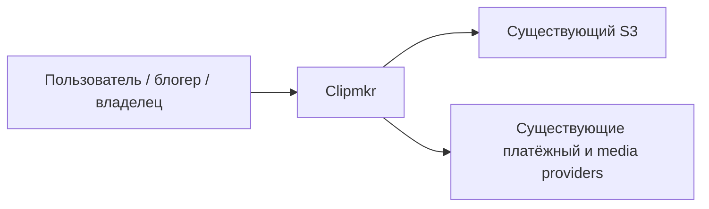
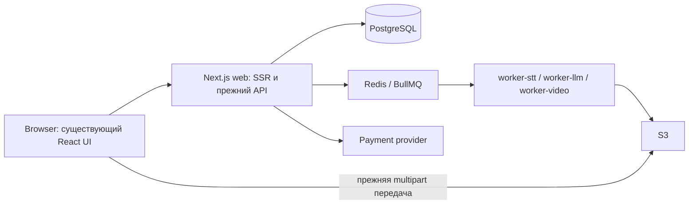
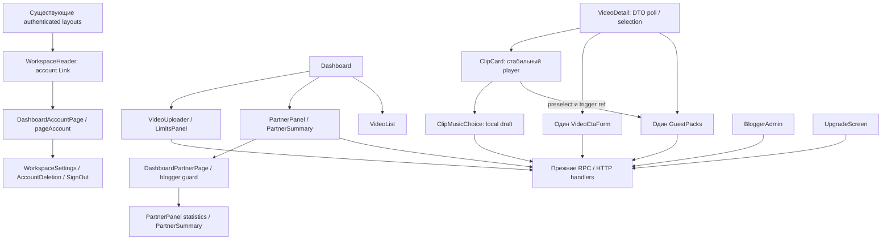

# Предварительная архитектура упрощения UI

05.11.2026. **Архитектура, НЕ независимое QE и НЕ разрешение Step7.** Назначенная роль — `gpt-6-astra xhigh`, проверка архитектуры отдельной Terra-сессией ещё PENDING. Base SHA `a4488b4caf602f093a0cc3393b4903e210cb3989`. Implementation L, 14 баллов; выбранный минимум **22 targets = 14 existing UI/CSS + 2 SSR pages + 6 test/harness**, верхняя граница после обоснованного пересмотра 25.

Exact approved HTML `docs/design/2026-11-05-ux-simplification.html`, SHA-256 `a85b3f073a335871e421ea2079269fa19c71f42a263d7b0bd17ae30469c50e68`: **APPROVED**, «Да, реализовать этот макет», вопрос `call_f0a94c16c93f49b38617215d46b23b7a`, owner-approval.md. Canonical root00/01/02 теперь текущие implementation inputs; research provenance — Git base a4488b4caf602f093a0cc3393b4903e210cb3989 и неизменённый design-review-inputs.sha256. Исторические receipts не implementation gates. Current OpenSpec hashes — canonical01. Frozen HTML/PNG неизменны.

## Размещение и зависимости

Решения feature-local ADR-001/002/003 в `03_adr/`. Реиспользование сначала: `WorkspaceSettings`, `PartnerPanel`, `ClipCard`, `ClipMusicChoice`, `GuestPacks`, `VideoCtaForm`, `AccountDeletion`, `SignOut`; планируются только два тонких SSR page wrappers из ADR-001, без нового API/service/provider. Проекты 1–8 и OSS не нужны как новые доноры при наличии этих блоков; исторический reuse inventory сохранён. Code-impl применяется как принцип минимальных обязанностей, без переноса Python/k8s шаблонов.

| Поверхность | Конкретное размещение и граница |
|---|---|
| Shell/account | Header Link «Аккаунт» → `/dashboard/account`; новый `DashboardAccountPage` в existing authenticated layout: один WorkspaceSettings/page presentation, AccountDeletion/SignOut/verify/support/back. Никакого inline account всего dashboard; pageAccount и прежние preferences |
| Upload | `VideoUploader`: file/limit/start, расход до старта, progress/pause/recovery/errors вне advanced. Existing music/teaser/compact/CTA внутри details, summary отличий вычисляется из текущего state. `LimitsPanel` — короткий баланс и existing подробности, без второго checkout CTA |
| Blogger | Dashboard PartnerPanel/summary сохраняет auto-link/copy/error/blocked и Link «Статистика» → `/dashboard/partner`. Новый DashboardPartnerPage проверяет pageAccount/getBloggerPolicy; existing PartnerPanel/statistics и PartnerSummary/filter/codes/all-time/back, без ensurePersonalLink на stats |
| Processing/partial | `VideoDetail`/`ProgressPanel`/`StageRibbon`: честный статус и допустимое действие, затем доступные клипы. Layout не remount player при done→partial или poll. Не добавлять partial enum/API |
| Ready/share | `ClipCard`: fixed player→download→«Ещё»; copy/guest/edit/score по запросу. `GuestPacks` один на video, mounted и contextual; `VideoCtaForm` один на video, отдельно от clip music. Focus-return и consent по ADR-002 |
| Owner | `BloggerAdmin`: lookup/назначение/причина + advanced limit/rate; отчёт отдельно раскрывается на прежней странице, видны monthMSK и ограничения оценки |
| Packages | `UpgradeScreen`: серверный каталог, цена/сроки/expiry/TEST/disabled reason рядом с действием. Help закрыт, но финансовые условия не исчезают. `UpgradePage` и checkout account key неизменны |


## C4 Context



Browser — недоверенная граница; права, цены, duration и действительные next_action определяет сервер. Внешние системы показаны как существующие зависимости, их вызовов эта подготовка не выполняет.

## C4 Container



Меняется только browser presentation и JSX-композиция существующего SSR Dashboard. Worker/server/DB/S3 адаптеры и deployment topology вне targets.

## C4 Component



Стрелка CC→G — callback через VideoDetail, не импорт guest-owner в каждую карточку. Layout/preferences меняют CSS attributes, не структуру компонента. `CtaFields`, `AccountDeletion`, `useClipDownload`, `dashboard/layout.tsx`, `upgrade/page.tsx` — read/reuse без edits в минимальном target list; если это невозможно, до кода пересчитать targets/K1/K2.

## Поток 1: загрузка и восстановление

```mermaid
sequenceDiagram
    actor U as Пользователь
    participant UI as VideoUploader
    participant S as Существующий upload protocol
    U->>UI: Выбор файла и опций
    UI-->>U: Проверка, лимит и предварительный расход
    U->>UI: Явный старт
    alt CTA invalid
        UI-->>U: Раскрыть details, ошибка и focus; запросов нет
    else валидно
        UI->>S: Прежняя загрузка / продолжение
        S-->>UI: Подтверждённые bytes / paused / error / accepted
        UI-->>U: Реальный статус и допустимое действие
    end
```

Hash/account scope/saved identity/storageBlocked/mismatch/unknownComplete и navigation guard сохраняются в `VideoUploader` и `lib/upload*`. 100% bytes не равно accepted. Native `onInvalid` недостаточен для ручного upload handler: custom CTA validation открывает форму до RPC.

## Поток 2: processing/partial, ready/share и отказ

```mermaid
sequenceDiagram
    participant V as VideoDetail
    participant S as video.get / clip.list
    participant C as ClipCard и формы
    actor U as Пользователь
    loop Прежний poll 5 секунд
        V->>S: Read DTO
        S-->>V: DTO либо ошибка связи
        V->>C: Обновить props без смены clip keys
    end
    U->>C: Play / выбрать другой клип / закрыть настройки
    Note over C: Player identity и dirty drafts сохраняются
    U->>C: Применить музыку или сохранить CTA
    C->>S: Прежняя отдельная mutation
    alt отказ
        S-->>C: Error
        C-->>U: Видимая ошибка, draft и старый доступный файл
    else принято
        S-->>C: Queued / saved
        C-->>U: Статус пересборки; новый файл лишь после публикации
    end
    U->>C: Поделиться → гостю
    C-->>U: Одна раскрытая GuestPacks, focus имени
    U->>C: Получатель, состав, явное согласие → создать
    C->>S: guest.create с consent version/hash
    S-->>C: Закрытый пакет
    Note over C: Send, copy, revoke — прежние отдельные действия
```

`ProgressPanel` использует `video.next_action === 'retry'` для existing `video.retry`, upload/tomorrow — существующие ветки. Число готовых клипов, ошибка S3 и локальный таймер не создают capability. При partial без разрешённого next_action показать готовые клипы, объяснение и только доступный серверный следующий шаг. Требуемый partial retry остаётся dependency отдельного recovery-блока: до его реального контракта интегрированный partial-сценарий **не принят**, placeholder endpoint или обещание «повторяем только недостающие» не добавляются. UI не доказывает отсутствие повторного STT/списания.

## CSS, данные и API

ADR-003 ограничивает изменения scoped sections `globals.css`; на компонентах до 700 LOC допускаются локальные handlers, без новой многоцелевой системы. Сохраняется `data-workspace-layout`, **не** prototype `data-layout`. Themes и layouts работают на одном дереве. Owner form invalid раскрывает nested details; custom validation и native capture покрываются раздельно. Status/error после закрытия панели остаётся видимым рядом с её trigger/действием.

Новых storage/cache/DB schemas/migrations/API/env/pkg нет. Черновики не пишутся в localStorage; existing upload resume storage и preference cookies не меняются. Server ownership, 90/120/individual duration, credit reserve/charge, catalogue source `CREDIT_SKUS`, billing windows, `checkoutAllowedForAccount` и TEST exception остаются каноническими. Не добавлять клиентскую копию authorization или цены из HTML. Public `/c/` — thumbnail/CTA, не обещанный player/download; `/g/` сохраняет серверную доступность.

## Покрытие 21 семейства

`change` означает будущую ограниченную правку, `preserve` — существующее поведение. **У каждой строки обязательна regression**, здесь ни одна не PASS. Pointers/полный control inventory — `implementation-inputs/code-target-inventory.md` и historical audits.

| № | Семейство | Режим и проверяемая граница |
|---|---|---|
| 1 | Главная/вход/регистрация | preserve; AuthForm/landing, ошибки и публичный вход |
| 2 | Восстановление пароля | preserve; RecoveryForm, focus/error/reload и CSS |
| 3 | Подтверждение почты | preserve; verify-email достижим из account, invalid/expired состояния |
| 4 | Новая запись | change TASK-1; cost/limit/start с закрытыми опциями |
| 5 | Передача/проверка | change TASK-1; hash/progress/pause/navigation guards |
| 6 | Прерванная передача | change TASK-1; same-file/account, storageBlocked/mismatch/unknownComplete |
| 7 | Список записей | change TASK-1; pagination, empty, uploading, длинное название |
| 8 | Расшифровка/выбор/монтаж | change TASK-2; polling/silence не успех/отказ |
| 9 | Полная ошибка | change TASK-2; причина и только реальный next_action |
| 10 | Частичный результат | change TASK-2; готовые файлы доступны, backend retry dependency открыта |
| 11 | Готовые клипы | change TASK-3; player identity/download/expiry/failed rerender |
| 12 | Share/guest | change TASK-3; один owner, consent по payload, create/send/revoke/list/focus |
| 13 | Короткая ссылка | preserve; `/c/[code]` thumbnail/CTA без вымышленного media |
| 14 | Кабинет блогера | change TASK-4; auto-link сохранена, loading/error/blocked/copy fallback |
| 15 | Статистика блогера | change TASK-4; отдельный /dashboard/partner, all-time stats/filter/codes/back, без monthly API |
| 16 | Назначение блогера | change TASK-4; server owner, required reason, invalid limit reveal |
| 17 | Отчёт владельца | change TASK-4; monthMSK/null rate/20/30, оценка не выплата |
| 18 | Пакеты/оплата | change TASK-5; цена/условия/TEST/reason, account isolation и явный checkout |
| 19 | Возврат оплаты | preserve; ReturnScreen confirmed/pending/canceled/unknown/timeout/foreign intent |
| 20 | Account/settings | change TASK-5; отдельный /dashboard/account, preferences/back, deletion consequences/72h/unchecked confirm |
| 21 | Support/legal/service | preserve; SupportPanel/legal/operator rights, CSS/focus/errors |

## Observability

Новые runtime logs, counters, analytics и pollers не вводятся. Existing `VideoDetail` сохраняет `observeClips`; upload/media/payment/server telemetry остаётся прежней. UI failure наблюдаем извне как потерю draft/player, невидимую ошибку, недоступную функцию или неверный disabled reason. Пользователь видит role=status/alert, QA — browser errors и требуемые assertions. В будущих receipts считать 21 покрытое семейство и число проваленных lifecycle/focus сценариев; это показатели проверки, не вымышленные production metrics. Подписанные URL, токены, реальные media/email не включать в screenshots/fixtures/logs Git.

## Источники и реальные пределы

Прочитаны AGENTS/CLAUDE, model-matrix/review-policy/core-cjm, заданные feature-adr модули ADR/DDD/architecture/plan из fallback worktree, code-impl и studio-extended-qe; latter применён как requirement→risk→scenario, без AQE runtime. Root research и frozen proposal прочитаны как provenance, не как успешный implementation checkpoint. Внешние legacy `../../.claude/rules` в данном расположении недоступны; локальные `.claude/rules`/architect/responsive правила и актуальная acceptance имеют приоритет над историческими числами.

Разрешённый pinned recall исполнен из `/tmp/clipmkr-public-entry-20261105`, Node22.23.4, `npm run dz -- recall 'UI progressive disclosure approved mockup' --project /home/clipmkr --limit 5 --json`: exit0, 5 записей. Прочитаны `teach:72dc09ec0bc1fff6`, `teach:2d16bb3c5fb99858`, `teach:c414643f087ad0f6`, `teach:820581d93a5cf7df`, `teach:f2472a51e3e72ac1`. Применены mounted CTA, checkout attempt isolation, visual negative controls, exact approval и приоритет UI. Первоначальный проход teach не выполнял. Коррекция приняла подтверждённый повтор mockup drift; наблюдение, действие и граница записи общего store зафиксированы в текущем root00.

Архитектура составлена до настоящего QCSD как ограниченный draft по прямому поручению. После QCSD пересмотреть риски/задачи; этот текст не заменяет step3.5/4/5 receipts. App/tests/runtime/SSH/provider/network и git commit/push не выполнялись. Независимое review, Mermaid renderer, браузер, сборка, typecheck, tests и новые checkpoints **NOT RUN**. Доказательство ограничено чтением исходников и документными проверками, перечисленными в root06.


## Макет → компонент → проверка: исправленные отдельные состояния

| Approved сцена | Компоненты / путь | Будущая проверка |
|---|---|---|
| `settings`, header `account-link`, back | `/dashboard/account` → DashboardAccountPage → WorkspaceSettings/page + native account actions | dedicated_account_and_stats_routes: отдельное main без upload/dashboard, один набор controls, back/direct/reload; screenshot same state/theme/layout/width |
| `stats`, referral «Статистика», back | `/dashboard/partner` → DashboardPartnerPage → PartnerPanel/statistics | presentation_route_guards: auth/non-blogger/erasure; all-time label, no ensure mutation, один stats owner; screenshot same state/theme/layout/width |
| `workspace`, referral card | Dashboard → PartnerPanel/summary | auto-link/loading/error/blocked/copy сохранены, stats Link не inline раскрытие |

Это исправление отклонённого placement, не запрос нового approval и не доказанная визуальная эквивалентность. Future route wrappers сохраняют прежние private resource guards; PartnerService.dashboard foreign-code403 остаётся существующим исключением, не меняется UI-рефакторингом.
