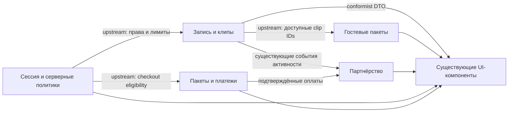

# Модель существующих областей и UI-состояния — draft

05.11.2026. База `a4488b4caf602f093a0cc3393b4903e210cb3989`. Архитектор по назначению: `gpt-6-astra xhigh`; независимой runtime-аттестации модели здесь нет. Exact HTML APPROVED; QCSD, review Terra и gates PENDING. Это отображение существующего домена, не новые ORM-модели.

## Границы контекстов

| Контекст | Серверный источник истины | UI-проекция / изменение |
|---|---|---|
| Создание и обработка записи | upload protocol, `VideoScreen`, `ClipScreen`; серверная availability/next_action | `VideoUploader`, `VideoDetail`, `ClipCard`: только размещение, local draft/disclosure |
| Распространение и партнёрство | `PartnerService`, guest/link RPC, атрибуция | `PartnerPanel`, `GuestPacks`: прежние links/stats/pack actions, consent конкретного состава |
| Аккаунт, права, пакеты | session/pageAccount, blogger policy, billing/checkout | `WorkspaceSettings`, `BloggerAdmin`, `UpgradeScreen`: прежние права и данные, упрощённая композиция |

Серверные области могут иметь общие account/video IDs; UI не создаёт новый aggregate, сервис или bounded context ради панели. Границы доверия не меняются: browser values не назначают роль, цену, лимит, оплаченные права или retry capability.

## Словарь

| Термин | Значение | Не смешивать |
|---|---|---|
| Запись / video_id | Загруженный исходник и его pipeline; CTA относится ко всем его клипам | С одним выбранным clip_id |
| Клип / clip_id | Фрагмент, музыка, опубликованная версия файла и срок доступа | Dirty music draft и готовый media version |
| Частичный результат | DTO сообщает готовые и неготовые клипы; доступные файлы остаются usable | Новый статус enum или автоматическое разрешение retry |
| Дополнительные настройки | Способ раскрыть существующие controls | Отдельный источник business state |
| Локальный черновик | Ввод в mounted компоненте до явного сохранения | Обещание persistence после reload/смены аккаунта |
| Согласие гостя | Подтверждение name + выбранных clip IDs + версии/хеша текста для create | Настройка «разрешать всегда», отправка или копирование ссылки |
| Личная ссылка | Уже создаваемая сервером auto-link блогера | Дополнительный ручной код, обход blocked-состояния |
| Вознаграждение | Предварительная оценка owner-отчёта при ставке 20/30 | Выплата, долг или новое API отчёта блогеру |
| Лимит файла | 90/120 минут либо индивидуальный integer 2–1440/null→120 | Баланс кредитов, дневная квота, цена |

## Владение и жизненный цикл

Все пути ниже относительно `apps/web/src/`; line pointers относятся к указанной базе.

| Значение / граница согласованности | Единственный владелец | Обновление / очистка |
|---|---|---|
| upload phase, File/digest, saved resume, attempts | `app/upload/Uploader.tsx:18` `VideoUploader`; `lib/upload*` | Прежние accountScope/generation/abort и resume правила; disclosure не очищает, новая загрузка — прежняя явная операция |
| video/clip DTO и selection | `app/videos/[videoId]/VideoDetail.tsx:62` `VideoDetail` | Poll5s; selected ID сохраняется, если есть; fallback при удалении ID уже задан. Ошибка poll не уничтожает последние данные |
| player/currentTime/media identity | `app/clips/ClipCard.tsx:10` `videoRef`, `fileVersion` | Ключ карточки clip_id; src/key media меняются по опубликованной версии, не по preferences/черновику |
| music draft / saved server track / preview | `app/clips/ClipMusicChoice.tsx:6` | Новый только локальный draft; dirty сохраняется между poll/selection, apply существующим RPC; reset при уходе с записи |
| CTA kind/url/saved/busy | `app/videos/CtaFields.tsx:32` `VideoCtaForm` | Один экземпляр на запись; явный `video.setCta`; не копировать state в карточки |
| guest draft / consent | `app/clips/GuestPacks.tsx:18` `GuestPacks` | Правила reset ADR-002; состав сравнивается по IDs, не по identity массива DTO; change recipient/selected eligibility/hash инвалидирует consent |
| guest packs | Тот же `GuestPacks`, сервер `GuestPackSummary` | create→closed, send→14 дней, revoke→закрыт; список не исчезает при закрытии share |
| share open / возврат focus | Локальный details карточки + ref trigger в `VideoDetail`/`GuestPacks` | Не новый global panel store; focus возврат согласно ADR-002, без эффектов на media |
| blogger data/filter/personalLink | `app/dashboard/PartnerPanel.tsx:26` | Прежние ensurePersonalLink/reloadDashboard, loading/error/blocked/copy fallback; disclosure не повторяет auto-link вызов |
| owner policy/month/report | `app/dashboard/bloggers/BloggerAdmin.tsx:25` | Найденный account_id отделён от поискового email; загрузка найденной политики сбрасывает form в прежнем порядке; скрытие details не сбрасывает limit/rate/reason |
| checkout key/attempt/busy | `app/upgrade/UpgradeScreen.tsx` `UpgradeScreen`; `app/upgrade/page.tsx` `UpgradePage` | Сохранить account-key remount, alive/abort и idempotency; presentation не создаёт local eligibility |
| theme/layout | `lib/workspace-layout.ts` document preference store; `WorkspacePreferenceSync` | Workspace default; cookie/SSR/current Document precedence и notice сохраняются |

## Существующие сущности и value objects

`VideoScreen`, `ClipScreen` (`lib/screen-contract.ts`) — read DTO, не новые агрегаты. `GuestPackSummary` и `GuestPreselect` — существующие контракт/команда UI. `RemainingLimits` (`lib/limits-contract.ts`) — серверная проекция. Policy/Report в `BloggerAdmin` выведены из существующих DB функций, не дублируются новой схемой. Все даты/лимиты/цены читаются в прежних единицах; преобразование в минуты/рубли — только отображение.

Новые persistent entities, таблицы, domain events, APIs, env и packages отсутствуют. Раскрытие панели не domain event. Existing analytics `observeClips` не получает новых событий и не пересчитывает историческую атрибуцию. Recovery retry/no-double-charge принадлежит отдельному backend-блоку; UI его не реализует.

## Confirmation и пределы

ADR-002 → план TASK-2/3, проверки draft/player/consent/hidden invalid. После записи состав draft не может незаметно изменить отправленный payload; повторное согласие обязательно при новом составе. Runtime соответствие этой модели пока не проверено. Чтение `GuestPacks` показывает текущие setters без reset на каждый name/selection change; это source-level основание запланировать проверку и правку, не отчёт независимого QE и не воспроизведённый browser defect.

## Авторская коррекция размещения 05.11.2026

Account и blogger stats — самостоятельные SSR pages `/dashboard/account` и `/dashboard/partner` по исправленному ADR-001. Это presentation слой существующих контекстов, не новые aggregates/API. `DashboardAccountPage` использует pageAccount и один WorkspaceSettings/page presentation; `DashboardPartnerPage` использует pageAccount/getBloggerPolicy, non-blogger → notFound, затем existing PartnerPanel/statistics. Dashboard оставляет PartnerPanel/summary и auto-link; statistics не выполняет ensurePersonalLink. Legacy non-personal flow сохранён отдельно, без расширения прав.

Header/back links меняют страницу, не копируют controls. Переход на отдельную задачу завершает page-local drafts по прежнему контракту, upload navigation guard остаётся; polling/настройки/selection внутри mounted записи по-прежнему не remount player/CTA. Document preferences переживают переход; новый global persistence не вводится. Источники и actual names — ADR-001, новые page targets root06.

## R2: уточнённые владельцы данных и переходов

| Состояние | Владелец / authoritative источник | Инвариант |
|---|---|---|
| Canonical personal identity/status на stats | PartnerPanel base/unfiltered snapshot; PartnerService.dashboard → canonical oldest `(created_at,id)` как ensurePartnerCode | Не filtered response и не первый active; account-scoped, base refresh generation, blocked copy absent; publicOrigin из server config |
| Filtered counters/codes | Тот же PartnerPanel, отдельный selected/filter response | Не переписывают base identity; error фильтра не делает blocked personal active; no ensure mutation |
| Account profile/email/access | SSR DashboardAccountPage: pageAccount + supportPageState.account/id check + readAccountBilling | Не создавать SQL/API; unknown/null не подменять false/free; operator/support secrets не props |
| Account balance/quota | readDashboardSummary(account) → RemainingLimits → LimitsPanel | Все credits/reserved/file/daily values native; owner/legacy/TEST по server data; existing shared-layout error сохраняется |
| Assignment/report scene | local view в BloggerAdmin; все поля/policy/report/month остаются в этом mounted owner | Report исключает assignment DOM; back восстанавливает draft/focus; server authorization прежняя |
| Music accepted intent vs DTO | VideoDetail: per-clip pending ack и read generation/request token; child draft/saving | Pre-ack reads не перезаписывают accepted track; post-ack fresh version/failure разрешают convergence; abort без generation недостаточен |
| Последний focus fallback | Всегда смонтированный VideoHeader h1 ref, tabIndex=-1 | Original trigger → current summary → visible h1; zero clips не удаляет цель |
| Active upload при выходе | Прежние VideoUploader attempt/generation/resume scope | New anchor cancel сохраняет attempt; leave/unmount invalidates; same-document Back не обещает cancel; complete in-flight может завершиться сервером |

Server `render_version` — версия запроса рендера, `published_render_version` — доступный файл; сравнение post-ack version > baseline защищает от старого DTO, но не доказывает успех публикации. `retryRender` при terminal failure возвращает music_track_id к rendered track, сохраняя старый файл; UI должен показать этот отказ и оставить desired draft отдельно. Один clip pending-map в VideoDetail не новый глобальный store/доменный aggregate. Детальный алгоритм и Confirmation — ADR-002 R2; методы/условия имеют задачи root06.
