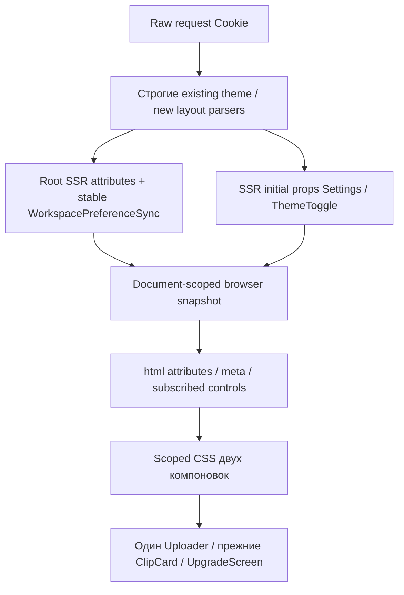

# Архитектура первого инкремента оболочки

Proposed после Q/R/T; исходный набор проверялся на разных HEAD, актуальная авторская сверка
исходников: /home/clipmkr HEAD12b2e17577fcabf923f37b8814046357fd12b78a. Перед execution
интегратор фиксирует новый settled SHA; этот документ не приписывает новые прогоны старой ревизии.
Inputs: FR/NFR, 03_adr/001-workspace-preferences.md, pending-convergence03.5.

## Компоненты

## Точная инвентаризация
| Блок | Переиспользуется / минимальный edit |
|---|---|
| lib/theme.ts | Existing strict raw cookie/default dark/writer/ThemeColor, без смены контракта |
| app/theme-server.ts | requestTheme raw headers, остаётся прежним |
| app/layout.tsx | SSR layout enum + один sibling PreferenceSync; children/banner/Support/analytics прежние |
| app/ThemeToggle.tsx | useState(initial) заменить useSyncExternalStore document snapshot, cookie catch/readback/status; accessible button/meta прежние |
| новый lib/workspace-layout.ts | Strict layout parser/writer + маленький browser-only WeakMap Document store/subscriptions/targeted observers, без server/React imports |
| новый app/WorkspaceSettings.tsx | native details/select + ThemeToggle и root Sync export; никаких children/Uploader/provider |
| dashboard/layout.tsx | Статический scope wrapper/settings, erasure→auth→owner gates/SignOut без перестановки |
| dashboard/page.tsx | Без изменения: support→Uploader→Limits→ProInterest→Partner→VideoList→Deletion |
| Uploader.tsx | File/useState/controller+resume refs/cleanup abort/flushSync video_id — сохраняются; tiny CTA markup move отдельно после recovery L integration, не transport |
| lib/upload-parts.ts / rpc | Три PUT/ListParts/signature refresh/idempotency/abort полностью прежние |
| LimitsPanel.tsx | Реальные router.refresh каждые30s и при focus, только visible; файл не менять/таймер не отключать ради теста |
| VideoDetail.tsx |5s video.get+clip.list, local clock, guestPreselect/GuestPacks, ClipCard map clip_id — без изменения |
| ClipCard.tsx | key=fileVersion у video, download/music/copy feedback/guest — без изменения; версия фиксируется fixture в window |
| UpgradePage/UpgradeScreen | Scope/settings только в page; existing ownerUnlimited/salesEnabled/catalogOnly/purchaseWindows/busy/error/idempotency keys не менять |
| PartnerPanel | Initial fetch считать hydration cause; не побочный toggle request |
| globals.css | Два root token blocks + scoped aliases/геометрия FR-1, без CSS order/новых UI библиотек |
| public /,/c/,/g/,/upgrade/return | Прежние token subset/CSP и existing themes; regression до/после ухода shell |
| tests/theme.test.ts | Сохранить и запускать; static markup не доказывает onClick/Next navigation |
| existing Vite upload lifecycle fixture | Реальный React/transport полезен для regression; mocked router не доказывает preserved Next layout/refresh |
| existing video-screen/clip-preview tests | Static geometry/playback subset, не новое runtime доказательство |
| check-responsive.mjs/rules | reuse domRules/axe/text enlargement/R9; domRules скроллит, R9 только geometry, axe incomplete/warn требует followup |
| seed-ui-fixture.mjs | Формат можно читать; запуск запрещён в этом пакете: live create/complete/jobs/guest mutation, не безопасный loader |

## Согласованность SSR и браузера
ADR определяет полный механизм: getServerSnapshot=SSR initial enums; browser WeakMap store
инициализируется только для нового Document; soft navigation/BackForward/30s+focus refresh
берут existing snapshot. RootSync layoutEffect/targeted MutationObserver восстанавливают attrs/
meta при stale RSC writes без сети/фокуса; controls подписаны на тот же snapshot. SSR snapshot
не становится shared mutable state между запросами/аккаунтами. Hard reload сбрасывает memory
и читает saved cookies/default. Cookie denial обнаруживается catch И точным readback;
живой выбор сохраняется, предупреждение доступно. Auth/account selection никак не основаны на preferences.

## Неизменное React-положение
Один статический scope wrapper появляется при поставке, а не при каждом toggle.
Дальше Settings меняет store/attrs/CSS: не меняются type/key/предки Uploader/ClipCard,
не clone children/portal/два hidden дерева. RootSync — sibling и не владелец File.
Background LimitsPanel refresh сохраняет Next client identity; если нет, это реальный failing
test, а не повод убрать refresh или транспорт. Recovery L сначала интегрирует свой Uploader,
затем один integration owner накладывает только presentation hunk; весь Uploader старой версией
не копировать. Если recovery merge ещё pending, shell/helpers/CSS можно писать независимо,
а active-upload финальная проверка ждёт settled совместного артефакта.

## Fixture/preflight без нового стека
Подробный контракт runner в06. Delivery-only уточнение:
Owner-steer04.11.2026 20:15 UTC supersedes прежний обязательный77 target: required owner manual
acceptance — https://clipmkr.ru, VPS194.85.249.105, существующий compose n5-clipmaker/service web
(наблюдавшийся n5-clipmaker-web-1). Root подтвердил DNS/current runtime; новый stack не создаётся.
Exact legacy pair clipmkr-stage-20261028 + https://77.83.87.178 остаётся optional internal regression;
TLS/SANIP и stub200 root наблюдал20:07, но app E2E этим не доказан. Другой n5.clipmkr.ru/project
n5-referral-paytest не является target. Arbitrary/cross-project origin пары runner отклоняет. Чистая unit/документная работа возможна, app-level results=2
до подтверждённых URL/TLS/auth/data/media. Никакого auto seed/new containers/DB/paid pipeline.
Существующие принадлежащие test account записи/два clips+versions и синтетические несекретные
media указывает оператор; provenance/разрешение/декодирование preflight. Если их пока нет,
не создавать через Complete: оператор отдельно готовит разрешённые данные существующим
безопасным процессом, затем preflight повторяется. Этот пакет подготовку автоматически не делает.
Browser intercept подменяет только явно объявленные test mutations/processing responses;
initial SSR остаётся настоящим из существующих owned records, не HTML fake. Complete fake
ведёт на реально существующий owned target из manifest, иначе исход 2 вместо ложногоE2E.

## Observability
Новых runtime logs/PII нет. В private browser evidence фазы:
H=hydration/Partner initial fetch и явно зарегистрированный prefetch; I=между ticks, toggle;
P=ровно один5s poll(video.get+clip.list); F=единственный штатный focus/30s refresh;
U=release pending PUT, затем штатный complete/redirect. Два P подтверждают живой UI update,
F выполняет настоящий Next RSC, не пустую router mock. Не вычитать средний baseline, не
скрывать все GET/RSC. У каждого request method/нормализованный endpoint/ordinal/phase/cause;
unknown→fail, попытки mutation считаются ДО abort/fulfill. Poll/read/prefetch/media range
разрешаются только с установленной причиной. Toggle в I не инициирует ни RSC, ни RPC/navigation.
Abort проверяется по сигналу/запросу именно upload, не общим числом controller.abort в странице.
ПослеU штатный Complete допустим; доказательство ограничено browser boundary, не server egress/jobs/DB.
Нет cookies/body/signedURL/HAR/trace/private screenshots в Git; closed paths и синтетические имена.

## Палитра/контраст
R5 aliases и derived fields/select-arrow/body colors заданы в ADR. Computed проверить на
каждой роли поверхности, при alpha композиции учитывать подложку. Текст/secondary/button
и реальные focus/control pairs меряются отдельно≥4.5/3; декоративный divider исключён.
Running/success/error/silent различаются текстом и семантикой, не только цветом. SupportLauncher
и тестовый banner вне shell проверяются на нейтральном body, public routes не меняются.

## Выпуск/откат
Только existing n5-clipmaker на194.85.249.105, manual URL https://clipmkr.ru; backup/volumes/config/active uploads перед app-only apply. Никаких
new stack/reset/down-v; app-only artifact rollback сохраняет данные. Нет миграций/новых API.
После valid fixture/TLS/auth/data: app E2E именно на clipmkr.ru→эта ссылка/инструкция→ручная приёмка→тот жеSHA/digest Cloud.
DNS не переключается; Cloud до этой ручной приёмки запрещён. DB/Redis/session/data сохраняются; minio/testminio не удаляются и не служат S3 proof. RawQC/текстовыйK2 не заменяют этот порядок.

AM-10 provenance: прямое owner-steer04.11.2026 20:15 UTC и root read receipts
/root/.config/clipmkr/release-parity-20261103/clipmkr-ru-ui-target/target-and-backup.private.json,
existing-runtime.private.json. Содержимое runtime receipt с секретами не копируется в Git.
Прежние ideation/QE receipts не переписаны и не приписываются новому target.
