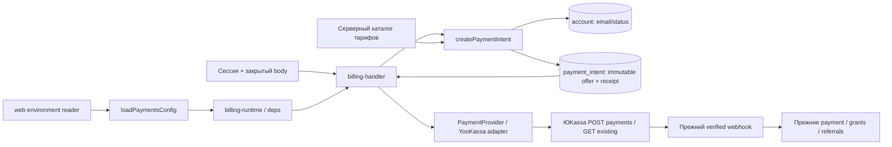

# Чеки ЮKassa: архитектура M

Статус: settled design для независимого QCSD, до K1/K2; не разрешение применять runtime SQL, менять магазин или выполнять настоящую покупку. Решение: [ADR-001](03_adr/001-snapshot-receipt-in-payment-intent.md).

## C4 Component

Браузер передаёт только прежние idempotency_key и разрешённый sku. Email не расширяет общую session/auth projection: его читает SQL creator по проверенному accountId под существующей блокировкой. JSON snapshot не выходит в API.

## Контракты и новые имена

В `packages/shared/src/tariff.ts`: `ReceiptConfig` (vatCode, paymentSubject, paymentMode), `ReceiptSnapshot` (тот же набор + email, description), `loadPaymentReceiptConfig(env)`, `paymentDescription(sku)`. Последний переиспользует ровно прежние строки каталога и заменяет сборку строки в handler; не создаёт второй словарь. Legacy exported PAYMENT_DESCRIPTION при наличии callers становится alias helper, не параллельным источником.

`PaymentsConfig` в live-ветке получает optional `receipt?: ReceiptConfig | null`: undefined — все три значения отсутствуют; null — набор частичный/непригодный; object — полный валидный набор. Это результат parser, не новое состояние платежа. Пустые значения compose при полностью незаданном наборе трактуются как отсутствие; whitespace, некорректные числа, неизвестные enum при наличии настроек — null. Конфигурация не включает сам merchant receipt service: он включается оператором ЮKassa отдельно.

`BillingWiring` и `BillingDependencies`: optional `receiptConfig?: ReceiptConfig | null`; `createIntent.input.receiptConfig?: ReceiptConfig`. Только валидный object передаётся SQL creator. `CreatePaymentInput.receipt?: ReceiptSnapshot` — additive provider contract. Fake игнорирует optional поле; реальный YooKassa adapter требует его при testMode=false и валидирует перед HTTP.

Вместо расширения public IntentView приватными данными создать `CheckoutIntentRow extends IntentRow` с обязательными `created_at: Date` и `receipt_snapshot: ReceiptSnapshot | null`; `CreateIntentResult` использует CheckoutIntentRow. Это узкая форма результата createPaymentIntent. `readPaymentIntent`/IntentView и их SELECT не получают snapshot. Fake fixture, возвращающий successful CreateIntentResult, обязан задать настоящий test created_at: отсутствие времени не является допустимым обходом 24h защиты.

## Создание и повтор

1. Сохранить порядок provider availability → session/rate/Origin → checkoutAllowed → закрытый body/sku/key. Никакого клиентского receipt.
2. `createPaymentIntent` берёт существующий account FOR SHARE, читая status/email; формирует snapshot только при валидном receiptConfig. INSERT atomically пишет snapshot вместе с price/sku/offer. ON CONFLICT возвращает прежние данные. Новая конфигурация/новый email не порождают idempotency_conflict; цена/sku по прежнему порождают.
3. Завершённый intent выдаёт прежний статус. Известный provider_payment_id вызывает только GET, даже при изменённых/непригодных текущих настройках и возрасте >24h.
4. Для unbound created intent прежде POST проверять `clock - created_at >= 24h`: 409 `payment_reconciliation_required`, без POST и без нового ключа автоматически. Недопустимое/отсутствующее время в successful createIntent result тоже fail closed; реальная БД всегда возвращает NOT NULL created_at.
5. Если snapshot уже существует, использовать его и сохранённую price_minor независимо от новых настроек. Если snapshot нет и текущая конфигурация валидна — старый intent получает 409 `receipt_snapshot_missing`, без retrofitting. Если конфигурация null — 503 `receipt_configuration_unavailable`, без HTTP. Undefined оставляет прежний TEST no-receipt путь; реальный adapter сам блокирует отсутствие receipt до HTTP.
6. POST получает прежние orderId/returnUrl/amountMinor и snapshot.description. Существующие setIntentPayment, статус ответа, ошибки/ретраи остаются. В случае отсутствующей/непригодной конфигурации может остаться created intent без HTTP — это прежний failed-intent lifecycle; после настройки ему нельзя добавлять receipt, нужен разбор и новый ключ.

При конкурентных попытках единственный UNIQUE(account_id,idempotency_key) выбирает canonical snapshot. Обе стороны используют победившую строку, а не локальный кандидат. Все сети остаются вне SQL transaction.

## Данные и миграция

`029_payment_receipt_snapshot.sql` добавляет единственный nullable JSONB `receipt_snapshot` без default/backfill. CHECK: NULL либо object с ровно пятью названными ключами, строковыми email/description (1..254 и 1..128 символов), числовым целым VAT 1..12, subject из service/intellectual_activity, mode=full_payment; JSON null/отсутствующие поля не обходят CHECK через SQL UNKNOWN. Ограничить размер объекта разумным фиксированным пределом 2 KiB. Runtime также валидирует корректный email до HTTP; произвольный сохранённый текст не отправляется как адрес.

Обновить существующую функцию credit_intent_immutable, добавив receipt_snapshot к сравнению OLD/NEW. Запрещено в том числе NULL→object. Старые миграции не редактировать. Существующий eraseAccount удаляет intent вместе со snapshot; не сохранять дубликат в payment/growth_event/log. Не возвращать snapshot через readIntent или collection/report readers. Миграция создаётся и проверяется на изолированной БД; runtime применение не входит в полномочия архитектора.

## API design

Вход/успех checkout и status неизменны. Непригодный body — прежний 422; receipt config failure — статический 503; старый unbound без snapshot/истёкший idempotency window — статический 409. Тексты не содержат email, snapshot или значения конфигурации.

Provider JSON расширяется только `receipt: {customer:{email},items:[{description,quantity:"1.000",amount:{value,currency:"RUB"},vat_code,payment_subject,payment_mode}]}`. Тот же formatMinor(intent.price_minor) задаёт payment.amount.value и единственную item.amount.value. Опциональные phone, tax_system_code, timezone, internet, marking/industry fields не добавляются без применимого требования. Не распространять общие правила сторонних онлайн-касс на подключённый yoo_receipt.

## Конфигурация и включение

Цепочка P23: `.env.example` (только комментарии) → `docker-compose.yml` (optional web env) → `apps/web/src/server/environment.ts:readEnvironment` → `loadWebConfig`/`loadPaymentsConfig` → `billing-runtime` → `createBillingDependencies` → handler/createIntent → сохранённый snapshot → YooKassa JSON. Web reader использует whitelist, поэтому одного compose/config parser недостаточно. Worker не нуждается в receipt settings и не получает их.

Три env: YOOKASSA_RECEIPT_VAT_CODE, YOOKASSA_RECEIPT_PAYMENT_SUBJECT, YOOKASSA_RECEIPT_PAYMENT_MODE. Нет активирующего флага: полный явный набор является TEST opt-in. Поддержанный набор: VAT 1..12; service|intellectual_activity; только full_payment. Ни один вариант не объявлен налоговым фактом магазина. Полностью отсутствующий и неполный набор не ломают startup/health/webhook; partial/invalid не допускает новый no-receipt TEST POST. Боевой режим всегда требует receipt. Реальное включение ждёт ответ бухгалтера и проверку merchant/webhook; действующий TEST runtime/checkout exception не меняются.

## Observability

Использовать текущие billing logs уровня error только со статическими категориями: receipt_configuration_unavailable, receipt_snapshot_missing, payment_reconciliation_required, provider rejected/unavailable. Не печатать exception.message, если он может содержать request/provider data; ошибки нового receipt validator обязаны быть статическими. Для текущего try/catch гарантировать, что receipt failures не включают email, секрет или сырой JSON.

Считать в существующем журнале количество этих отказов и успешных checkout/подтверждённых payments; новых metric exporters/таблиц нет. Внешний симптом: 503 настройки или 409 требующего разбора intent, вместо redirect; оператор видит безопасную категорию в web logs и исходный order_id/платёж в ЮKassa. Успешный POST доказывает принятие payload, не регистрацию чека: receipt_registration и доставку оператор проверяет в кабинете ЮKassa. Автоматический фискальный monitor в этот блок не входит.

## Source/test targets и проверка

Изменяемые source/config targets: `packages/shared/src/tariff.ts`; `apps/web/src/server/{environment,billing-runtime,billing-deps,billing-handler}.ts`; `apps/web/src/server/payments/{provider,yookassa}.ts`; `packages/db/src/payments.ts`; `docker-compose.yml`; `.env.example`. Новый: `packages/db/migrations/029_payment_receipt_snapshot.sql`. Итого 11 source/config файлов, включая одну миграцию; новых production TS файлов/пакетов нет.

Новые test targets: `tests/yookassa-receipts.unit.test.ts`, `tests/yookassa-receipts.integration.test.ts`. Точные названия — 01_requirements и ADR Confirmation. Дополнительно обязательны `receipt config reaches checkout through readEnvironment and billing wiring`, `invalid receipt config leaves webhook and status readable`, `unbound intent older than 24 hours requires reconciliation`. Если existing typed successful checkout fixtures требуют created_at, править только конкретные найденные callers и внести их в финальный06plan до K2; текущий поиск в billing unit/integration не нашёл самописанного successful intent fixture.

Интеграция выполняет actual HTTP adapter через fetch/fixture и настоящую PostgreSQL transaction: timeout после принятия payload, повтор после смены VAT/email, две конкурентные конфигурации, >24h, bound legacy GET, immutable trigger, account erase, public status. Исходные billing/credit-packages/blogger-referrals тесты покрывают начисления и старые TEST paths. После адресных проверок — `npm test`, `npm run typecheck`, `npm run lint` и существующий env wiring check; SQLite/mock SQL не заменяет DB evidence. ЮKassa реальные деньги и merchant API mutations не используются.
