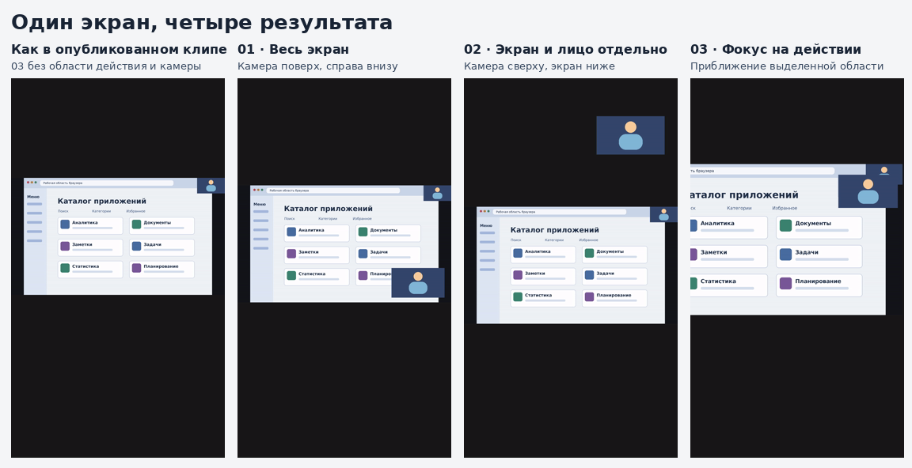

# Почему раскладки 01, 02 и 03 похожи

На фрагменте «Кастомизированные агенты и призы» опубликован вариант 03 без выделенной области действия и отдельной камеры. Поэтому плеер показывает весь экран, включая маленькое окно ведущего, записанное в исходнике. Выбор другого варианта меняет предпросмотр. Файл в плеере заменяется после подтверждения и завершения пересборки.

Ниже тот же расчёт компоновки на демонстрационном кадре с такими же размерами. В первой колонке — настройки опубликованного клипа. В остальных трёх включена отдельная камера, а для 03 дополнительно выделена область действия.

- **01. Весь экран.** Демонстрация сохраняется целиком, камера накладывается справа внизу.
- **02. Экран и лицо отдельно.** Демонстрация сохраняется целиком, камера размещается над ней. Без отдельной камеры на этой записи 01 и 02 дают экран одинакового размера, сдвинутый по вертикали.
- **03. Фокус на действии.** Выделенная область увеличивается. Если область не выделена, виден весь экран.

При локальной проверке этого фрагмента с выделенной камерой текущая сборка нашла 47 из 48 обязательных замеров и убрала отдельное окно ведущего. Последний замер оказался примерно за 87 мс до конца интервала. Локальная проверка с другим режимом окончания фильтра получила 48 из 48. На момент диагностики исправление на сайте не применялось.
