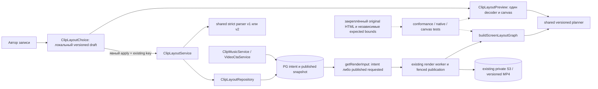

# Архитектура исправленной композиции 01/02

Дата 16.11.2026. Статус: Proposed; архитектурный план до кода. Основа: `01_requirements.md`, `02_reuse_inventory.md`, `03_adr/001-original-composition-compatibility.md`, исходный HTML11.11 и аудит 16.11. Stage/K1/K2 не выполнены. Новые сервисы, runtime/framework, зависимости и источники ML не нужны.

## Компоненты и границы

Parser — граница недоверенных API/sessionStorage/stored JSON. PG остаётся источником intent и версии публикации, Redis — транспортом существующих заданий. Source URL, real media и credentials остаются в закрытых артефактах. Oracle — test-only вход; production его не импортирует. Входной request version, published envelope version, render_version и draftVersion имеют разные назначения.

## Контракты producer/consumer

| Компонент | Изменение и обязательное сохранённое свойство |
|---|---|
| `packages/shared/src/screen-layout.ts` | Строгий union v1/v2, dispatch version→variant. Прежний v1 алгоритм и canonical bytes сохранены; v2 допускает только 01/02, focus: null |
| `packages/db/src/clip-layout.ts` | Union-типы Apply/Context/LayoutPublished/activeIntent; canonical сравнение включает version; quota/locks/seed/replay без новой логики |
| `packages/db/src/render.ts` | Union RenderInput; существующий COALESCE и publication equality сохраняют exact выбранную версию; подмена версии отвергается |
| migration033 | CHECK intent допускает explicit v2; migration032 и внешний published envelope version1 не меняются; без UPDATE/backfill |
| `apps/worker/src/render/{screen-layout,ffmpeg}.ts` | Union input; для v2 сборка полного кадра от того же source/timebase, detector/compaction/filter-order остаются действующими |
| `apps/web/src/lib/screen-contract.ts` | Union в nested published/activeIntent; API процедуры, поля источника и quota не меняются |
| `ClipLayoutChoice.tsx` | Versioned local opt-in, точные подписи, независимая высота ROI, explicit подтверждение 02; старый submitted snapshot неприкосновенен |
| `ClipLayoutPreview.tsx` | Для v2 clip полного кадра; для v1 прежний pane. Один decoder и существующее преобразование cut_plan времени |
| `apps/web/src/lib/clip-layout-draft.ts` | Read-only dependency: prefix `n5-clip-layout:v1:` и logout clearing остаются; union парсится внутри Choice envelope |
| `apps/web/src/server/{clip-music,video-cta}.ts` | Read-only consumers: новые intent не создают, получают прежний published request после increment render_version; интеграционные тесты обязательны |

`apps/web/src/app/clips/clip-layout-draft.ts` не существует: фактический helper расположен в `apps/web/src/lib/clip-layout-draft.ts`.

## Геометрия v2 и эталон одного источника

Полный выход 1080×1920. Значения ниже задают **слоты**, а destination внутри них считается существующим contain с единым масштабом; width/height/x/y выравниваются в пределах существующего допуска растеризации. Нельзя растягивать ROI, обрезать выбранную работу ради слота или определять её через центр источника.

| V2 | Screen slot x/y/w/h относительно полного кадра | Camera slot x/y/w/h | Контрольный source ROI1816×968 |
|---|---|---|---|
|01|0 / .27 / 1 / .3333|.72 / .50 / .25 / .0791|screen(0,40,1496,886), camera(1496,0,320,180)|
|02|0 / .28 / 1 / .426|.62 / .10 / .32 / .1013|screen(320,190,930,704), camera(1496,0,320,180)|

Camera01 рисуется поверх screen как PiP. Camera02 отделена от screen и располагается справа сверху. `protectedAction` v2 соответствует отображению всего выбранного screen; его нельзя использовать для прежнего universal non-overlap assertion на 01. Для другого ROI/aspect destination может иметь поля внутри этих слотов: равенство CSS процентов относится к контрольной геометрии, contain/bounded crop — к универсальному правилу. При no-camera слоты screen не пересчитываются. При unsupported SAR/невозможном even crop показывается существующий явный unsupported_geometry fallback с whole source и сохранённым display aspect внутри v2 screen slot, camera скрыта; успешный match оригинала для такого fallback не утверждается.

Прежний FFmpeg строит screen в 1080×800, затем pad y400, а canvas режет y400..1200. Это отрежет низ 02 (~1355.5px) и camera02(y192). Для v2: из того же уже compacted source сделать background1080×1920, overlay screen по абсолютным координатам, затем live camera. Не создавать второй декодер, tpad/freeze/loop или отдельный camera clock. Для v1 оставить действующий graph. Final ASS→teaser→flash→CTA→watermark порядок сохраняется; после сборки v2 запрещён повторный crop/scale из legacy tail.

## Настройки области и состояния UI

Композиционные эталоны: [original01](reference/original-01.png), [original02](reference/original-02.png), [пины](reference/pins.json). Публичная ссылка закрепляется по commit при передаче владельцу. Новый UI-макет — `reference/selector-v2-mockup.html`; его title/footer, независимая высота, upgrade-button и подтверждение области требуют отдельного конкретного согласования. Старое `zoom-screen-focus/ui-approval.md` не является этим согласованием.

Один путь обновления старого 01/02: notice о сохранённой предыдущей композиции и кнопка «Использовать исправленную композицию». Она создаёт local draft v2 того же variant, сохраняет source ROI, обнуляет unused focus, сбрасывает reviewed. Никаких jobs/quota/network mutations до существующего apply. Старый draft/restored published остаётся v1 до этого действия. Переход radio03→01/02 создаёт local v2; переход в 03 — v1/03. Нажатие уже выбранного radio не считается миграцией. Возврат к уже сохранённому v2 не меняет его версию.

Для v2-02 в advanced есть x/y/width/height отдельно; height применяется к высоте исходника, width — к ширине. Изменение width больше не масштабирует height этой области. Выбрано существующее правило clamp origin: ограничить размеры пределами источника, затем сдвинуть origin внутрь bounds; отрицательные/нефинитные значения отвергнуть. Camera и v1/03 сохраняют текущую связанную пропорцию. Значения 930/1816 и 704/968 должны быть достижимы через controls с step any и canonical rounding 1e−6. Дополнительный checkbox не вводится. После простого переключения на 02 UI сообщает: «Показан прежний экран; для крупного плана уточните область». Preview показывает именно прежнюю ROI, а ручное изменение width/height — явный выбор новой области. Existing reviewed_full_clip в окончательном диалоге подтверждает просмотр и области; reviewed сбрасывается после их изменения. Открытие/restore не выдаёт широкую ROI за обнаруженную работу.

Unknown submitted request повторяется в своей исходной версии с прежним ключом. Новые изменения хранятся отдельно; poll не перезаписывает dirty draft. Опубликованная старая версия в UI обозначается как предыдущая композиция без технического JSON номера. Подпись увеличения зависит от действительно используемой области/variant, а не просто ненулевого focus.

## Размещение настоящих подписей: обязательная квалификация до K2

Исследовательские фразы original HTML не копируются в клип как титры. Сохраняются настоящие transcript words, glossary/escaping, word timing/cut_plan, максимум две строки, неизменные текст/ссылки/короткий код watermark и CTA. V1/03 позиции и размеры текста не меняются.

Для нового 02 заголовок ограничен левой верхней зоной x≈65..637, y≈211..500, с существующим ограничением трёх строк и 60..84px. Сначала проверить фактическую плашку/ink bbox с учётом border24: она не должна заходить в camera slot x≈670..1016, y192..386 либо screen y≈538. Подбор/усечение использует существующий алгоритм layoutTeaser; добавляется узкий параметр размещения для v2, а не новая типографическая система.

Для нового 02 две строки субтитров размещаются после screen: ink top≥1364. Предложение — шрифт 48px, затем 46px, затем 44px, без изменения текста/тайминга. Используется реальная высота glyphs/outline/shadow из libass в текущем image; арифметика fontSize не является доказательством. Текущее CTA font 48 имеет plateHeight80px; watermark top1573 и gap12 дают допустимую плашку **y1481..1561**. Поэтому для одновременных subtitle+CTA требуется subtitle ink bottom≤1469; поле до экрана остаётся≥8px. Полоса 1488..1565 для CTA80px не годится и в реализации не используется. При отсутствии CTA выбранная общая версия всё равно сохраняет фиксированную квалифицированную полосу для captions, чтобы строки не прыгали в конце клипа.

Pre-code qualification рендерит контрольные кириллические верхние/нижние выносные, широкий двухстрочный transcript после glossary, длинный teaser, все непустые CTA labels и watermark текущим закреплённым шрифтом. Если даже 44px не даёт две строки в 1364..1469, либо teaser не помещается без пересечения, **STOP до уточнения и согласования конкретного макета**. Нельзя молча перейти на одну строку, сделать шрифт меньше 44px, скрыть subtitle/CTA, сдвинуть watermark, обрезать screen или менять содержание ссылок. Этот критерий намеренно не объявляет непроверенное fit состоявшимся.

Новая типографика 02 и её положение показаны в supplemental mockup и требуют owner approval по SHA до UI/product кода.01 сохраняет текущие subtitle/CTA позиции, поскольку screen заканчивается≈1158px; bounded native smoke проверяет этот вывод на реальных текстах. Интеграция использует существующие `subtitles.ts`, `teaser.ts`, `cta-overlay.ts`: opt-in параметры v2/02, default значения прежние. Filter order и fail-closed поведения glyph/WM остаются прежними.

## Observability

Существующий INFO `screen_layout_resolved` дополнить `composition_version`; оставить variant, reason, camera_present. Ни ROI/URL/media, ни секреты не логируются. Считать на QA интервале render success/failure по версии и отказы parse/publication mismatch; значения извлекаются из существующего журнала, новая telemetry платформа не нужна. Снаружи отказ выглядит как непубликация нового файла при сохранённом старом MP4 и существующий статус ошибки. Исполнитель выпуска и независимый QE проверяют terminal jobs, доступность файла и фактический image SHA; владелец получает отдельные ссылки на QA-клипы 01/02/03. Ноль ошибок на двух клипах не доказывает отсутствие дефектов на всех видео.

## Инварианты проверки и ограничение scope

Независимый oracle берёт bounds из original HTML и контрольные ROI из его метрик/аудита, а не из production planner. Сравнение canvas↔native само по себе доказывает только parity: оба могут одинаково ошибаться. Пины immutable original и согласованного UI хранятся отдельно от candidate source hashes; одновременное изменение planner+expected+pin требует нового owner approval по конкретным SHA. Локальный guard не защищает от root, который изменит сам guard/receipt; поэтому evidence содержит независимую модель/сессию и сопоставление с закреплённым исходным Git commit.

Cloud.ru deployment, изменение DNS, новая storage архитектура, биллинг, detector, автопоиск работы, v1/03 redesign и массовая пересборка вне этой фичи. Действующий S3 harness допускается только в существующем изолированном test namespace, без изменения endpoint/bucket/конфигурации поставщика. Продолжение использует pinned dz feature-adr и реальные gates; отсутствующий в этом repo `docs/process/extended-qe.md` не считается прочитанным или выполненным — применяются локальный `.agents/skills/feature-adr` и `docs/review-policy.md`.

## Штатный путь записи текущего VPS

Узкий `scripts/apply-zoom-layout-current-vps.mjs` принимает утверждённый manifest, сам вызывает read-only guard перед первой мутацией и связывает проверенные host/source/image/evidence с фактическими аргументами исполнителя. Nonzero/exception/missing/drift прекращает запись; критичные bindings сверяются между фазами. Допустимы только pause/drain/backup/migration033/проверенные services/совместимый rollback C0 в пределах этого VPS; Cloud/DNS, произвольные команды и удаление media не допускаются. Отрицательные тесты наблюдают отсутствие write side effects самого entrypoint; отдельный checker не считается enforcement. Прямой root/manual обход находится вне гарантии. Подробный порядок — TASK-06/TASK-08 плана.

## Дополнение QER-03/QER-04: qualified DB boundary

Один `scripts/zoom-layout-database.mjs` обслуживает readonly checker и fixed executor. Его metadata contract без secrets содержит bound container/cluster system_identifier, actual database name/OID/schema, роли/OID и проверенные journal/authority. Все четыре existing runtime containers подтверждают своё назначение настоящим readonly SQL и DNS; admin читает cluster identity на том же pinned DB container, поэтому restricted app не обязан иметь pg_control_system. Различие с POSTGRES_DB допустимо и ожидаемо; отсутствие доказанного соответствия actual runtime DB запрещает выпуск.

Qualification находится отдельным preflight перед lock/state output и pauseAttempted; exception здесь не попадает в catch, останавливающий web. Revalidate выполняется непосредственно перед pause, identity/authority проверяются снова до backup и migration по saved qualified runtime target, актуальному inspect и admin SQL: app processes уже остановлены, exec в них не выполняется. После начала pause прежняя самостоятельная safety closure остаётся действующей. Нельзя маскировать wrong DB в backup совпадающими image/container IDs.

Backup: existing admin native pg_dump -d actualDB -Fc→fresh0600 archive→terminal exit/size/SHA/native TOC с той же DB identity. Миграция: bound DB inspect→existing admin credentials только в памяти→stdin JSON в read-only ephemeral immutable candidate Node с network=container:<boundDB>→Pool(config)→exported migrate(pool). Постоянные runtime DSN/env/grants не меняются; admin password не допускается в command argv/Docker Config.Env/envfile/evidence. Новых tables/providers/stack/GRANT нет. Admin authority означает effective inherited ownership/superuser без SET ROLE, а не один MEMBER; trusted admin search_path=public и public journal/intent OID проверены. Initial pending033, already033 exact/idempotent forward и rollbackC0/033 exact/noDDL — отдельные состояния; unknown/other pending entries запрещены. Read/connect/query/process ограничены таймаутами, child/container и backend операции должны иметь подтверждённый terminal outcome, включая timeout; CLI exit/kill без этого недостаточен. При неизвестном исходе DDL — UNKNOWN/STOP/reconcile без blind retry. Private sanitized SQLSTATE/phase сохраняются до передачи управления.

Изолированный realPG harness имеет только две собственные logical DB и собственную restricted role в existing QE PostgreSQL; secondary DB используется для meaningful restore с source/decoy sentinel. Lifecycle не включает production DDL или чтение чужих rows; не создаёт DB/Redis stack/постоянных services, но проверяет ephemeral pinned candidate Node stdin path. Новый unit support сохраняет единственную existing release fixture и предотвращает нарушение500line cap.
