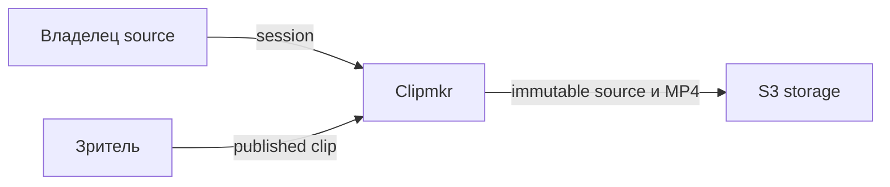
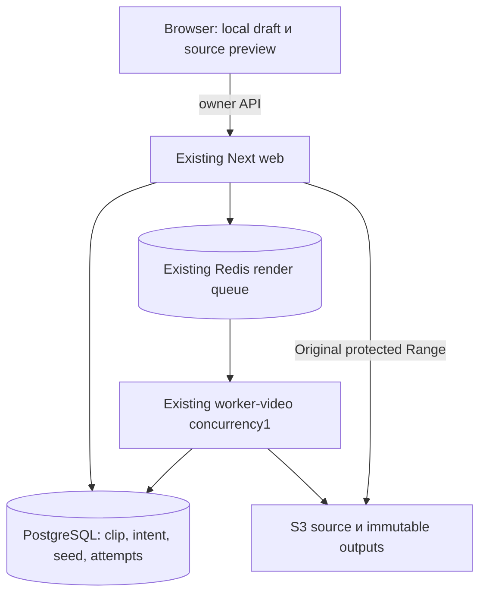
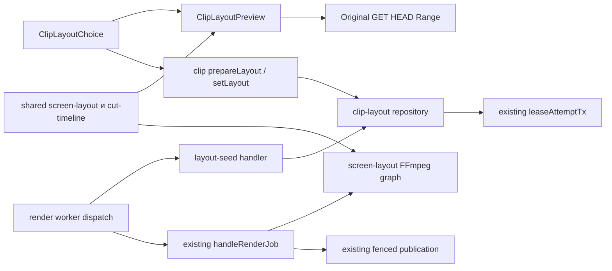

# Архитектура screen + face

Статус: proposed dossier для QCSD; код приложения ещё не изменён. Inputs:01_requirements,02_research,03_adr/001…004,04_domain_model,requirements-revision.json. UI approval отделён вui-approval.md. Полноценный Step6/K1/K2/root GO ещё впереди.

## C4 Context

Ведущий в своей session включает «Экран + лицо», получает auto-seed, просматривает весь retained clip и явно применяет. Зритель/download видит только опубликованный MP4. External systems прежние: S3/Redis/PostgreSQL; новых ML providers, публичных credential schemes и очередей нет.



## C4 Container



Доверительная граница browser→web: ни ownership, ни quota, ни source URL, ни caller version не доверены. Queue message содержит identity; worker reread DB. Подписанный S3 URL для seed живёт только в worker memory/child argv и не логируется. Browser source — same-origin Original route; никакой второй source-read policy.

## C4 Component



## Sequence flows

```mermaid
sequenceDiagram
  actor U as Пользователь
  participant UI as Choice / Preview
  participant API as Web
  participant DB as PostgreSQL
  participant Q as Existing render queue
  participant W as Worker-video
  U->>UI: Явно включить Экран + лицо
  UI->>API: prepareLayout(clipId, sourceRevision)
  API->>DB: owner check + ensure seed cache
  API->>Q: enqueue seed identity only при новой pending operation
  Q->>W: low priority seed
  W->>DB: claim revision/epoch
  W->>DB: ready / unavailable CAS
  UI->>API: read layoutInfo
  API-->>UI: seed + cutPlan + quota + published state
  U->>UI: radio / ROI / полный playback
  Note over UI: Только local draft;0 render jobs
  U->>UI: Проверено; применить к этому clip
  UI->>API: setLayout(key, expected versions, layout)
  API->>DB: owner locks + replay + quota + intent + lease commit
  API->>Q: existing render attempt
  Q->>W: existing render pipeline
  W->>DB: accepted fence: publish keys и layout
  API-->>UI: published version via polling
```

Ошибка queue delivery после commit не отменяет accepted intent: existing watchdog восстанавливает render; seed pending восстанавливается тем же watchdog hook. Exact replay возвращает прежний outcome. Ошибка source/analysis даёт unavailable с manual/fullscreen fallback; failed/stale render оставляет old MP4. Error/async sequences отдельно вdiagrams/.

## Data & storage

Одна additive migration (номер определить поHEAD при интеграции): nullable `clip.rendered_layout`, таблицы `clip_layout_intent` и `clip_layout_seed` из ADR-002/004. Existing rows не backfill-ятся и не рендерятся массово. `rendered_layout` содержит versioned object `{version:1,requested:ScreenFaceLayoutV1,resolved:{cameraVisible,reason}}`; shared reader отличает requested config от resolved render outcome. Intent хранит только requested config. Worker storage contract hash включает version/config/resolved camera decision, чтобы совпадение object key не позволяло принять несовместимые пиксели.

Source revision один с Original: lowercase SHA256 UTF8 от `JSON.stringify(['original-source-v1',videoId,objectKey,uploadId??null,String(actualBytes)])`, opaque outward; canonical server-only leaf `packages/shared/src/server/original-source.ts`, export `originalSourceRevision`, import `@clipmaker/shared/server/original-source` (ownership Original/root). Root shared index не re-export-ит leaf; existing `./*` exports достаточны, package/dependency changes не нужны. Worker→web import запрещён. Seed cache identity дополнительно включает clip start/end/cut_plan, algorithm version и ONNX SHA; это отдельный `seed_revision`, а не подмена sourceRevision. Все FK→clip cascade; account erasure/retention проверяются и при claim, и при publish seed/render. Cache не содержит frames/URLs/source key. Normal render может opportunistically сохранить advisory seed из уже прочитанных данных, failure этого save логируется и не отменяет paid clip render. Нет постоянного source-file cache: current withSource удаляет temporary source.

Rollout: additive migration→new worker→new web на тестовой копии; старый worker не должен обрабатывать новые seed message/layout intent. Rollback web ограничивает новые apply, active intents drain новым worker; старый worker до drain не выкатывается. Публикация на Cloud/production и реальные private source jobs здесь не авторизованы.

## API design

- `clip.layoutInfo` query: `{clip_id}` → owner-only `{sourceRevision,cutPlan,start,end,renderVersion,publishedRenderVersion,publishedLayout,seed:{state,proposal?,reason?},rerenderQuota:{available,unlimited,limit:number|null,remaining:number|null,resetsAt},activeIntent?}`. Read-only, no queue init/prepare. Дневной bucket иreset берутся из existing `moscowDay`/`quotaResetAt`, limit из `N5_LIMIT_USER_RERENDERS`, owner exemption из `hasOwnerUnlimited`; unlimited возвращает null limit/remaining, не ложный отказ. Existing ScreenService получает limits для advisory quota read; source URL не возвращает.
- `clip.prepareLayout` mutation: `{clip_id,expected_source_revision}` → `{state,seedRevision}`. Только явное включение режима. Durable cache row reused; quota/render_version/MP4 untouched. Unknown/foreign404, stale source409, bad payload422; storage/analysis error обрабатывается state unavailable, не misleading ready.
- `clip.setLayout` mutation: `{clip_id,request_key,expected_render_version,expected_source_revision,layout,reviewed_full_clip:true}` → `{clip_id,request_key,render_version,status:'pending'|'succeeded'|'failed',replayed}`. Exact replay non-charging; mutation применяет квоту повторно независимо от advisory read. No source URL/body watermark fields accepted.
- Original dependency: `/api/videos/:videoId/original` GET/HEAD/Range, `?metadata=1`, `?download=1`; metadata — discriminated union: ready `{videoId,state:'ready',available:true,sourceRevision,media:{kind,mime,extension,bytes:string,durationSeconds:number|null}}`; non-ready `{videoId,state:'incomplete'|'missing'|'error',available:false,unavailableReason}` без revision/media. Auth/Range implementation принадлежит Original worktree; root монтирует последовательной интеграцией.

## Geometry, timing и деградация

ADR-001 задаёт normalized regions и protected zones; ADR-003 — один source decoder/canvas и shared timing. Auto camera seed не требует ручного рисования; optional controls корректируют неудачное предложение. Seed threshold implementation candidate:≥8 samples across clip, единственная spatial cluster, score≥0.8, face area0.002..0.12 source, centre в крайних20% source, разброс centres≤0.04 по каждой оси, max/min face width/height≤1.5. Candidate crop расширяет median face в2.4 раза по ширине/3.2 по высоте, с запасом плеч снизу и clamp source. Это детерминированные eligibility rules, не calibrated confidence probability. Неоднозначность→no-camera/fullscreen explanation. Actual render проверяет candidate camera ROI на0.5s samples и может veto wholeclip; exact identity/subsample event guarantee отсутствует и должна быть явно признана QCSD.

## Observability

INFO: layout_seed_requested/cache_hit/ready/unavailable, layout_apply_accepted/replayed, screen_layout_resolved; WARN: timeout/failed seed, stale seed lease; existing render errors/stale_attempt_result остаются. Поля: clip id, revision digest prefix, variant, reason, elapsed_ms, attempts; без S3key/URL, кадра, transcript/user title. Считать accepted/replayed ratio и camera fallback rate через structured events, seed latency/attempt counts; отдельная metrics subsystem не нужна. На тестовом storage access log измеряется network traffic, не объявляется hard byte limit. Снаружи отказ выглядит как объяснение unavailable/manual correction либо pending→failed при доступном старом файле. Замечают пользователь по UI и координатор по existing worker logs; independent QE подтверждает отсутствие leakage.
