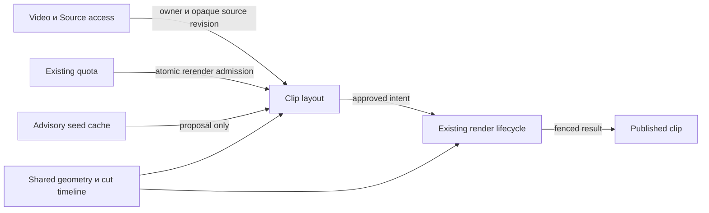

# Доменная модель screen + face

Статус: proposal для QCSD на11.11.2026; новый bounded context/service не создаётся. Основа:01 и ADR-001…004. Существующий Clip/Video/Attempt lifecycle остаётся владельцем исполнения.

## Bounded context map

| Существующая область | Ответственность | Что добавляется |
|---|---|---|
| Source access / Video | Принятая immutable загрузка, owner, active/retention | Opaque sourceRevision от Original; никаких новых source credentials |
| Clip presentation | Published MP4/layout и local draft | ScreenFaceLayoutV1; pending layout intent отдельно от published |
| Rendering | Очередь, attempts, fence, immutable publication | Additive screen compositor; seed-analysis как auxiliary message того же worker |
| Quota / credits | Серверные лимиты, source credit ledger | Только существующий rerender quota для apply; seed0, source charge0 |

## Ubiquitous language

| Термин | Значение | Не означает |
|---|---|---|
| Source revision | Стабильная identity принятого source | `video.updated_at`, S3 URL или новый source upload |
| Screen ROI | Полный выбранный контекст экрана | Автоматически распознанная цель действия |
| Focus ROI | Защищённая важная область внутри screen | Обязательный crop без доступа к контексту |
| Camera ROI | Предложенная/подтверждённая область пикселей source | Identity автора, отдельная camera track, face recognition |
| Seed | Advisory cached предложение по наблюдениям | Применённые settings или опубликованный MP4 |
| Draft | Локальный UI выбор | Durable render request |
| Layout intent | Принятый идемпотентный apply snapshot | Новый job execution framework |
| Render version | Номер принятого изменения существующего clip | Номер уже доступного MP4 во время pending |
| Published layout/version | Settings и версия принятого storage result | Последний radio choice |
| Camera veto | Отключение PiP при недостаточных наблюдениях | Подстановка фото/другого лица или отказ от screen |

## Aggregates/Entities/VOs

Consistency boundary исполнения — существующий Video lock с последующим Clip lock; clip является identity изменяемого результата. `ClipLayoutIntent` — зависимая entity с key(clip_id,request_key), immutable layout, base/render versions и series. Она не владеет job status/fence: их авторитет — existing job_attempt/clip.render_fence. `ClipLayoutSeed` — зависимая advisory cache entity с revision/lease_epoch/attempts/status, отдельным коротким lifecycle; не является render attempt. Обе FK удаляются с clip; erasing/deleted account прекращает новые reads/claims/publication.

Value objects: `NormalizedRect`, `ScreenFaceLayoutV1`, `ScreenLayoutGeometry`, `SeedProposal`, `CutTimeline`, `SourceRevision`. Shared module знает geometry/config, не SQL/S3/auth. Domain events здесь structured outcomes, а не новая event bus: `seed_ready`, `seed_unavailable`, `layout_accepted`, `layout_replayed`, `layout_published`, `layout_fallback`.

## Relationships

Web/worker разделяют один value contract; PostgreSQL является источником истины accepted/published/seed lease, Redis транспортом. S3 хранит source и immutable rendered objects; URL — краткоживущая runtime capability, не доменная настройка. Browser draft не trusted input.

## State transitions и инварианты

- Draft: pristine→dirty→confirming→accepted; cancel возвращает в editor без server write; fail/conflict сохраняет draft; dirty не перетирается seed/polling. Dirty сохраняется как closed sessionStorage envelope (accountScope/clip/sourceRevision/baseRenderVersion/layout), отдельно от accepted DB intent. Возврат/reload: authorized source read→validate envelope→restored dirty с объявлением и reviewed=false; version conflict сохраняет draft, source mismatch/invalid/expired удаляет с объяснением. Storage failure предупреждает до ухода; cancel navigation сохраняет draft; accepted intent не заменяется локальным восстановлением. Неизвестный исход apply сохраняет прежний request key для exact replay. Полный lifecycle — ADR-003.
- Seed: closed message→authoritative active owner/retention/source+seed revision lookup→CAS; unknown/mixed message не создаёт сущность/side effects. absent→pending→running→ready|unavailable; crash→pending не более оставшихся2 attempts; terminal не перезапускается refresh; source revision mismatch создаёт новую generation, старый epoch stale.
- Apply: request key unseen→accepted intent+quota+attempt одной транзакцией; exact replay возвращает ту же operation; incompatible replay409; другой clip не меняется.
- Render: existing attempt running/deferred→retry либо failed; old published layout/keys неизменны. Success+current fence→одновременная замена published keys/layout; stale→0 adopted rows.
- Quota и credits: prepare/preview/cancel0; apply1 user_rerenders; repeatedsource charge/STT/select0; automatic retry accepted operation не повторяет quota.

## Codebase mapping

`packages/shared/src/screen-layout.ts` владеет config/ROI/geometry, `cut-timeline.ts` — перенесённой pure timing частью. `packages/db/src/clip-layout.ts` — intent/seed repository transitions; `render.ts` сохраняет canonical fenced publication. `apps/web/src/server/clip-layout.ts` — тонкий application service prepare/apply; existing ScreenService выдаёт protected read DTO. `apps/worker/src/render/screen-layout.ts` — graph/seed rule, `workers/layout-seed.ts` — bounded orchestration; current render worker лишь dispatch. `ClipLayoutChoice` и `ClipLayoutPreview` разделяют draft и playback; VideoDetail/ClipCard только mount/props. Имена ещё должны пройти K1, наличие в документе не разрешение создать конфликтующие exports.
